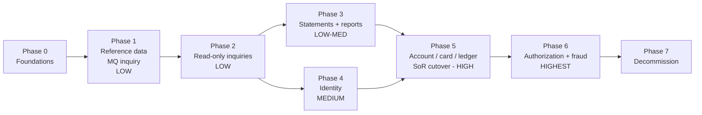

# CardDemo Cutover Plan: Phased Migration from Lowest to Highest Risk

> Phase sequence for moving CardDemo from COBOL/CICS/JCL to Java 17. Each phase lists scope, entry/exit criteria, the cutover mechanism and the rollback path.
> Phase order follows the seam ratings and data coupling in [DOMAIN_DECOMPOSITION.md](DOMAIN_DECOMPOSITION.md) and the hotspot scores in [HOTSPOT_REPORT.md](../modernization-analysis/HOTSPOT_REPORT.md).

Companion documents: [MIGRATION_BLUEPRINT.md](MIGRATION_BLUEPRINT.md) | [RISK_REGISTER.md](RISK_REGISTER.md)

## 1. Phase Overview

| Phase | Name | Risk | Programs moved | Jobs moved / retired | Data system of record after phase | Cutover mechanism | Indicative duration* |
|---|---|---|---|---|---|---|---|
| 0 | Foundations | - | none | none | Mainframe | n/a | 6-8 weeks |
| 1 | Reference data + MQ inquiry + utilities | **Low** | COTRTLIC, COTRTUPC, COBTUPDT, COACCT01, CODATE01 | MNTTRDB2, CREADB2 -> Java/Flyway; retire READACCT, READCARD, READCUST, READXREF, WAITSTEP, ESDSRRDS, DEFCUST, INTRDRJ1/2 | Reference data in target DB (VSAM copies still fed by TRANEXTR) | Admin menu entries 5-6 and MQ queue aliases point to Java | 4-6 weeks |
| 2 | Read-only inquiries | **Low** | COACTVWC, COCRDLIC, COCRDSLC, COTRN00C, COTRN01C, COPAUS0C (view) | none | Mainframe (target holds a replicated read model) | Menu options 1, 3, 4, 6, 7, 11 link to the web UI | 6-8 weeks |
| 3 | Statements and reporting | **Low-Medium** | CBSTM03A, CBSTM03B, CBTRN03C, CORPT00C | CREASTMT, TXT2PDF1, TRANREPT, PRTCATBL | Mainframe (reports built from the replica) | Scheduler runs Java jobs; menu option 9 links to the web UI | 6-8 weeks |
| 4 | Identity and access | **Medium** | COSGN00C, COUSR00C-03C, COMEN01C, COADM01C (navigation) | DUSRSECJ | IdP for users/roles | Sign-on through IdP; CC00 stays as fallback until exit | 4-6 weeks |
| 5 | Account, card and ledger (system-of-record cutover) | **High** | COACTUPC, COCRDUPC, COTRN02C, COBIL00C, CBTRN02C, CBACT04C (+ CBTRN01C retired) | POSTTRAN, INTCALC, COMBTRAN, TRANBKP, TRANFILE, TRANIDX, ACCTFILE, CARDFILE, CUSTFILE, XREFFILE, TCATBALF, DISCGRP, TRANTYPE, TRANCATG, TRANEXTR, CLOSEFIL, OPENFIL | **Target DB** for account, customer, card, xref, transaction, category balance, disclosure group, reference data | Big-bang data cutover in a planned weekend window after parallel run | 12-16 weeks (incl. 2 monthly cycles of parallel run) |
| 6 | Card authorization and fraud | **Highest** | COPAUA0C, COPAUS1C, COPAUS2C, CBPAUP0C, PAUDBLOD, PAUDBUNL, DBUNLDGS | CBPAUP0J, LOADPADB, UNLDPADB, UNLDGSAM, DBPAUTP0 | Target DB for authorizations (IMS + AUTHFRDS retired) | Shadow mode, then progressive MQ routing by card range | 8-12 weeks |
| 7 | Decommission | Low | CBEXPORT, CBIMPORT (rewrite or retire) | CBEXPORT, CBIMPORT, FTPJCL, DEFGDGB/D, CBADMCDJ, remaining JCL | Target only | Mainframe artifacts archived | 4 weeks |

\*Durations assume one cross-functional team of 6-8 engineers with mainframe SME access. Treat them as relative sizing, not commitments.

## 2. Phase Details

### Phase 0 - Foundations
- **Scope**:
  - Maven multi-module skeleton (Java 17, Spring Boot 3.x, Google Java Style), CI pipeline, environments.
  - Target schema created with Flyway from [DATA_DICTIONARY.md](../modernization-analysis/DATA_DICTIONARY.md).
  - `carddemo-common`: Money, COBOL-truncation arithmetic, date validator, lookup tables.
  - `migration-tools`: EBCDIC, zoned and packed codecs, VSAM/IMS/DB2 unload loaders.
  - One-way replication VSAM/IMS -> target (CDC product or scheduled REPRO + delta load).
  - Golden-master harness that runs COBOL jobs and Java jobs on identical inputs and diffs outputs.
  - Business decisions from MIGRATION_BLUEPRINT section 9.
- **Exit criteria**:
  - Full sample data set (50 accounts/cards/customers/xrefs, 300 daily transactions, 51 disclosure-group rows, 7 types, 18 categories) loads with zero conversion errors.
  - Balances reconcile to the cent.
  - Replication lag is measured and within the agreed threshold.

### Phase 1 - Reference data, MQ inquiry, utility retirement (Low)
- **Why first**: clean seams (S2, S3). DB2 already relational. Reference data changes rarely. MQ inquiry is read-only.
- **Steps**:
  1. Java `reference-data` module on the existing DB2 `CARDDEMO.TRANSACTION_TYPE` / `_CATEGORY` (replatform).
  2. Admin menu options 5 and 6 (COTRTLIC/COTRTUPC) link to the web UI.
  3. COBTUPDT is replaced by a Spring Batch job for file-driven maintenance (A/U/D records).
  4. TRANEXTR keeps feeding the VSAM copies for COBOL batch consumers.
  5. COACCT01/CODATE01 are replaced by `@JmsListener`s on the same queues.
  6. Diagnostic and demo jobs are retired.
- **Exit criteria**:
  - Java CRUD results match the COBOL screens for all 7 types and 18 categories.
  - The TRANEXTR output is byte-identical to the pre-migration output.
  - MQ inquiry replies are identical for a replayed message set.
- **Rollback**: revert the menu entries and queue aliases. The DB2 tables are untouched.

### Phase 2 - Read-only inquiries (Low)
- **Scope**:
  - Account view (CAVW), card list/detail (CCLI, CCDL), transaction list/detail (CT00, CT01), pending authorization summary (CPVS, view only).
  - All of them read the replicated read model; the mainframe stays the system of record.
- **Controls**:
  - The UI shows "as of" replication time.
  - Paging order matches EBCDIC key order where users depend on it (R-05).
  - COTRN01C's READ UPDATE lock is not reproduced, because the Java version is read-only.
- **Exit criteria**:
  - Recorded 3270 inquiry scenarios match field-for-field.
  - p95 latency is within target.
  - Two weeks of production use with no data-freshness incidents.
- **Rollback**: re-point the menu options to the COBOL transactions.

### Phase 3 - Statements and reporting (Low-Medium)
- **Scope**:
  - Rewrite CBSTM03A/B (ALTER, PSA/TIOT pointer logic) as a statement job with templates for text, HTML and PDF. This replaces CREASTMT SORT + TRXFL + TXT2PDF1.
  - CBTRN03C becomes a transaction detail report job.
  - PRTCATBL becomes a SQL report.
  - CORPT00C becomes `POST /reports`, replacing JCL built in code and the TDQ JOBS submission.
- **Exit criteria**:
  - For 2 consecutive statement cycles, Java statements match COBOL statements: all amounts and totals exact, layout differences approved by the business.
  - The transaction report's page, account and grand totals are equal.
- **Rollback**: the scheduler re-enables the COBOL jobs; the outputs are independent files.

### Phase 4 - Identity and access (Medium)
- **Scope**:
  - Sign-on through the OIDC IdP; roles ADMIN/USER from `SEC-USR-TYPE`.
  - User administration (CU00-CU03) becomes IdP group management.
  - Navigation menus (CM00/CA00) become UI routes.
  - Passwords are not migrated; users re-enrol.
- **Exit criteria**:
  - Every migrated function enforces roles.
  - Audit log of sign-ons and admin changes.
  - Penetration test passed.
- **Rollback**: CC00 sign-on remains available until exit.

### Phase 5 - Account, card and ledger system-of-record cutover (High)
- **Why together**: ACCTDATA has 4 writers and TRANSACT has 4 writers across online and batch (Domain Decomposition section 4). Moving any subset requires dual writes, which is rejected as too risky.
- **Pre-cutover (parallel run, at least 20 daily posting cycles and 2 monthly interest cycles)**:
  1. Run the Java posting job (CBTRN02C refactor) and interest job (CBACT04C refactor) on the same DALYTRAN input and VSAM snapshot as the mainframe.
  2. Compare ACCTDATA balances and cycle totals, TCATBALF, TRANSACT, DALYREJS (reason codes 100-109) and SYSTRAN. Zero unexplained differences is the gate.
  3. Run the online maintenance functions (CAUP, CCUP, CT02, CB00) against a staging copy using recorded scenarios.
- **Cutover window (planned weekend)**:
  1. Freeze online maintenance and run the last mainframe batch cycle (POSTTRAN, plus INTCALC/COMBTRAN if month-end).
  2. CLOSEFIL, then final unload of ACCTDATA, CUSTDATA, CARDDATA, CARDXREF, TRANSACT, TCATBALF, DISCGRP, TRANTYPE, TRANCATG.
  3. Convert and load into the target, then reconcile: counts, balance hash totals per account and in total, referential integrity.
  4. Switch the menu options for maintenance functions to the web UI. Disable the CICS transactions CAUP, CCUP, CT02 and CB00.
  5. The scheduler disables POSTTRAN, INTCALC, COMBTRAN and TRANBKP on the mainframe and enables the Java jobs. The daily DALYTRAN feed is redirected to the Java input location.
  6. Keep CLOSEFIL/OPENFIL and the VSAM files read-only for 1 cycle as the rollback source.
- **Exit criteria**:
  - First 5 daily cycles and the first month-end in production reconcile against a shadow mainframe run (the mainframe keeps processing a copy of the feed in read-only mode for comparison).
- **Rollback**:
  - Until the first new posting cycle completes: re-enable the CICS transactions and mainframe jobs and restore VSAM from the final unload (no data loss).
  - After that: replay the Java ledger deltas into VSAM using a reverse converter, which is built and tested in Phase 0. The no-go decision point is after day 1.

### Phase 6 - Card authorization and fraud (Highest)
- **Why last**: real-time customer impact on every card swipe. It mixes MQ, IMS, DB2 and VSAM. It depends on account, customer and xref data, which became authoritative in the target in Phase 5.
- **Steps**:
  1. Migrate the IMS DBPAUTP0 unload (PAUTSUM0/PAUTDTL1) and DB2 AUTHFRDS to `auth.*` tables. Keep them in sync by replication.
  2. **Shadow mode**: the Java authorization service consumes a copy of each request from the CP00 request queue, computes a decision and logs it without replying. The decision match rate must be 100% over at least 2 weeks of production volume.
  3. **Progressive routing**: route 1%, 10%, 50% and then 100% of requests by card range/BIN to Java, which replies on the same reply queue with the CCPAURLY format.
  4. Move the CPVD fraud screen (COPAUS1C/2C) and the CBPAUP0C purge to Java. Fix the duplicated approved-count condition if the business confirms it is a defect.
- **Exit criteria**:
  - p99 decision latency within the network SLA.
  - Zero lost or duplicated replies (transacted JMS session plus outbox).
  - Fraud flags consistent.
- **Rollback**: routing back to COPAUA0C is a configuration change, instant per card range. IMS stays updated from the Java side via reverse sync until exit.

### Phase 7 - Decommission (Low)
- Rewrite or retire CBEXPORT/CBIMPORT (branch migration) depending on the business decision.
- Archive datasets, load libraries, CSD groups (CARDDEMO, CRDDEMO2, CRDDEMOD, CRDDEMOM), Control-M/CA-7 definitions and DB2/IMS objects.
- Keep read-only archives for the regulatory retention period.

## 3. Program Disposition Matrix

| Program | Phase | Strategy | Disposition |
|---|---|---|---|
| COTRTLIC, COTRTUPC, COBTUPDT | 1 | Replatform | Java on same DB2, later consolidated |
| COACCT01, CODATE01 | 1 | Replatform | JMS listeners |
| CBACT01C, CBACT02C, CBACT03C, CBCUS01C, COBSWAIT | 1 | Retire | SQL views / scheduler |
| COACTVWC, COCRDLIC, COCRDSLC, COTRN00C, COTRN01C, COPAUS0C | 2 (COPAUS0C final in 6) | Strangler | Read APIs + UI |
| CBSTM03A, CBSTM03B, CBTRN03C, CORPT00C | 3 | Rewrite | Statement/report jobs, report API |
| CSUTLDTC | 0 | Refactor | `carddemo-common` DateValidator |
| COSGN00C, COUSR00C-03C, COMEN01C, COADM01C | 4 | Rewrite | IdP + UI navigation |
| COACTUPC, COCRDUPC, COTRN02C, COBIL00C | 5 | Strangler + Refactor | Write APIs |
| CBTRN02C, CBACT04C | 5 | Refactor | Spring Batch posting + interest |
| CBTRN01C | 5 | Retire | Dead code (no JCL or caller) |
| COPAUA0C, COPAUS1C, COPAUS2C, CBPAUP0C | 6 | Strangler + Rewrite | Authorization service |
| PAUDBLOD, PAUDBUNL, DBUNLDGS | 6 | Retire | Replaced by DB tooling after IMS migration |
| CBEXPORT, CBIMPORT | 7 | Rewrite or Retire | Business decision |

## 4. Go / No-Go Checklist (applies to every phase)
- [ ] Golden-master / parallel-run differences: zero unexplained.
- [ ] Reconciliation report signed off by finance (Phases 5 and 6).
- [ ] Rollback rehearsed in a production-like environment within the window.
- [ ] Monitoring dashboards and alerts live (latency, error rate, replication lag, reconciliation deltas).
- [ ] Runbook and on-call roster published; mainframe SMEs on call for the hypercare period (2 weeks; 1 full month-end for Phase 5).
- [ ] Users trained on the new screens for the functions moving in the phase.
- [ ] Open risks in [RISK_REGISTER.md](RISK_REGISTER.md) for the phase are at or below the accepted residual level.
