# CardDemo Domain Decomposition and Extraction Seam Analysis

> Bounded contexts identified from data ownership (which programs create/update each store), transaction boundaries and the call graph in [DEPENDENCY_MAP.md](../modernization-analysis/DEPENDENCY_MAP.md). The document also covers the seams along which each context can be lifted out of the COBOL estate.

Companion documents: [MIGRATION_BLUEPRINT.md](MIGRATION_BLUEPRINT.md) | [CUTOVER_PLAN.md](CUTOVER_PLAN.md) | [RISK_REGISTER.md](RISK_REGISTER.md)

## 1. Method
1. **Data ownership first**: each VSAM file, IMS DB and DB2 table is assigned to the context whose business rules create or change it. The writers come from the CRUD matrices (online CICS file ops, batch OPEN modes, SQL, DL/I).
2. **Transaction boundaries**: a single CICS task or batch step that updates two stores ties those stores to one consistency boundary. Such stores either belong to one context or need an explicit saga/event.
3. **Language**: the COBOL vocabulary (account, card, xref, disclosure group, category balance, pending authorization) gives the ubiquitous language.
4. **Seams** are places where the legacy system already has a well-defined interface: a transaction ID, a COMMAREA, an MQ queue, a file passed between jobs, a DB2 table, or a called subprogram. Each seam is rated by how cleanly it can be intercepted.

## 2. Bounded Contexts

| # | Bounded context | Core concepts | Owned data (system of record) | COBOL programs | Jobs | Type |
|---|---|---|---|---|---|---|
| BC1 | **Identity and Access** | User, role (A/U), sign-on | USRSEC | COSGN00C, COUSR00C, COUSR01C, COUSR02C, COUSR03C | DUSRSECJ | Generic (replace with IdP) |
| BC2 | **Customer** | Customer, PII, address, phone, FICO | CUSTDATA | (updated inside COACTUPC) | CUSTFILE, READCUST | Supporting |
| BC3 | **Account** | Account, balance, credit/cash limit, cycle credit/debit, group | ACCTDATA | COACTVWC, COACTUPC (writes), COACCT01 | ACCTFILE, READACCT | **Core** |
| BC4 | **Card** | Card, PAN, expiry, status, card-account-customer xref | CARDDATA (+AIX), CARDXREF (+AIX) | COCRDLIC, COCRDSLC, COCRDUPC | CARDFILE, XREFFILE, READCARD, READXREF | Core |
| BC5 | **Transaction Ledger** | Daily transaction, posted transaction, reject, category balance | TRANSACT (+AIX), TCATBALF, DALYTRAN (input), DALYREJS | CBTRN02C, CBTRN01C, COTRN00C, COTRN01C, COTRN02C | POSTTRAN, TRANFILE, TRANBKP, COMBTRAN, TRANIDX, TCATBALF | **Core** |
| BC6 | **Pricing and Interest** | Disclosure group, interest rate, interest charge, (fees) | DISCGRP | CBACT04C | INTCALC, DISCGRP | **Core** |
| BC7 | **Payments** | Bill payment | (writes Ledger + Account) | COBIL00C | - | Core |
| BC8 | **Reference Data** | Transaction type, transaction category | DB2 TRANSACTION_TYPE, TRANSACTION_TYPE_CATEGORY (VSAM TRANTYPE/TRANCATG are copies) | COTRTLIC, COTRTUPC, COBTUPDT | TRANEXTR, MNTTRDB2, TRANTYPE, TRANCATG, CREADB2 | Supporting |
| BC9 | **Statements and Reporting** | Statement, transaction detail report, category-balance listing | TRXFL (work), STATEMNT.*, TRANREPT GDG, TCATBALF.REPT (outputs only) | CBSTM03A, CBSTM03B, CBTRN03C, CORPT00C | CREASTMT, TXT2PDF1, TRANREPT, PRTCATBL | Supporting (read model) |
| BC10 | **Card Authorization and Fraud** | Authorization request/response, pending authorization summary/detail, fraud flag | IMS DBPAUTP0 (PAUTSUM0/PAUTDTL1), DB2 AUTHFRDS, MQ request/reply queues | COPAUA0C, COPAUS0C, COPAUS1C, COPAUS2C, CBPAUP0C, PAUDBLOD, PAUDBUNL, DBUNLDGS | CBPAUP0J, LOADPADB, UNLDPADB, UNLDGSAM, DBPAUTP0 | **Core** |
| BC11 | **Data Exchange** | Branch export/import record | EXPORT.DATA, *.IMPORT | CBEXPORT, CBIMPORT | CBEXPORT, CBIMPORT, FTPJCL | Generic |
| BC12 | **Platform / Operations** | Scheduling, file open/close, wait, provisioning | GDG bases, catalog | COBSWAIT, CSUTLDTC (shared), CBACT01C-03C, CBCUS01C | CLOSEFIL, OPENFIL, WAITSTEP, DEFGDGB/D, ESDSRRDS, DEFCUST, INTRDRJ1/2, CBADMCDJ | Generic (retire) |

**Design note - Account vs Customer**: COACTUPC updates ACCTDATA and CUSTDATA in one task. To avoid a cross-context transaction, they share one deployable module (`account-servicing`) in the first release, with two aggregates and two schemas. They can be separated later with a domain event (`CustomerContactChanged`) if needed.

**Design note - Payments**: COBIL00C writes the payment as a Ledger transaction (type 02 / category 2) and reduces the Account balance. In the target, Payments is a thin application service that calls Ledger (record transaction) and Account (apply balance change) in a single local DB transaction inside the modular monolith.

### 2.1 Bounded Context Diagrams

The overview below groups every COBOL program with the data its context owns. Arrows are cross-context dependencies: a read or a write of another context's data. The per-context diagrams after it show each context as a box with its entry points, the programs inside it, its owned stores and batch jobs, and the contexts it depends on (upstream) or that depend on it (downstream).

#### Overview: all contexts

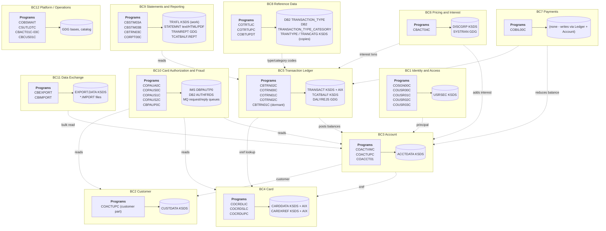

#### BC1 Identity and Access

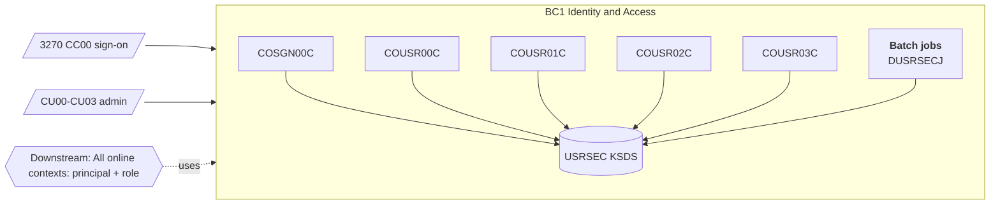

#### BC2 Customer

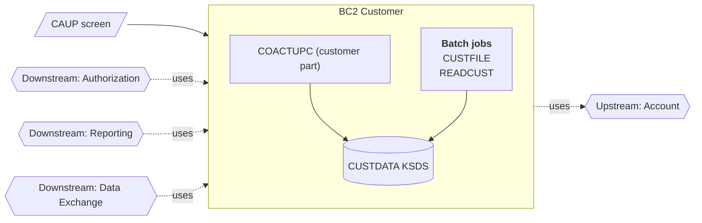

#### BC3 Account

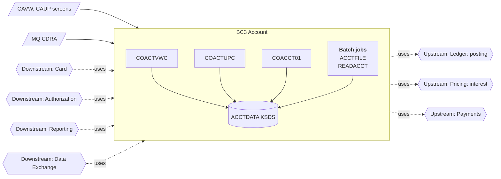

#### BC4 Card

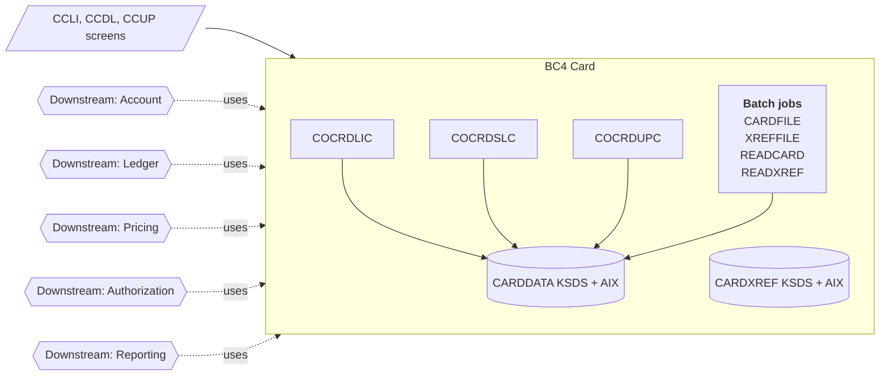

#### BC5 Transaction Ledger

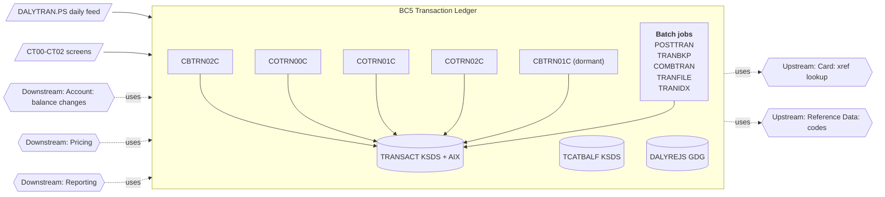

#### BC6 Pricing and Interest

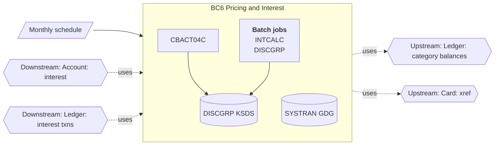

#### BC7 Payments

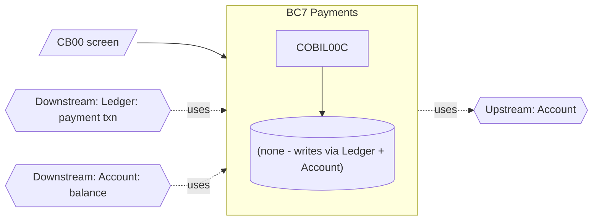

#### BC8 Reference Data

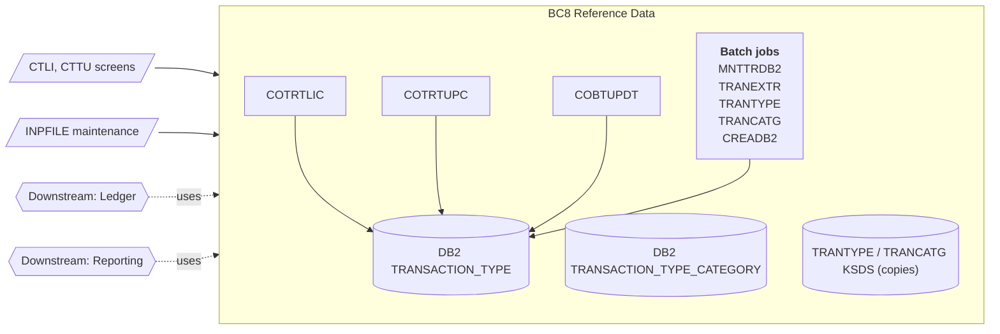

#### BC9 Statements and Reporting

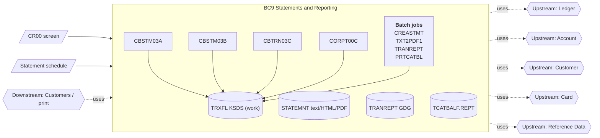

#### BC10 Card Authorization and Fraud

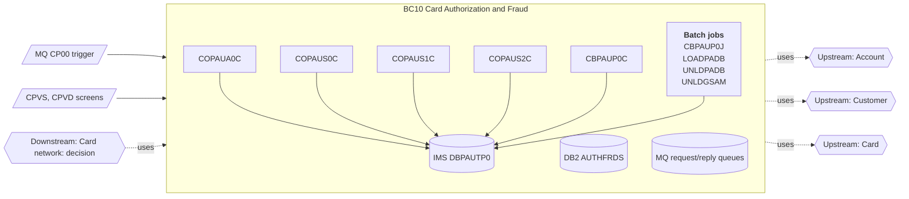

#### BC11 Data Exchange

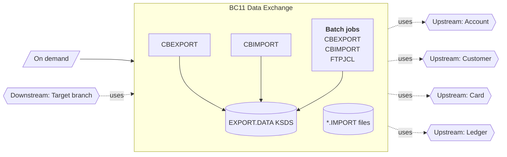

#### BC12 Platform / Operations

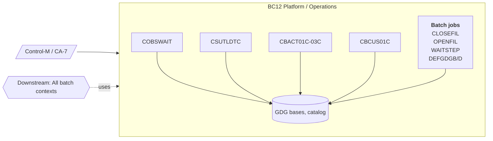

## 3. Context Map

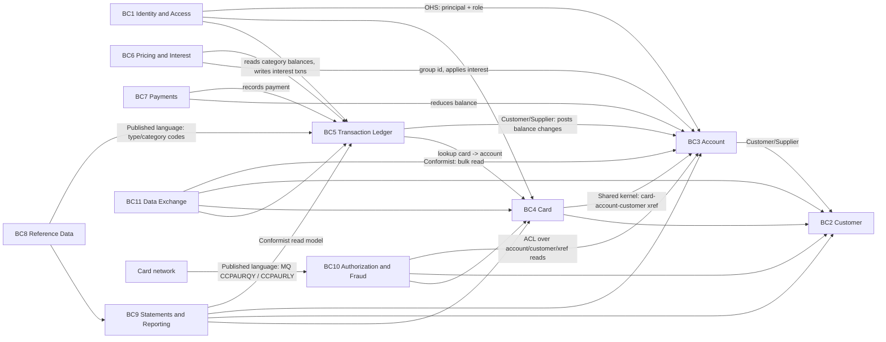

| Relationship | Pattern | Evidence in COBOL | Target integration |
|---|---|---|---|
| Ledger -> Account | Customer/Supplier (Ledger is the customer) | CBTRN02C REWRITEs ACCTDATA balances; CBACT04C adds interest | `AccountBalancePort.applyPosting(accountId, amount, creditOrDebit)` in-process; becomes an event if Account is ever split out |
| Card <-> Account | Shared kernel (xref) | CVACT03Y is copied by 14 programs across 5 contexts | `card_xref` owned by Card, exposed through a read API / view |
| Reference Data -> Ledger / Reporting | Published language | Type/category codes in TRAN-TYPE-CD / TRAN-CAT-CD; DB2 is synced to VSAM weekly | Read-through cache of the reference tables; the copy job is removed |
| Authorization -> Account/Customer/Card | Anti-corruption layer | COPAUA0C reads CCXREF, ACCTDAT and CUSTDAT directly via CICS file control | `AccountSnapshotClient` in authorization-service; during coexistence it reads the replicated store |
| Network -> Authorization | Published language (MQ) | CCPAURQY request / CCPAURLY reply copybooks | Same message formats kept on the queues through cutover |
| Reporting -> everything | Conformist read model | CBSTM03A/B and CBTRN03C read 4-5 masters | SQL views / read replicas; no writes |
| Identity -> all online | Open host service | COMMAREA CDEMO-USER-ID / CDEMO-USER-TYPE | JWT principal with role claim |

## 4. Data Coupling Analysis (what makes extraction hard)

| Store | Owning context | Writers (online) | Writers (batch) | Readers outside owner | Coupling |
|---|---|---|---|---|---|
| ACCTDATA | Account | COACTUPC, COBIL00C | CBTRN02C (POSTTRAN), CBACT04C (INTCALC) | Card, Authorization, Reporting, Data Exchange, MQ inquiry | **High**: 4 writers in 3 contexts |
| TRANSACT | Ledger | COTRN02C, COBIL00C | CBTRN02C, COMBTRAN reload, TRANFILE | Reporting, Data Exchange | **High**: rebuilt by delete/define + REPRO in TRANBKP/COMBTRAN |
| CARDXREF | Card | - | XREFFILE (load only) | Account, Ledger, Pricing, Reporting, Authorization | Medium: read-only fan-out (shared kernel) |
| CUSTDATA | Customer | COACTUPC | CUSTFILE (load only) | Account, Authorization, Reporting | Medium |
| CARDDATA | Card | COCRDUPC | CARDFILE (load only) | Data Exchange | Low |
| TCATBALF | Ledger | - | CBTRN02C | Pricing (CBACT04C), Reporting (PRTCATBL) | Medium |
| DISCGRP | Pricing | - | DISCGRP (load) | - | Low |
| USRSEC | Identity | COUSR01C-03C | DUSRSECJ | - | Low |
| DB2 TRANSACTION_TYPE / _CATEGORY | Reference | COTRTLIC, COTRTUPC | COBTUPDT | Ledger/Reporting via VSAM copies | Low |
| IMS DBPAUTP0 | Authorization | COPAUA0C, COPAUS1C | CBPAUP0C, PAUDBLOD | - | Low (self-contained) |
| DB2 AUTHFRDS | Authorization | COPAUS2C | - | - | Low |

**Consequence**: Account and Ledger cannot be cut over independently without dual writes. In the CUTOVER_PLAN, all writers of ACCTDATA and TRANSACT (COACTUPC, COBIL00C, COTRN02C, CBTRN02C, CBACT04C, COMBTRAN) move in **one phase** (Phase 5). Read-only consumers move earlier against replicated data.

## 5. Extraction Seam Analysis

Rating: **Clean** = can be intercepted without changing COBOL. **Moderate** = needs a small COBOL or config change, or data replication. **Tangled** = shared mutable state or embedded control flow; requires coordinated cutover.

| # | Seam | Type | Where | Contexts | Rating | Extraction technique |
|---|---|---|---|---|---|---|
| S1 | MQ authorization request/reply queues (trigger CP00) | Messaging | COPAUA0C, copybooks CCPAURQY/CCPAURLY | BC10 | **Clean** | Put a Java consumer on the request queue in shadow mode (copy of each message). Then route by card range/BIN. The reply format is unchanged |
| S2 | MQ inquiry queues (CDRA, CDRD) | Messaging | COACCT01, CODATE01 | BC3 | **Clean** | Java `@JmsListener` on the same queues; switch with a queue alias |
| S3 | DB2 reference tables | Shared database | COTRTLIC, COTRTUPC, COBTUPDT | BC8 | **Clean** | Java (JPA) on the same DB2 tables; later migrate the tables and point TRANEXTR at the new DB until the VSAM copies are retired |
| S4 | CICS transaction ID / menu option | UI routing | COMEN02Y (11 options), COADM02Y (6 options), CSD transactions | all online | **Clean** for read-only screens | Change a menu entry to a web-UI link per function. Users enter via the new UI; COBOL screens stay reachable for rollback |
| S5 | COMMAREA (COCOM01Y) | Session state | all 21 online programs | BC1, BC3, BC4, BC5 | Moderate | Identity, account ID and card number come from the principal and URL. For hybrid navigation (Java page -> COBOL screen) pass context through a signed deep link; no COMMAREA bridging inside CICS |
| S6 | Daily input file DALYTRAN.PS | File (batch input) | POSTTRAN / CBTRN02C | BC5 | Clean (format) / **Tangled** (data) | The input contract is fixed (CVTRA06Y, 350 B). The outputs update ACCTDATA/TCATBALF/TRANSACT, so posting can only move with the ledger data (Phase 5) |
| S7 | SYSTRAN GDG between INTCALC and COMBTRAN | File (job-to-job) | CBACT04C -> COMBTRAN | BC6 -> BC5 | Moderate | Java interest job writes the same SYSTRAN layout during parallel run so COMBTRAN output can be compared; afterwards it writes ledger rows directly |
| S8 | Reports and statements outputs | File (outbound) | TRANREPT GDG, STATEMNT.PS/HTML/PDF, TCATBALF.REPT | BC9 | **Clean** | Output files are the contract. Java jobs read replicated data and produce byte- or field-comparable outputs |
| S9 | TDQ JOBS -> internal reader | Integration | CORPT00C -> TRANREPT | BC9 | Clean | Replace with `POST /reports` once BC9 is on Java; the COBOL screen can keep submitting JCL until then |
| S10 | Called subprograms | Code | CSUTLDTC (date), CBSTM03B (file service), COPAUS2C (LINK, DB2 fraud) | shared, BC9, BC10 | Clean | CSUTLDTC -> `carddemo-common` `DateValidator`; CBSTM03B disappears with the statement rewrite; COPAUS2C -> fraud repository |
| S11 | Entity copybooks | Shared types | CVACT01Y (14 users), CVACT03Y (14), CVTRA05Y (11), CVACT02Y (10), CVCUS01Y (10), COCOM01Y (21) | all | Moderate | Generate JPA entities + migration codecs from the copybooks. The copybook remains the shared kernel until the last COBOL consumer is gone |
| S12 | VSAM file control (CICS FCT entries ACCTDAT, CUSTDAT, CARDDAT, CCXREF, CXACAIX, TRANSACT, USRSEC) | Shared datastore | 15 online programs | BC3, BC4, BC5, BC1 | **Tangled** for ACCTDAT/TRANSACT, Moderate for others | Read-only consumers use a replicated relational copy. Writers switch together at the system-of-record cutover |
| S13 | CLOSEFIL / OPENFIL coupling | Operational | every batch update of CICS-owned files | BC12 | Moderate | Disappears once the files are relational (online and batch run concurrently under DB transactions) |
| S14 | IMS DL/I calls | Data access | COPAUA0C, COPAUS0C/1C, CBPAUP0C, utilities | BC10 | Moderate | Self-contained in BC10: migrate the IMS DB to two tables at the same time the authorization service goes live |

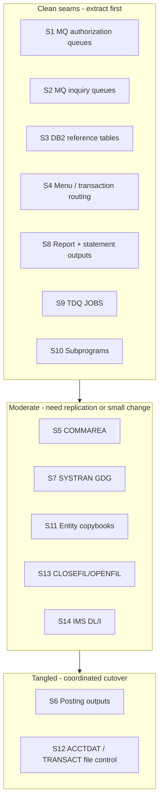

## 6. Extraction Order by Context

| Order | Context | Primary seam(s) | Prerequisite | Why this position |
|---|---|---|---|---|
| 1 | BC8 Reference Data | S3 | Target DB available | Clean seam, low business risk, proves the CICS+DB2 -> Spring Boot + JPA pattern |
| 2 | BC12 Platform (partial) and MQ inquiry (BC3 read) | S2 | Spring JMS connectivity to MQ | Retires diagnostics/utilities, proves MQ connectivity |
| 3 | Read models of BC3/BC4/BC5 (inquiry screens) | S4, S12 (read-only), S11 | One-way replication VSAM -> RDBMS | No writes, so a rollback is only a routing switch |
| 4 | BC9 Statements and Reporting | S8, S9, S10 | Replicated data | Output-file contract allows golden-file comparison |
| 5 | BC1 Identity and Access | S5, S4 | IdP integration | Must precede write functions so they carry a real principal/audit |
| 6 | BC3 + BC2 + BC4 (write) + BC5 + BC6 + BC7 | S6, S7, S12 | Parallel-run reconciliation, data cutover | Tangled data; all ACCTDATA/TRANSACT writers move together |
| 7 | BC10 Authorization and Fraud | S1, S14 | Account/Card/Customer data authoritative in the target | Real-time path, highest operational risk; depends on account data |
| 8 | BC11 Data Exchange, remaining BC12 | - | Everything above | Retire or rebuild only if still needed |

## 7. Aggregate Design per Core Context

| Context | Aggregate root | Entities / value objects | Invariants carried over from COBOL |
|---|---|---|---|
| Account | `Account` (id) | `Money` balance, credit limit, cash limit, cycle credit, cycle debit, `AccountStatus`, group id, open/expiry/reissue dates | Concurrent-update detection (COACTUPC) becomes `@Version`. Field edits come from COACTUPC |
| Customer | `Customer` (id) | `Address`, `PhoneNumber` (NANP area-code table), `Ssn` (encrypted), FICO score | State/ZIP prefix combination valid (CSLKPCDY) |
| Card | `Card` (PAN token) | `CardXref` (card -> account -> customer), expiry, status, embossed name | Embossed name letters and spaces only (COCRDUPC) |
| Ledger | `Transaction` (id) | `DailyTransaction`, `Reject(reasonCode)`, `CategoryBalance(account, type, category)` | Reject 100 card not in xref, 101 account not found, 102 over limit (cycle credit - cycle debit + amount > limit), 103 after account expiry, 109 rewrite failure; category balance create-or-add |
| Pricing | `DisclosureGroup` (group, type, category) | `InterestRate` | Monthly interest = balance x rate / 1200 (truncation); fallback to `DEFAULT` group |
| Authorization | `AuthorizationSummary` (account) | `AuthorizationDetail` (timestamp DESC), `FraudReport` | Decline when amount > credit limit - credit balance; purge after N days (default 5) |
