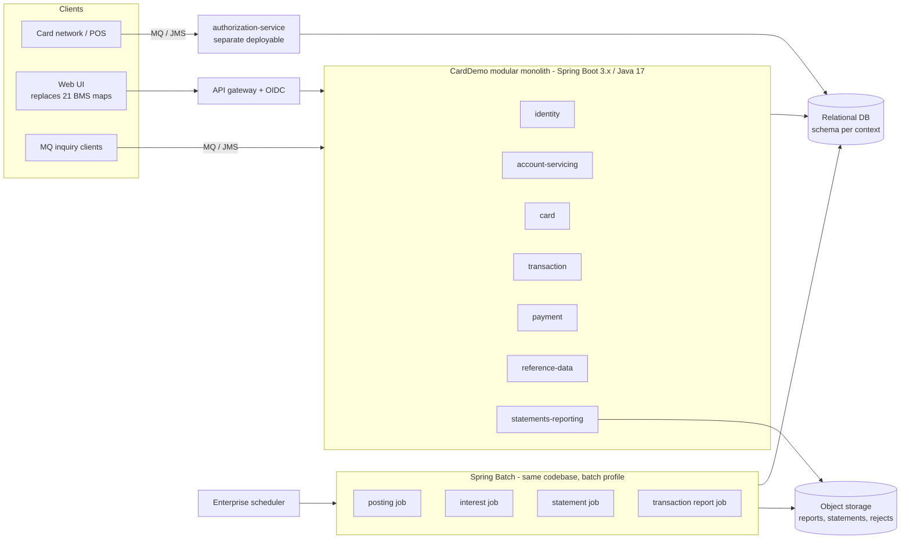
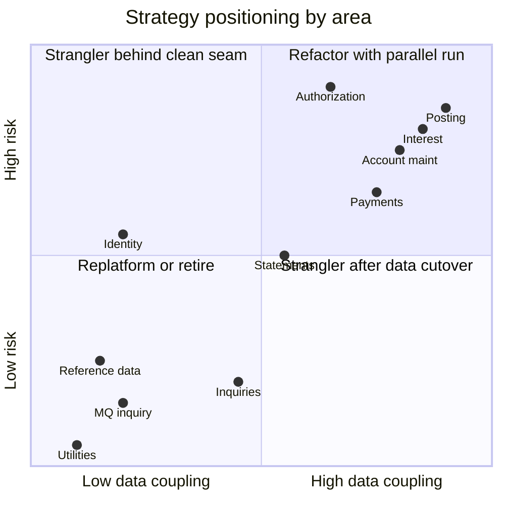

# CardDemo COBOL to Java 17 Migration Blueprint

> Target-state design and per-area migration strategy for moving the CardDemo mainframe application (z/OS COBOL, CICS, BMS, JCL, VSAM, DB2, IMS DL/I, IBM MQ) to **Java 17**.
> It builds on the static analysis in [`docs/modernization-analysis`](../modernization-analysis/README.md): inventory, data dictionary, dependency map and hotspot scores.

Companion documents: [DOMAIN_DECOMPOSITION.md](DOMAIN_DECOMPOSITION.md) | [CUTOVER_PLAN.md](CUTOVER_PLAN.md) | [RISK_REGISTER.md](RISK_REGISTER.md)

## 1. Executive Summary

| Item | Current state | Target state |
|---|---|---|
| Code | 44 COBOL programs, 22,904 LOC; 2 HLASM routines; 62 copybooks | Java 17 modular monolith of 12 bounded-context modules, plus one separately deployable Authorization service |
| Online | 25 CICS pseudo-conversational programs, 21 BMS 3270 maps, 25 transactions | Spring Boot 3.x REST APIs + web UI. Screens map 1:1 to pages for the first release |
| Batch | 46 JCL jobs, 2 PROCs, Control-M + CA-7 chains, GDG datasets | Spring Batch jobs launched by the enterprise scheduler. Run artifacts live in object storage / tables |
| Data | 11 VSAM KSDS (+3 AIX), IMS HIDAM `DBPAUTP0`, DB2 `CARDDEMO` (3 tables), sequential/GDG files | One relational database (PostgreSQL-compatible), one schema per bounded context, managed by Flyway |
| Integration | MQ request/reply (authorization, account/date inquiry), TDQ `JOBS` to the internal reader, FTP | Spring JMS (IBM MQ client) during coexistence, then the enterprise messaging standard. Job-launch API. SFTP/object storage |
| Security | Plain-text passwords in USRSEC; PAN, CVV and SSN stored in clear | OIDC identity provider + Spring Security; tokenised PAN, no stored CVV, encrypted PII |

**Recommended overall approach: a strangler fig at the CICS transaction and MQ boundary, with the data moved first, context by context.**
- Read-only and reference functions move first; they are low risk.
- The account/transaction ledger (online maintenance + batch posting + interest) moves **together** in one controlled cutover, because four programs share `ACCTDATA` and `TRANSACT` as writers (see Domain Decomposition, Section 4).
- The real-time authorization path moves last, behind MQ routing.

Each functional area gets one primary strategy, chosen by its hotspot score, technology mix and data coupling (Section 4).

## 2. Strategy Definitions

| Strategy | Meaning in this program | Use when |
|---|---|---|
| **Strangler** | Build the Java replacement next to the COBOL version and route traffic (CICS transaction, menu option, MQ queue or job) to Java one function at a time. Both versions coexist on synchronised data until the COBOL one is switched off | The boundary is clean (transaction ID, queue, job) and the function can run alongside the legacy one |
| **Rewrite** | Re-implement from the business rules, not line by line. The COBOL serves as the specification and as the golden-master oracle | The legacy structure has no Java equivalent (ALTER, z/OS control blocks, 3270 navigation), or a product/standard replaces it (IdP, reporting engine) |
| **Refactor** | Translate the logic faithfully into idiomatic Java 17 and preserve the behaviour exactly. Structure is cleaned up (GO TO removed, paragraphs become methods, copybooks become types), but the rules and arithmetic are kept bit-for-bit | The logic is the financial core and must match to the cent (posting, interest) |
| **Replatform** | Move with minimal logic change: same schema and SQL, new runtime | The component is already relational or a thin integration (DB2 reference data, MQ inquiry services) |
| **Retire** | Do not migrate. Replace with a platform capability or drop it | Infrastructure jobs (CLOSEFIL/OPENFIL, WAITSTEP, IDCAMS provisioning), diagnostics, dead code |

## 3. Target Architecture



### 3.1 Technology baseline

| Concern | Choice | Notes |
|---|---|---|
| Language / runtime | Java 17 (LTS) | Google Java Style, enforced with google-java-format in CI |
| Framework | Spring Boot 3.x (requires Java 17+) | Spring Web, Spring Data JPA, Spring Security, Spring Batch, Spring JMS |
| Build | Maven multi-module | One module per bounded context, plus `carddemo-common` |
| Database | PostgreSQL-compatible RDBMS | DB2 can be kept for reference data during Phase 1 (replatform), then consolidated |
| Schema migration | Flyway versioned scripts | Replaces the IDCAMS DEFINE / DB2CREAT control cards |
| Messaging | Spring JMS with the IBM MQ JMS client during coexistence | Same queues the COBOL programs use. Switch transport only after the authorization cutover |
| UI | Server-rendered pages or an SPA over the REST API | First release keeps screen parity (fields, validations, PF-key actions become buttons) to limit retraining |
| Test | JUnit 5, Testcontainers, golden-master comparators | See Section 7 |

### 3.2 Module layout (Maven)

```
carddemo/
  carddemo-common/            Money (BigDecimal, scale 2), COBOL-compatible arithmetic, date validation (CSUTLDTC/CSUTLDPY),
                              EBCDIC/packed-decimal codecs for migration, CSLKPCDY lookup tables (state, ZIP prefix, area codes)
  identity/                   COSGN00C, COUSR00C-03C       -> Spring Security + OIDC, user admin API
  account-servicing/          COACTVWC, COACTUPC           -> Account + Customer aggregates
  card/                       COCRDLIC, COCRDSLC, COCRDUPC -> Card + CardXref
  transaction/                COTRN00C-02C                 -> Transaction query + manual entry
  payment/                    COBIL00C                     -> Bill payment
  ledger-batch/               CBTRN02C, CBACT04C, COMBTRAN -> posting + interest Spring Batch jobs
  pricing/                    DISCGRP lookup, interest rule
  reference-data/             COTRTLIC, COTRTUPC, COBTUPDT -> transaction type / category
  statements-reporting/       CBSTM03A/B, CBTRN03C, CORPT00C, PRTCATBL
  data-exchange/              CBEXPORT, CBIMPORT
  authorization-service/      COPAUA0C, COPAUS0C-2C, CBPAUP0C  (separate Spring Boot app)
  migration-tools/            VSAM/IMS/DB2 unload converters, reconciliation jobs
```

## 4. Strategy per Functional Area

Hotspot score is the 0-10 priority score from [HOTSPOT_REPORT.md](../modernization-analysis/HOTSPOT_REPORT.md) (0.4 complexity + 0.3 risk + 0.3 impact). The area score shown is the highest program score in that area.

| # | Functional area | COBOL / JCL scope | LOC | Max hotspot | Strategy | Rationale | Java target |
|---|---|---|---|---|---|---|---|
| 1 | Reference data (transaction type / category) | COTRTLIC, COTRTUPC, COBTUPDT; TRANEXTR, MNTTRDB2, TRANTYPE, TRANCATG | 3,015 | 6.42 | **Replatform**, then consolidate | Already DB2 with clean SQL. The JPA entities map 1:1 to `TRANSACTION_TYPE` / `_CATEGORY`. After VSAM consumers move, drop the weekly DB2 -> VSAM copy (TRANEXTR) | `reference-data` module: Spring Data JPA, keyset paging replaces the cursor |
| 2 | MQ inquiry services | COACCT01 (CDRA), CODATE01 (CDRD) | 909 | low | **Replatform** | Thin request/reply wrappers. Keep the queue names and message formats | `@JmsListener` in `account-servicing` |
| 3 | Batch utilities and infrastructure | CBACT01C-03C, CBCUS01C, COBSWAIT/MVSWAIT, READ*, WAITSTEP, CLOSEFIL/OPENFIL, IDCAMS provisioning jobs, DEFGDG*, ESDSRRDS, INTRDRJ1/2, FTPJCL | 874 + JCL | low | **Retire** | They exist only because of VSAM/CICS file sharing and GDG management. The database, Flyway and the scheduler replace them | Flyway, scheduler dependencies, SQL views for diagnostics |
| 4 | Identity and access | COSGN00C, COUSR00C-03C, USRSEC, DUSRSECJ | 1,455 | 4.9 | **Rewrite** (replace with platform) | Plain-text passwords. Authentication belongs in an IdP. User admin becomes IdP group management (A = admin, U = user) | Spring Security OIDC resource server; roles `ADMIN` / `USER` from `SEC-USR-TYPE` |
| 5 | Navigation / menus | COMEN01C, COADM01C, COMEN02Y, COADM02Y | 402 | low | **Rewrite** | Table-driven 3270 menus become UI routes. The COMMAREA becomes the authenticated session plus resource IDs in URLs | UI navigation; no server module |
| 6 | Account and customer inquiry | COACTVWC | 703 | 4.45 | **Strangler** | Read-only; can run on replicated data before the system-of-record cutover | `GET /accounts/{id}` aggregate (account + customer + cards) |
| 7 | Card inquiry | COCRDLIC, COCRDSLC | 1,735 | 5.53 | **Strangler** | Read-only browse and detail; keyset pagination replaces STARTBR/READNEXT/READPREV | `GET /cards?accountId=` and `GET /cards/{pan-token}` |
| 8 | Transaction inquiry | COTRN00C, COTRN01C | 760 | ~4 | **Strangler** | Read-only | `GET /transactions` with paging |
| 9 | Statements and reporting | CBSTM03A/B, CBTRN03C, CORPT00C; CREASTMT, TXT2PDF1, TRANREPT, PRTCATBL | 1,989 | 6.63 | **Rewrite** | CBSTM03A uses ALTER/GO TO and reads z/OS PSA/TIOT through pointers, so it cannot be translated. The outputs (text/HTML/PDF statements, transaction detail report) are the contract, verified by golden-file comparison | Spring Batch jobs + template engine; `POST /reports` replaces JCL built in COBOL working storage and submitted via TDQ |
| 10 | Account and customer maintenance | COACTUPC | 3,368 | **8.70** | **Strangler + Refactor** | Highest complexity in the estate. Extract the edit rules (SSN, phone/area code, state/ZIP, dates, limits, FICO) into tested validators first, then switch the update transaction (CAUP) at ledger cutover | `PUT /accounts/{id}` with optimistic locking (`@Version` replaces the "record changed by someone else" check) |
| 11 | Card maintenance | COCRDUPC | 1,194 | 6.2 | **Strangler + Refactor** | Same pattern as COACTUPC, smaller | `PUT /cards/{id}` |
| 12 | Transaction entry | COTRN02C | 614 | 5.13 | **Strangler + Refactor** | Replace the "last key + 1" ID with a DB sequence. Apply the batch posting validations | `POST /transactions` |
| 13 | Bill payment | COBIL00C | 420 | 6.08 | **Strangler + Refactor** | Money movement. The account update and the payment transaction become a single `@Transactional` unit | `POST /accounts/{id}/payments` |
| 14 | Transaction posting (daily ledger) | CBTRN02C (+ dormant CBTRN01C); POSTTRAN | 1,034 | 7.4 | **Refactor** | Financial core: reject codes 100/101/102/103/109, balance and category-balance updates must match exactly. Parallel-run against the mainframe | Spring Batch chunk job, restartable, idempotent per `TRAN-ID` |
| 15 | Interest and pricing | CBACT04C, DISCGRP; INTCALC, COMBTRAN, TRANBKP | 552 | 7.13 | **Refactor** | `interest = TRAN-CAT-BAL x DIS-INT-RATE / 1200` with COBOL truncation (no ROUNDED anywhere in the code base), DEFAULT-group fallback, cycle reset. The fee stub needs a business decision | `pricing` rule service + Spring Batch job; COMBTRAN disappears because interest is written straight to the transaction table |
| 16 | Card authorization and fraud | COPAUA0C, COPAUS0C/1C/2C, CBPAUP0C, PAUDBLOD/UNL, DBUNLDGS; CBPAUP0J, IMS DBPAUTP0, DB2 AUTHFRDS | 3,147 | 7.48 | **Strangler** (MQ routing) + **Rewrite** of IMS data access | Real-time and mixes four technologies. The MQ request/reply queues are a clean seam: route a subset of card BINs/accounts to Java and compare decisions. IMS root/child becomes two tables | `authorization-service`: `@JmsListener`, transactional outbox, JPA |
| 17 | Data exchange / branch migration | CBEXPORT, CBIMPORT | 733 | 4 | **Rewrite** (or retire) | The multi-record REDEFINES file has inconsistent encodings and a known key defect. In the target, branch migration is a database export or API | `data-exchange` batch job (records as a Java 17 `sealed interface` hierarchy) if still needed |



## 5. COBOL to Java 17 Construct Mapping

| COBOL / CICS / JCL construct | Java 17 target | Rule |
|---|---|---|
| `PIC X(n)` | `String` | Trim trailing spaces on read. Column length = n |
| `PIC 9(n)` identifiers (ACCT-ID, CUST-ID) | `long`, or `String` for zero-padded identifiers | Keep leading zeros wherever they are shown or used as keys (PAN, TRAN-ID) |
| `PIC S9(n)V99` (zoned / `COMP-3`) | `BigDecimal` with scale 2 (`NUMERIC(n+2,2)`) | Never use `double`. Use `RoundingMode.DOWN` to reproduce COBOL truncation, because no `ROUNDED` clause exists in the code |
| `COMP` / `BINARY` | `short` / `int` / `long` | By digit count (<=4, <=9, <=18) |
| `88` level conditions | `enum` with a code field | e.g. `UserType {ADMIN("A"), USER("U")}`, `MatchStatus {P,D,E,M}` |
| `REDEFINES` record variants (CVEXPORT) | `sealed interface ExportRecord permits CustomerExport, AccountExport, ...` with `record` implementations | Java 17 sealed classes + records. Use `switch` on the record-type code; pattern matching for switch is only a preview in 17 and should not be used |
| Copybook entity layouts (CVACT01Y ...) | JPA `@Entity` (mutable aggregate) + `record` DTOs | One copybook gives one entity and one or more API records |
| `PERFORM paragraph` / `THRU` | private method | Paragraph names become method names |
| `GO TO` / `ALTER` (185 GO TO in 10 programs; ALTER in CBSTM03A) | structured control flow | Rewrite these areas. Do not emulate GO TO |
| `EVALUATE TRUE ... WHEN` | `switch` expression / `if` chain | |
| File status / `RESP` codes (`DFHRESP(NOTFND)`) | `Optional` / typed exceptions | `NOTFND` returns `Optional.empty()`; `DUPREC` raises `DuplicateKeyException` |
| `EXEC CICS SEND/RECEIVE MAP` | REST endpoint + page | Field-level edits become Bean Validation + domain validators |
| COMMAREA (`COCOM01Y`) | Authenticated principal + path/query parameters | No server-side conversational state |
| `XCTL PROGRAM(...)` | UI route change | Menu tables (COMEN02Y/COADM02Y) become role-based navigation config |
| `READ UPDATE` + `REWRITE` | JPA load + `@Version` optimistic lock in `@Transactional` | Replaces field-by-field "changed by someone else" comparison |
| `STARTBR / READNEXT / READPREV` | keyset pagination (`WHERE key > :last ORDER BY key LIMIT n`) | Must preserve EBCDIC sort order where users rely on it (see Risk R-05) |
| `SYNCPOINT` / end-of-task commit | `@Transactional` boundary | One request = one transaction |
| `WRITEQ TD QUEUE('JOBS')` + JCL text | Job-launch API (Spring Batch `JobLauncher` behind `POST /reports`) | |
| `EXEC SQL` (DB2) | Spring Data JPA / `JdbcTemplate` | Keep the SQL semantics (cursor -> paged query) |
| `EXEC DLI` / `CBLTDLI` (GU/GNP/ISRT/REPL/DLET) | JPA repositories on `auth_summary` / `auth_detail` | The complemented-date key (`99999 - YYDDD`) becomes a timestamp column sorted DESC |
| MQ `MQOPEN/MQGET/MQPUT1` | `@JmsListener` + `JmsTemplate` | Use transacted sessions to remove the MQGET NO-SYNCPOINT gap |
| JCL job / step | Spring Batch `Job` / `Step` | Scheduler dependencies replace Control-M/CA-7 conditions |
| `SORT` step | SQL `ORDER BY` / Spring Batch sorting reader | |
| GDG `(+1)` generations | run-id-partitioned table rows or versioned object-storage keys | Rejects (DALYREJS), SYSTRAN, reports, backups |
| IDCAMS DEFINE / REPRO | Flyway DDL / migration-tools loaders | |
| `CEEDAYS` (CSUTLDTC) | `java.time.LocalDate` parsing with `ResolverStyle.STRICT` | Return the same severity/message semantics to callers |
| HLASM `COBDATFT`, `MVSWAIT` | `java.time` formatting; scheduler delay | Retire |

## 6. Data Migration Strategy

| Source | Records (sample) | Target | Conversion rules |
|---|---|---|---|
| ACCTDATA KSDS (300 B) | 50 | `account.account` | Zoned `S9(10)V99` -> `NUMERIC(12,2)`; `X(10)` dates -> `DATE` (validate; reject invalid); rename `ACCT-EXPIRAION-DATE` -> `expiration_date` |
| CUSTDATA KSDS (500 B) | 50 | `account.customer` | SSN / government ID encrypted at rest; DOB -> `DATE` |
| CARDDATA KSDS + AIX (150 B) | 50 | `card.card` | PAN tokenised; **CVV not migrated** (PCI DSS) |
| CARDXREF KSDS + AIX (50 B) | 50 | `card.card_xref` (or FKs on card) | Card -> account -> customer referential integrity checked |
| TRANSACT KSDS + AIX (350 B) | 300 daily sample | `ledger.transaction` | `TRAN-ORIG-TS` / `TRAN-PROC-TS` text -> `TIMESTAMP`; index on processed timestamp replaces the AIX |
| TCATBALF KSDS (50 B) | 50 | `ledger.category_balance` | Composite PK (account, type, category) |
| DISCGRP KSDS (50 B) | 51 | `pricing.disclosure_group` | Groups A000000000, DEFAULT, ZEROAPR |
| TRANTYPE / TRANCATG (VSAM + DB2) | 7 / 18 | `reference.transaction_type`, `reference.transaction_category` | DB2 is the system of record; drop the VSAM copies |
| USRSEC KSDS (80 B) | seeded | IdP users | Passwords not migrated; users re-enrol |
| IMS DBPAUTP0 (PAUTSUM0 / PAUTDTL1) | unload image | `auth.auth_summary`, `auth.auth_detail` | Packed `COMP-3` -> `NUMERIC`; complemented key -> `auth_ts` |
| DB2 AUTHFRDS | - | `auth.auth_fraud` | Direct copy |

Migration mechanics:
1. Unload with the existing JCL (REPRO to sequential, UNLDPADB for IMS, DSNTIAUL for DB2).
2. Convert EBCDIC and packed/zoned fields in `migration-tools`. Codecs are driven by the field tables in [DATA_DICTIONARY.md](../modernization-analysis/DATA_DICTIONARY.md).
3. Load with batch inserts.
4. Reconcile: row counts, hash totals of `ACCT-CURR-BAL`, `TRAN-CAT-BAL` and `TRAN-AMT` per account, and a referential-integrity report.

During strangler coexistence, the mainframe stays the system of record. A one-way, near-real-time replication (CDC tool or nightly REPRO + delta load; product TBD) feeds the Java read models until the ledger cutover (see Cutover Plan, Phase 5).

## 7. Verification Strategy

| Layer | Technique | Oracle |
|---|---|---|
| Field codecs | Property-based tests per PIC type (zoned, packed, signed, implied decimal) | DATA_DICTIONARY layouts + EBCDIC sample files in `app/data/EBCDIC` |
| Business rules | Unit tests per extracted rule (reject codes, interest, payment, authorization decision, validators) | Rules listed in DATA_DICTIONARY section 5 |
| Batch outputs | **Golden master**: run COBOL and Java on the same inputs and diff `ACCTDATA`, `TCATBALF`, `TRANSACT`, `DALYREJS`, `SYSTRAN`, the TRANREPT report and statements | Mainframe outputs from the 300-record `dailytran.txt` sample and production-like volumes |
| Online | Recorded 3270 scenarios replayed as API/UI tests; field-level validation messages compared | CICS screens |
| Authorization | Shadow mode: Java consumes a copy of each request and logs its decision without replying; compare with COBOL replies | MQ reply queue |
| Parallel run | At least 2 monthly interest cycles and 20 daily posting cycles with zero unexplained reconciliation differences before ledger cutover | Reconciliation reports |

## 8. Engineering Standards
- Java 17, Spring Boot 3.x, Google Java Style (google-java-format in CI).
- Constructor injection only.
- Credentials from environment/secret store; nothing in code or JCL equivalents (FTPJCL and DUSRSECJ show the anti-pattern).
- Schema changes only through new versioned Flyway migrations; existing migrations are never edited.
- Every migrated rule carries a reference to its COBOL source paragraph (e.g. `CBTRN02C 2700-UPDATE-TCATBAL`) in the test name or Javadoc, for traceability during parallel run.

## 9. Decisions Required from the Business
1. **Fees**: `CBACT04C 1400-COMPUTE-FEES` is an empty stub. Implement fees or formally drop them.
2. **Known defects**: preserve them for parity or fix them? Candidates:
   - CBPAUP0C duplicated approved-count condition.
   - CBIMPORT missing CARDOUT DD.
   - EXPORT.DATA `KEYS(4 28)` offset.
   - Over-limit rule based on cycle totals rather than balance.
3. **Bill payment**: keep full-balance-only payments, or allow partial payments?
4. **Statements**: is the PDF produced by TXT2PDF the required format, or are HTML/e-delivery enough?
5. **Branch export/import**: still needed after migration?
6. **Missing program `COCRDSEC`** (CSD transaction `CDV1`): confirm it is out of scope.
