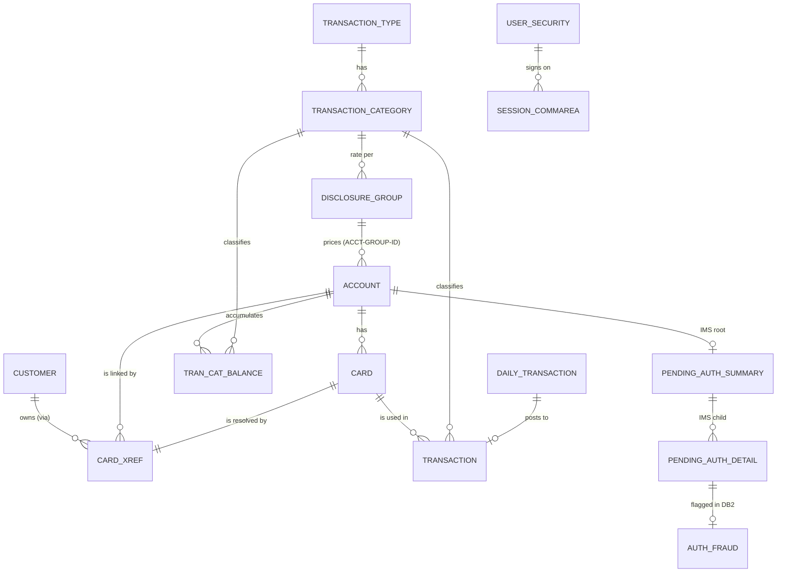

# CardDemo Data Dictionary

> Business-friendly catalogue of every persistent entity and interface record in CardDemo, derived from the copybook PIC clauses, VSAM IDCAMS definitions (key offsets / record sizes), DB2 DDL and IMS DBDs. "Start" is the 1-based byte position in the record; "Bytes" is the storage length (packed `COMP-3` = ceil((digits+1)/2), binary `COMP` = 2/4/8). Sample values come from `app/data/ASCII`.

Companion documents: [APPLICATION_INVENTORY.md](APPLICATION_INVENTORY.md) | [DEPENDENCY_MAP.md](DEPENDENCY_MAP.md) | [HOTSPOT_REPORT.md](HOTSPOT_REPORT.md)

## 1. How to read PIC clauses

| COBOL PIC | Meaning | Example in CardDemo | Java mapping |
|---|---|---|---|
| `X(n)` | Text of n characters (space-padded) | `CUST-FIRST-NAME PIC X(25)` | String (trim on read) |
| `9(n)` | Unsigned whole number of n digits, one byte per digit (zoned) | `ACCT-ID PIC 9(11)` | long, or String when it is an identifier |
| `S9(n)V99` | Signed number with implied decimal point (V) - no physical point stored | `ACCT-CURR-BAL PIC S9(10)V99` = up to 9,999,999,999.99 | BigDecimal (scale 2) |
| `... COMP-3` | Packed decimal: two digits per byte + sign nibble | `PA-CREDIT-LIMIT PIC S9(09)V99 COMP-3` (6 bytes) | BigDecimal |
| `... COMP` / `BINARY` | Binary integer (2, 4 or 8 bytes) | `PA-APPROVED-AUTH-CNT PIC S9(04) COMP` | short / int / long |
| `+9(10).99`, `-zzz9.99` | Edited display numeric (sign, point, zero-suppression stored as text) | `PA-RQ-TRANSACTION-AMT PIC +9(10).99` | String -> BigDecimal parse |
| `OCCURS n` | Repeating group / array | `PA-ACCOUNT-STATUS OCCURS 5` | List / array |
| `REDEFINES` | Alternative view of the same bytes (union) | `EXPORT-CUSTOMER-DATA REDEFINES EXPORT-RECORD-DATA` | Polymorphic subtype / discriminator |
| `88 name VALUE v` | Named condition = allowed value / enumeration | `88 CDEMO-USRTYP-ADMIN VALUE 'A'` | enum |

## 2. Business Entity Model

| Entity | Copybook | Physical store | Key | Record bytes | Relationships |
|---|---|---|---|---|---|
| [Customer](#customer) | `CVCUS01Y` | VSAM KSDS `AWS.M2.CARDDEMO.CUSTDATA.VSAM.KSDS` (CICS file CUSTDAT), RECORDSIZE 500 | CUST-ID (9, offset 0) | 500 | Customer 1..* Card-Account Cross-Reference |
| [Account](#account) | `CVACT01Y` | VSAM KSDS `AWS.M2.CARDDEMO.ACCTDATA.VSAM.KSDS` (CICS file ACCTDAT), RECORDSIZE 300 | ACCT-ID (11, offset 0) | 300 | Account 1..* Card; Account 1..* Transaction Category Balance; Account N..1 Disclosure Group (via ACCT-GROUP-ID) |
| [Card](#card) | `CVACT02Y` | VSAM KSDS `AWS.M2.CARDDEMO.CARDDATA.VSAM.KSDS` (CICS CARDDAT) + AIX on CARD-ACCT-ID (CICS CARDAIX), RECORDSIZE 150 | CARD-NUM (16, offset 0); AIX CARD-ACCT-ID (11, offset 16) | 150 | Card N..1 Account |
| [Card-Account Cross-Reference](#card-account-cross-reference) | `CVACT03Y` | VSAM KSDS `AWS.M2.CARDDEMO.CARDXREF.VSAM.KSDS` (CICS CCXREF) + AIX on XREF-ACCT-ID (CICS CXACAIX), RECORDSIZE 50 | XREF-CARD-NUM (16, offset 0); AIX XREF-ACCT-ID (11, offset 25) | 50 | Links Card, Account, Customer |
| [Transaction (posted)](#transaction-posted) | `CVTRA05Y` | VSAM KSDS `AWS.M2.CARDDEMO.TRANSACT.VSAM.KSDS` (CICS TRANSACT) + AIX on TRAN-PROC-TS (offset 304, 26), RECORDSIZE 350 | TRAN-ID (16, offset 0) | 350 | Transaction N..1 Card (TRAN-CARD-NUM); N..1 Transaction Type/Category |
| [Daily Transaction (input)](#daily-transaction-input) | `CVTRA06Y` | Sequential `AWS.M2.CARDDEMO.DALYTRAN.PS` (FB 350) | none (sequential) | 350 | Becomes Transaction (valid) or Daily Reject (invalid) |
| [Transaction Category Balance](#transaction-category-balance) | `CVTRA01Y` | VSAM KSDS `AWS.M2.CARDDEMO.TCATBALF.VSAM.KSDS`, RECORDSIZE 50 | TRAN-CAT-KEY = account + type + category (17, offset 0) | 50 | N..1 Account; N..1 Transaction Category |
| [Disclosure Group (interest rates)](#disclosure-group-interest-rates) | `CVTRA02Y` | VSAM KSDS `AWS.M2.CARDDEMO.DISCGRP.VSAM.KSDS`, RECORDSIZE 50 | DIS-GROUP-KEY = group + type + category (16, offset 0) | 50 | Account.ACCT-GROUP-ID -> DIS-ACCT-GROUP-ID |
| [Transaction Type](#transaction-type) | `CVTRA03Y` | VSAM KSDS `AWS.M2.CARDDEMO.TRANTYPE.VSAM.KSDS` (RECORDSIZE 60); master in DB2 `CARDDEMO.TRANSACTION_TYPE` | TRAN-TYPE (2) | 60 | 1..* Transaction Category |
| [Transaction Category](#transaction-category) | `CVTRA04Y` | VSAM KSDS `AWS.M2.CARDDEMO.TRANCATG.VSAM.KSDS` (RECORDSIZE 60); master in DB2 `CARDDEMO.TRANSACTION_TYPE_CATEGORY` | TRAN-CAT-KEY = type + category (6) | 60 | N..1 Transaction Type |
| [User (application security)](#user-application-security) | `CSUSR01Y` | VSAM KSDS `AWS.M2.CARDDEMO.USRSEC.VSAM.KSDS` (CICS USRSEC), RECORDSIZE 80 | SEC-USR-ID (8, offset 0) | 80 | none |
| [Pending Authorization Summary (IMS root PAUTSUM0)](#pending-authorization-summary-ims-root-pautsum0) | `CIPAUSMY` | IMS HIDAM DB `DBPAUTP0`, root segment PAUTSUM0 (100 bytes) | ACCNTID = PA-ACCT-ID (packed, 6 bytes) | 100 | 1..* Pending Authorization Detail; 1..1 Account |
| [Pending Authorization Detail (IMS child PAUTDTL1)](#pending-authorization-detail-ims-child-pautdtl1) | `CIPAUDTY` | IMS HIDAM DB `DBPAUTP0`, child segment PAUTDTL1 (200 bytes) | PAUT9CTS = PA-AUTHORIZATION-KEY (8 bytes, complemented date/time so newest sorts first) | 200 | N..1 Summary; 0..1 Fraud record (DB2) |
| [Authorization Request (MQ message)](#authorization-request-mq-message) | `CCPAURQY` | MQ request queue (name from trigger message, MQTM-QNAME) | PA-RQ-CARD-NUM + PA-RQ-TRANSACTION-ID | 153 | Produces Authorization Response + IMS detail |
| [Authorization Response (MQ message)](#authorization-response-mq-message) | `CCPAURLY` | MQ reply queue (MQPUT1) | PA-RL-CARD-NUM + PA-RL-TRANSACTION-ID | 57 | Response to Request |
| [Authorization Error Log](#authorization-error-log) | `CCPAUERY` | CICS TD queue `CSSL` | none | 122 | none |
| [Statement Work Record](#statement-work-record) | `COSTM01` | VSAM KSDS `AWS.M2.CARDDEMO.TRXFL.VSAM.KSDS` (RECORDSIZE 350, KEYS 32 0) | TRNX-KEY = card number + transaction ID (32) | 350 | Projection of Transaction |
| [Branch Export Record](#branch-export-record) | `CVEXPORT` | VSAM KSDS `AWS.M2.CARDDEMO.EXPORT.DATA` (RECORDSIZE 500, KEYS 4 28) | EXPORT-SEQUENCE-NUM (intended) | 500 | Carries Customer, Account, Transaction, Xref, Card |
| [Online Session (COMMAREA)](#online-session-commarea) | `COCOM01Y` | CICS COMMAREA passed on every XCTL / RETURN TRANSID | n/a | 160 | References User, Customer, Account, Card |
| [Authorization Fraud (DB2)](#authorization-fraud-db2-carddemoauthfrds) | DCLGEN `AUTHFRDS` | DB2 table `CARDDEMO.AUTHFRDS` | CARD_NUM + AUTH_TS |  | N..1 Pending Authorization Detail |
| [Transaction Type / Category (DB2)](#transaction-type--category-db2) | DCLGEN `DCLTRTYP`, `DCLTRCAT` | DB2 `CARDDEMO.TRANSACTION_TYPE`, `CARDDEMO.TRANSACTION_TYPE_CATEGORY` | TR_TYPE; TRC_TYPE_CODE + TRC_TYPE_CATEGORY |  | FK category -> type (ON DELETE RESTRICT) |

## 3. Entity Definitions

### Customer

- **Copybook**: [CVCUS01Y](../../app/cpy/CVCUS01Y.cpy)
- **Stored in**: VSAM KSDS `AWS.M2.CARDDEMO.CUSTDATA.VSAM.KSDS` (CICS file CUSTDAT), RECORDSIZE 500
- **Key**: CUST-ID (9, offset 0)
- **Description**: A person who holds one or more cards/accounts. Contains PII (SSN, government ID, DOB).
- **Relationships**: Customer 1..* Card-Account Cross-Reference

- **Programs using it**: COPAUA0C, COPAUS0C, CBCUS01C, CBEXPORT, CBIMPORT, CBTRN01C, COACTUPC, COACTVWC, COCRDSLC, COCRDUPC

| Lvl | COBOL field | Business name | PIC / usage | Business type | Suggested Java type | Start | Bytes | Business meaning / rules | Valid values (88-levels) |
|---|---|---|---|---|---|---|---|---|---|
| 1 | `CUSTOMER-RECORD` | Customer Record | group | Group |  | 1 | 500 |  |  |
| 5 | &nbsp;&nbsp;`CUST-ID` | Customer ID | `9(09)` | integer 9 digits (zoned) | int | 1 | 9 | Unique customer number (primary key). |  |
| 5 | &nbsp;&nbsp;`CUST-FIRST-NAME` | First Name | `X(25)` | Text (25) | String | 10 | 25 |  |  |
| 5 | &nbsp;&nbsp;`CUST-MIDDLE-NAME` | Middle Name | `X(25)` | Text (25) | String | 35 | 25 |  |  |
| 5 | &nbsp;&nbsp;`CUST-LAST-NAME` | Last Name | `X(25)` | Text (25) | String | 60 | 25 |  |  |
| 5 | &nbsp;&nbsp;`CUST-ADDR-LINE-1` | Address Line 1 | `X(50)` | Text (50) | String | 85 | 50 |  |  |
| 5 | &nbsp;&nbsp;`CUST-ADDR-LINE-2` | Address Line 2 | `X(50)` | Text (50) | String | 135 | 50 |  |  |
| 5 | &nbsp;&nbsp;`CUST-ADDR-LINE-3` | Address Line 3 | `X(50)` | Text (50) | String | 185 | 50 |  |  |
| 5 | &nbsp;&nbsp;`CUST-ADDR-STATE-CD` | Address State Code | `X(02)` | Text (2) | String | 235 | 2 | US state; validated against CSLKPCDY state list. |  |
| 5 | &nbsp;&nbsp;`CUST-ADDR-COUNTRY-CD` | Address Country Code | `X(03)` | Text (3) | String | 237 | 3 |  |  |
| 5 | &nbsp;&nbsp;`CUST-ADDR-ZIP` | Address ZIP | `X(10)` | Text (10) | String | 240 | 10 | ZIP; validated against state/ZIP prefix table. |  |
| 5 | &nbsp;&nbsp;`CUST-PHONE-NUM-1` | Phone Number 1 | `X(15)` | Text (15) | String | 250 | 15 | Phone (NANP); COACTUPC validates the area code against the CSLKPCDY table. |  |
| 5 | &nbsp;&nbsp;`CUST-PHONE-NUM-2` | Phone Number 2 | `X(15)` | Text (15) | String | 265 | 15 |  |  |
| 5 | &nbsp;&nbsp;`CUST-SSN` | SSN | `9(09)` | integer 9 digits (zoned) | int | 280 | 9 | US Social Security Number - **PII, stored unmasked**; edited in COACTUPC. |  |
| 5 | &nbsp;&nbsp;`CUST-GOVT-ISSUED-ID` | Government Issued ID | `X(20)` | Text (20) | String | 289 | 20 | Government ID - PII. |  |
| 5 | &nbsp;&nbsp;`CUST-DOB-YYYY-MM-DD` | Date of Birth (YYYY-MM-DD) | `X(10)` | Text (10) | String | 309 | 10 | Date of birth as text YYYY-MM-DD; validated in COACTUPC. |  |
| 5 | &nbsp;&nbsp;`CUST-EFT-ACCOUNT-ID` | EFT Account ID | `X(10)` | Text (10) | String | 319 | 10 | Bank account used for electronic funds transfer. |  |
| 5 | &nbsp;&nbsp;`CUST-PRI-CARD-HOLDER-IND` | Primary Card Holder Indicator | `X(01)` | Text (1) | String | 329 | 1 | Y/N primary card holder. |  |
| 5 | &nbsp;&nbsp;`CUST-FICO-CREDIT-SCORE` | FICO Credit Score | `9(03)` | integer 3 digits (zoned) | int | 330 | 3 | FICO credit score; edited as numeric in COACTUPC. |  |
|  | FILLER | (unused / reserved) | `X(168)` | Text |  | 333 | 168 | Reserved space |  |

### Account

- **Copybook**: [CVACT01Y](../../app/cpy/CVACT01Y.cpy)
- **Stored in**: VSAM KSDS `AWS.M2.CARDDEMO.ACCTDATA.VSAM.KSDS` (CICS file ACCTDAT), RECORDSIZE 300
- **Key**: ACCT-ID (11, offset 0)
- **Description**: Credit-card account: balances, limits and life-cycle dates. Updated online (COACTUPC, COBIL00C) and in batch (CBTRN02C posting, CBACT04C interest).
- **Relationships**: Account 1..* Card; Account 1..* Transaction Category Balance; Account N..1 Disclosure Group (via ACCT-GROUP-ID)

- **Programs using it**: COPAUA0C, COPAUS0C, COACCT01, CBACT01C, CBACT04C, CBEXPORT, CBIMPORT, CBSTM03A, CBTRN01C, CBTRN02C, COACTUPC, COACTVWC, COBIL00C, COTRN02C

| Lvl | COBOL field | Business name | PIC / usage | Business type | Suggested Java type | Start | Bytes | Business meaning / rules | Valid values (88-levels) |
|---|---|---|---|---|---|---|---|---|---|
| 1 | `ACCOUNT-RECORD` | Account Record | group | Group |  | 1 | 300 |  |  |
| 5 | &nbsp;&nbsp;`ACCT-ID` | Account ID | `9(11)` | integer 11 digits (zoned) | long / String (identifier) | 1 | 11 | Account number (primary key). |  |
| 5 | &nbsp;&nbsp;`ACCT-ACTIVE-STATUS` | Active Status | `X(01)` | Text (1) | String | 12 | 1 | Y = active, N = inactive. |  |
| 5 | &nbsp;&nbsp;`ACCT-CURR-BAL` | Current Balance | `S9(10)V99` | Signed decimal 10.2 digits (zoned) | BigDecimal (scale 2) | 13 | 12 | Current balance. +posted transaction amount (CBTRN02C), -payment (COBIL00C), +interest (CBACT04C). |  |
| 5 | &nbsp;&nbsp;`ACCT-CREDIT-LIMIT` | Credit Limit | `S9(10)V99` | Signed decimal 10.2 digits (zoned) | BigDecimal (scale 2) | 25 | 12 | Credit limit. Posting rejects (code 102) when cycle credit - cycle debit + amount exceeds it. |  |
| 5 | &nbsp;&nbsp;`ACCT-CASH-CREDIT-LIMIT` | Cash Credit Limit | `S9(10)V99` | Signed decimal 10.2 digits (zoned) | BigDecimal (scale 2) | 37 | 12 | Cash-advance limit. |  |
| 5 | &nbsp;&nbsp;`ACCT-OPEN-DATE` | Open Date | `X(10)` | Text (10) | String | 49 | 10 | YYYY-MM-DD text. |  |
| 5 | &nbsp;&nbsp;`ACCT-EXPIRAION-DATE` | Expiration Date | `X(10)` | Text (10) | String | 59 | 10 | YYYY-MM-DD text (sic: misspelt). Posting rejects transactions after this date (code 103). |  |
| 5 | &nbsp;&nbsp;`ACCT-REISSUE-DATE` | Reissue Date | `X(10)` | Text (10) | String | 69 | 10 | YYYY-MM-DD text. |  |
| 5 | &nbsp;&nbsp;`ACCT-CURR-CYC-CREDIT` | Current Cycle Credit | `S9(10)V99` | Signed decimal 10.2 digits (zoned) | BigDecimal (scale 2) | 79 | 12 | Credits in current cycle; reset to 0 by interest run. |  |
| 5 | &nbsp;&nbsp;`ACCT-CURR-CYC-DEBIT` | Current Cycle Debit | `S9(10)V99` | Signed decimal 10.2 digits (zoned) | BigDecimal (scale 2) | 91 | 12 | Debits in current cycle; reset to 0 by interest run. |  |
| 5 | &nbsp;&nbsp;`ACCT-ADDR-ZIP` | Address ZIP | `X(10)` | Text (10) | String | 103 | 10 |  |  |
| 5 | &nbsp;&nbsp;`ACCT-GROUP-ID` | Group ID | `X(10)` | Text (10) | String | 113 | 10 | Disclosure / pricing group; key into DISCGRP (fallback DEFAULT). |  |
|  | FILLER | (unused / reserved) | `X(178)` | Text |  | 123 | 178 | Reserved space |  |

### Card

- **Copybook**: [CVACT02Y](../../app/cpy/CVACT02Y.cpy)
- **Stored in**: VSAM KSDS `AWS.M2.CARDDEMO.CARDDATA.VSAM.KSDS` (CICS CARDDAT) + AIX on CARD-ACCT-ID (CICS CARDAIX), RECORDSIZE 150
- **Key**: CARD-NUM (16, offset 0); AIX CARD-ACCT-ID (11, offset 16)
- **Description**: A plastic card issued against an account.
- **Relationships**: Card N..1 Account

- **Programs using it**: COPAUS0C, COTRTLIC, CBACT02C, CBEXPORT, CBIMPORT, CBTRN01C, COACTVWC, COCRDLIC, COCRDSLC, COCRDUPC

| Lvl | COBOL field | Business name | PIC / usage | Business type | Suggested Java type | Start | Bytes | Business meaning / rules | Valid values (88-levels) |
|---|---|---|---|---|---|---|---|---|---|
| 1 | `CARD-RECORD` | Record | group | Group |  | 1 | 150 |  |  |
| 5 | &nbsp;&nbsp;`CARD-NUM` | Card Number | `X(16)` | Text (16) | String | 1 | 16 | 16-digit PAN (primary key) - **PCI data, stored in clear**. |  |
| 5 | &nbsp;&nbsp;`CARD-ACCT-ID` | Account ID | `9(11)` | integer 11 digits (zoned) | long / String (identifier) | 17 | 11 |  |  |
| 5 | &nbsp;&nbsp;`CARD-CVV-CD` | CVV Code | `9(03)` | integer 3 digits (zoned) | int | 28 | 3 | Card verification value - **PCI sensitive authentication data, must not be stored post-authorization**. |  |
| 5 | &nbsp;&nbsp;`CARD-EMBOSSED-NAME` | Embossed Name | `X(50)` | Text (50) | String | 31 | 50 | Name printed on the card; COCRDUPC allows alphabetic + spaces only. |  |
| 5 | &nbsp;&nbsp;`CARD-EXPIRAION-DATE` | Expiration Date | `X(10)` | Text (10) | String | 81 | 10 | YYYY-MM-DD text (sic). |  |
| 5 | &nbsp;&nbsp;`CARD-ACTIVE-STATUS` | Active Status | `X(01)` | Text (1) | String | 91 | 1 | Y/N. |  |
|  | FILLER | (unused / reserved) | `X(59)` | Text |  | 92 | 59 | Reserved space |  |

### Card-Account Cross-Reference

- **Copybook**: [CVACT03Y](../../app/cpy/CVACT03Y.cpy)
- **Stored in**: VSAM KSDS `AWS.M2.CARDDEMO.CARDXREF.VSAM.KSDS` (CICS CCXREF) + AIX on XREF-ACCT-ID (CICS CXACAIX), RECORDSIZE 50
- **Key**: XREF-CARD-NUM (16, offset 0); AIX XREF-ACCT-ID (11, offset 25)
- **Description**: Resolves a card number to its account and customer - the join table of the model.
- **Relationships**: Links Card, Account, Customer

- **Programs using it**: COPAUA0C, COPAUS0C, CBACT03C, CBACT04C, CBEXPORT, CBIMPORT, CBSTM03A, CBTRN01C, CBTRN02C, CBTRN03C, COACTUPC, COACTVWC, COBIL00C, COTRN02C

| Lvl | COBOL field | Business name | PIC / usage | Business type | Suggested Java type | Start | Bytes | Business meaning / rules | Valid values (88-levels) |
|---|---|---|---|---|---|---|---|---|---|
| 1 | `CARD-XREF-RECORD` | Card Cross-Reference Record | group | Group |  | 1 | 50 |  |  |
| 5 | &nbsp;&nbsp;`XREF-CARD-NUM` | Card Number | `X(16)` | Text (16) | String | 1 | 16 |  |  |
| 5 | &nbsp;&nbsp;`XREF-CUST-ID` | Customer ID | `9(09)` | integer 9 digits (zoned) | int | 17 | 9 |  |  |
| 5 | &nbsp;&nbsp;`XREF-ACCT-ID` | Account ID | `9(11)` | integer 11 digits (zoned) | long / String (identifier) | 26 | 11 |  |  |
|  | FILLER | (unused / reserved) | `X(14)` | Text |  | 37 | 14 | Reserved space |  |

### Transaction (posted)

- **Copybook**: [CVTRA05Y](../../app/cpy/CVTRA05Y.cpy)
- **Stored in**: VSAM KSDS `AWS.M2.CARDDEMO.TRANSACT.VSAM.KSDS` (CICS TRANSACT) + AIX on TRAN-PROC-TS (offset 304, 26), RECORDSIZE 350
- **Key**: TRAN-ID (16, offset 0)
- **Description**: A posted financial transaction. Written by batch posting (CBTRN02C), interest (CBACT04C via SYSTRAN + COMBTRAN), bill payment (COBIL00C) and manual entry (COTRN02C).
- **Relationships**: Transaction N..1 Card (TRAN-CARD-NUM); N..1 Transaction Type/Category

- **Programs using it**: CBACT04C, CBEXPORT, CBIMPORT, CBTRN01C, CBTRN02C, CBTRN03C, COBIL00C, CORPT00C, COTRN00C, COTRN01C, COTRN02C

| Lvl | COBOL field | Business name | PIC / usage | Business type | Suggested Java type | Start | Bytes | Business meaning / rules | Valid values (88-levels) |
|---|---|---|---|---|---|---|---|---|---|
| 1 | `TRAN-RECORD` | Record | group | Group |  | 1 | 350 |  |  |
| 5 | &nbsp;&nbsp;`TRAN-ID` | Transaction ID | `X(16)` | Text (16) | String | 1 | 16 | Transaction ID. Online programs generate it as highest existing key + 1. |  |
| 5 | &nbsp;&nbsp;`TRAN-TYPE-CD` | Type Code | `X(02)` | Text (2) | String | 17 | 2 | See Transaction Type reference data. |  |
| 5 | &nbsp;&nbsp;`TRAN-CAT-CD` | Category Code | `9(04)` | integer 4 digits (zoned) | int | 19 | 4 | See Transaction Category reference data. |  |
| 5 | &nbsp;&nbsp;`TRAN-SOURCE` | Source | `X(10)` | Text (10) | String | 23 | 10 | Origin channel of the transaction. |  |
| 5 | &nbsp;&nbsp;`TRAN-DESC` | Description | `X(100)` | Text (100) | String | 33 | 100 |  |  |
| 5 | &nbsp;&nbsp;`TRAN-AMT` | Amount | `S9(09)V99` | Signed decimal 9.2 digits (zoned) | BigDecimal (scale 2) | 133 | 11 | Amount; positive = debit/purchase, negative = credit/payment. |  |
| 5 | &nbsp;&nbsp;`TRAN-MERCHANT-ID` | Merchant ID | `9(09)` | integer 9 digits (zoned) | int | 144 | 9 |  |  |
| 5 | &nbsp;&nbsp;`TRAN-MERCHANT-NAME` | Merchant Name | `X(50)` | Text (50) | String | 153 | 50 |  |  |
| 5 | &nbsp;&nbsp;`TRAN-MERCHANT-CITY` | Merchant City | `X(50)` | Text (50) | String | 203 | 50 |  |  |
| 5 | &nbsp;&nbsp;`TRAN-MERCHANT-ZIP` | Merchant ZIP | `X(10)` | Text (10) | String | 253 | 10 |  |  |
| 5 | &nbsp;&nbsp;`TRAN-CARD-NUM` | Card Number | `X(16)` | Text (16) | String | 263 | 16 | Card used (PAN). |  |
| 5 | &nbsp;&nbsp;`TRAN-ORIG-TS` | Origination Timestamp | `X(26)` | Text (26) | String | 279 | 26 | Origination timestamp YYYY-MM-DD-HH.MM.SS.nnnnnn. |  |
| 5 | &nbsp;&nbsp;`TRAN-PROC-TS` | Processing Timestamp | `X(26)` | Text (26) | String | 305 | 26 | Processing timestamp (set at posting); AIX key. |  |
|  | FILLER | (unused / reserved) | `X(20)` | Text |  | 331 | 20 | Reserved space |  |

### Daily Transaction (input)

- **Copybook**: [CVTRA06Y](../../app/cpy/CVTRA06Y.cpy)
- **Stored in**: Sequential `AWS.M2.CARDDEMO.DALYTRAN.PS` (FB 350)
- **Key**: none (sequential)
- **Description**: Unposted transactions from the card network for the day; same layout as Transaction with DALYTRAN- prefix.
- **Relationships**: Becomes Transaction (valid) or Daily Reject (invalid)

- **Programs using it**: CBTRN01C, CBTRN02C

| Lvl | COBOL field | Business name | PIC / usage | Business type | Suggested Java type | Start | Bytes | Business meaning / rules | Valid values (88-levels) |
|---|---|---|---|---|---|---|---|---|---|
| 1 | `DALYTRAN-RECORD` | Record | group | Group |  | 1 | 350 |  |  |
| 5 | &nbsp;&nbsp;`DALYTRAN-ID` | Daily Transaction ID | `X(16)` | Text (16) | String | 1 | 16 |  |  |
| 5 | &nbsp;&nbsp;`DALYTRAN-TYPE-CD` | Type Code | `X(02)` | Text (2) | String | 17 | 2 |  |  |
| 5 | &nbsp;&nbsp;`DALYTRAN-CAT-CD` | Category Code | `9(04)` | integer 4 digits (zoned) | int | 19 | 4 |  |  |
| 5 | &nbsp;&nbsp;`DALYTRAN-SOURCE` | Source | `X(10)` | Text (10) | String | 23 | 10 |  |  |
| 5 | &nbsp;&nbsp;`DALYTRAN-DESC` | Description | `X(100)` | Text (100) | String | 33 | 100 |  |  |
| 5 | &nbsp;&nbsp;`DALYTRAN-AMT` | Amount | `S9(09)V99` | Signed decimal 9.2 digits (zoned) | BigDecimal (scale 2) | 133 | 11 |  |  |
| 5 | &nbsp;&nbsp;`DALYTRAN-MERCHANT-ID` | Merchant ID | `9(09)` | integer 9 digits (zoned) | int | 144 | 9 |  |  |
| 5 | &nbsp;&nbsp;`DALYTRAN-MERCHANT-NAME` | Merchant Name | `X(50)` | Text (50) | String | 153 | 50 |  |  |
| 5 | &nbsp;&nbsp;`DALYTRAN-MERCHANT-CITY` | Merchant City | `X(50)` | Text (50) | String | 203 | 50 |  |  |
| 5 | &nbsp;&nbsp;`DALYTRAN-MERCHANT-ZIP` | Merchant ZIP | `X(10)` | Text (10) | String | 253 | 10 |  |  |
| 5 | &nbsp;&nbsp;`DALYTRAN-CARD-NUM` | Card Number | `X(16)` | Text (16) | String | 263 | 16 |  |  |
| 5 | &nbsp;&nbsp;`DALYTRAN-ORIG-TS` | Origination Timestamp | `X(26)` | Text (26) | String | 279 | 26 |  |  |
| 5 | &nbsp;&nbsp;`DALYTRAN-PROC-TS` | Processing Timestamp | `X(26)` | Text (26) | String | 305 | 26 |  |  |
|  | FILLER | (unused / reserved) | `X(20)` | Text |  | 331 | 20 | Reserved space |  |

### Transaction Category Balance

- **Copybook**: [CVTRA01Y](../../app/cpy/CVTRA01Y.cpy)
- **Stored in**: VSAM KSDS `AWS.M2.CARDDEMO.TCATBALF.VSAM.KSDS`, RECORDSIZE 50
- **Key**: TRAN-CAT-KEY = account + type + category (17, offset 0)
- **Description**: Running balance per account per transaction type/category; basis for interest calculation.
- **Relationships**: N..1 Account; N..1 Transaction Category

- **Programs using it**: CBACT04C, CBTRN02C

| Lvl | COBOL field | Business name | PIC / usage | Business type | Suggested Java type | Start | Bytes | Business meaning / rules | Valid values (88-levels) |
|---|---|---|---|---|---|---|---|---|---|
| 1 | `TRAN-CAT-BAL-RECORD` | Category Balance Record | group | Group |  | 1 | 50 |  |  |
| 5 | &nbsp;&nbsp;`TRAN-CAT-KEY` | Category Key | group | Group |  | 1 | 17 |  |  |
| 10 | &nbsp;&nbsp;&nbsp;&nbsp;`TRANCAT-ACCT-ID` | Account ID | `9(11)` | integer 11 digits (zoned) | long / String (identifier) | 1 | 11 |  |  |
| 10 | &nbsp;&nbsp;&nbsp;&nbsp;`TRANCAT-TYPE-CD` | Type Code | `X(02)` | Text (2) | String | 12 | 2 |  |  |
| 10 | &nbsp;&nbsp;&nbsp;&nbsp;`TRANCAT-CD` | Code | `9(04)` | integer 4 digits (zoned) | int | 14 | 4 |  |  |
| 5 | &nbsp;&nbsp;`TRAN-CAT-BAL` | Category Balance | `S9(09)V99` | Signed decimal 9.2 digits (zoned) | BigDecimal (scale 2) | 18 | 11 | Balance; incremented by CBTRN02C (create-or-update), multiplied by DIS-INT-RATE in CBACT04C. |  |
|  | FILLER | (unused / reserved) | `X(22)` | Text |  | 29 | 22 | Reserved space |  |

### Disclosure Group (interest rates)

- **Copybook**: [CVTRA02Y](../../app/cpy/CVTRA02Y.cpy)
- **Stored in**: VSAM KSDS `AWS.M2.CARDDEMO.DISCGRP.VSAM.KSDS`, RECORDSIZE 50
- **Key**: DIS-GROUP-KEY = group + type + category (16, offset 0)
- **Description**: Pricing table: annual interest rate per account group and transaction type/category. Group `DEFAULT` is the fallback; sample groups A000000000, DEFAULT, ZEROAPR (17 rate rows each).
- **Relationships**: Account.ACCT-GROUP-ID -> DIS-ACCT-GROUP-ID

- **Programs using it**: CBACT04C

| Lvl | COBOL field | Business name | PIC / usage | Business type | Suggested Java type | Start | Bytes | Business meaning / rules | Valid values (88-levels) |
|---|---|---|---|---|---|---|---|---|---|
| 1 | `DIS-GROUP-RECORD` | Group Record | group | Group |  | 1 | 50 |  |  |
| 5 | &nbsp;&nbsp;`DIS-GROUP-KEY` | Group Key | group | Group |  | 1 | 16 |  |  |
| 10 | &nbsp;&nbsp;&nbsp;&nbsp;`DIS-ACCT-GROUP-ID` | Account Group ID | `X(10)` | Text (10) | String | 1 | 10 |  |  |
| 10 | &nbsp;&nbsp;&nbsp;&nbsp;`DIS-TRAN-TYPE-CD` | Transaction Type Code | `X(02)` | Text (2) | String | 11 | 2 |  |  |
| 10 | &nbsp;&nbsp;&nbsp;&nbsp;`DIS-TRAN-CAT-CD` | Transaction Category Code | `9(04)` | integer 4 digits (zoned) | int | 13 | 4 |  |  |
| 5 | &nbsp;&nbsp;`DIS-INT-RATE` | Interest Rate | `S9(04)V99` | Signed decimal 4.2 digits (zoned) | BigDecimal (scale 2) | 17 | 6 | Annual percentage rate (e.g. 15.00). Monthly interest = balance x rate / 1200. |  |
|  | FILLER | (unused / reserved) | `X(28)` | Text |  | 23 | 28 | Reserved space |  |

### Transaction Type

- **Copybook**: [CVTRA03Y](../../app/cpy/CVTRA03Y.cpy)
- **Stored in**: VSAM KSDS `AWS.M2.CARDDEMO.TRANTYPE.VSAM.KSDS` (RECORDSIZE 60); master in DB2 `CARDDEMO.TRANSACTION_TYPE`
- **Key**: TRAN-TYPE (2)
- **Description**: Reference data: kind of transaction.
- **Relationships**: 1..* Transaction Category

- **Programs using it**: CBTRN03C

| Lvl | COBOL field | Business name | PIC / usage | Business type | Suggested Java type | Start | Bytes | Business meaning / rules | Valid values (88-levels) |
|---|---|---|---|---|---|---|---|---|---|
| 1 | `TRAN-TYPE-RECORD` | Type Record | group | Group |  | 1 | 60 |  |  |
| 5 | &nbsp;&nbsp;`TRAN-TYPE` | Transaction Type | `X(02)` | Text (2) | String | 1 | 2 |  |  |
| 5 | &nbsp;&nbsp;`TRAN-TYPE-DESC` | Type Description | `X(50)` | Text (50) | String | 3 | 50 |  |  |
|  | FILLER | (unused / reserved) | `X(08)` | Text |  | 53 | 8 | Reserved space |  |

### Transaction Category

- **Copybook**: [CVTRA04Y](../../app/cpy/CVTRA04Y.cpy)
- **Stored in**: VSAM KSDS `AWS.M2.CARDDEMO.TRANCATG.VSAM.KSDS` (RECORDSIZE 60); master in DB2 `CARDDEMO.TRANSACTION_TYPE_CATEGORY`
- **Key**: TRAN-CAT-KEY = type + category (6)
- **Description**: Reference data: sub-classification of a transaction type.
- **Relationships**: N..1 Transaction Type

- **Programs using it**: CBTRN03C

| Lvl | COBOL field | Business name | PIC / usage | Business type | Suggested Java type | Start | Bytes | Business meaning / rules | Valid values (88-levels) |
|---|---|---|---|---|---|---|---|---|---|
| 1 | `TRAN-CAT-RECORD` | Category Record | group | Group |  | 1 | 60 |  |  |
| 5 | &nbsp;&nbsp;`TRAN-CAT-KEY` | Category Key | group | Group |  | 1 | 6 |  |  |
| 10 | &nbsp;&nbsp;&nbsp;&nbsp;`TRAN-TYPE-CD` | Type Code | `X(02)` | Text (2) | String | 1 | 2 |  |  |
| 10 | &nbsp;&nbsp;&nbsp;&nbsp;`TRAN-CAT-CD` | Category Code | `9(04)` | integer 4 digits (zoned) | int | 3 | 4 |  |  |
| 5 | &nbsp;&nbsp;`TRAN-CAT-TYPE-DESC` | Category Type Description | `X(50)` | Text (50) | String | 7 | 50 |  |  |
|  | FILLER | (unused / reserved) | `X(04)` | Text |  | 57 | 4 | Reserved space |  |

### User (application security)

- **Copybook**: [CSUSR01Y](../../app/cpy/CSUSR01Y.cpy)
- **Stored in**: VSAM KSDS `AWS.M2.CARDDEMO.USRSEC.VSAM.KSDS` (CICS USRSEC), RECORDSIZE 80
- **Key**: SEC-USR-ID (8, offset 0)
- **Description**: Operator credentials and role for the online application.
- **Relationships**: none

- **Programs using it**: COTRTLIC, COTRTUPC, COACTUPC, COACTVWC, COADM01C, COCRDLIC, COCRDSLC, COCRDUPC, COMEN01C, COSGN00C, COUSR00C, COUSR01C, COUSR02C, COUSR03C

| Lvl | COBOL field | Business name | PIC / usage | Business type | Suggested Java type | Start | Bytes | Business meaning / rules | Valid values (88-levels) |
|---|---|---|---|---|---|---|---|---|---|
| 1 | `SEC-USER-DATA` | User Data | group | Group |  | 1 | 80 |  |  |
| 5 | &nbsp;&nbsp;`SEC-USR-ID` | Security ID | `X(08)` | Text (8) | String | 1 | 8 |  |  |
| 5 | &nbsp;&nbsp;`SEC-USR-FNAME` | First Name | `X(20)` | Text (20) | String | 9 | 20 |  |  |
| 5 | &nbsp;&nbsp;`SEC-USR-LNAME` | Last Name | `X(20)` | Text (20) | String | 29 | 20 |  |  |
| 5 | &nbsp;&nbsp;`SEC-USR-PWD` | Password | `X(08)` | Text (8) | String | 49 | 8 | Password - **stored and compared in plain text**, max 8 chars. |  |
| 5 | &nbsp;&nbsp;`SEC-USR-TYPE` | Security Type | `X(01)` | Text (1) | String | 57 | 1 | A = admin (Admin Menu), U = regular user (Main Menu). |  |
| 5 | &nbsp;&nbsp;`SEC-USR-FILLER` | Filler | `X(23)` | Text (23) | String | 58 | 23 |  |  |

### Pending Authorization Summary (IMS root PAUTSUM0)

- **Copybook**: [CIPAUSMY](../../app/app-authorization-ims-db2-mq/cpy/CIPAUSMY.cpy)
- **Stored in**: IMS HIDAM DB `DBPAUTP0`, root segment PAUTSUM0 (100 bytes)
- **Key**: ACCNTID = PA-ACCT-ID (packed, 6 bytes)
- **Description**: Per-account aggregate of card authorizations: limits, balances and approved/declined counts and amounts.
- **Relationships**: 1..* Pending Authorization Detail; 1..1 Account

- **Programs using it**: CBPAUP0C, COPAUA0C, COPAUS0C, COPAUS1C, DBUNLDGS, PAUDBLOD, PAUDBUNL

| Lvl | COBOL field | Business name | PIC / usage | Business type | Suggested Java type | Start | Bytes | Business meaning / rules | Valid values (88-levels) |
|---|---|---|---|---|---|---|---|---|---|
| 5 | `PA-ACCT-ID` | Account ID | `S9(11) COMP-3` | Signed integer 11 digits (packed) | long | 1 | 6 |  |  |
| 5 | `PA-CUST-ID` | Customer ID | `9(09)` | integer 9 digits (zoned) | int | 7 | 9 |  |  |
| 5 | `PA-AUTH-STATUS` | Authorization Status | `X(01)` | Text (1) | String | 16 | 1 |  |  |
| 5 | `PA-ACCOUNT-STATUS` | Account Status x5 | `X(02)` | Text (2) | String | 17 | 10 |  |  |
| 5 | `PA-CREDIT-LIMIT` | Credit Limit | `S9(09)V99 COMP-3` | Signed decimal 9.2 digits (packed) | BigDecimal (scale 2) | 27 | 6 |  |  |
| 5 | `PA-CASH-LIMIT` | Cash Limit | `S9(09)V99 COMP-3` | Signed decimal 9.2 digits (packed) | BigDecimal (scale 2) | 33 | 6 |  |  |
| 5 | `PA-CREDIT-BALANCE` | Credit Balance | `S9(09)V99 COMP-3` | Signed decimal 9.2 digits (packed) | BigDecimal (scale 2) | 39 | 6 | Authorized-but-unposted credit balance; COPAUA0C declines when amount > credit limit - balance. |  |
| 5 | `PA-CASH-BALANCE` | Cash Balance | `S9(09)V99 COMP-3` | Signed decimal 9.2 digits (packed) | BigDecimal (scale 2) | 45 | 6 |  |  |
| 5 | `PA-APPROVED-AUTH-CNT` | Approved Authorization Count | `S9(04) COMP` | Signed integer 4 digits (binary) | int | 51 | 2 |  |  |
| 5 | `PA-DECLINED-AUTH-CNT` | Declined Authorization Count | `S9(04) COMP` | Signed integer 4 digits (binary) | int | 53 | 2 |  |  |
| 5 | `PA-APPROVED-AUTH-AMT` | Approved Authorization Amount | `S9(09)V99 COMP-3` | Signed decimal 9.2 digits (packed) | BigDecimal (scale 2) | 55 | 6 |  |  |
| 5 | `PA-DECLINED-AUTH-AMT` | Declined Authorization Amount | `S9(09)V99 COMP-3` | Signed decimal 9.2 digits (packed) | BigDecimal (scale 2) | 61 | 6 |  |  |
|  | FILLER | (unused / reserved) | `X(34)` | Text |  | 67 | 34 | Reserved space |  |

### Pending Authorization Detail (IMS child PAUTDTL1)

- **Copybook**: [CIPAUDTY](../../app/app-authorization-ims-db2-mq/cpy/CIPAUDTY.cpy)
- **Stored in**: IMS HIDAM DB `DBPAUTP0`, child segment PAUTDTL1 (200 bytes)
- **Key**: PAUT9CTS = PA-AUTHORIZATION-KEY (8 bytes, complemented date/time so newest sorts first)
- **Description**: One card authorization request and its decision; may be flagged as fraud.
- **Relationships**: N..1 Summary; 0..1 Fraud record (DB2)

- **Programs using it**: CBPAUP0C, COPAUA0C, COPAUS0C, COPAUS1C, COPAUS2C, DBUNLDGS, PAUDBLOD, PAUDBUNL

| Lvl | COBOL field | Business name | PIC / usage | Business type | Suggested Java type | Start | Bytes | Business meaning / rules | Valid values (88-levels) |
|---|---|---|---|---|---|---|---|---|---|
| 5 | `PA-AUTHORIZATION-KEY` | Authorization Key | group | Group |  | 1 | 8 |  |  |
| 10 | &nbsp;&nbsp;`PA-AUTH-DATE-9C` | Authorization Date (complemented) | `S9(05) COMP-3` | Signed integer 5 digits (packed) | int | 1 | 3 | 99999 - YYDDD (complemented so newest first); CBPAUP0C derives age from it. |  |
| 10 | &nbsp;&nbsp;`PA-AUTH-TIME-9C` | Authorization Time (complemented) | `S9(09) COMP-3` | Signed integer 9 digits (packed) | int | 4 | 5 |  |  |
| 5 | `PA-AUTH-ORIG-DATE` | Authorization Origination Date | `X(06)` | Text (6) | String | 9 | 6 |  |  |
| 5 | `PA-AUTH-ORIG-TIME` | Authorization Origination Time | `X(06)` | Text (6) | String | 15 | 6 |  |  |
| 5 | `PA-CARD-NUM` | Card Number | `X(16)` | Text (16) | String | 21 | 16 | PAN of the card used. |  |
| 5 | `PA-AUTH-TYPE` | Authorization Type | `X(04)` | Text (4) | String | 37 | 4 |  |  |
| 5 | `PA-CARD-EXPIRY-DATE` | Card Expiry Date | `X(04)` | Text (4) | String | 41 | 4 |  |  |
| 5 | `PA-MESSAGE-TYPE` | Message Type | `X(06)` | Text (6) | String | 45 | 6 |  |  |
| 5 | `PA-MESSAGE-SOURCE` | Message Source | `X(06)` | Text (6) | String | 51 | 6 |  |  |
| 5 | `PA-AUTH-ID-CODE` | Authorization ID Code | `X(06)` | Text (6) | String | 57 | 6 |  |  |
| 5 | `PA-AUTH-RESP-CODE` | Authorization Response Code | `X(02)` | Text (2) | String | 63 | 2 | 00 = approved, otherwise declined. | '00' = Authorization Approved |
| 5 | `PA-AUTH-RESP-REASON` | Authorization Response Reason | `X(04)` | Text (4) | String | 65 | 4 | Decline reason code. |  |
| 5 | `PA-PROCESSING-CODE` | Processing Code | `9(06)` | integer 6 digits (zoned) | int | 69 | 6 |  |  |
| 5 | `PA-TRANSACTION-AMT` | Transaction Amount | `S9(10)V99 COMP-3` | Signed decimal 10.2 digits (packed) | BigDecimal (scale 2) | 75 | 7 | Requested amount. |  |
| 5 | `PA-APPROVED-AMT` | Approved Amount | `S9(10)V99 COMP-3` | Signed decimal 10.2 digits (packed) | BigDecimal (scale 2) | 82 | 7 | Approved amount (0 when declined). |  |
| 5 | `PA-MERCHANT-CATAGORY-CODE` | Merchant Category Code | `X(04)` | Text (4) | String | 89 | 4 |  |  |
| 5 | `PA-ACQR-COUNTRY-CODE` | Acquirer Country Code | `X(03)` | Text (3) | String | 93 | 3 |  |  |
| 5 | `PA-POS-ENTRY-MODE` | POS Entry Mode | `9(02)` | integer 2 digits (zoned) | int | 96 | 2 |  |  |
| 5 | `PA-MERCHANT-ID` | Merchant ID | `X(15)` | Text (15) | String | 98 | 15 |  |  |
| 5 | `PA-MERCHANT-NAME` | Merchant Name | `X(22)` | Text (22) | String | 113 | 22 |  |  |
| 5 | `PA-MERCHANT-CITY` | Merchant City | `X(13)` | Text (13) | String | 135 | 13 |  |  |
| 5 | `PA-MERCHANT-STATE` | Merchant State | `X(02)` | Text (2) | String | 148 | 2 |  |  |
| 5 | `PA-MERCHANT-ZIP` | Merchant ZIP | `X(09)` | Text (9) | String | 150 | 9 |  |  |
| 5 | `PA-TRANSACTION-ID` | Transaction ID | `X(15)` | Text (15) | String | 159 | 15 |  |  |
| 5 | `PA-MATCH-STATUS` | Match Status | `X(01)` | Text (1) | String | 174 | 1 |  | 'P' = Match Pending; 'D' = Match Authorization Declined; 'E' = Match Pending Expired; 'M' = Matched With Transaction |
| 5 | `PA-AUTH-FRAUD` | Authorization Fraud | `X(01)` | Text (1) | String | 175 | 1 |  | 'F' = Fraud Confirmed; 'R' = Fraud Removed |
| 5 | `PA-FRAUD-RPT-DATE` | Fraud Report Date | `X(08)` | Text (8) | String | 176 | 8 |  |  |
|  | FILLER | (unused / reserved) | `X(17)` | Text |  | 184 | 17 | Reserved space |  |

### Authorization Request (MQ message)

- **Copybook**: [CCPAURQY](../../app/app-authorization-ims-db2-mq/cpy/CCPAURQY.cpy)
- **Stored in**: MQ request queue (name from trigger message, MQTM-QNAME)
- **Key**: PA-RQ-CARD-NUM + PA-RQ-TRANSACTION-ID
- **Description**: Inbound authorization request from the card network / POS.
- **Relationships**: Produces Authorization Response + IMS detail

- **Programs using it**: COPAUA0C

| Lvl | COBOL field | Business name | PIC / usage | Business type | Suggested Java type | Start | Bytes | Business meaning / rules | Valid values (88-levels) |
|---|---|---|---|---|---|---|---|---|---|
| 5 | `PA-RQ-AUTH-DATE` | Authorization Date | `X(06)` | Text (6) | String | 1 | 6 |  |  |
| 5 | `PA-RQ-AUTH-TIME` | Authorization Time | `X(06)` | Text (6) | String | 7 | 6 |  |  |
| 5 | `PA-RQ-CARD-NUM` | Card Number | `X(16)` | Text (16) | String | 13 | 16 |  |  |
| 5 | `PA-RQ-AUTH-TYPE` | Authorization Type | `X(04)` | Text (4) | String | 29 | 4 |  |  |
| 5 | `PA-RQ-CARD-EXPIRY-DATE` | Card Expiry Date | `X(04)` | Text (4) | String | 33 | 4 |  |  |
| 5 | `PA-RQ-MESSAGE-TYPE` | Message Type | `X(06)` | Text (6) | String | 37 | 6 |  |  |
| 5 | `PA-RQ-MESSAGE-SOURCE` | Message Source | `X(06)` | Text (6) | String | 43 | 6 |  |  |
| 5 | `PA-RQ-PROCESSING-CODE` | Processing Code | `9(06)` | integer 6 digits (zoned) | int | 49 | 6 |  |  |
| 5 | `PA-RQ-TRANSACTION-AMT` | Transaction Amount | `+9(10).99` | Edited numeric (display, 14 chars) | String (formatted) | 55 | 14 | Signed edited amount (text) - converted to numeric in COPAUA0C. |  |
| 5 | `PA-RQ-MERCHANT-CATAGORY-CODE` | Merchant Category Code | `X(04)` | Text (4) | String | 69 | 4 |  |  |
| 5 | `PA-RQ-ACQR-COUNTRY-CODE` | Acquirer Country Code | `X(03)` | Text (3) | String | 73 | 3 |  |  |
| 5 | `PA-RQ-POS-ENTRY-MODE` | POS Entry Mode | `9(02)` | integer 2 digits (zoned) | int | 76 | 2 |  |  |
| 5 | `PA-RQ-MERCHANT-ID` | Merchant ID | `X(15)` | Text (15) | String | 78 | 15 |  |  |
| 5 | `PA-RQ-MERCHANT-NAME` | Merchant Name | `X(22)` | Text (22) | String | 93 | 22 |  |  |
| 5 | `PA-RQ-MERCHANT-CITY` | Merchant City | `X(13)` | Text (13) | String | 115 | 13 |  |  |
| 5 | `PA-RQ-MERCHANT-STATE` | Merchant State | `X(02)` | Text (2) | String | 128 | 2 |  |  |
| 5 | `PA-RQ-MERCHANT-ZIP` | Merchant ZIP | `X(09)` | Text (9) | String | 130 | 9 |  |  |
| 5 | `PA-RQ-TRANSACTION-ID` | Transaction ID | `X(15)` | Text (15) | String | 139 | 15 |  |  |

### Authorization Response (MQ message)

- **Copybook**: [CCPAURLY](../../app/app-authorization-ims-db2-mq/cpy/CCPAURLY.cpy)
- **Stored in**: MQ reply queue (MQPUT1)
- **Key**: PA-RL-CARD-NUM + PA-RL-TRANSACTION-ID
- **Description**: Outbound decision message.
- **Relationships**: Response to Request

- **Programs using it**: COPAUA0C

| Lvl | COBOL field | Business name | PIC / usage | Business type | Suggested Java type | Start | Bytes | Business meaning / rules | Valid values (88-levels) |
|---|---|---|---|---|---|---|---|---|---|
| 5 | `PA-RL-CARD-NUM` | Card Number | `X(16)` | Text (16) | String | 1 | 16 |  |  |
| 5 | `PA-RL-TRANSACTION-ID` | Transaction ID | `X(15)` | Text (15) | String | 17 | 15 |  |  |
| 5 | `PA-RL-AUTH-ID-CODE` | Authorization ID Code | `X(06)` | Text (6) | String | 32 | 6 |  |  |
| 5 | `PA-RL-AUTH-RESP-CODE` | Authorization Response Code | `X(02)` | Text (2) | String | 38 | 2 |  |  |
| 5 | `PA-RL-AUTH-RESP-REASON` | Authorization Response Reason | `X(04)` | Text (4) | String | 40 | 4 |  |  |
| 5 | `PA-RL-APPROVED-AMT` | Approved Amount | `+9(10).99` | Edited numeric (display, 14 chars) | String (formatted) | 44 | 14 |  |  |

### Authorization Error Log

- **Copybook**: [CCPAUERY](../../app/app-authorization-ims-db2-mq/cpy/CCPAUERY.cpy)
- **Stored in**: CICS TD queue `CSSL`
- **Key**: none
- **Description**: Technical/application error record written by COPAUA0C.
- **Relationships**: none

- **Programs using it**: COPAUA0C

| Lvl | COBOL field | Business name | PIC / usage | Business type | Suggested Java type | Start | Bytes | Business meaning / rules | Valid values (88-levels) |
|---|---|---|---|---|---|---|---|---|---|
| 1 | `ERROR-LOG-RECORD` | Error Log Record | group | Group |  | 1 | 122 |  |  |
| 5 | &nbsp;&nbsp;`ERR-DATE` | Date | `X(06)` | Text (6) | String | 1 | 6 |  |  |
| 5 | &nbsp;&nbsp;`ERR-TIME` | Time | `X(06)` | Text (6) | String | 7 | 6 |  |  |
| 5 | &nbsp;&nbsp;`ERR-APPLICATION` | Application | `X(08)` | Text (8) | String | 13 | 8 |  |  |
| 5 | &nbsp;&nbsp;`ERR-PROGRAM` | Program | `X(08)` | Text (8) | String | 21 | 8 |  |  |
| 5 | &nbsp;&nbsp;`ERR-LOCATION` | Location | `X(04)` | Text (4) | String | 29 | 4 |  |  |
| 5 | &nbsp;&nbsp;`ERR-LEVEL` | Level | `X(01)` | Text (1) | String | 33 | 1 |  | 'L' = Error Log; 'I' = Error Info; 'W' = Error Warning; 'C' = Error Critical |
| 5 | &nbsp;&nbsp;`ERR-SUBSYSTEM` | Subsystem | `X(01)` | Text (1) | String | 34 | 1 |  | 'A' = Error App; 'C' = Error Cics; 'I' = Error Ims; 'D' = Error Db2; 'M' = Error Mq; 'F' = Error File |
| 5 | &nbsp;&nbsp;`ERR-CODE-1` | Code 1 | `X(09)` | Text (9) | String | 35 | 9 |  |  |
| 5 | &nbsp;&nbsp;`ERR-CODE-2` | Code 2 | `X(09)` | Text (9) | String | 44 | 9 |  |  |
| 5 | &nbsp;&nbsp;`ERR-MESSAGE` | Message | `X(50)` | Text (50) | String | 53 | 50 |  |  |
| 5 | &nbsp;&nbsp;`ERR-EVENT-KEY` | Event Key | `X(20)` | Text (20) | String | 103 | 20 |  |  |

### Statement Work Record

- **Copybook**: [COSTM01](../../app/cpy/COSTM01.CPY)
- **Stored in**: VSAM KSDS `AWS.M2.CARDDEMO.TRXFL.VSAM.KSDS` (RECORDSIZE 350, KEYS 32 0)
- **Key**: TRNX-KEY = card number + transaction ID (32)
- **Description**: Transactions re-keyed by card for statement printing (built by SORT in CREASTMT).
- **Relationships**: Projection of Transaction

- **Programs using it**: CBSTM03A

| Lvl | COBOL field | Business name | PIC / usage | Business type | Suggested Java type | Start | Bytes | Business meaning / rules | Valid values (88-levels) |
|---|---|---|---|---|---|---|---|---|---|
| 1 | `TRNX-RECORD` | Record | group | Group |  | 1 | 350 |  |  |
| 5 | &nbsp;&nbsp;`TRNX-KEY` | Key | group | Group |  | 1 | 32 |  |  |
| 10 | &nbsp;&nbsp;&nbsp;&nbsp;`TRNX-CARD-NUM` | Card Number | `X(16)` | Text (16) | String | 1 | 16 |  |  |
| 10 | &nbsp;&nbsp;&nbsp;&nbsp;`TRNX-ID` | Transaction ID | `X(16)` | Text (16) | String | 17 | 16 |  |  |
| 5 | &nbsp;&nbsp;`TRNX-REST` | Rest | group | Group |  | 33 | 318 |  |  |
| 10 | &nbsp;&nbsp;&nbsp;&nbsp;`TRNX-TYPE-CD` | Type Code | `X(02)` | Text (2) | String | 33 | 2 |  |  |
| 10 | &nbsp;&nbsp;&nbsp;&nbsp;`TRNX-CAT-CD` | Category Code | `9(04)` | integer 4 digits (zoned) | int | 35 | 4 |  |  |
| 10 | &nbsp;&nbsp;&nbsp;&nbsp;`TRNX-SOURCE` | Source | `X(10)` | Text (10) | String | 39 | 10 |  |  |
| 10 | &nbsp;&nbsp;&nbsp;&nbsp;`TRNX-DESC` | Description | `X(100)` | Text (100) | String | 49 | 100 |  |  |
| 10 | &nbsp;&nbsp;&nbsp;&nbsp;`TRNX-AMT` | Amount | `S9(09)V99` | Signed decimal 9.2 digits (zoned) | BigDecimal (scale 2) | 149 | 11 |  |  |
| 10 | &nbsp;&nbsp;&nbsp;&nbsp;`TRNX-MERCHANT-ID` | Merchant ID | `9(09)` | integer 9 digits (zoned) | int | 160 | 9 |  |  |
| 10 | &nbsp;&nbsp;&nbsp;&nbsp;`TRNX-MERCHANT-NAME` | Merchant Name | `X(50)` | Text (50) | String | 169 | 50 |  |  |
| 10 | &nbsp;&nbsp;&nbsp;&nbsp;`TRNX-MERCHANT-CITY` | Merchant City | `X(50)` | Text (50) | String | 219 | 50 |  |  |
| 10 | &nbsp;&nbsp;&nbsp;&nbsp;`TRNX-MERCHANT-ZIP` | Merchant ZIP | `X(10)` | Text (10) | String | 269 | 10 |  |  |
| 10 | &nbsp;&nbsp;&nbsp;&nbsp;`TRNX-ORIG-TS` | Origination Timestamp | `X(26)` | Text (26) | String | 279 | 26 |  |  |
| 10 | &nbsp;&nbsp;&nbsp;&nbsp;`TRNX-PROC-TS` | Processing Timestamp | `X(26)` | Text (26) | String | 305 | 26 |  |  |
|  | FILLER | (unused / reserved) | `X(20)` | Text |  | 331 | 20 | Reserved space |  |

### Branch Export Record

- **Copybook**: [CVEXPORT](../../app/cpy/CVEXPORT.cpy)
- **Stored in**: VSAM KSDS `AWS.M2.CARDDEMO.EXPORT.DATA` (RECORDSIZE 500, KEYS 4 28)
- **Key**: EXPORT-SEQUENCE-NUM (intended)
- **Description**: Multi-record interface: one header + a REDEFINES body per entity type (customer, account, transaction, xref, card).
- **Relationships**: Carries Customer, Account, Transaction, Xref, Card

- **Programs using it**: CBEXPORT, CBIMPORT

| Lvl | COBOL field | Business name | PIC / usage | Business type | Suggested Java type | Start | Bytes | Business meaning / rules | Valid values (88-levels) |
|---|---|---|---|---|---|---|---|---|---|
| 1 | `EXPORT-RECORD` | Record | group | Group |  | 1 | 500 |  |  |
| 5 | &nbsp;&nbsp;`EXPORT-REC-TYPE` | Record Type | `X(1)` | Text (1) | String | 1 | 1 | Record type discriminator (C, A, X, T, D per CBEXPORT/CBIMPORT). |  |
| 5 | &nbsp;&nbsp;`EXPORT-TIMESTAMP` | Timestamp | `X(26)` | Text (26) | String | 2 | 26 |  |  |
| 5 | &nbsp;&nbsp;`EXPORT-TIMESTAMP-R` | Timestamp R | REDEFINES EXPORT-TIMESTAMP | Group |  | 2 | 26 |  |  |
| 10 | &nbsp;&nbsp;&nbsp;&nbsp;`EXPORT-DATE` | Date | `X(10)` | Text (10) | String | 2 | 10 |  |  |
| 10 | &nbsp;&nbsp;&nbsp;&nbsp;`EXPORT-DATE-TIME-SEP` | Date Time Sep | `X(1)` | Text (1) | String | 12 | 1 |  |  |
| 10 | &nbsp;&nbsp;&nbsp;&nbsp;`EXPORT-TIME` | Time | `X(15)` | Text (15) | String | 13 | 15 |  |  |
| 5 | &nbsp;&nbsp;`EXPORT-SEQUENCE-NUM` | Sequence Number | `9(9) COMP` | integer 9 digits (binary) | int | 28 | 4 | Binary sequence number at offset 27; note the cluster is defined with KEYS(4 28) (offset 28) - one byte off. |  |
| 5 | &nbsp;&nbsp;`EXPORT-BRANCH-ID` | Branch ID | `X(4)` | Text (4) | String | 32 | 4 |  |  |
| 5 | &nbsp;&nbsp;`EXPORT-REGION-CODE` | Region Code | `X(5)` | Text (5) | String | 36 | 5 |  |  |
| 5 | &nbsp;&nbsp;`EXPORT-RECORD-DATA` | Record Data | `X(460)` | Text (460) | String | 41 | 460 |  |  |
| 5 | &nbsp;&nbsp;`EXPORT-CUSTOMER-DATA` | Customer Data | REDEFINES EXPORT-RECORD-DATA | Group |  | 41 | 460 |  |  |
| 10 | &nbsp;&nbsp;&nbsp;&nbsp;`EXP-CUST-ID` | Customer ID | `9(09) COMP` | integer 9 digits (binary) | int | 41 | 4 |  |  |
| 10 | &nbsp;&nbsp;&nbsp;&nbsp;`EXP-CUST-FIRST-NAME` | Customer First Name | `X(25)` | Text (25) | String | 45 | 25 |  |  |
| 10 | &nbsp;&nbsp;&nbsp;&nbsp;`EXP-CUST-MIDDLE-NAME` | Customer Middle Name | `X(25)` | Text (25) | String | 70 | 25 |  |  |
| 10 | &nbsp;&nbsp;&nbsp;&nbsp;`EXP-CUST-LAST-NAME` | Customer Last Name | `X(25)` | Text (25) | String | 95 | 25 |  |  |
| 10 | &nbsp;&nbsp;&nbsp;&nbsp;`EXP-CUST-ADDR-LINES` | Customer Address Lines x3 | group | Group |  | 120 | 150 |  |  |
| 15 | &nbsp;&nbsp;&nbsp;&nbsp;&nbsp;&nbsp;`EXP-CUST-ADDR-LINE` | Customer Address Line | `X(50)` | Text (50) | String | 120 | 50 |  |  |
| 10 | &nbsp;&nbsp;&nbsp;&nbsp;`EXP-CUST-ADDR-STATE-CD` | Customer Address State Code | `X(02)` | Text (2) | String | 170 | 2 |  |  |
| 10 | &nbsp;&nbsp;&nbsp;&nbsp;`EXP-CUST-ADDR-COUNTRY-CD` | Customer Address Country Code | `X(03)` | Text (3) | String | 172 | 3 |  |  |
| 10 | &nbsp;&nbsp;&nbsp;&nbsp;`EXP-CUST-ADDR-ZIP` | Customer Address ZIP | `X(10)` | Text (10) | String | 175 | 10 |  |  |
| 10 | &nbsp;&nbsp;&nbsp;&nbsp;`EXP-CUST-PHONE-NUMS` | Customer Phone Nums x2 | group | Group |  | 185 | 30 |  |  |
| 15 | &nbsp;&nbsp;&nbsp;&nbsp;&nbsp;&nbsp;`EXP-CUST-PHONE-NUM` | Customer Phone Number | `X(15)` | Text (15) | String | 185 | 15 |  |  |
| 10 | &nbsp;&nbsp;&nbsp;&nbsp;`EXP-CUST-SSN` | Customer SSN | `9(09)` | integer 9 digits (zoned) | int | 200 | 9 |  |  |
| 10 | &nbsp;&nbsp;&nbsp;&nbsp;`EXP-CUST-GOVT-ISSUED-ID` | Customer Government Issued ID | `X(20)` | Text (20) | String | 209 | 20 |  |  |
| 10 | &nbsp;&nbsp;&nbsp;&nbsp;`EXP-CUST-DOB-YYYY-MM-DD` | Customer Date of Birth (YYYY-MM-DD) | `X(10)` | Text (10) | String | 229 | 10 |  |  |
| 10 | &nbsp;&nbsp;&nbsp;&nbsp;`EXP-CUST-EFT-ACCOUNT-ID` | Customer EFT Account ID | `X(10)` | Text (10) | String | 239 | 10 |  |  |
| 10 | &nbsp;&nbsp;&nbsp;&nbsp;`EXP-CUST-PRI-CARD-HOLDER-IND` | Customer Primary Card Holder Indicator | `X(01)` | Text (1) | String | 249 | 1 |  |  |
| 10 | &nbsp;&nbsp;&nbsp;&nbsp;`EXP-CUST-FICO-CREDIT-SCORE` | Customer FICO Credit Score | `9(03) COMP-3` | integer 3 digits (packed) | int | 250 | 2 |  |  |
|  | FILLER | (unused / reserved) | `X(134)` | Text |  | 252 | 134 | Reserved space |  |
| 5 | &nbsp;&nbsp;`EXPORT-ACCOUNT-DATA` | Account Data | REDEFINES EXPORT-RECORD-DATA | Group |  | 41 | 460 |  |  |
| 10 | &nbsp;&nbsp;&nbsp;&nbsp;`EXP-ACCT-ID` | Account ID | `9(11)` | integer 11 digits (zoned) | long / String (identifier) | 41 | 11 |  |  |
| 10 | &nbsp;&nbsp;&nbsp;&nbsp;`EXP-ACCT-ACTIVE-STATUS` | Account Active Status | `X(01)` | Text (1) | String | 52 | 1 |  |  |
| 10 | &nbsp;&nbsp;&nbsp;&nbsp;`EXP-ACCT-CURR-BAL` | Account Current Balance | `S9(10)V99 COMP-3` | Signed decimal 10.2 digits (packed) | BigDecimal (scale 2) | 53 | 7 |  |  |
| 10 | &nbsp;&nbsp;&nbsp;&nbsp;`EXP-ACCT-CREDIT-LIMIT` | Account Credit Limit | `S9(10)V99` | Signed decimal 10.2 digits (zoned) | BigDecimal (scale 2) | 60 | 12 |  |  |
| 10 | &nbsp;&nbsp;&nbsp;&nbsp;`EXP-ACCT-CASH-CREDIT-LIMIT` | Account Cash Credit Limit | `S9(10)V99 COMP-3` | Signed decimal 10.2 digits (packed) | BigDecimal (scale 2) | 72 | 7 |  |  |
| 10 | &nbsp;&nbsp;&nbsp;&nbsp;`EXP-ACCT-OPEN-DATE` | Account Open Date | `X(10)` | Text (10) | String | 79 | 10 |  |  |
| 10 | &nbsp;&nbsp;&nbsp;&nbsp;`EXP-ACCT-EXPIRAION-DATE` | Account Expiration Date | `X(10)` | Text (10) | String | 89 | 10 |  |  |
| 10 | &nbsp;&nbsp;&nbsp;&nbsp;`EXP-ACCT-REISSUE-DATE` | Account Reissue Date | `X(10)` | Text (10) | String | 99 | 10 |  |  |
| 10 | &nbsp;&nbsp;&nbsp;&nbsp;`EXP-ACCT-CURR-CYC-CREDIT` | Account Current Cycle Credit | `S9(10)V99` | Signed decimal 10.2 digits (zoned) | BigDecimal (scale 2) | 109 | 12 |  |  |
| 10 | &nbsp;&nbsp;&nbsp;&nbsp;`EXP-ACCT-CURR-CYC-DEBIT` | Account Current Cycle Debit | `S9(10)V99 COMP` | Signed decimal 10.2 digits (binary) | BigDecimal (scale 2) | 121 | 8 |  |  |
| 10 | &nbsp;&nbsp;&nbsp;&nbsp;`EXP-ACCT-ADDR-ZIP` | Account Address ZIP | `X(10)` | Text (10) | String | 129 | 10 |  |  |
| 10 | &nbsp;&nbsp;&nbsp;&nbsp;`EXP-ACCT-GROUP-ID` | Account Group ID | `X(10)` | Text (10) | String | 139 | 10 |  |  |
|  | FILLER | (unused / reserved) | `X(352)` | Text |  | 149 | 352 | Reserved space |  |
| 5 | &nbsp;&nbsp;`EXPORT-TRANSACTION-DATA` | Transaction Data | REDEFINES EXPORT-RECORD-DATA | Group |  | 41 | 460 |  |  |
| 10 | &nbsp;&nbsp;&nbsp;&nbsp;`EXP-TRAN-ID` | Transaction ID | `X(16)` | Text (16) | String | 41 | 16 |  |  |
| 10 | &nbsp;&nbsp;&nbsp;&nbsp;`EXP-TRAN-TYPE-CD` | Transaction Type Code | `X(02)` | Text (2) | String | 57 | 2 |  |  |
| 10 | &nbsp;&nbsp;&nbsp;&nbsp;`EXP-TRAN-CAT-CD` | Transaction Category Code | `9(04)` | integer 4 digits (zoned) | int | 59 | 4 |  |  |
| 10 | &nbsp;&nbsp;&nbsp;&nbsp;`EXP-TRAN-SOURCE` | Transaction Source | `X(10)` | Text (10) | String | 63 | 10 |  |  |
| 10 | &nbsp;&nbsp;&nbsp;&nbsp;`EXP-TRAN-DESC` | Transaction Description | `X(100)` | Text (100) | String | 73 | 100 |  |  |
| 10 | &nbsp;&nbsp;&nbsp;&nbsp;`EXP-TRAN-AMT` | Transaction Amount | `S9(09)V99 COMP-3` | Signed decimal 9.2 digits (packed) | BigDecimal (scale 2) | 173 | 6 |  |  |
| 10 | &nbsp;&nbsp;&nbsp;&nbsp;`EXP-TRAN-MERCHANT-ID` | Transaction Merchant ID | `9(09) COMP` | integer 9 digits (binary) | int | 179 | 4 |  |  |
| 10 | &nbsp;&nbsp;&nbsp;&nbsp;`EXP-TRAN-MERCHANT-NAME` | Transaction Merchant Name | `X(50)` | Text (50) | String | 183 | 50 |  |  |
| 10 | &nbsp;&nbsp;&nbsp;&nbsp;`EXP-TRAN-MERCHANT-CITY` | Transaction Merchant City | `X(50)` | Text (50) | String | 233 | 50 |  |  |
| 10 | &nbsp;&nbsp;&nbsp;&nbsp;`EXP-TRAN-MERCHANT-ZIP` | Transaction Merchant ZIP | `X(10)` | Text (10) | String | 283 | 10 |  |  |
| 10 | &nbsp;&nbsp;&nbsp;&nbsp;`EXP-TRAN-CARD-NUM` | Transaction Card Number | `X(16)` | Text (16) | String | 293 | 16 |  |  |
| 10 | &nbsp;&nbsp;&nbsp;&nbsp;`EXP-TRAN-ORIG-TS` | Transaction Origination Timestamp | `X(26)` | Text (26) | String | 309 | 26 |  |  |
| 10 | &nbsp;&nbsp;&nbsp;&nbsp;`EXP-TRAN-PROC-TS` | Transaction Processing Timestamp | `X(26)` | Text (26) | String | 335 | 26 |  |  |
|  | FILLER | (unused / reserved) | `X(140)` | Text |  | 361 | 140 | Reserved space |  |
| 5 | &nbsp;&nbsp;`EXPORT-CARD-XREF-DATA` | Card Cross-Reference Data | REDEFINES EXPORT-RECORD-DATA | Group |  | 41 | 460 |  |  |
| 10 | &nbsp;&nbsp;&nbsp;&nbsp;`EXP-XREF-CARD-NUM` | Cross-Reference Card Number | `X(16)` | Text (16) | String | 41 | 16 |  |  |
| 10 | &nbsp;&nbsp;&nbsp;&nbsp;`EXP-XREF-CUST-ID` | Cross-Reference Customer ID | `9(09)` | integer 9 digits (zoned) | int | 57 | 9 |  |  |
| 10 | &nbsp;&nbsp;&nbsp;&nbsp;`EXP-XREF-ACCT-ID` | Cross-Reference Account ID | `9(11) COMP` | integer 11 digits (binary) | long | 66 | 8 |  |  |
|  | FILLER | (unused / reserved) | `X(427)` | Text |  | 74 | 427 | Reserved space |  |
| 5 | &nbsp;&nbsp;`EXPORT-CARD-DATA` | Card Data | REDEFINES EXPORT-RECORD-DATA | Group |  | 41 | 460 |  |  |
| 10 | &nbsp;&nbsp;&nbsp;&nbsp;`EXP-CARD-NUM` | Card Number | `X(16)` | Text (16) | String | 41 | 16 |  |  |
| 10 | &nbsp;&nbsp;&nbsp;&nbsp;`EXP-CARD-ACCT-ID` | Card Account ID | `9(11) COMP` | integer 11 digits (binary) | long | 57 | 8 |  |  |
| 10 | &nbsp;&nbsp;&nbsp;&nbsp;`EXP-CARD-CVV-CD` | Card CVV Code | `9(03) COMP` | integer 3 digits (binary) | int | 65 | 2 |  |  |
| 10 | &nbsp;&nbsp;&nbsp;&nbsp;`EXP-CARD-EMBOSSED-NAME` | Card Embossed Name | `X(50)` | Text (50) | String | 67 | 50 |  |  |
| 10 | &nbsp;&nbsp;&nbsp;&nbsp;`EXP-CARD-EXPIRAION-DATE` | Card Expiration Date | `X(10)` | Text (10) | String | 117 | 10 |  |  |
| 10 | &nbsp;&nbsp;&nbsp;&nbsp;`EXP-CARD-ACTIVE-STATUS` | Card Active Status | `X(01)` | Text (1) | String | 127 | 1 |  |  |
|  | FILLER | (unused / reserved) | `X(373)` | Text |  | 128 | 373 | Reserved space |  |

### Online Session (COMMAREA)

- **Copybook**: [COCOM01Y](../../app/cpy/COCOM01Y.cpy)
- **Stored in**: CICS COMMAREA passed on every XCTL / RETURN TRANSID
- **Key**: n/a
- **Description**: Pseudo-conversational session state: who is signed on, where they came from / go to, and the selected customer/account/card.
- **Relationships**: References User, Customer, Account, Card

- **Programs using it**: COPAUS0C, COPAUS1C, COTRTLIC, COTRTUPC, COACTUPC, COACTVWC, COADM01C, COBIL00C, COCRDLIC, COCRDSLC, COCRDUPC, COMEN01C, CORPT00C, COSGN00C, COTRN00C, COTRN01C, COTRN02C, COUSR00C, COUSR01C, COUSR02C, COUSR03C

| Lvl | COBOL field | Business name | PIC / usage | Business type | Suggested Java type | Start | Bytes | Business meaning / rules | Valid values (88-levels) |
|---|---|---|---|---|---|---|---|---|---|
| 1 | `CARDDEMO-COMMAREA` | Carddemo Commarea | group | Group |  | 1 | 160 |  |  |
| 5 | &nbsp;&nbsp;`CDEMO-GENERAL-INFO` | General Info | group | Group |  | 1 | 34 |  |  |
| 10 | &nbsp;&nbsp;&nbsp;&nbsp;`CDEMO-FROM-TRANID` | From Transaction ID | `X(04)` | Text (4) | String | 1 | 4 |  |  |
| 10 | &nbsp;&nbsp;&nbsp;&nbsp;`CDEMO-FROM-PROGRAM` | From Program | `X(08)` | Text (8) | String | 5 | 8 |  |  |
| 10 | &nbsp;&nbsp;&nbsp;&nbsp;`CDEMO-TO-TRANID` | To Transaction ID | `X(04)` | Text (4) | String | 13 | 4 |  |  |
| 10 | &nbsp;&nbsp;&nbsp;&nbsp;`CDEMO-TO-PROGRAM` | To Program | `X(08)` | Text (8) | String | 17 | 8 |  |  |
| 10 | &nbsp;&nbsp;&nbsp;&nbsp;`CDEMO-USER-ID` | User ID | `X(08)` | Text (8) | String | 25 | 8 |  |  |
| 10 | &nbsp;&nbsp;&nbsp;&nbsp;`CDEMO-USER-TYPE` | User Type | `X(01)` | Text (1) | String | 33 | 1 |  | 'A' = User Type Admin; 'U' = User Type User |
| 10 | &nbsp;&nbsp;&nbsp;&nbsp;`CDEMO-PGM-CONTEXT` | Program Context | `9(01)` | integer 1 digits (zoned) | int | 34 | 1 |  | 0 = Program Enter; 1 = Program Reenter |
| 5 | &nbsp;&nbsp;`CDEMO-CUSTOMER-INFO` | Customer Info | group | Group |  | 35 | 84 |  |  |
| 10 | &nbsp;&nbsp;&nbsp;&nbsp;`CDEMO-CUST-ID` | Customer ID | `9(09)` | integer 9 digits (zoned) | int | 35 | 9 |  |  |
| 10 | &nbsp;&nbsp;&nbsp;&nbsp;`CDEMO-CUST-FNAME` | Customer First Name | `X(25)` | Text (25) | String | 44 | 25 |  |  |
| 10 | &nbsp;&nbsp;&nbsp;&nbsp;`CDEMO-CUST-MNAME` | Customer Middle Name | `X(25)` | Text (25) | String | 69 | 25 |  |  |
| 10 | &nbsp;&nbsp;&nbsp;&nbsp;`CDEMO-CUST-LNAME` | Customer Last Name | `X(25)` | Text (25) | String | 94 | 25 |  |  |
| 5 | &nbsp;&nbsp;`CDEMO-ACCOUNT-INFO` | Account Info | group | Group |  | 119 | 12 |  |  |
| 10 | &nbsp;&nbsp;&nbsp;&nbsp;`CDEMO-ACCT-ID` | Account ID | `9(11)` | integer 11 digits (zoned) | long / String (identifier) | 119 | 11 |  |  |
| 10 | &nbsp;&nbsp;&nbsp;&nbsp;`CDEMO-ACCT-STATUS` | Account Status | `X(01)` | Text (1) | String | 130 | 1 |  |  |
| 5 | &nbsp;&nbsp;`CDEMO-CARD-INFO` | Card Info | group | Group |  | 131 | 16 |  |  |
| 10 | &nbsp;&nbsp;&nbsp;&nbsp;`CDEMO-CARD-NUM` | Card Number | `9(16)` | integer 16 digits (zoned) | long / String (identifier) | 131 | 16 |  |  |
| 5 | &nbsp;&nbsp;`CDEMO-MORE-INFO` | More Info | group | Group |  | 147 | 14 |  |  |
| 10 | &nbsp;&nbsp;&nbsp;&nbsp;`CDEMO-LAST-MAP` | Last Map | `X(7)` | Text (7) | String | 147 | 7 |  |  |
| 10 | &nbsp;&nbsp;&nbsp;&nbsp;`CDEMO-LAST-MAPSET` | Last Mapset | `X(7)` | Text (7) | String | 154 | 7 |  |  |

### Authorization Fraud (DB2 CARDDEMO.AUTHFRDS)

Written by COPAUS2C when an operator marks/unmarks fraud on the authorization-detail screen (COPAUS1C). Source: `app/app-authorization-ims-db2-mq/ddl/AUTHFRDS.ddl`; unique index XAUTHFRD (CARD_NUM ASC, AUTH_TS DESC).

| Column | Business name | SQL type | Nullable | Key |
|---|---|---|---|---|
| CARD_NUM | Card Number | CHAR(16) | No | PK |
| AUTH_TS | Authorization Timestamp | TIMESTAMP | No | PK |
| AUTH_TYPE | Authorization Type | CHAR(4) | Yes |  |
| CARD_EXPIRY_DATE | Card Expiry Date | CHAR(4) | Yes |  |
| MESSAGE_TYPE | Message Type | CHAR(6) | Yes |  |
| MESSAGE_SOURCE | Message Source | CHAR(6) | Yes |  |
| AUTH_ID_CODE | Authorization ID Code | CHAR(6) | Yes |  |
| AUTH_RESP_CODE | Authorization Response Code | CHAR(2) | Yes |  |
| AUTH_RESP_REASON | Authorization Response Reason | CHAR(4) | Yes |  |
| PROCESSING_CODE | Processing Code | CHAR(6) | Yes |  |
| TRANSACTION_AMT | Transaction Amount | DECIMAL(12,2) | Yes |  |
| APPROVED_AMT | Approved Amount | DECIMAL(12,2) | Yes |  |
| MERCHANT_CATAGORY_CODE | Merchant Category Code | CHAR(4) | Yes |  |
| ACQR_COUNTRY_CODE | Acquirer Country Code | CHAR(3) | Yes |  |
| POS_ENTRY_MODE | POS Entry Mode | SMALLINT | Yes |  |
| MERCHANT_ID | Merchant ID | CHAR(15) | Yes |  |
| MERCHANT_NAME | Merchant Name | VARCHAR(22) | Yes |  |
| MERCHANT_CITY | Merchant City | CHAR(13) | Yes |  |
| MERCHANT_STATE | Merchant State | CHAR(02) | Yes |  |
| MERCHANT_ZIP | Merchant ZIP | CHAR(09) | Yes |  |
| TRANSACTION_ID | Transaction ID | CHAR(15) | Yes |  |
| MATCH_STATUS | Match Status | CHAR(1) | Yes |  |
| AUTH_FRAUD | Authorization Fraud | CHAR(1) | Yes |  |
| FRAUD_RPT_DATE | Fraud Report Date | DATE | Yes |  |
| ACCT_ID | Account ID | DECIMAL(11) | Yes |  |
| CUST_ID | Customer ID | DECIMAL(9) | Yes |  |

### Transaction Type / Category (DB2)

| Table | Column | SQL type | Key | Notes |
|---|---|---|---|---|
| CARDDEMO.TRANSACTION_TYPE | TR_TYPE | CHAR(2) NOT NULL | PK | Maps to TRAN-TYPE |
| CARDDEMO.TRANSACTION_TYPE | TR_DESCRIPTION | VARCHAR(50) NOT NULL |  | Maps to TRAN-TYPE-DESC |
| CARDDEMO.TRANSACTION_TYPE_CATEGORY | TRC_TYPE_CODE | CHAR(2) NOT NULL | PK, FK -> TRANSACTION_TYPE.TR_TYPE (ON DELETE RESTRICT) | Maps to TRAN-TYPE-CD |
| CARDDEMO.TRANSACTION_TYPE_CATEGORY | TRC_TYPE_CATEGORY | CHAR(4) NOT NULL | PK | Maps to TRAN-CAT-CD (numeric 9(4) in VSAM) |
| CARDDEMO.TRANSACTION_TYPE_CATEGORY | TRC_CAT_DATA | VARCHAR(50) NOT NULL |  | Maps to TRAN-CAT-TYPE-DESC |

DB2 is the system of record for these two tables in the optional module; job TRANEXTR unloads them (DSNTIAUL) to `TRANTYPE.PS` / `TRANCATG.PS`, which jobs TRANTYPE / TRANCATG reload into the VSAM copies read by batch (CBTRN03C).

## 4. Reference Data (code tables)

### 4.1 Transaction types (`app/data/ASCII/trantype.txt`)

| TRAN-TYPE | Description |
|---|---|
| 01 | Purchase |
| 02 | Payment |
| 03 | Credit |
| 04 | Authorization |
| 05 | Refund |
| 06 | Reversal |
| 07 | Adjustment |

### 4.2 Transaction categories (`app/data/ASCII/trancatg.txt`)

| TRAN-TYPE-CD | TRAN-CAT-CD | Description |
|---|---|---|
| 01 | 0001 | Regular Sales Draft |
| 01 | 0002 | Regular Cash Advance |
| 01 | 0003 | Convenience Check Debit |
| 01 | 0004 | ATM Cash Advance |
| 01 | 0005 | Interest Amount |
| 02 | 0001 | Cash payment |
| 02 | 0002 | Electronic payment |
| 02 | 0003 | Check payment |
| 03 | 0001 | Credit to Account |
| 03 | 0002 | Credit to Purchase balance |
| 03 | 0003 | Credit to Cash balance |
| 04 | 0001 | Zero dollar authorization |
| 04 | 0002 | Online purchase authorization |
| 04 | 0003 | Travel booking authorization |
| 05 | 0001 | Refund credit |
| 06 | 0001 | Fraud reversal |
| 06 | 0002 | Non-fraud reversal |
| 07 | 0001 | Sales draft credit adjustment |

### 4.3 Status and role codes

| Field | Value | Meaning | Source |
|---|---|---|---|
| ACCT-ACTIVE-STATUS / CARD-ACTIVE-STATUS | Y / N | Active / inactive | COACTUPC, COCRDUPC edits |
| SEC-USR-TYPE / CDEMO-USER-TYPE | A / U | Admin / regular user | COCOM01Y 88-levels, COSGN00C routing |
| CUST-PRI-CARD-HOLDER-IND | Y / N | Primary card holder | COACTUPC |
| PA-AUTH-RESP-CODE | 00 / other | Approved / declined | CIPAUDTY |
| PA-MATCH-STATUS | P / D / E / M | Pending / declined / expired / matched with posted transaction | CIPAUDTY |
| PA-AUTH-FRAUD | F / R | Fraud confirmed / fraud removed | CIPAUDTY |
| Daily reject reason (WS-VALIDATION-FAIL-REASON) | 100 | Invalid card number (not in XREF) | CBTRN02C |
|  | 101 | Account record not found | CBTRN02C |
|  | 102 | Over-limit transaction | CBTRN02C |
|  | 103 | Transaction received after account expiration | CBTRN02C |
|  | 109 | Account record could not be rewritten | CBTRN02C |
| COBTUPDT input record type | A / U / D / * | Add / update / delete / comment | COBTUPDT |
| CBSTM03B operation | O / C / R / K / W / Z | Open / close / read / read-by-key / write / rewrite | CBSTM03B |
| ERR-LEVEL / ERR-SUBSYSTEM | L I W C / A C I D M F | Log, info, warning, critical / App, CICS, IMS, DB2, MQ, File | CCPAUERY |

## 5. Derived Values and Business Rules on Data

| Rule | Formula / logic | Program |
|---|---|---|
| Monthly interest | TRAN-CAT-BAL x DIS-INT-RATE / 1200, summed per account, posted as a transaction and added to ACCT-CURR-BAL; cycle credit/debit reset to 0 | CBACT04C |
| Interest rate lookup | DISCGRP key = ACCT-GROUP-ID + type + category; if not found retry with group DEFAULT | CBACT04C |
| Over-limit check (posting) | ACCT-CURR-CYC-CREDIT - ACCT-CURR-CYC-DEBIT + DALYTRAN-AMT > ACCT-CREDIT-LIMIT -> reject 102 | CBTRN02C |
| Expiry check (posting) | ACCT-EXPIRAION-DATE < DALYTRAN-ORIG-TS(1:10) -> reject 103 | CBTRN02C |
| Balance posting | ACCT-CURR-BAL += amount; amount >= 0 -> cycle credit, else cycle debit; TCATBAL(acct,type,cat) += amount | CBTRN02C |
| Bill payment | Payment amount = ACCT-CURR-BAL (full balance only); new TRAN type 02 / cat 2; ACCT-CURR-BAL -= amount | COBIL00C |
| Authorization decision | available = credit limit - credit balance (IMS summary, else account master); decline if request amount > available | COPAUA0C |
| Authorization expiry | age (days) from complemented PA-AUTH-DATE-9C > P-EXPIRY-DAYS (default 5) -> delete detail; delete summary when no details remain | CBPAUP0C |
| New transaction ID | Browse TRANSACT to last record (STARTBR HIGH-VALUES + READPREV), ID + 1 | COTRN02C, COBIL00C |

## 6. Data Quality and Compliance Notes

- **PII / PCI in clear text**: `CUST-SSN`, `CUST-GOVT-ISSUED-ID`, `CUST-DOB`, full PAN (`CARD-NUM`, `XREF-CARD-NUM`, `TRAN-CARD-NUM`) and **CVV (`CARD-CVV-CD`)** are stored unencrypted in VSAM and exported by CBEXPORT. Storing CVV after authorization violates PCI DSS 3.2. Target design must tokenize/encrypt.
- **Passwords** (`SEC-USR-PWD`, 8 chars) are stored and compared in plain text; seeded in-stream in DUSRSECJ.
- **Dates as text**: all dates are `X(10)` `YYYY-MM-DD` or `X(26)` DB2-style timestamps; no type enforcement at rest -> validate during migration.
- **Implied decimals**: amounts use `V99` (no stored point) in zoned format; converting via character copy will corrupt values - use field-level conversion.
- **Inconsistent encodings for the same field**: in `CVEXPORT`, account balance is COMP-3, credit limit zoned, cycle debit COMP (binary) - converters must be per-field.
- **Export key definition**: EXPORT.DATA is defined with `KEYS(4 28)` while EXPORT-SEQUENCE-NUM starts at offset 27 - the key straddles the sequence number and branch ID (likely a defect).
- **Misspellings**: `EXPIRAION`, `CATAGORY` are part of the data names; keep a mapping table to clean target names.
- **Redundant copies**: Transaction Type/Category exist in DB2 and VSAM (synchronised weekly by TRANEXTR); customer layout duplicated in CUSTREC.
- **FILLER**: most records reserve 14-178 trailing bytes - not used by any program; safe to drop in a relational model.
