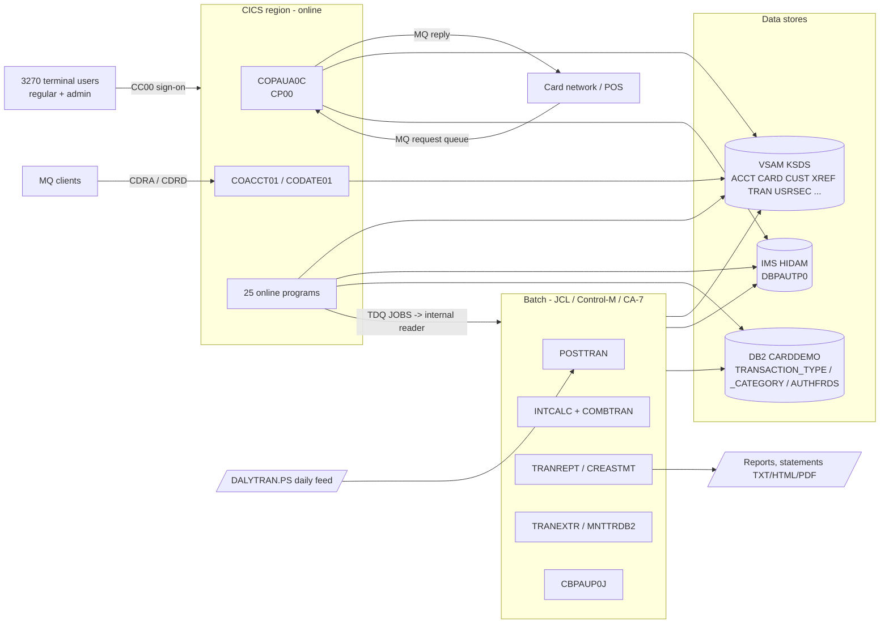
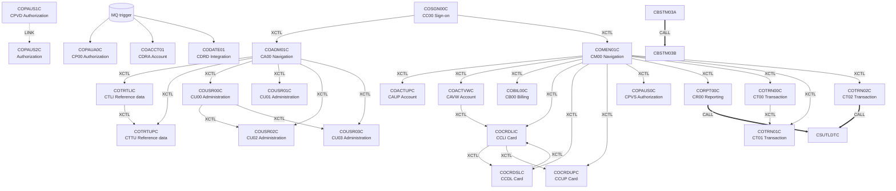
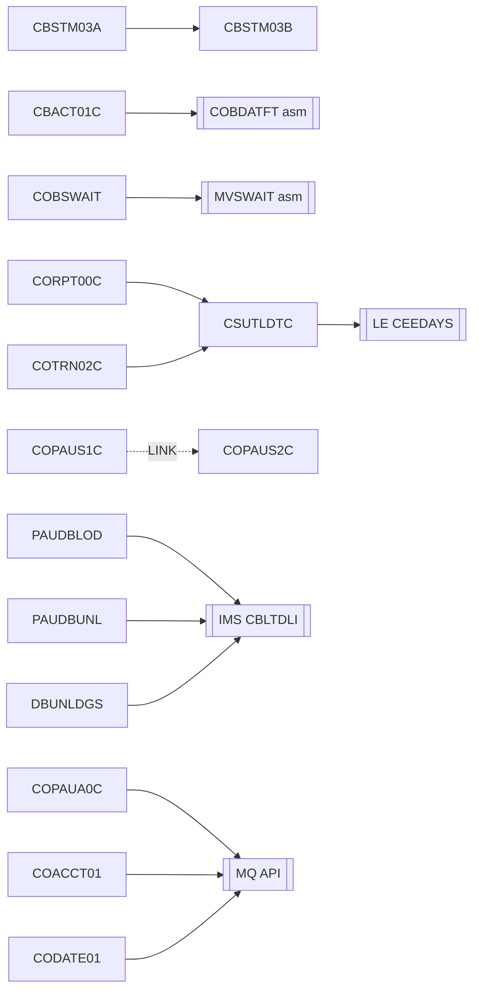
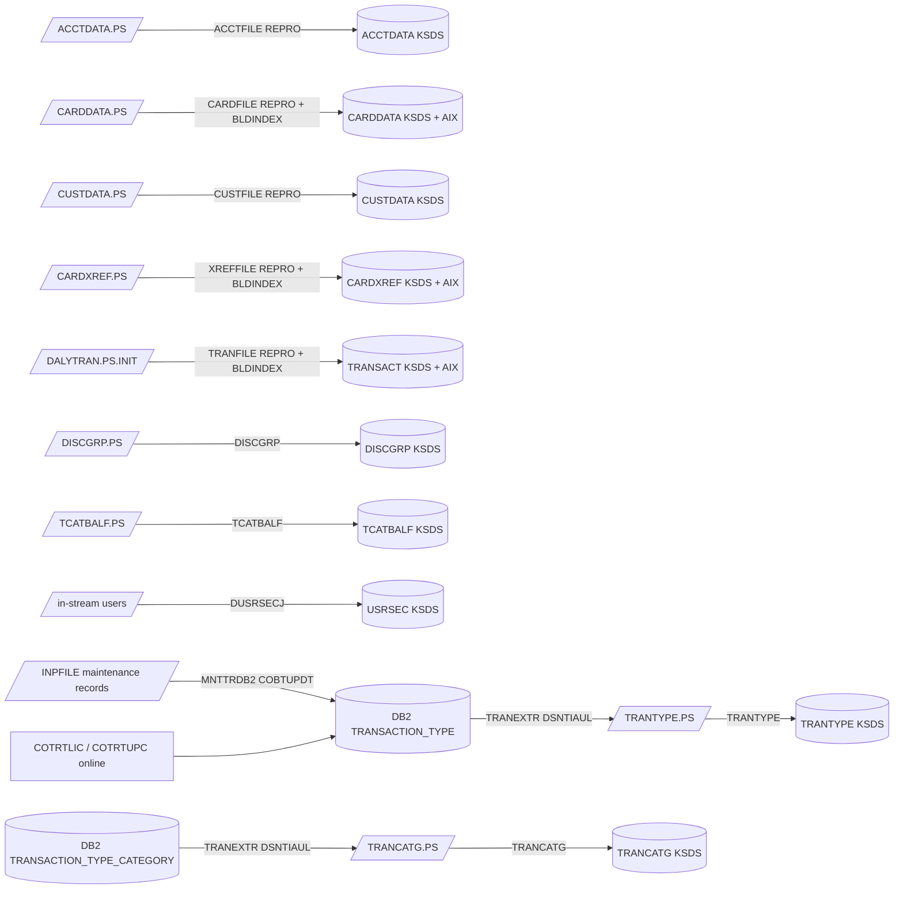
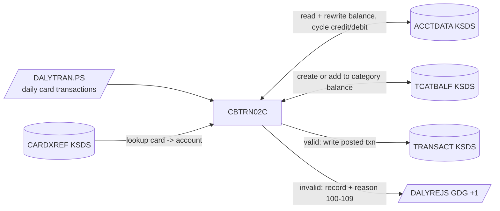
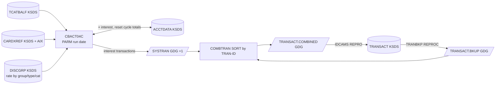
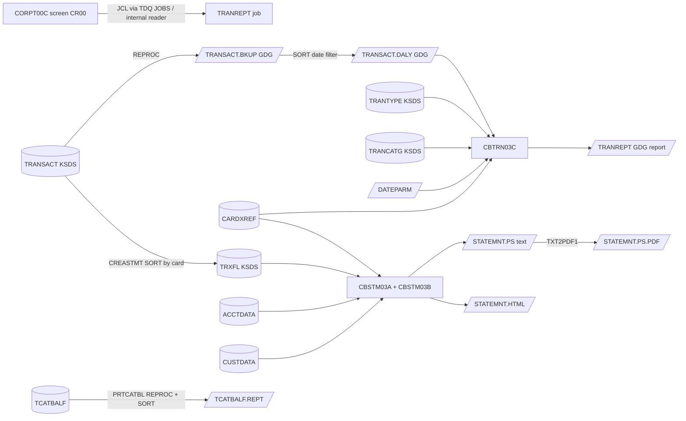
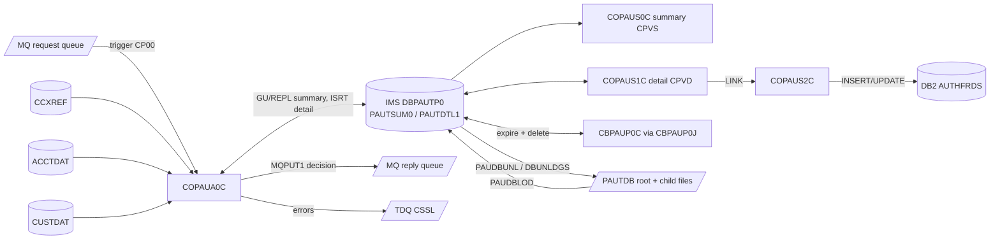
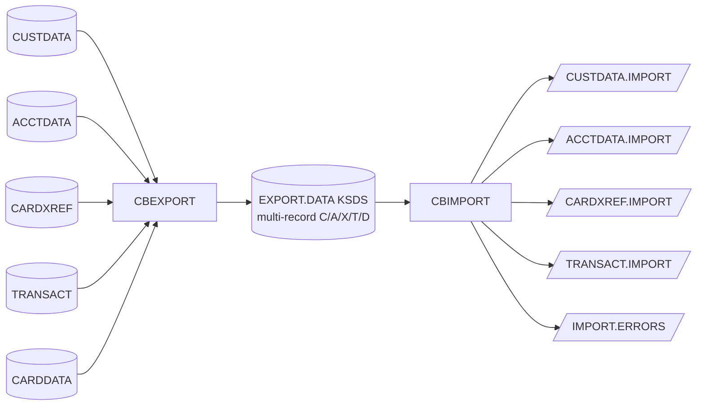
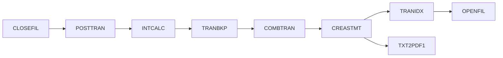

# CardDemo Dependency Map

> Call graph, screen navigation, program-to-data CRUD, job-to-dataset I/O and end-to-end data lineage for CardDemo. Built from `EXEC CICS XCTL/LINK/READ/WRITE...`, `CALL`, `EXEC SQL`, `EXEC DLI`/`CBLTDLI`, MQ API calls, `SELECT ... ASSIGN`/`OPEN` modes, JCL DD statements (DISP), IDCAMS control cards, CSD file definitions and scheduler chains. Dynamic targets (`XCTL PROGRAM(CDEMO-TO-PROGRAM)`) are resolved from the program-name literals each program moves into the COMMAREA and from the menu tables COMEN02Y / COADM02Y.

Companion documents: [APPLICATION_INVENTORY.md](APPLICATION_INVENTORY.md) | [DATA_DICTIONARY.md](DATA_DICTIONARY.md) | [HOTSPOT_REPORT.md](HOTSPOT_REPORT.md)

## 1. System Context

## 2. Online Call Graph (CICS program flow)

### 2.1 Navigation diagram

Every function screen returns to its menu (COMEN01C or COADM01C) on PF3 and to COSGN00C on session end; those return edges are omitted from the diagram for readability and listed in 2.2.

### 2.2 Transfer-of-control edges

| From | Tran | Type | To | Tran | Resolution |
|---|---|---|---|---|---|
| CBSTM03A |  | CALL | CBSTM03B |  | static literal |
| COACTUPC | CAUP | XCTL | COCRDLIC | CCLI | COMMAREA CDEMO-TO-PROGRAM / CCARD-NEXT-PROG |
| COACTUPC | CAUP | XCTL | COCRDSLC | CCDL | COMMAREA CDEMO-TO-PROGRAM / CCARD-NEXT-PROG |
| COACTUPC | CAUP | XCTL | COCRDUPC | CCUP | COMMAREA CDEMO-TO-PROGRAM / CCARD-NEXT-PROG |
| COACTUPC | CAUP | XCTL | COMEN01C | CM00 | COMMAREA CDEMO-TO-PROGRAM / CCARD-NEXT-PROG |
| COACTVWC | CAVW | XCTL | COCRDLIC | CCLI | COMMAREA CDEMO-TO-PROGRAM / CCARD-NEXT-PROG |
| COACTVWC | CAVW | XCTL | COCRDSLC | CCDL | COMMAREA CDEMO-TO-PROGRAM / CCARD-NEXT-PROG |
| COACTVWC | CAVW | XCTL | COCRDUPC | CCUP | COMMAREA CDEMO-TO-PROGRAM / CCARD-NEXT-PROG |
| COACTVWC | CAVW | XCTL | COMEN01C | CM00 | COMMAREA CDEMO-TO-PROGRAM / CCARD-NEXT-PROG |
| COADM01C | CA00 | XCTL | COSGN00C | CC00 | static literal |
| COADM01C | CA00 | XCTL | COTRTLIC | CTLI | menu table |
| COADM01C | CA00 | XCTL | COTRTUPC | CTTU | menu table |
| COADM01C | CA00 | XCTL | COUSR00C | CU00 | menu table |
| COADM01C | CA00 | XCTL | COUSR01C | CU01 | menu table |
| COADM01C | CA00 | XCTL | COUSR02C | CU02 | menu table |
| COADM01C | CA00 | XCTL | COUSR03C | CU03 | menu table |
| COBIL00C | CB00 | XCTL | COMEN01C | CM00 | static literal |
| COBIL00C | CB00 | XCTL | COSGN00C | CC00 | static literal |
| COCRDLIC | CCLI | XCTL | COCRDSLC | CCDL | COMMAREA CDEMO-TO-PROGRAM / CCARD-NEXT-PROG |
| COCRDLIC | CCLI | XCTL | COCRDUPC | CCUP | COMMAREA CDEMO-TO-PROGRAM / CCARD-NEXT-PROG |
| COCRDLIC | CCLI | XCTL | COMEN01C | CM00 | static literal |
| COCRDSLC | CCDL | XCTL | COCRDLIC | CCLI | COMMAREA CDEMO-TO-PROGRAM / CCARD-NEXT-PROG |
| COCRDSLC | CCDL | XCTL | COMEN01C | CM00 | COMMAREA CDEMO-TO-PROGRAM / CCARD-NEXT-PROG |
| COCRDUPC | CCUP | XCTL | COCRDLIC | CCLI | COMMAREA CDEMO-TO-PROGRAM / CCARD-NEXT-PROG |
| COCRDUPC | CCUP | XCTL | COCRDSLC | CCDL | COMMAREA CDEMO-TO-PROGRAM / CCARD-NEXT-PROG |
| COCRDUPC | CCUP | XCTL | COMEN01C | CM00 | COMMAREA CDEMO-TO-PROGRAM / CCARD-NEXT-PROG |
| COMEN01C | CM00 | XCTL | COACTUPC | CAUP | menu table |
| COMEN01C | CM00 | XCTL | COACTVWC | CAVW | menu table |
| COMEN01C | CM00 | XCTL | COBIL00C | CB00 | menu table |
| COMEN01C | CM00 | XCTL | COCRDLIC | CCLI | menu table |
| COMEN01C | CM00 | XCTL | COCRDSLC | CCDL | menu table |
| COMEN01C | CM00 | XCTL | COCRDUPC | CCUP | menu table |
| COMEN01C | CM00 | XCTL | COPAUS0C | CPVS | menu table |
| COMEN01C | CM00 | XCTL | CORPT00C | CR00 | menu table |
| COMEN01C | CM00 | XCTL | COSGN00C | CC00 | static literal |
| COMEN01C | CM00 | XCTL | COTRN00C | CT00 | menu table |
| COMEN01C | CM00 | XCTL | COTRN01C | CT01 | menu table |
| COMEN01C | CM00 | XCTL | COTRN02C | CT02 | menu table |
| COPAUS0C | CPVS | XCTL | COSGN00C | CC00 | static literal |
| COPAUS1C | CPVD | XCTL | COPAUS0C | CPVS | COMMAREA CDEMO-TO-PROGRAM / CCARD-NEXT-PROG |
| COPAUS1C | CPVD | LINK | COPAUS2C |  | static literal |
| CORPT00C | CR00 | XCTL | COMEN01C | CM00 | static literal |
| CORPT00C | CR00 | XCTL | COSGN00C | CC00 | static literal |
| CORPT00C | CR00 | CALL | CSUTLDTC |  | static literal |
| COSGN00C | CC00 | XCTL | COADM01C | CA00 | static literal |
| COSGN00C | CC00 | XCTL | COMEN01C | CM00 | static literal |
| COTRN00C | CT00 | XCTL | COMEN01C | CM00 | static literal |
| COTRN00C | CT00 | XCTL | COSGN00C | CC00 | static literal |
| COTRN00C | CT00 | XCTL | COTRN01C | CT01 | static literal |
| COTRN01C | CT01 | XCTL | COMEN01C | CM00 | static literal |
| COTRN01C | CT01 | XCTL | COSGN00C | CC00 | static literal |
| COTRN01C | CT01 | XCTL | COTRN00C | CT00 | static literal |
| COTRN02C | CT02 | XCTL | COMEN01C | CM00 | static literal |
| COTRN02C | CT02 | XCTL | COSGN00C | CC00 | static literal |
| COTRN02C | CT02 | CALL | CSUTLDTC |  | static literal |
| COTRTLIC | CTLI | XCTL | COADM01C | CA00 | COMMAREA CDEMO-TO-PROGRAM / CCARD-NEXT-PROG |
| COTRTLIC | CTLI | XCTL | COTRTUPC | CTTU | static literal |
| COTRTUPC | CTTU | XCTL | COADM01C | CA00 | COMMAREA CDEMO-TO-PROGRAM / CCARD-NEXT-PROG |
| COTRTUPC | CTTU | XCTL | COTRTLIC | CTLI | COMMAREA CDEMO-TO-PROGRAM / CCARD-NEXT-PROG |
| COUSR00C | CU00 | XCTL | COADM01C | CA00 | static literal |
| COUSR00C | CU00 | XCTL | COSGN00C | CC00 | static literal |
| COUSR00C | CU00 | XCTL | COUSR02C | CU02 | static literal |
| COUSR00C | CU00 | XCTL | COUSR03C | CU03 | static literal |
| COUSR01C | CU01 | XCTL | COADM01C | CA00 | static literal |
| COUSR01C | CU01 | XCTL | COSGN00C | CC00 | static literal |
| COUSR02C | CU02 | XCTL | COADM01C | CA00 | static literal |
| COUSR02C | CU02 | XCTL | COSGN00C | CC00 | static literal |
| COUSR03C | CU03 | XCTL | COADM01C | CA00 | static literal |
| COUSR03C | CU03 | XCTL | COSGN00C | CC00 | static literal |

### 2.3 Static CALL graph (batch and utility)

| Caller | Callee | Callee kind |
|---|---|---|
| CBACT01C | CEE3ABD | LE service |
| CBACT01C | COBDATFT | Assembler |
| CBACT02C | CEE3ABD | LE service |
| CBACT03C | CEE3ABD | LE service |
| CBACT04C | CEE3ABD | LE service |
| CBCUS01C | CEE3ABD | LE service |
| CBEXPORT | CEE3ABD | LE service |
| CBIMPORT | CEE3ABD | LE service |
| CBSTM03A | CBSTM03B | COBOL |
| CBSTM03A | CEE3ABD | LE service |
| CBTRN01C | CEE3ABD | LE service |
| CBTRN02C | CEE3ABD | LE service |
| CBTRN03C | CEE3ABD | LE service |
| COACCT01 | MQCLOSE | MQ API |
| COACCT01 | MQGET | MQ API |
| COACCT01 | MQOPEN | MQ API |
| COACCT01 | MQPUT | MQ API |
| COBSWAIT | MVSWAIT | Assembler |
| CODATE01 | MQCLOSE | MQ API |
| CODATE01 | MQGET | MQ API |
| CODATE01 | MQOPEN | MQ API |
| CODATE01 | MQPUT | MQ API |
| COPAUA0C | MQCLOSE | MQ API |
| COPAUA0C | MQGET | MQ API |
| COPAUA0C | MQOPEN | MQ API |
| COPAUA0C | MQPUT1 | MQ API |
| CORPT00C | CSUTLDTC | COBOL |
| COTRN02C | CSUTLDTC | COBOL |
| CSUTLDTC | CEEDAYS | LE service |
| DBUNLDGS | CBLTDLI | IMS DL/I API |
| PAUDBLOD | CBLTDLI | IMS DL/I API |
| PAUDBUNL | CBLTDLI | IMS DL/I API |

All batch programs also call `CEE3ABD` (LE abend) on unrecoverable I/O errors.

## 3. Program -> Copybook Dependencies

Entity copybooks (X = COPY). Changing a column copybook impacts every marked program.

| Program | CVACT01Y | CVACT02Y | CVACT03Y | CVCUS01Y | CVTRA01Y | CVTRA02Y | CVTRA03Y | CVTRA04Y | CVTRA05Y | CVTRA06Y | CSUSR01Y | COCOM01Y | CIPAUSMY | CIPAUDTY | Other copybooks |
|---|---|---|---|---|---|---|---|---|---|---|---|---|---|---|---|
| CBACT01C | X |  |  |  |  |  |  |  |  |  |  |  |  |  | CODATECN |
| CBACT02C |  | X |  |  |  |  |  |  |  |  |  |  |  |  |  |
| CBACT03C |  |  | X |  |  |  |  |  |  |  |  |  |  |  |  |
| CBACT04C | X |  | X |  | X | X |  |  | X |  |  |  |  |  |  |
| CBCUS01C |  |  |  | X |  |  |  |  |  |  |  |  |  |  |  |
| CBEXPORT | X | X | X | X |  |  |  |  | X |  |  |  |  |  | CVEXPORT |
| CBIMPORT | X | X | X | X |  |  |  |  | X |  |  |  |  |  | CVEXPORT |
| CBPAUP0C |  |  |  |  |  |  |  |  |  |  |  |  | X | X |  |
| CBSTM03A | X |  | X |  |  |  |  |  |  |  |  |  |  |  | COSTM01, CUSTREC |
| CBSTM03B |  |  |  |  |  |  |  |  |  |  |  |  |  |  |  |
| CBTRN01C | X | X | X | X |  |  |  |  | X | X |  |  |  |  |  |
| CBTRN02C | X |  | X |  | X |  |  |  | X | X |  |  |  |  |  |
| CBTRN03C |  |  | X |  |  |  | X | X | X |  |  |  |  |  | CVTRA07Y |
| COACCT01 | X |  |  |  |  |  |  |  |  |  |  |  |  |  | CMQGMOV, CMQMDV, CMQODV, CMQPMOV, CMQTML, CMQV, PERFORM, REPLACING |
| COACTUPC | X |  | X | X |  |  |  |  |  |  | X | X |  |  | COACTUP, COTTL01Y, CSDAT01Y, CSLKPCDY, CSMSG01Y, CSMSG02Y, CSSETATY, CSSTRPFY, CSUTLDPY, CSUTLDWY, CVCRD01Y, DFHAID, DFHBMSCA |
| COACTVWC | X | X | X | X |  |  |  |  |  |  | X | X |  |  | COACTVW, COTTL01Y, CSDAT01Y, CSMSG01Y, CSMSG02Y, CSSTRPFY, CVCRD01Y, DFHAID, DFHBMSCA |
| COADM01C |  |  |  |  |  |  |  |  |  |  | X | X |  |  | COADM01, COADM02Y, COTTL01Y, CSDAT01Y, CSMSG01Y, DFHAID, DFHBMSCA |
| COBIL00C | X |  | X |  |  |  |  |  | X |  |  | X |  |  | COBIL00, COTTL01Y, CSDAT01Y, CSMSG01Y, DFHAID, DFHBMSCA |
| COBSWAIT |  |  |  |  |  |  |  |  |  |  |  |  |  |  |  |
| COBTUPDT |  |  |  |  |  |  |  |  |  |  |  |  |  |  |  |
| COCRDLIC |  | X |  |  |  |  |  |  |  |  | X | X |  |  | COCRDLI, COTTL01Y, CSDAT01Y, CSMSG01Y, CSSTRPFY, CVCRD01Y, DFHAID, DFHBMSCA |
| COCRDSLC |  | X |  | X |  |  |  |  |  |  | X | X |  |  | COCRDSL, COTTL01Y, CSDAT01Y, CSMSG01Y, CSMSG02Y, CSSTRPFY, CVCRD01Y, DFHAID, DFHBMSCA |
| COCRDUPC |  | X |  | X |  |  |  |  |  |  | X | X |  |  | COCRDUP, COTTL01Y, CSDAT01Y, CSMSG01Y, CSMSG02Y, CSSTRPFY, CVCRD01Y, DFHAID, DFHBMSCA |
| CODATE01 |  |  |  |  |  |  |  |  |  |  |  |  |  |  | CMQGMOV, CMQMDV, CMQODV, CMQPMOV, CMQTML, CMQV, PERFORM, REPLACING |
| COMEN01C |  |  |  |  |  |  |  |  |  |  | X | X |  |  | COMEN01, COMEN02Y, COTTL01Y, CSDAT01Y, CSMSG01Y, DFHAID, DFHBMSCA |
| COPAUA0C | X |  | X | X |  |  |  |  |  |  |  |  | X | X | CCPAUERY, CCPAURLY, CCPAURQY, CMQGMOV, CMQMDV, CMQODV, CMQPMOV, CMQTML, CMQV |
| COPAUS0C | X | X | X | X |  |  |  |  |  |  |  | X | X | X | COPAU00, COTTL01Y, CSDAT01Y, CSMSG01Y, CSMSG02Y, DFHAID, DFHBMSCA |
| COPAUS1C |  |  |  |  |  |  |  |  |  |  |  | X | X | X | COPAU01, COTTL01Y, CSDAT01Y, CSMSG01Y, CSMSG02Y, DFHAID, DFHBMSCA |
| COPAUS2C |  |  |  |  |  |  |  |  |  |  |  |  |  | X |  |
| CORPT00C |  |  |  |  |  |  |  |  | X |  |  | X |  |  | CORPT00, COTTL01Y, CSDAT01Y, CSMSG01Y, DFHAID, DFHBMSCA |
| COSGN00C |  |  |  |  |  |  |  |  |  |  | X | X |  |  | COSGN00, COTTL01Y, CSDAT01Y, CSMSG01Y, DFHAID, DFHBMSCA |
| COTRN00C |  |  |  |  |  |  |  |  | X |  |  | X |  |  | COTRN00, COTTL01Y, CSDAT01Y, CSMSG01Y, DFHAID, DFHBMSCA |
| COTRN01C |  |  |  |  |  |  |  |  | X |  |  | X |  |  | COTRN01, COTTL01Y, CSDAT01Y, CSMSG01Y, DFHAID, DFHBMSCA |
| COTRN02C | X |  | X |  |  |  |  |  | X |  |  | X |  |  | COTRN02, COTTL01Y, CSDAT01Y, CSMSG01Y, DFHAID, DFHBMSCA |
| COTRTLIC |  | X |  |  |  |  |  |  |  |  | X | X |  |  | COTRTLI, COTTL01Y, CSDAT01Y, CSMSG01Y, CSSTRPFY, CVCRD01Y, DFHAID, DFHBMSCA |
| COTRTUPC |  |  |  |  |  |  |  |  |  |  | X | X |  |  | COTRTUP, COTTL01Y, CSDAT01Y, CSMSG01Y, CSMSG02Y, CSSETATY, CSSTRPFY, CSUTLDWY, CVCRD01Y, DFHAID, DFHBMSCA |
| COUSR00C |  |  |  |  |  |  |  |  |  |  | X | X |  |  | COTTL01Y, COUSR00, CSDAT01Y, CSMSG01Y, DFHAID, DFHBMSCA |
| COUSR01C |  |  |  |  |  |  |  |  |  |  | X | X |  |  | COTTL01Y, COUSR01, CSDAT01Y, CSMSG01Y, DFHAID, DFHBMSCA |
| COUSR02C |  |  |  |  |  |  |  |  |  |  | X | X |  |  | COTTL01Y, COUSR02, CSDAT01Y, CSMSG01Y, DFHAID, DFHBMSCA |
| COUSR03C |  |  |  |  |  |  |  |  |  |  | X | X |  |  | COTTL01Y, COUSR03, CSDAT01Y, CSMSG01Y, DFHAID, DFHBMSCA |
| CSUTLDTC |  |  |  |  |  |  |  |  |  |  |  |  |  |  |  |
| DBUNLDGS |  |  |  |  |  |  |  |  |  |  |  |  | X | X | IMSFUNCS, PADFLPCB, PASFLPCB, PAUTBPCB |
| PAUDBLOD |  |  |  |  |  |  |  |  |  |  |  |  | X | X | IMSFUNCS, PAUTBPCB |
| PAUDBUNL |  |  |  |  |  |  |  |  |  |  |  |  | X | X | IMSFUNCS, PAUTBPCB |

**Highest fan-in copybooks**: COCOM01Y (21), COTTL01Y (21), CSDAT01Y (21), CSMSG01Y (21), DFHAID (21), DFHBMSCA (21), CVACT01Y (14), CVACT03Y (14), CSUSR01Y (14), CVTRA05Y (11), CVCUS01Y (10), CVACT02Y (10)

## 4. Online Program -> Data Store CRUD Matrix

C = create/insert, R = read/browse, U = update/rewrite, D = delete, L = READ UPDATE lock without rewrite.

| Program | Tran | ACCTDAT | CUSTDAT | CARDDAT | CARDAIX | CCXREF | CXACAIX | TRANSACT | USRSEC | IMS PAUTDB | DB2 TRANSACTION_TYPE | DB2 AUTHFRDS | MQ | TDQ |
|---|---|---|---|---|---|---|---|---|---|---|---|---|---|---|
| COPAUA0C | CP00 | R | R |  |  | R |  |  |  | CRU |  |  | CR | CSSL |
| COPAUS0C | CPVS | R | R |  |  |  | R |  |  | R |  |  |  |  |
| COPAUS1C | CPVD |  |  |  |  |  |  |  |  | RU |  |  |  |  |
| COPAUS2C |  |  |  |  |  |  |  |  |  |  |  | CU |  |  |
| COTRTLIC | CTLI |  |  |  |  |  |  |  |  |  | RUD |  |  |  |
| COTRTUPC | CTTU |  |  |  |  |  |  |  |  |  | CRUD |  |  |  |
| COACCT01 | CDRA | R |  |  |  |  |  |  |  |  |  |  | CR |  |
| CODATE01 | CDRD |  |  |  |  |  |  |  |  |  |  |  | CR |  |
| COACTUPC | CAUP | RU | RU |  |  |  | R |  |  |  |  |  |  |  |
| COACTVWC | CAVW | R | R |  |  |  | R |  |  |  |  |  |  |  |
| COADM01C | CA00 |  |  |  |  |  |  |  |  |  |  |  |  |  |
| COBIL00C | CB00 | RU |  |  |  |  | R | CR |  |  |  |  |  |  |
| COCRDLIC | CCLI |  |  | R |  |  |  |  |  |  |  |  |  |  |
| COCRDSLC | CCDL |  |  | R | R |  |  |  |  |  |  |  |  |  |
| COCRDUPC | CCUP |  |  | RU |  |  |  |  |  |  |  |  |  |  |
| COMEN01C | CM00 |  |  |  |  |  |  |  |  |  |  |  |  |  |
| CORPT00C | CR00 |  |  |  |  |  |  |  |  |  |  |  |  | JOBS |
| COSGN00C | CC00 |  |  |  |  |  |  |  | R |  |  |  |  |  |
| COTRN00C | CT00 |  |  |  |  |  |  | R |  |  |  |  |  |  |
| COTRN01C | CT01 |  |  |  |  |  |  | RL |  |  |  |  |  |  |
| COTRN02C | CT02 |  |  |  |  | R | R | CR |  |  |  |  |  |  |
| COUSR00C | CU00 |  |  |  |  |  |  |  | R |  |  |  |  |  |
| COUSR01C | CU01 |  |  |  |  |  |  |  | C |  |  |  |  |  |
| COUSR02C | CU02 |  |  |  |  |  |  |  | RU |  |  |  |  |  |
| COUSR03C | CU03 |  |  |  |  |  |  |  | RD |  |  |  |  |  |

| CICS file | Dataset |
|---|---|
| ACCTDAT | AWS.M2.CARDDEMO.ACCTDATA.VSAM.KSDS |
| CARDAIX | AWS.M2.CARDDEMO.CARDDATA.VSAM.AIX.PATH |
| CARDDAT | AWS.M2.CARDDEMO.CARDDATA.VSAM.KSDS |
| CCXREF | AWS.M2.CARDDEMO.CARDXREF.VSAM.KSDS |
| CUSTDAT | AWS.M2.CARDDEMO.CUSTDATA.VSAM.KSDS |
| CXACAIX | AWS.M2.CARDDEMO.CARDXREF.VSAM.AIX.PATH |
| TRANSACT | AWS.M2.CARDDEMO.TRANSACT.VSAM.KSDS |
| USRSEC | AWS.M2.CARDDEMO.USRSEC.VSAM.KSDS |

## 5. Batch Job -> Dataset I/O

Dataset names are shown without the `AWS.M2.CARDDEMO.` high-level qualifier; GDG relative generations are folded into the base. "Define/Delete" covers IDCAMS DEFINE/DELETE and IEFBR14 DISP=(MOD,DELETE) clean-up.

| Job | Category | Programs | Reads | Writes / updates | Defines / deletes |
|---|---|---|---|---|---|
| **ACCTFILE** | Data load (VSAM provisioning) | IDCAMS | ACCTDATA.PS | ACCTDATA.VSAM.KSDS | ACCTDATA.VSAM.KSDS |
| **CARDFILE** | Data load (VSAM provisioning) | SDSF, IDCAMS | CARDDATA.PS CARDDATA.VSAM.KSDS | CARDDATA.VSAM.AIX CARDDATA.VSAM.KSDS | CARDDATA.VSAM.AIX CARDDATA.VSAM.KSDS |
| **CBEXPORT** | Data migration | IDCAMS, CBEXPORT | ACCTDATA.VSAM.KSDS CARDDATA.VSAM.KSDS CARDXREF.VSAM.KSDS CUSTDATA.VSAM.KSDS TRANSACT.VSAM.KSDS | EXPORT.DATA | EXPORT.DATA |
| **CBIMPORT** | Data migration | CBIMPORT | EXPORT.DATA | ACCTDATA.IMPORT CARDXREF.IMPORT CUSTDATA.IMPORT IMPORT.ERRORS TRANSACT.IMPORT |  |
| **CBPAUP0J** | Business batch (IMS) | DFSRRC00 (BMP CBPAUP0C) | IMS PAUTDB | IMS PAUTDB |  |
| **COMBTRAN** | Business batch | SORT, IDCAMS | SYSTRAN TRANSACT.BKUP TRANSACT.COMBINED | TRANSACT.COMBINED TRANSACT.VSAM.KSDS |  |
| **CREADB2** | DB2 setup | IKJEFT01, IEFBR14 | &LBNM..CNTL(DB2CREAT) &LBNM..CNTL(DB2LTCAT) &LBNM..CNTL(DB2LTTYP) |  |  |
| **CREASTMT** | Reporting | IDCAMS, SORT, IEFBR14, CBSTM03A | ACCTDATA.VSAM.KSDS CARDXREF.VSAM.KSDS CUSTDATA.VSAM.KSDS TRANSACT.VSAM.KSDS TRXFL.SEQ TRXFL.VSAM.KSDS | STATEMNT.HTML TRXFL.SEQ TRXFL.VSAM.KSDS | STATEMNT.HTML STATEMNT.PS TRXFL.SEQ TRXFL.VSAM.KSDS |
| **CUSTFILE** | Data load (VSAM provisioning) | SDSF, IDCAMS | CUSTDATA.PS | CUSTDATA.VSAM.KSDS | CUSTDATA.VSAM.KSDS |
| **DBPAUTP0** | IMS database utility | IEFBR14, DFSRRC00 | IMS PAUTDB | IMSDATA.DBPAUTP0 | IMSDATA.DBPAUTP0 |
| **DEFCUST** | Data load (VSAM provisioning) | IDCAMS |  |  | AWS.CCDA.CUSTDATA.CLUSTER AWS.CUSTDATA.CLUSTER |
| **DEFGDGD** | Data load (VSAM provisioning) | IDCAMS, IEBGENER | DISCGRP.PS TRANCATG.PS TRANTYPE.PS | DISCGRP.BKUP TRANCATG.PS.BKUP TRANTYPE.BKUP |  |
| **DISCGRP** | Data load (VSAM provisioning) | IDCAMS | DISCGRP.PS | DISCGRP.VSAM.KSDS | DISCGRP.VSAM.KSDS |
| **DUSRSECJ** | Data load (VSAM provisioning) | IEFBR14, IEBGENER, IDCAMS | USRSEC.PS | USRSEC.PS USRSEC.VSAM.KSDS | USRSEC.PS USRSEC.VSAM.KSDS |
| **ESDSRRDS** | Data load (VSAM provisioning) | IEFBR14, IEBGENER, IDCAMS | ESDSRRDS.PS | ESDSRRDS.PS USRSEC.VSAM.ESDS USRSEC.VSAM.RRDS | ESDSRRDS.PS USRSEC.VSAM.ESDS USRSEC.VSAM.RRDS |
| **INTCALC** | Business batch | CBACT04C | CARDXREF.VSAM.AIX.PATH CARDXREF.VSAM.KSDS DISCGRP.VSAM.KSDS TCATBALF.VSAM.KSDS | ACCTDATA.VSAM.KSDS SYSTRAN |  |
| **INTRDRJ1** | Utility / integration | IDCAMS, IEBGENER | AWS.M2.CARDEMO.FTP.TEST JCL(INTRDRJ2) | AWS.M2.CARDEMO.FTP.TEST.BKUP |  |
| **INTRDRJ2** | Utility / integration | IDCAMS | AWS.M2.CARDEMO.FTP.TEST.BKUP | AWS.M2.CARDEMO.FTP.TEST.BKUP.INTRDR |  |
| **LOADPADB** | IMS database utility | DFSRRC00 (BMP PAUDBLOD) | PAUTDB.CHILD.FILEO PAUTDB.ROOT.FILEO | IMS PAUTDB |  |
| **MNTTRDB2** | Business batch (DB2) | IKJEFT01 (DSN RUN COBTUPDT) | INPFILE | DB2 TRANSACTION_TYPE |  |
| **POSTTRAN** | Business batch | CBTRN02C | CARDXREF.VSAM.KSDS DALYTRAN.PS | ACCTDATA.VSAM.KSDS DALYREJS TCATBALF.VSAM.KSDS TRANSACT.VSAM.KSDS |  |
| **PRTCATBL** | Reporting | IEFBR14, PROC REPROC, SORT | TCATBALF.BKUP TCATBALF.VSAM.KSDS | TCATBALF.BKUP TCATBALF.REPT | TCATBALF.REPT |
| **READACCT** | Utility / diagnostics | IEFBR14, CBACT01C | ACCTDATA.VSAM.KSDS | ACCTDATA.ARRYPS ACCTDATA.PSCOMP ACCTDATA.VBPS | ACCTDATA.ARRYPS ACCTDATA.PSCOMP ACCTDATA.VBPS |
| **READCARD** | Utility / diagnostics | CBACT02C | CARDDATA.VSAM.KSDS |  |  |
| **READCUST** | Utility / diagnostics | CBCUS01C | CUSTDATA.VSAM.KSDS |  |  |
| **READXREF** | Utility / diagnostics | CBACT03C | CARDXREF.VSAM.KSDS |  |  |
| **TCATBALF** | Data load (VSAM provisioning) | IDCAMS | TCATBALF.PS | TCATBALF.VSAM.KSDS | TCATBALF.VSAM.KSDS |
| **TRANBKP** | Business batch | PROC REPROC, IDCAMS | TRANSACT.VSAM.KSDS | TRANSACT.BKUP | TRANSACT.VSAM.AIX TRANSACT.VSAM.KSDS |
| **TRANCATG** | Data load (VSAM provisioning) | IDCAMS | TRANCATG.PS | TRANCATG.VSAM.KSDS | TRANCATG.VSAM.KSDS |
| **TRANEXTR** | DB2 extract | IEBGENER, IEFBR14, IKJEFT01 (DSN RUN DSNTIAUL) | TRANCATG.PS TRANTYPE.PS | TRANCATG.PS TRANCATG.PS.BKUP TRANTYPE.BKUP TRANTYPE.PS | TRANCATG.PS TRANTYPE.PS |
| **TRANFILE** | Data load (VSAM provisioning) | SDSF, IDCAMS | DALYTRAN.PS.INIT TRANSACT.VSAM.KSDS | TRANSACT.VSAM.AIX TRANSACT.VSAM.KSDS | TRANSACT.VSAM.AIX TRANSACT.VSAM.KSDS |
| **TRANIDX** | Data load (VSAM provisioning) | IDCAMS | TRANSACT.VSAM.KSDS | TRANSACT.VSAM.AIX | TRANSACT.VSAM.AIX |
| **TRANREPT** | Reporting | PROC REPROC, SORT, CBTRN03C | CARDXREF.VSAM.KSDS DATEPARM TRANCATG.VSAM.KSDS TRANSACT.BKUP TRANSACT.DALY TRANSACT.VSAM.KSDS TRANTYPE.VSAM.KSDS | TRANREPT TRANSACT.BKUP TRANSACT.DALY |  |
| **TRANTYPE** | Data load (VSAM provisioning) | IDCAMS | TRANTYPE.PS | TRANTYPE.VSAM.KSDS | TRANTYPE.VSAM.KSDS |
| **TXT2PDF1** | Reporting | IKJEFT1B | STATEMNT.PS |  |  |
| **UNLDGSAM** | IMS database utility | DFSRRC00 (DLI DBUNLDGS) | IMS PAUTDB | PAUTDB.CHILD.GSAM PAUTDB.ROOT.GSAM |  |
| **UNLDPADB** | IMS database utility | IEFBR14, DFSRRC00 (DLI PAUDBUNL) | IMS PAUTDB | PAUTDB.CHILD.FILEO PAUTDB.ROOT.FILEO | PAUTDB.CHILD.FILEO PAUTDB.ROOT.FILEO |
| **XREFFILE** | Data load (VSAM provisioning) | IDCAMS | CARDXREF.PS CARDXREF.VSAM.KSDS | CARDXREF.VSAM.AIX CARDXREF.VSAM.KSDS | CARDXREF.VSAM.AIX CARDXREF.VSAM.KSDS |

### 5.1 Step-level detail for business batch

| Job | Step | Program / utility | Dataset | Access |
|---|---|---|---|---|
| CBPAUP0J | STEP01 | CBPAUP0C | IMS PAUTDB | RD |
| CREADB2 | CRCRDDB | IKJEFT01 | &LBNM..CNTL(DB2CREAT) | R |
| CREADB2 | RUNTEP2 | IKJEFT01 | &LBNM..CNTL(DB2LTTYP) | R |
| CREADB2 | LDTCCAT | IKJEFT01 | &LBNM..CNTL(DB2LTCAT) | R |
| MNTTRDB2 | STEP1 | COBTUPDT | DB2 TRANSACTION_TYPE | CUD |
| MNTTRDB2 | STEP1 | COBTUPDT | INPFILE | R |
| TRANEXTR | STEP10 | IEBGENER | TRANTYPE.PS | R |
| TRANEXTR | STEP10 | IEBGENER | TRANTYPE.BKUP | W |
| TRANEXTR | STEP20 | IEBGENER | TRANCATG.PS | R |
| TRANEXTR | STEP20 | IEBGENER | TRANCATG.PS.BKUP | W |
| TRANEXTR | STEP30 | IEFBR14 | TRANTYPE.PS | Delete |
| TRANEXTR | STEP30 | IEFBR14 | TRANCATG.PS | Delete |
| TRANEXTR | STEP40 | IKJEFT01 | TRANTYPE.PS | W |
| TRANEXTR | STEP50 | IKJEFT01 | TRANCATG.PS | W |
| CBEXPORT | STEP01 | IDCAMS | EXPORT.DATA | Define |
| CBEXPORT | STEP01 | IDCAMS | EXPORT.DATA | Delete |
| CBEXPORT | STEP02 | CBEXPORT | CUSTDATA.VSAM.KSDS | R |
| CBEXPORT | STEP02 | CBEXPORT | ACCTDATA.VSAM.KSDS | R |
| CBEXPORT | STEP02 | CBEXPORT | CARDXREF.VSAM.KSDS | R |
| CBEXPORT | STEP02 | CBEXPORT | TRANSACT.VSAM.KSDS | R |
| CBEXPORT | STEP02 | CBEXPORT | CARDDATA.VSAM.KSDS | R |
| CBEXPORT | STEP02 | CBEXPORT | EXPORT.DATA | W |
| CBIMPORT | STEP01 | CBIMPORT | EXPORT.DATA | R |
| CBIMPORT | STEP01 | CBIMPORT | CUSTDATA.IMPORT | W |
| CBIMPORT | STEP01 | CBIMPORT | ACCTDATA.IMPORT | W |
| CBIMPORT | STEP01 | CBIMPORT | CARDXREF.IMPORT | W |
| CBIMPORT | STEP01 | CBIMPORT | TRANSACT.IMPORT | W |
| CBIMPORT | STEP01 | CBIMPORT | IMPORT.ERRORS | W |
| COMBTRAN | STEP05R | SORT | TRANSACT.BKUP | R |
| COMBTRAN | STEP05R | SORT | SYSTRAN | R |
| COMBTRAN | STEP05R | SORT | TRANSACT.COMBINED | W |
| COMBTRAN | STEP10 | IDCAMS REPRO | TRANSACT.COMBINED | R |
| COMBTRAN | STEP10 | IDCAMS REPRO | TRANSACT.VSAM.KSDS | W |
| CREASTMT | DELDEF01 | IDCAMS | TRXFL.VSAM.KSDS | Define |
| CREASTMT | DELDEF01 | IDCAMS | TRXFL.SEQ | Delete |
| CREASTMT | DELDEF01 | IDCAMS | TRXFL.VSAM.KSDS | Delete |
| CREASTMT | STEP010 | SORT | TRANSACT.VSAM.KSDS | R |
| CREASTMT | STEP010 | SORT | TRXFL.SEQ | W |
| CREASTMT | STEP020 | IDCAMS REPRO | TRXFL.SEQ | R |
| CREASTMT | STEP020 | IDCAMS REPRO | TRXFL.VSAM.KSDS | W |
| CREASTMT | STEP030 | IEFBR14 | STATEMNT.HTML | Delete |
| CREASTMT | STEP030 | IEFBR14 | STATEMNT.PS | Delete |
| CREASTMT | STEP040 | CBSTM03A | TRXFL.VSAM.KSDS | R |
| CREASTMT | STEP040 | CBSTM03A | CARDXREF.VSAM.KSDS | R |
| CREASTMT | STEP040 | CBSTM03A | ACCTDATA.VSAM.KSDS | R |
| CREASTMT | STEP040 | CBSTM03A | CUSTDATA.VSAM.KSDS | R |
| CREASTMT | STEP040 | CBSTM03A | STATEMNT.HTML | W |
| INTCALC | STEP15 | CBACT04C | TCATBALF.VSAM.KSDS | R |
| INTCALC | STEP15 | CBACT04C | CARDXREF.VSAM.KSDS | R |
| INTCALC | STEP15 | CBACT04C | CARDXREF.VSAM.AIX.PATH | R |
| INTCALC | STEP15 | CBACT04C | ACCTDATA.VSAM.KSDS | RW |
| INTCALC | STEP15 | CBACT04C | DISCGRP.VSAM.KSDS | R |
| INTCALC | STEP15 | CBACT04C | SYSTRAN | W |
| POSTTRAN | STEP15 | CBTRN02C | TRANSACT.VSAM.KSDS | W |
| POSTTRAN | STEP15 | CBTRN02C | DALYTRAN.PS | R |
| POSTTRAN | STEP15 | CBTRN02C | CARDXREF.VSAM.KSDS | R |
| POSTTRAN | STEP15 | CBTRN02C | DALYREJS | W |
| POSTTRAN | STEP15 | CBTRN02C | ACCTDATA.VSAM.KSDS | RW |
| POSTTRAN | STEP15 | CBTRN02C | TCATBALF.VSAM.KSDS | RW |
| PRTCATBL | DELDEF | IEFBR14 | TCATBALF.REPT | Delete |
| PRTCATBL | STEP05R |  | TCATBALF.VSAM.KSDS | R |
| PRTCATBL | STEP05R |  | TCATBALF.BKUP | W |
| PRTCATBL | STEP05R | REPROC | TCATBALF.VSAM.KSDS | R |
| PRTCATBL | STEP05R | REPROC | TCATBALF.BKUP | W |
| PRTCATBL | STEP10R | SORT | TCATBALF.BKUP | R |
| PRTCATBL | STEP10R | SORT | TCATBALF.REPT | W |
| TRANBKP | STEP05R |  | TRANSACT.VSAM.KSDS | R |
| TRANBKP | STEP05R |  | TRANSACT.BKUP | W |
| TRANBKP | STEP05R | REPROC | TRANSACT.VSAM.KSDS | R |
| TRANBKP | STEP05R | REPROC | TRANSACT.BKUP | W |
| TRANBKP | STEP05 | IDCAMS | TRANSACT.VSAM.KSDS | Delete |
| TRANBKP | STEP05 | IDCAMS | TRANSACT.VSAM.AIX | Delete |
| TRANBKP | STEP10 | IDCAMS | TRANSACT.VSAM.KSDS | Define |
| TRANREPT | STEP05R |  | TRANSACT.VSAM.KSDS | R |
| TRANREPT | STEP05R |  | TRANSACT.BKUP | W |
| TRANREPT | STEP05R | REPROC | TRANSACT.VSAM.KSDS | R |
| TRANREPT | STEP05R | REPROC | TRANSACT.BKUP | W |
| TRANREPT | STEP05R | SORT | TRANSACT.BKUP | R |
| TRANREPT | STEP05R | SORT | TRANSACT.DALY | W |
| TRANREPT | STEP10R | CBTRN03C | TRANSACT.DALY | R |
| TRANREPT | STEP10R | CBTRN03C | CARDXREF.VSAM.KSDS | R |
| TRANREPT | STEP10R | CBTRN03C | TRANTYPE.VSAM.KSDS | R |
| TRANREPT | STEP10R | CBTRN03C | TRANCATG.VSAM.KSDS | R |
| TRANREPT | STEP10R | CBTRN03C | DATEPARM | R |
| TRANREPT | STEP10R | CBTRN03C | TRANREPT | W |
| TXT2PDF1 | TXT2PDF | IKJEFT1B | STATEMNT.PS | R |

## 6. Data Lineage by Dataset (producers and consumers)

| Dataset / store | Written by jobs | Written by online programs | Read by jobs | Read by online programs |
|---|---|---|---|---|
| `ACCTDATA.VSAM.KSDS` | ACCTFILE, INTCALC, POSTTRAN | COACTUPC, COBIL00C | CBEXPORT, CREASTMT, INTCALC, POSTTRAN, READACCT | COACCT01, COACTUPC, COACTVWC, COBIL00C, COPAUA0C, COPAUS0C |
| `TRANSACT.VSAM.KSDS` | COMBTRAN, POSTTRAN, TRANFILE | COBIL00C, COTRN02C | CBEXPORT, CREASTMT, TRANBKP, TRANFILE, TRANIDX, TRANREPT | COBIL00C, COTRN00C, COTRN01C, COTRN02C |
| `CARDXREF.VSAM.KSDS` | XREFFILE |  | CBEXPORT, CREASTMT, INTCALC, POSTTRAN, READXREF, TRANREPT, XREFFILE | COACTUPC, COACTVWC, COBIL00C, COPAUA0C, COPAUS0C, COTRN02C |
| `IMS PAUTDB` | CBPAUP0J, LOADPADB | COPAUA0C, COPAUS1C | CBPAUP0J, DBPAUTP0, UNLDGSAM, UNLDPADB | COPAUA0C, COPAUS0C, COPAUS1C |
| `CUSTDATA.VSAM.KSDS` | CUSTFILE | COACTUPC | CBEXPORT, CREASTMT, READCUST | COACTUPC, COACTVWC, COPAUA0C, COPAUS0C |
| `CARDDATA.VSAM.KSDS` | CARDFILE | COCRDUPC | CARDFILE, CBEXPORT, READCARD | COCRDLIC, COCRDSLC, COCRDUPC |
| `USRSEC.VSAM.KSDS` | DUSRSECJ | COUSR01C, COUSR02C, COUSR03C |  | COSGN00C, COUSR00C, COUSR02C, COUSR03C |
| `DB2 TRANSACTION_TYPE` | MNTTRDB2 | COTRTLIC, COTRTUPC |  | COTRTLIC, COTRTUPC |
| `TCATBALF.VSAM.KSDS` | POSTTRAN, TCATBALF |  | INTCALC, POSTTRAN, PRTCATBL |  |
| `TRANCATG.PS` | TRANEXTR |  | DEFGDGD, TRANCATG, TRANEXTR |  |
| `TRANSACT.BKUP` | TRANBKP, TRANREPT |  | COMBTRAN, TRANREPT |  |
| `TRANTYPE.PS` | TRANEXTR |  | DEFGDGD, TRANEXTR, TRANTYPE |  |
| `AWS.M2.CARDEMO.FTP.TEST.BKUP` | INTRDRJ1 |  | INTRDRJ2 |  |
| `DISCGRP.PS` |  |  | DEFGDGD, DISCGRP |  |
| `DISCGRP.VSAM.KSDS` | DISCGRP |  | INTCALC |  |
| `ESDSRRDS.PS` | ESDSRRDS |  | ESDSRRDS |  |
| `EXPORT.DATA` | CBEXPORT |  | CBIMPORT |  |
| `PAUTDB.CHILD.FILEO` | UNLDPADB |  | LOADPADB |  |
| `PAUTDB.ROOT.FILEO` | UNLDPADB |  | LOADPADB |  |
| `SYSTRAN` | INTCALC |  | COMBTRAN |  |
| `TCATBALF.BKUP` | PRTCATBL |  | PRTCATBL |  |
| `TRANCATG.PS.BKUP` | DEFGDGD, TRANEXTR |  |  |  |
| `TRANCATG.VSAM.KSDS` | TRANCATG |  | TRANREPT |  |
| `TRANSACT.COMBINED` | COMBTRAN |  | COMBTRAN |  |
| `TRANSACT.DALY` | TRANREPT |  | TRANREPT |  |
| `TRANSACT.VSAM.AIX` | TRANFILE, TRANIDX |  |  |  |
| `TRANTYPE.BKUP` | DEFGDGD, TRANEXTR |  |  |  |
| `TRANTYPE.VSAM.KSDS` | TRANTYPE |  | TRANREPT |  |
| `TRXFL.SEQ` | CREASTMT |  | CREASTMT |  |
| `TRXFL.VSAM.KSDS` | CREASTMT |  | CREASTMT |  |
| `USRSEC.PS` | DUSRSECJ |  | DUSRSECJ |  |
| `ACCTDATA.ARRYPS` | READACCT |  |  |  |
| `ACCTDATA.IMPORT` | CBIMPORT |  |  |  |
| `ACCTDATA.PS` |  |  | ACCTFILE |  |
| `ACCTDATA.PSCOMP` | READACCT |  |  |  |
| `ACCTDATA.VBPS` | READACCT |  |  |  |
| `AWS.M2.CARDEMO.FTP.TEST` |  |  | INTRDRJ1 |  |
| `AWS.M2.CARDEMO.FTP.TEST.BKUP.INTRDR` | INTRDRJ2 |  |  |  |
| `CARDDATA.PS` |  |  | CARDFILE |  |
| `CARDDATA.VSAM.AIX` | CARDFILE |  |  |  |
| `CARDXREF.IMPORT` | CBIMPORT |  |  |  |
| `CARDXREF.PS` |  |  | XREFFILE |  |
| `CARDXREF.VSAM.AIX` | XREFFILE |  |  |  |
| `CARDXREF.VSAM.AIX.PATH` |  |  | INTCALC |  |
| `CUSTDATA.IMPORT` | CBIMPORT |  |  |  |
| `CUSTDATA.PS` |  |  | CUSTFILE |  |
| `DALYREJS` | POSTTRAN |  |  |  |
| `DALYTRAN.PS` |  |  | POSTTRAN |  |
| `DALYTRAN.PS.INIT` |  |  | TRANFILE |  |
| `DATEPARM` |  |  | TRANREPT |  |
| `DB2 AUTHFRDS` |  | COPAUS2C |  |  |
| `DISCGRP.BKUP` | DEFGDGD |  |  |  |
| `IMPORT.ERRORS` | CBIMPORT |  |  |  |
| `IMSDATA.DBPAUTP0` | DBPAUTP0 |  |  |  |
| `INPFILE` |  |  | MNTTRDB2 |  |
| `JCL(INTRDRJ2)` |  |  | INTRDRJ1 |  |
| `PAUTDB.CHILD.GSAM` | UNLDGSAM |  |  |  |
| `PAUTDB.ROOT.GSAM` | UNLDGSAM |  |  |  |
| `STATEMNT.HTML` | CREASTMT |  |  |  |
| `STATEMNT.PS` |  |  | TXT2PDF1 |  |
| `TCATBALF.PS` |  |  | TCATBALF |  |
| `TCATBALF.REPT` | PRTCATBL |  |  |  |
| `TRANREPT` | TRANREPT |  |  |  |
| `TRANSACT.IMPORT` | CBIMPORT |  |  |  |
| `USRSEC.VSAM.ESDS` | ESDSRRDS |  |  |  |
| `USRSEC.VSAM.RRDS` | ESDSRRDS |  |  |  |

## 7. End-to-End Data Lineage Flows

### 7.1 Initial load / refresh of masters

### 7.2 Daily transaction posting (POSTTRAN / CBTRN02C)

### 7.3 Monthly interest cycle (INTCALC -> COMBTRAN)

### 7.4 Reporting and statements

### 7.5 Card authorization (optional IMS/DB2/MQ module)

### 7.6 Branch migration (export / import)

Note: CBIMPORT opens a CARDOUT file but CBIMPORT.jcl has no CARDOUT DD - card records cannot be written as provided.

## 8. Job Scheduling Dependencies

### 8.1 Control-M (`app/scheduler/CardDemo.controlm`)

- **Daily (Control-M "TransactionBackup")**: CLOSEFIL -> TRANBKP -> WAITSTEP -> OPENFIL
- **Weekly (Control-M "TransactionTypesDBRefresh")**: MNTTRDB2 -> TRANEXTR
- **Weekly (Control-M "DisclosureGroupsRefresh")**: CLOSEFIL -> DISCGRP -> WAITSTEP -> OPENFIL
- **Monthly (Control-M "InterestCalculation")**: CLOSEFIL -> INTCALC -> COMBTRAN -> WAITSTEP -> OPENFIL

### 8.2 CA-7 trigger chains (`app/scheduler/CardDemo.ca7`)

- CLOSEFIL -> CBPAUP0J -> POSTTRAN -> WAITSTEP -> OPENFIL
- TRANTYPE / TRANCATG / TCATBALF reference reloads triggered after CLOSEFIL variants (CLOSEFIL1 / CLOSEFIL2), each followed by WAITSTEP -> OPENFIL
- CLOSEFIL -> READACCT -> READCARD -> READCUST -> READXREF -> WAITSTEP -> OPENFIL
- CREASTMT -> TXT2PDF1 -> WAITSTEP -> OPENFIL
- CLOSEFIL -> PRTCATBL -> WAITSTEP -> OPENFIL

### 8.3 README full-batch order

CLOSEFIL -> ACCTFILE -> CARDFILE -> XREFFILE -> CUSTFILE -> TRANBKP -> (TRANEXTR) -> TRANCATG -> TRANTYPE -> DISCGRP -> TCATBALF -> DUSRSECJ -> **POSTTRAN** -> **INTCALC** -> TRANBKP -> **COMBTRAN** -> **CREASTMT** -> TRANIDX -> OPENFIL (also scripted in `scripts/run_full_batch.sh`).

**Online/batch coupling**: batch jobs that update ACCTDATA, CARDDATA, CUSTDATA, CARDXREF and TRANSACT require CICS files to be closed first (CLOSEFIL / OPENFIL via SDSF `CEMT SET FIL ... CLO/OPE`). There is no record-level sharing (RLSACCESS(NO) in the CSD), so batch windows mean online downtime.

## 9. External Interfaces

| Interface | Direction | Mechanism | Producer -> Consumer |
|---|---|---|---|
| Daily transaction feed | Inbound | Sequential file DALYTRAN.PS | Card network extract -> POSTTRAN |
| Card authorization | Inbound / outbound | IBM MQ request/reply (trigger) | Network/POS -> COPAUA0C -> reply queue |
| Account / date inquiry | Inbound / outbound | IBM MQ request/reply | MQ client -> COACCT01 / CODATE01 |
| Online report submission | Internal | CICS TD queue JOBS -> JES internal reader | CORPT00C -> TRANREPT job |
| Error log | Internal | CICS TD queue CSSL | COPAUA0C -> operations |
| Statements | Outbound | Text, HTML and PDF datasets | CREASTMT/TXT2PDF1 -> print/e-delivery |
| Branch migration | Outbound / inbound | Multi-record export file | CBEXPORT -> CBIMPORT |
| FTP | Outbound | z/OS FTP client | FTPJCL -> remote host |
