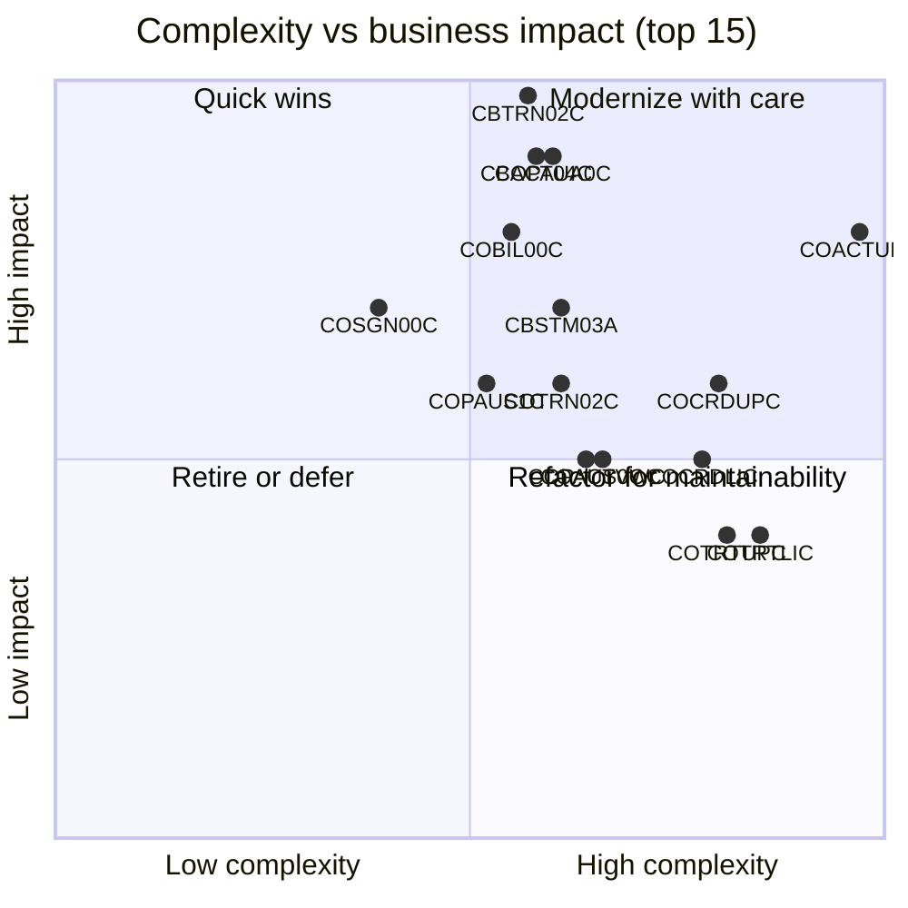

# CardDemo Hotspot Report - Top 10 Modernization Priorities

> Ranks all 44 COBOL programs by a weighted score of **complexity** (measured), **risk** (technical / operational / security findings from source) and **business impact** (financial and customer criticality). Use it to sequence modernization: the top modules need the most characterization testing and design attention; low-complexity / high-impact modules are quick wins.

Companion documents: [APPLICATION_INVENTORY.md](APPLICATION_INVENTORY.md) | [DATA_DICTIONARY.md](DATA_DICTIONARY.md) | [DEPENDENCY_MAP.md](DEPENDENCY_MAP.md)

## 1. Scoring Model

| Dimension | Weight | How it is computed (0-10) |
|---|---|---|
| Complexity | 40% | Min-max normalised (log scale) across the 44 programs: LOC 30%, cyclomatic complexity 35%, GO TO count 15%, data/copybook fan-out (copybooks + files + tables) 10%, IF/EVALUATE nesting 10% |
| Risk | 30% | Sum of risk findings in the source (points 1-3 each, capped at 10): legacy constructs (ALTER, GO TO, pointer/control-block access), multi-resource-manager transactions, non-idempotent batch, concurrency/ID-generation races, security (plain-text passwords, PII/PCI), known defects / stubs, hard-coded values; +1 when the program mixes 2+ of CICS/DB2/IMS/MQ |
| Business impact | 30% | Analyst rating: 10 = moves money or decides on every card transaction, 7-8 = customer-facing or security gate, 4-6 = operational / customer service, 1-3 = utilities and demos |

`Priority score = 0.4 x Complexity + 0.3 x Risk + 0.3 x Impact` (max 10).

## 2. Top 10 Hotspots

| # | Program | Domain | Tran / Job | LOC | Cyclo. | GO TO | Complexity | Risk | Impact | Score |
|---|---|---|---|---|---|---|---|---|---|---|
| 1 | **COACTUPC** | Account / Customer | CAUP | 3368 | 616 | 51 | 9.7 | 8 | 8 | **8.7** |
| 2 | **COPAUA0C** | Authorization | CP00 | 771 | 72 | 0 | 6.0 | 8 | 9 | **7.48** |
| 3 | **CBTRN02C** | Transaction posting | POSTTRAN | 619 | 100 | 0 | 5.7 | 7 | 10 | **7.4** |
| 4 | **CBACT04C** | Interest & Fees | INTCALC | 552 | 90 | 0 | 5.8 | 7 | 9 | **7.13** |
| 5 | **CBSTM03A** | Statements | CREASTMT | 784 | 57 | 14 | 6.1 | 7 | 7 | **6.63** |
| 6 | **COTRTLIC** | Reference data | CTLI | 1597 | 318 | 28 | 8.5 | 6 | 4 | **6.42** |
| 7 | **COCRDUPC** | Card | CCUP | 1194 | 261 | 21 | 8.0 | 4 | 6 | **6.2** |
| 8 | **COBIL00C** | Billing / Payments | CB00 | 420 | 50 | 0 | 5.5 | 5 | 8 | **6.08** |
| 9 | **COTRTUPC** | Reference data | CTTU | 1241 | 276 | 23 | 8.1 | 5 | 4 | **5.94** |
| 10 | **COCRDLIC** | Card | CCLI | 1093 | 195 | 16 | 7.8 | 3 | 5 | **5.53** |

## 3. Hotspot Details

### 1. COACTUPC - Account / Customer (score 8.7)

**What it does**: Account + customer maintenance: edits dozens of fields (dates, limits, SSN, phone, state/ZIP lookups via CSLKPCDY), detects concurrent changes, rewrites ACCTDAT and CUSTDAT.

**Metrics**: 3368 LOC (4236 physical lines), cyclomatic ~616, 51 GO TO, 85 paragraphs, 61 PERFORMs, 18 copybooks; tech: CICS; data: CXACAIX, ACCTDAT, CUSTDAT.

**Business impact (8/10)**: Only online path to change account limits/status and customer PII.

**Risk findings**:
- (2) Updates two masters (ACCTDAT + CUSTDAT) in one pseudo-conversational task with hand-written "changed by someone else" detection
- (2) 51 GO TO statements
- (2) Dozens of field edits (SSN, phone, state/ZIP, dates, limits) embedded in the screen program
- (1) Handles PII (SSN, government ID, DOB)
- (1) 18 copybooks incl. 20+ CSSETATY REPLACING expansions

**Recommendation**: Split into an Account/Customer maintenance service (REST) + validation library (SSN, phone, state/ZIP, dates) + optimistic locking via version column. Highest LOC and complexity in the estate; start with characterization tests on the edit rules.

**Source**: [COACTUPC.cbl](../../app/cbl/COACTUPC.cbl)

### 2. COPAUA0C - Authorization (score 7.48)

**What it does**: Authorization decision engine (tran CP00, MQ trigger): reads requests from the request queue, looks up xref/account/customer and the IMS auth summary, approves/declines against available credit, inserts/updates IMS summary + detail, replies with MQPUT1; errors to TD queue CSSL.

**Metrics**: 771 LOC (1026 physical lines), cyclomatic ~72, 0 GO TO, 43 paragraphs, 38 PERFORMs, 14 copybooks; tech: CICS, IMS, MQ; data: CCXREF, ACCTDAT, CUSTDAT, IMS PAUTDB.

**Business impact (9/10)**: Real-time approve/decline of every card authorization.

**Risk findings**:
- (3) Spans CICS + MQ + IMS DL/I + VSAM in one program
- (2) MQGET with MQGMO-NO-SYNCPOINT while IMS updates are under CICS syncpoint - message can be lost if the task fails (inference)
- (1) Real-time authorization path: latency and availability critical
- (1) Decision rule is a single available-credit check (no velocity/fraud rules)

**Recommendation**: Decompose into an authorization microservice (MQ/Kafka listener) with transactional outbox; move IMS summary/detail to relational tables; make decline rules configurable.

**Source**: [COPAUA0C.cbl](../../app/app-authorization-ims-db2-mq/cbl/COPAUA0C.cbl)

### 3. CBTRN02C - Transaction posting (score 7.4)

**What it does**: Core daily posting: validates each daily transaction (reject codes 100-103, 109), writes valid ones to TRANSACT, updates account balance / cycle totals and category balances (TCATBALF create-or-update), writes rejects + reason to DALYREJS GDG; RC=4 if any rejects.

**Metrics**: 619 LOC (731 physical lines), cyclomatic ~100, 0 GO TO, 26 paragraphs, 62 PERFORMs, 5 copybooks; tech: batch COBOL; data: DALYTRAN, TRANFILE, XREFFILE, DALYREJS, ACCTFILE, TCATBALF.

**Business impact (10/10)**: Posts every card transaction to balances - core of the ledger.

**Risk findings**:
- (3) Updates ACCTDATA, TCATBALF and writes TRANSACT with no checkpoint/restart logic - a rerun after partial failure would re-apply balance updates (inference)
- (2) Requires CICS files closed (CLOSEFIL/OPENFIL) - batch window = online outage
- (1) Over-limit test uses cycle credit - cycle debit rather than current balance
- (1) Validation order and reject codes are implicit contract with downstream DALYREJS consumers

**Recommendation**: Re-implement as a Spring Batch job with chunked transactions, idempotent posting keyed on TRAN-ID, and explicit reject-reason enum (100-109). Run golden-file comparison of ACCTDATA/TCATBALF/DALYREJS against the COBOL output on sample data (300 daily transactions).

**Source**: [CBTRN02C.cbl](../../app/cbl/CBTRN02C.cbl)

### 4. CBACT04C - Interest & Fees (score 7.13)

**What it does**: Monthly interest: per transaction-category balance, looks up disclosure-group rate (falls back to DEFAULT group), interest = balance x rate / 1200, writes interest transactions to SYSTRAN GDG, adds interest to ACCT-CURR-BAL and resets cycle credit/debit. Fee computation (1400-COMPUTE-FEES) is an empty stub.

**Metrics**: 552 LOC (652 physical lines), cyclomatic ~90, 0 GO TO, 22 paragraphs, 57 PERFORMs, 5 copybooks; tech: batch COBOL; data: TCATBALF, XREFFILE, ACCTFILE, DISCGRP, TRANSACT.

**Business impact (9/10)**: Monthly interest revenue and account balances.

**Risk findings**:
- (2) Fee computation (1400-COMPUTE-FEES) is an unimplemented stub
- (2) Not idempotent: adds interest to ACCT-CURR-BAL and resets cycle totals; rerun double-charges (inference)
- (1) Run date hard-coded as JCL PARM 2022071800
- (1) Silent fallback to DEFAULT disclosure group
- (1) Interest transactions only reach TRANSACT after COMBTRAN - multi-job consistency

**Recommendation**: Extract interest rule (balance x rate / 1200, DEFAULT fallback) into a pricing service; replace hard-coded PARM with run-date parameter; implement or formally retire fees; add idempotency guard per cycle.

**Source**: [CBACT04C.cbl](../../app/cbl/CBACT04C.cbl)

### 5. CBSTM03A - Statements (score 6.63)

**What it does**: Account statements in plain text and HTML; uses ALTER + GO TO and walks z/OS control blocks (PSA/TIOT) via POINTERs; delegates all file I/O to CBSTM03B.

**Metrics**: 784 LOC (924 physical lines), cyclomatic ~57, 14 GO TO, 25 paragraphs, 33 PERFORMs, 4 copybooks; tech: batch COBOL; data: STMTFILE, HTMLFILE.

**Business impact (7/10)**: Customer-facing statements (regulatory disclosure).

**Risk findings**:
- (3) ALTER + GO TO control flow
- (3) Walks z/OS control blocks (PSA/TIOT) through POINTERs - not portable to any non-z/OS runtime
- (1) Generic file-service coupling to CBSTM03B via DD name + op-code

**Recommendation**: Rewrite rather than translate: ALTER/GO TO and PSA/TIOT pointer logic has no Java equivalent. Generate statements from a query over transactions + template engine (text/HTML/PDF), replacing CREASTMT SORT + TXT2PDF.

**Source**: [CBSTM03A.CBL](../../app/cbl/CBSTM03A.CBL)

### 6. COTRTLIC - Reference data (score 6.42)

**What it does**: Transaction-type list with filters, inline update and delete using a DB2 cursor over CARDDEMO.TRANSACTION_TYPE.

**Metrics**: 1597 LOC (2098 physical lines), cyclomatic ~318, 28 GO TO, 57 paragraphs, 69 PERFORMs, 11 copybooks; tech: CICS, DB2; data: DB2 TRANSACTION_TYPE.

**Business impact (4/10)**: Transaction-type reference data drives reporting/interest keys.

**Risk findings**:
- (2) DB2 cursor paging plus inline UPDATE/DELETE in the list screen
- (2) 28 GO TO statements
- (1) 1,597 LOC - second-largest program

**Recommendation**: Low business risk but high structural complexity; good early candidate to prove the CICS-DB2 -> Spring Boot + JPA pattern (paging query replaces cursor).

**Source**: [COTRTLIC.cbl](../../app/app-transaction-type-db2/cbl/COTRTLIC.cbl)

### 7. COCRDUPC - Card (score 6.2)

**What it does**: Credit-card maintenance (embossed name, active status, expiry); READ UPDATE + REWRITE on CARDDAT with "record changed by someone else" detection.

**Metrics**: 1194 LOC (1560 physical lines), cyclomatic ~261, 21 GO TO, 45 paragraphs, 26 PERFORMs, 13 copybooks; tech: CICS; data: CARDDAT.

**Business impact (6/10)**: Card status/expiry changes (card blocking).

**Risk findings**:
- (2) 21 GO TO statements
- (1) Concurrency check by field comparison
- (1) Updates PCI data (card master)

**Recommendation**: Card maintenance API with optimistic locking; PCI scope - tokenise PAN, drop CVV storage.

**Source**: [COCRDUPC.cbl](../../app/cbl/COCRDUPC.cbl)

### 8. COBIL00C - Billing / Payments (score 6.08)

**What it does**: Bill payment: pays the full current balance, writes a payment transaction (type 02, category 2) with ID = last key + 1, subtracts amount from ACCT-CURR-BAL.

**Metrics**: 420 LOC (572 physical lines), cyclomatic ~50, 0 GO TO, 16 paragraphs, 38 PERFORMs, 10 copybooks; tech: CICS; data: ACCTDAT, CXACAIX, TRANSACT.

**Business impact (8/10)**: Customer payments reduce balances.

**Risk findings**:
- (2) Next TRAN-ID = last key + 1 (race: concurrent payments get DUPREC)
- (1) Pays full balance only - partial payments unsupported
- (2) Account REWRITE and TRANSACT WRITE rely on implicit end-of-task commit

**Recommendation**: Payment service: replace "last key + 1" with sequence/UUID, wrap balance update + payment transaction in one DB transaction, support partial payments if business wants.

**Source**: [COBIL00C.cbl](../../app/cbl/COBIL00C.cbl)

### 9. COTRTUPC - Reference data (score 5.94)

**What it does**: Transaction-type add / edit / delete on DB2 CARDDEMO.TRANSACTION_TYPE.

**Metrics**: 1241 LOC (1702 physical lines), cyclomatic ~276, 23 GO TO, 63 paragraphs, 40 PERFORMs, 13 copybooks; tech: CICS, DB2; data: DB2 TRANSACTION_TYPE.

**Business impact (4/10)**: Transaction-type reference data.

**Risk findings**:
- (2) 23 GO TO statements
- (2) DB2 insert/update/delete with SQLCODE-driven flow

**Recommendation**: Merge with COTRTLIC into one reference-data CRUD API; DB2 tables map 1:1 to JPA entities.

**Source**: [COTRTUPC.cbl](../../app/app-transaction-type-db2/cbl/COTRTUPC.cbl)

### 10. COCRDLIC - Card (score 5.53)

**What it does**: Paged credit-card list (STARTBR/READNEXT/READPREV on CARDDAT), filter by account/card, branch to view (COCRDSLC) or update (COCRDUPC).

**Metrics**: 1093 LOC (1459 physical lines), cyclomatic ~195, 16 GO TO, 39 paragraphs, 33 PERFORMs, 11 copybooks; tech: CICS; data: CARDDAT.

**Business impact (5/10)**: Card lookup for customer service.

**Risk findings**:
- (2) 16 GO TO statements
- (1) Bidirectional browse paging state kept in COMMAREA

**Recommendation**: Replace COMMAREA browse state with keyset-paginated query on card table.

**Source**: [COCRDLIC.cbl](../../app/cbl/COCRDLIC.cbl)

## 4. Full Ranking (all programs)

| # | Program | Kind | Domain | LOC | Cyclo. | GO TO | Complexity | Risk | Impact | Score |
|---|---|---|---|---|---|---|---|---|---|---|
| 1 | COACTUPC | Online (CICS) | Account / Customer | 3368 | 616 | 51 | 9.7 | 8 | 8 | 8.7 |
| 2 | COPAUA0C | Online (CICS, MQ-triggered) | Authorization | 771 | 72 | 0 | 6.0 | 8 | 9 | 7.48 |
| 3 | CBTRN02C | Batch | Transaction posting | 619 | 100 | 0 | 5.7 | 7 | 10 | 7.4 |
| 4 | CBACT04C | Batch | Interest & Fees | 552 | 90 | 0 | 5.8 | 7 | 9 | 7.13 |
| 5 | CBSTM03A | Batch | Statements | 784 | 57 | 14 | 6.1 | 7 | 7 | 6.63 |
| 6 | COTRTLIC | Online (CICS + DB2) | Reference data | 1597 | 318 | 28 | 8.5 | 6 | 4 | 6.42 |
| 7 | COCRDUPC | Online (CICS) | Card | 1194 | 261 | 21 | 8.0 | 4 | 6 | 6.2 |
| 8 | COBIL00C | Online (CICS) | Billing / Payments | 420 | 50 | 0 | 5.5 | 5 | 8 | 6.08 |
| 9 | COTRTUPC | Online (CICS + DB2) | Reference data | 1241 | 276 | 23 | 8.1 | 5 | 4 | 5.94 |
| 10 | COCRDLIC | Online (CICS) | Card | 1093 | 195 | 16 | 7.8 | 3 | 5 | 5.53 |
| 11 | COTRN02C | Online (CICS) | Transaction | 614 | 97 | 0 | 6.1 | 3 | 6 | 5.13 |
| 12 | COPAUS0C | Online (CICS) | Authorization | 792 | 105 | 0 | 6.4 | 3 | 5 | 4.98 |
| 13 | COSGN00C | Online (CICS) | Security / Sign-on | 172 | 17 | 0 | 3.9 | 4 | 7 | 4.86 |
| 14 | COPAUS1C | Online (CICS) | Authorization / Fraud | 461 | 53 | 0 | 5.2 | 3 | 6 | 4.76 |
| 15 | COACTVWC | Online (CICS) | Account | 703 | 78 | 9 | 6.6 | 1 | 5 | 4.45 |
| 16 | CORPT00C | Online (CICS) | Reporting | 498 | 77 | 1 | 5.6 | 3 | 4 | 4.33 |
| 17 | COCRDSLC | Online (CICS) | Card | 642 | 98 | 9 | 6.8 | 1 | 4 | 4.23 |
| 18 | CBEXPORT | Batch | Data migration | 396 | 43 | 0 | 4.5 | 4 | 4 | 4.22 |
| 19 | COTRN00C | Online (CICS) | Transaction | 529 | 132 | 0 | 6.0 | 1 | 5 | 4.19 |
| 20 | CBTRN03C | Batch | Reporting | 545 | 83 | 0 | 5.8 | 1 | 5 | 4.12 |
| 21 | CBPAUP0C | Batch (IMS BMP) | Authorization | 266 | 50 | 0 | 4.2 | 3 | 5 | 4.07 |
| 22 | CBSTM03B | Batch subroutine | Statements | 162 | 29 | 13 | 4.4 | 2 | 5 | 3.88 |
| 23 | CBIMPORT | Batch | Data migration | 337 | 36 | 0 | 4.4 | 3 | 4 | 3.86 |
| 24 | COUSR02C | Online (CICS) | Administration / Security | 303 | 51 | 0 | 5.1 | 2 | 4 | 3.84 |
| 25 | COUSR00C | Online (CICS) | Administration / Security | 531 | 133 | 0 | 6.0 | 1 | 3 | 3.59 |
| 26 | COUSR01C | Online (CICS) | Administration / Security | 198 | 26 | 0 | 4.2 | 2 | 4 | 3.49 |
| 27 | COACCT01 | Online (CICS, MQ) | Account / Integration | 500 | 33 | 0 | 4.9 | 2 | 3 | 3.47 |
| 28 | COPAUS2C | Online (CICS subprogram) | Authorization / Fraud | 201 | 8 | 0 | 3.0 | 2 | 5 | 3.29 |
| 29 | COUSR03C | Online (CICS) | Administration / Security | 251 | 33 | 0 | 4.7 | 1 | 3 | 3.1 |
| 30 | COTRN01C | Online (CICS) | Transaction | 231 | 26 | 0 | 4.6 | 1 | 3 | 3.02 |
| 31 | COMEN01C | Online (CICS) | Navigation | 213 | 38 | 0 | 4.5 | 0 | 4 | 2.99 |
| 32 | CODATE01 | Online (CICS, MQ) | Integration | 409 | 28 | 0 | 4.6 | 2 | 1 | 2.74 |
| 33 | CBTRN01C | Batch | Transaction posting | 415 | 69 | 0 | 5.3 | 1 | 1 | 2.74 |
| 34 | CBACT01C | Batch | Account | 358 | 51 | 0 | 4.6 | 1 | 2 | 2.72 |
| 35 | COADM01C | Online (CICS) | Navigation / Administration | 189 | 31 | 0 | 4.3 | 0 | 3 | 2.62 |
| 36 | PAUDBLOD | Batch (IMS BMP) | Authorization / Data utility | 251 | 45 | 0 | 4.3 | 1 | 2 | 2.61 |
| 37 | PAUDBUNL | Batch (IMS DL/I) | Authorization / Data utility | 207 | 30 | 0 | 3.9 | 1 | 2 | 2.47 |
| 38 | COBTUPDT | Batch (DB2) | Reference data | 177 | 18 | 0 | 3.1 | 1 | 3 | 2.44 |
| 39 | DBUNLDGS | Batch (IMS DL/I) | Authorization / Data utility | 198 | 22 | 0 | 3.7 | 1 | 2 | 2.39 |
| 40 | CSUTLDTC | Subroutine | Utility | 114 | 10 | 0 | 2.4 | 0 | 3 | 1.88 |
| 41 | CBACT02C | Batch | Card | 129 | 25 | 0 | 3.4 | 0 | 1 | 1.65 |
| 42 | CBACT03C | Batch | Card / Account | 130 | 25 | 0 | 3.4 | 0 | 1 | 1.65 |
| 43 | CBCUS01C | Batch | Customer | 130 | 25 | 0 | 3.4 | 0 | 1 | 1.65 |
| 44 | COBSWAIT | Batch utility | Utility / Scheduling | 13 | 1 | 0 | 0.0 | 1 | 1 | 0.6 |

## 5. Cross-Cutting Hotspots (not tied to one program)

| Area | Finding | Impact on modernization |
|---|---|---|
| Shared VSAM masters | ACCTDATA is updated by COACTUPC, COBIL00C (online) and CBTRN02C, CBACT04C (batch); TRANSACT is written by 4 programs and rebuilt by COMBTRAN/TRANBKP | Migrate account + transaction stores together; define a single owning service and an event for balance changes |
| Batch/online coupling | CLOSEFIL/OPENFIL around every batch update; CSD RLSACCESS(NO) | Target platform must support concurrent online + batch (database transactions) - removes batch window |
| Transaction ID generation | COBIL00C and COTRN02C use "read last key + 1" | Replace with DB sequence; data migration must preserve existing IDs |
| Security | Plain-text passwords (USRSEC, DUSRSECJ), PAN + CVV + SSN in clear, FTP credentials in JCL | Blocker for any cloud target (PCI DSS / privacy); address in the data-migration design |
| Dual system of record | Transaction types/categories in DB2 and VSAM, synced weekly by TRANEXTR | Collapse to one table; remove TRANEXTR/TRANTYPE/TRANCATG jobs |
| IMS hierarchical data | Pending authorizations in HIDAM with complemented-timestamp keys | Model as two relational tables ordered by timestamp DESC; rewrite CBPAUP0C purge as SQL delete |
| Hard-coded run parameters | INTCALC PARM 2022071800, TRANREPT date range in SYMNAMES, CORPT00C JCL text | Externalise to scheduler parameters / configuration |
| Legacy control flow | 185 GO TOs across 10 programs, ALTER in CBSTM03A | Prefer re-design over line-by-line translation for these modules |
| Test coverage | No automated tests in the repository; sample data only (50 accounts, 300 daily transactions) | Build golden-master tests from batch outputs and recorded 3270 sessions before converting |
| Dead / missing code | CBTRN01C has no caller; COCRDSEC referenced by CSD but absent; UNUSED1Y copybook | Exclude from scope; confirm with business owners |

## 6. Suggested Modernization Waves

| Wave | Scope | Rationale |
|---|---|---|
| 0 - Foundations | Data dictionary-driven schema (DATA_DICTIONARY.md), VSAM -> RDBMS migration with field-level conversion, golden-master test harness, IdP for sign-on (COSGN00C, COUSR0xC) | Everything else depends on the data layer and security fixes |
| 1 - Low-risk CRUD | COTRTLIC, COTRTUPC, COBTUPDT (reference data), COACTVWC, COCRDSLC, COTRN00C, COTRN01C, COUSR00C | Prove the CICS -> REST/UI pattern on read-mostly or reference data |
| 2 - Core maintenance | COACTUPC, COCRDUPC, COCRDLIC, COBIL00C, COTRN02C | High complexity + money movement; needs Wave 0 tests and sequences |
| 3 - Batch ledger | CBTRN02C, CBACT04C, COMBTRAN/TRANBKP flow, CBTRN03C, CBSTM03A/B (+ CREASTMT, TXT2PDF1) | Run parallel with mainframe and reconcile ACCTDATA/TCATBALF/TRANSACT after each cycle |
| 4 - Authorization | COPAUA0C, COPAUS0C/1C/2C, CBPAUP0C, IMS utilities | Most technology mixing (MQ + IMS + DB2); migrate after the account/card data is off VSAM |
