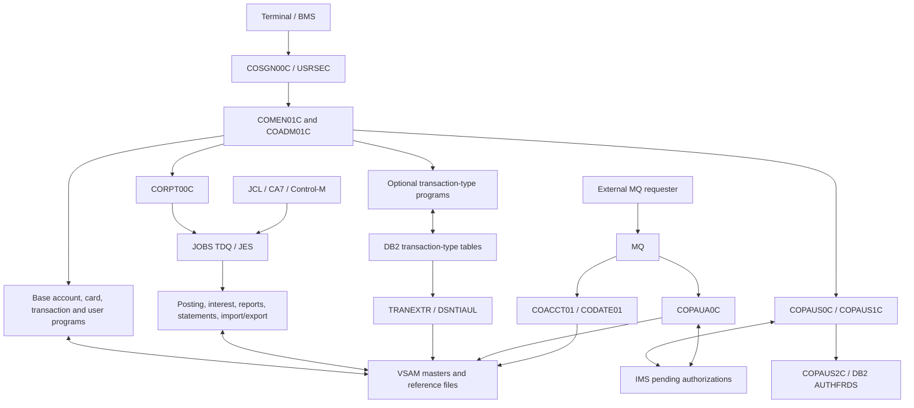
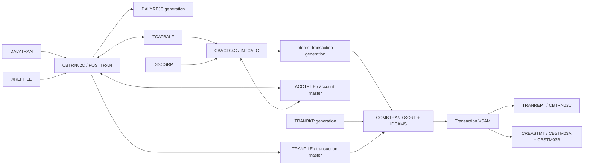

# System overview and component inventory

## Purpose, evidence and navigation

**Question answered:** What is present in CardDemo, what does each component do, and which entry points, files, programs and platform services connect it to the rest of the application?

**Analyzed revision:** `fbcb944af892dcb8c94c0549f2ee248945010ff8`.

**Coverage:** All 329 tracked files were classified; all 44 COBOL source files and the BMS, copybook, JCL/procedure, CICS, scheduler, assembler, IMS, DB2, fixture and script families were inspected for inventory and dependency evidence. Archive contents were listed, not executed. Counts below exclude files inside archives. This document describes the source at that revision, not a proposed Java or Spring design.

**Evidence status:** Source-only. **Source-confirmed** means an executable statement, declaration, resource definition or tracked artifact supports the claim. **README/comment claim** means stated intent rather than proven behavior. **Inferred** labels interpretation beyond a direct declaration. **Runtime-observed: none. Unknown:** installed resources, enabled modules, compiled load modules, dataset contents, effective configuration, operational schedules and successful execution.

### Agent read order

| Order | Document | Use it to answer |
|---|---|---|
| 1 | [System overview and inventory](01_SYSTEM_OVERVIEW_AND_INVENTORY.md) | Which source component owns a capability or dependency? |
| 2 | [End-to-end execution flows](02_END_TO_END_EXECUTION_FLOWS.md) | In what order do user, batch and integration paths execute? |
| 3 | [Data model, dictionary and lineage](04_DATA_MODEL_DICTIONARY_AND_LINEAGE.md) | What are the record layouts, keys and transformations? |
| 4 | [Interface contracts](05_INTERFACE_CONTRACTS.md) | What enters and leaves each boundary? |
| 5 | [Business rules catalog](03_BUSINESS_RULES_CATALOG.md) | Which validations, calculations and decisions must be preserved? |
| 6 | [Runtime, state and failure semantics](06_RUNTIME_STATE_AND_FAILURE_SEMANTICS.md) | What persists, commits, rolls back, retries or fails? |
| 7 | [Behavioral evidence and open questions](07_BEHAVIORAL_EVIDENCE_AND_OPEN_QUESTIONS.md) | What evidence supports parity and what still needs confirmation? |

For a particular program, start with its row below, follow its source citation, then consult documents 04/05 before interpreting field values and document 03 before changing decisions. The sibling links deliberately name complete documents without assuming their internal anchors.

## 1. Purpose, actors and boundaries

The README describes CardDemo as a demonstration application for migration, analysis, modernization and testing tools, with deliberately varied coding styles. That is an explicit **README claim**, not evidence that this checkout is a production banking service. [README.md:27–60](https://github.com/codev-workshops/uc-legacy-modernization-cobol-to-java/blob/fbcb944af892dcb8c94c0549f2ee248945010ff8/README.md#L27-L60)

The implementation models credit-card account servicing: sign-on; account and card inquiry/update; transaction browsing/addition; bill payment; report submission; user-security administration; batch posting, interest and statements; and profile export/import. The menu tables, sign-on dispatch, posting and statement entry points establish these capabilities. [COMEN02Y.cpy:19–96](https://github.com/codev-workshops/uc-legacy-modernization-cobol-to-java/blob/fbcb944af892dcb8c94c0549f2ee248945010ff8/app/cpy/COMEN02Y.cpy#L19-L96) [COADM02Y.cpy:19–59](https://github.com/codev-workshops/uc-legacy-modernization-cobol-to-java/blob/fbcb944af892dcb8c94c0549f2ee248945010ff8/app/cpy/COADM02Y.cpy#L19-L59) [COSGN00C.cbl:209–249](https://github.com/codev-workshops/uc-legacy-modernization-cobol-to-java/blob/fbcb944af892dcb8c94c0549f2ee248945010ff8/app/cbl/COSGN00C.cbl#L209-L249) [CBTRN02C.cbl:193–235](https://github.com/codev-workshops/uc-legacy-modernization-cobol-to-java/blob/fbcb944af892dcb8c94c0549f2ee248945010ff8/app/cbl/CBTRN02C.cbl#L193-L235) [CBSTM03A.CBL:262–360](https://github.com/codev-workshops/uc-legacy-modernization-cobol-to-java/blob/fbcb944af892dcb8c94c0549f2ee248945010ff8/app/cbl/CBSTM03A.CBL#L262-L360)

| Actor/boundary | Source-confirmed interaction | Limit of this evidence |
|---|---|---|
| Terminal user | `COSGN00C` reads `USRSEC`; user type selects main/admin menu; BMS screens receive AID and field input. | Real identities, permissions enforced outside the program and installed terminal access are unknown. |
| Application administrator | User list/add/update/delete; two menu targets for optional DB2 transaction-type maintenance. | Menu presence does not prove optional resources are installed. |
| Batch operator/scheduler | Submits JCL for posting, interest, statements, file refresh, backup, reporting and utilities. | Tracked scheduler exports are not observed schedules or run histories. |
| MQ requester | Sends requests to account/date services or authorization processor; receives MQ replies. | External producer implementation and deployed queue/trigger setup are not in these COBOL programs. |
| Platform/build operator | Provides CICS, JES, VSAM, compilers, LE, and optional DB2/IMS/MQ libraries/resources. | Supplied sample names and library locations are configuration examples, not discovered infrastructure. |

Actor evidence: sign-on `READ-USER-SEC-FILE` above; admin dispatch [COADM01C.cbl:94–179](https://github.com/codev-workshops/uc-legacy-modernization-cobol-to-java/blob/fbcb944af892dcb8c94c0549f2ee248945010ff8/app/cbl/COADM01C.cbl#L94-L179); MQ request/reply processing [COACCT01.cbl:176–450](https://github.com/codev-workshops/uc-legacy-modernization-cobol-to-java/blob/fbcb944af892dcb8c94c0549f2ee248945010ff8/app/app-vsam-mq/cbl/COACCT01.cbl#L176-L450); build dependency examples [BUILDONL.prc:19–99](https://github.com/codev-workshops/uc-legacy-modernization-cobol-to-java/blob/fbcb944af892dcb8c94c0549f2ee248945010ff8/samples/proc/BUILDONL.prc#L19-L99).

### Base and optional modules

| Source boundary | COBOL files | Capability and dependencies |
|---|---:|---|
| Base `app/`, excluding the three nested optional modules | 31 | CICS/BMS online servicing and security; VSAM and sequential batch processing; report submission to JES; statements, import/export, date and wait utilities. |
| `app/app-transaction-type-db2` | 3 | Transaction-type list/add/update/delete and batch maintenance in DB2; DDL/control cards and extract to sequential reference datasets. It reuses base menu/state/screen helpers. [COTRTLIC.cbl:1673–1880](https://github.com/codev-workshops/uc-legacy-modernization-cobol-to-java/blob/fbcb944af892dcb8c94c0549f2ee248945010ff8/app/app-transaction-type-db2/cbl/COTRTLIC.cbl#L1673-L1880) [TRANEXTR.jcl:65–122](https://github.com/codev-workshops/uc-legacy-modernization-cobol-to-java/blob/fbcb944af892dcb8c94c0549f2ee248945010ff8/app/app-transaction-type-db2/jcl/TRANEXTR.jcl#L65-L122) |
| `app/app-authorization-ims-db2-mq` | 8 | MQ authorization intake; VSAM account/customer/cross-reference reads; IMS pending summary/detail storage and inquiry; DB2 fraud marking; IMS purge/load/unload. [COPAUA0C.cbl:438–646](https://github.com/codev-workshops/uc-legacy-modernization-cobol-to-java/blob/fbcb944af892dcb8c94c0549f2ee248945010ff8/app/app-authorization-ims-db2-mq/cbl/COPAUA0C.cbl#L438-L646) [COPAUS2C.cbl:88–241](https://github.com/codev-workshops/uc-legacy-modernization-cobol-to-java/blob/fbcb944af892dcb8c94c0549f2ee248945010ff8/app/app-authorization-ims-db2-mq/cbl/COPAUS2C.cbl#L88-L241) |
| `app/app-vsam-mq` | 2 | MQ account inquiry against `ACCTDAT` and MQ date inquiry using CICS time services; no BMS screens. [COACCT01.cbl:365–450](https://github.com/codev-workshops/uc-legacy-modernization-cobol-to-java/blob/fbcb944af892dcb8c94c0549f2ee248945010ff8/app/app-vsam-mq/cbl/COACCT01.cbl#L365-L450) [CODATE01.cbl:328–364](https://github.com/codev-workshops/uc-legacy-modernization-cobol-to-java/blob/fbcb944af892dcb8c94c0549f2ee248945010ff8/app/app-vsam-mq/cbl/CODATE01.cbl#L328-L364) |

The base menus already contain optional targets; the directory boundary is therefore a packaging boundary, not complete source isolation. `COMEN01C` uses `EXEC CICS INQUIRE PROGRAM` for the pending-authorization target. `COADM01C` dispatches DB2 targets from its table. [COMEN01C.cbl:135–190](https://github.com/codev-workshops/uc-legacy-modernization-cobol-to-java/blob/fbcb944af892dcb8c94c0549f2ee248945010ff8/app/cbl/COMEN01C.cbl#L135-L190) [COADM01C.cbl:112–159](https://github.com/codev-workshops/uc-legacy-modernization-cobol-to-java/blob/fbcb944af892dcb8c94c0549f2ee248945010ff8/app/cbl/COADM01C.cbl#L112-L159)

### Component dependency diagram

**Text equivalent:** Sign-on chooses a table-driven menu, which transfers control to base screens or optional programs. Base screens share CICS state and VSAM files. The report screen submits JCL through `JOBS`; batch programs also access master/reference datasets. The DB2 optional module maintains reference tables and exports sequential datasets that refresh jobs can load into VSAM. Authorization intake consumes MQ, reads base VSAM and writes IMS; its inquiry screens read IMS and link to a DB2 fraud helper. Independent MQ inquiry programs return account or date information. The date program has no account-file access; the diagram groups it with the account program for readability.

The arrows represent source dependencies, not observed deployment topology. Report submission evidence is `WIRTE-JOBSUB-TDQ` [CORPT00C.cbl:462–535](https://github.com/codev-workshops/uc-legacy-modernization-cobol-to-java/blob/fbcb944af892dcb8c94c0549f2ee248945010ff8/app/cbl/CORPT00C.cbl#L462-L535); authorization storage is `8000-WRITE-AUTH-TO-DB` [COPAUA0C.cbl:786–931](https://github.com/codev-workshops/uc-legacy-modernization-cobol-to-java/blob/fbcb944af892dcb8c94c0549f2ee248945010ff8/app/app-authorization-ims-db2-mq/cbl/COPAUA0C.cbl#L786-L931); fraud linkage is [COPAUS1C.cbl:233–269](https://github.com/codev-workshops/uc-legacy-modernization-cobol-to-java/blob/fbcb944af892dcb8c94c0549f2ee248945010ff8/app/app-authorization-ims-db2-mq/cbl/COPAUS1C.cbl#L233-L269). Program and job tables below provide the remaining edges.

### Glossary

| Term | Meaning in this source |
|---|---|
| Account / customer / card / cross-reference | Separate records: `CVACT01Y`, `CVCUS01Y`, `CVACT02Y`, `CVACT03Y`; the cross-reference associates a card, customer and account. |
| Transaction type / category | Reference records `CVTRA03Y`/`CVTRA04Y`; optional DB2 equivalents are separate tables. |
| Category balance / disclosure group | Balance record `CVTRA01Y` and interest-rate lookup record `CVTRA02Y`, consumed by `CBACT04C`. |
| COMMAREA | `CARDDEMO-COMMAREA` in `COCOM01Y`: routing, user, account/card selection and entry/reentry state. |
| Transid / program / mapset / map | Four-character CICS transaction, executable program, BMS mapset, and individual map are distinct names; their mapping is enumerated below. |
| KSDS / AIX / PATH | VSAM keyed cluster, alternate index and alternate-index access path; CICS logical file names resolve to dataset names in CSD. |
| DD / DSN / GDG | JCL logical allocation name, dataset name, and generation data group. A COBOL `ASSIGN` name must be reconciled with its JCL DD. |
| PSB / PCB / DBD / DL/I | IMS program specification block, program communication block, database description, and data-access interface. |
| Pending authorization | IMS root `PAUTSUM0` with child `PAUTDTL1`; separate DB2 `AUTHFRDS` stores fraud-related records. |
| COPY / SQL INCLUDE | Source expansion dependencies, including executable procedure copybooks; neither implies a separate runtime program call. |

Glossary evidence: [COCOM01Y.cpy:19–43](https://github.com/codev-workshops/uc-legacy-modernization-cobol-to-java/blob/fbcb944af892dcb8c94c0549f2ee248945010ff8/app/cpy/COCOM01Y.cpy#L19-L43) [CVACT03Y.cpy:1–11](https://github.com/codev-workshops/uc-legacy-modernization-cobol-to-java/blob/fbcb944af892dcb8c94c0549f2ee248945010ff8/app/cpy/CVACT03Y.cpy#L1-L11) [CVTRA01Y.cpy:1–13](https://github.com/codev-workshops/uc-legacy-modernization-cobol-to-java/blob/fbcb944af892dcb8c94c0549f2ee248945010ff8/app/cpy/CVTRA01Y.cpy#L1-L13) [CVTRA02Y.cpy:1–13](https://github.com/codev-workshops/uc-legacy-modernization-cobol-to-java/blob/fbcb944af892dcb8c94c0549f2ee248945010ff8/app/cpy/CVTRA02Y.cpy#L1-L13) [DBPAUTP0.dbd:18–37](https://github.com/codev-workshops/uc-legacy-modernization-cobol-to-java/blob/fbcb944af892dcb8c94c0549f2ee248945010ff8/app/app-authorization-ims-db2-mq/ims/DBPAUTP0.dbd#L18-L37) [AUTHFRDS.ddl:1–28](https://github.com/codev-workshops/uc-legacy-modernization-cobol-to-java/blob/fbcb944af892dcb8c94c0549f2ee248945010ff8/app/app-authorization-ims-db2-mq/ddl/AUTHFRDS.ddl#L1-L28).

## 2. Mechanical inventory and counting scope

The reproducible input is `git ls-tree -r --name-only fbcb944af892dcb8c94c0549f2ee248945010ff8`. Classify paths by directory; compare file suffixes after converting to lowercase. Thus `.CBL`, `.CPY`, `.JCL`, `.DBD` and `.PSB` are included. Count files, not README rows, CSD declarations, compiled modules or entry labels. One COBOL file contains one `PROGRAM-ID`; additional `DLITCBL` entries do not increase the 44-program count.

| Family | Base | Authorization | DB2 types | MQ inquiry | Samples/other | Total |
|---|---:|---:|---:|---:|---:|---:|
| COBOL `.cbl` | 31 | 8 | 3 | 2 | 0 | **44** |
| BMS `.bms` | 17 | 2 | 2 | 0 | 0 | **21** |
| Non-map `.cpy` | 30 | 9 | 2 | 0 | 0 | **41** |
| Symbolic map `.cpy` | 17 | 2 | 2 | 0 | 0 | **21** |
| JCL `.jcl` | 38 | 5 | 3 | 0 | 9 | **55** |
| Procedures `.prc` | 2 | 0 | 0 | 0 | 4 | **6** |
| CSD `.csd` | 1 | 1 | 1 | 1 | 0 | **4** |
| Assembler / macros | 2 / 2 | 0 | 0 | 0 | 0 | **4** |
| IMS DBD / PSB | 0 | 4 / 4 | 0 | 0 | 0 | **8** |
| DB2 DDL / DCL | 0 | 2 / 1 | 4 / 2 | 0 | 0 | **9** |
| Control-card `.ctl` | 1 | 0 | 7 | 0 | 0 | **8** |
| Scheduler artifacts | 2 | 0 | 0 | 0 | 0 | **2** |
| Data payload files, excluding `.gitkeep` | 22 | 1 | 0 | 0 | 0 | **23** |
| Runtime ZIP archives | 0 | 0 | 0 | 0 | 2 | **2** |

The 329 files partition into 169 base `app` files, 40 authorization files, 27 DB2-type files, 4 MQ-inquiry files, 15 `samples` files, 56 `scripts` files, 12 `diagrams` files and 6 root files. These path partitions include READMEs and `.gitkeep` where present. The base has 30 ordinary plus 17 BMS copybooks; a naive count of 18 files in `app/cpy-bms` incorrectly includes `.gitkeep`.

The **46 JCL files under `app` are not 46 distinct scheduled business jobs**: they include setup, demonstrations, CSD administration and utilities. The nine `samples/jcl` files are compile or platform examples. `scripts/compile_batch.jcl.template` is a template, outside the `.jcl` count. `scripts/markers` contains 45 marker files, not 45 runnable components. Archived source/load-module copies are not added to any source-program count.

## 3. Complete COBOL inventory

All rows refer to source present at the analyzed revision. `R`, `W`, `U`, `D`, `B` below mean read, write, update, delete and browse operations visible in source, not successful runtime operations. Storage names are CICS file names for online programs and DD/`ASSIGN` names for batch. Some files are declared or opened without being used in a business path; those are labeled explicitly.

Every online row also depends on its BMS/COPY bindings in sections 4–5. CICS programs enter through their `PROCEDURE DIVISION` under the transaction or `XCTL`/`LINK` listed; standalone batch programs enter their `PROGRAM-ID`. “No JCL found” means no matching invocation in the tracked text JCL/procedure set, not that the program can never run.

### 3.1 Base online programs — 17

| Program | Purpose and entry | Storage/program dependencies; implementation evidence |
|---|---|---|
| `COSGN00C` | Online sign-on; `CC00` | R `USRSEC`; `READ-USER-SEC-FILE` dispatches `COADM01C` or `COMEN01C`. [COSGN00C.cbl:209–249](https://github.com/codev-workshops/uc-legacy-modernization-cobol-to-java/blob/fbcb944af892dcb8c94c0549f2ee248945010ff8/app/cbl/COSGN00C.cbl#L209-L249) |
| `COMEN01C` | Online main menu; `CM00`, sign-on `XCTL` | `COMEN02Y` dynamic program table, COMMAREA; no active VSAM read despite a `USRSEC` name declaration. `INQUIRE PROGRAM` for `COPAUS0C`, then `XCTL` on a normal response. [COMEN01C.cbl:74–206](https://github.com/codev-workshops/uc-legacy-modernization-cobol-to-java/blob/fbcb944af892dcb8c94c0549f2ee248945010ff8/app/cbl/COMEN01C.cbl#L74-L206) |
| `COADM01C` | Online administrator menu; `CA00`, sign-on `XCTL` | `COADM02Y` dynamic targets, COMMAREA; return to sign-on. [COADM01C.cbl:74–179](https://github.com/codev-workshops/uc-legacy-modernization-cobol-to-java/blob/fbcb944af892dcb8c94c0549f2ee248945010ff8/app/cbl/COADM01C.cbl#L74-L179) |
| `COACTVWC` | Online account inquiry; `CAVW`, main menu | Reads `CXACAIX`, `ACCTDAT`, `CUSTDAT` through CICS; `9000-READ-ACCT` family. Declares shared card/navigation constants as well. [COACTVWC.cbl:687–872](https://github.com/codev-workshops/uc-legacy-modernization-cobol-to-java/blob/fbcb944af892dcb8c94c0549f2ee248945010ff8/app/cbl/COACTVWC.cbl#L687-L872) |
| `COACTUPC` | Online account/customer update; `CAUP`, main menu | Account/customer read-update path and `CXACAIX` lookup; date editing and lookup copybooks; COMMAREA/menu routing. `9000-READ-ACCT` and `9600-WRITE-PROCESSING` paragraphs. [COACTUPC.cbl:3608–3797](https://github.com/codev-workshops/uc-legacy-modernization-cobol-to-java/blob/fbcb944af892dcb8c94c0549f2ee248945010ff8/app/cbl/COACTUPC.cbl#L3608-L3797) [COACTUPC.cbl:3888–4105](https://github.com/codev-workshops/uc-legacy-modernization-cobol-to-java/blob/fbcb944af892dcb8c94c0549f2ee248945010ff8/app/cbl/COACTUPC.cbl#L3888-L4105) |
| `COCRDLIC` | Online card list; `CCLI`, main menu | B `CARDDAT`; selection transfers to `COCRDSLC` or `COCRDUPC`; `CARDAIX` also declared. [COCRDLIC.cbl:519–580](https://github.com/codev-workshops/uc-legacy-modernization-cobol-to-java/blob/fbcb944af892dcb8c94c0549f2ee248945010ff8/app/cbl/COCRDLIC.cbl#L519-L580) [COCRDLIC.cbl:1120–1388](https://github.com/codev-workshops/uc-legacy-modernization-cobol-to-java/blob/fbcb944af892dcb8c94c0549f2ee248945010ff8/app/cbl/COCRDLIC.cbl#L1120-L1388) |
| `COCRDSLC` | Online card detail; `CCDL`, menu/list | R `CARDDAT`; source also contains `9150-GETCARD-BYACCT` on `CARDAIX`. Returns using COMMAREA/program constants. [COCRDSLC.cbl:726–812](https://github.com/codev-workshops/uc-legacy-modernization-cobol-to-java/blob/fbcb944af892dcb8c94c0549f2ee248945010ff8/app/cbl/COCRDSLC.cbl#L726-L812) |
| `COCRDUPC` | Online card update; `CCUP`, menu/list | R/U `CARDDAT`; `REWRITE FILE(LIT-CARDFILENAME)`; shared PF-key procedure copybook. [COCRDUPC.cbl:1350–1508](https://github.com/codev-workshops/uc-legacy-modernization-cobol-to-java/blob/fbcb944af892dcb8c94c0549f2ee248945010ff8/app/cbl/COCRDUPC.cbl#L1350-L1508) |
| `COTRN00C` | Online transaction list; `CT00`, menu | B `TRANSACT`, selection `XCTL` to `COTRN01C`. [COTRN00C.cbl:177–200](https://github.com/codev-workshops/uc-legacy-modernization-cobol-to-java/blob/fbcb944af892dcb8c94c0549f2ee248945010ff8/app/cbl/COTRN00C.cbl#L177-L200) [COTRN00C.cbl:591–699](https://github.com/codev-workshops/uc-legacy-modernization-cobol-to-java/blob/fbcb944af892dcb8c94c0549f2ee248945010ff8/app/cbl/COTRN00C.cbl#L591-L699) |
| `COTRN01C` | Online transaction detail; `CT01`, menu/list | R `TRANSACT`; previous-program or list/menu routing. [COTRN01C.cbl:85–174](https://github.com/codev-workshops/uc-legacy-modernization-cobol-to-java/blob/fbcb944af892dcb8c94c0549f2ee248945010ff8/app/cbl/COTRN01C.cbl#L85-L174) [COTRN01C.cbl:267–299](https://github.com/codev-workshops/uc-legacy-modernization-cobol-to-java/blob/fbcb944af892dcb8c94c0549f2ee248945010ff8/app/cbl/COTRN01C.cbl#L267-L299) |
| `COTRN02C` | Online transaction add; `CT02`, menu | R `CCXREF`/`CXACAIX`, B/W `TRANSACT`; calls `CSUTLDTC` for dates. `ACCTDAT` is declared but no corresponding CICS read is used here. [COTRN02C.cbl:389–478](https://github.com/codev-workshops/uc-legacy-modernization-cobol-to-java/blob/fbcb944af892dcb8c94c0549f2ee248945010ff8/app/cbl/COTRN02C.cbl#L389-L478) [COTRN02C.cbl:576–742](https://github.com/codev-workshops/uc-legacy-modernization-cobol-to-java/blob/fbcb944af892dcb8c94c0549f2ee248945010ff8/app/cbl/COTRN02C.cbl#L576-L742) |
| `CORPT00C` | Online report selection/submission; `CR00`, menu | Calls `CSUTLDTC`; generates JCL records and writes TDQ `JOBS`. A `TRANSACT` declaration is not a direct report scan; `CBTRN03C` runs through submitted JCL/procedure. [CORPT00C.cbl:383–425](https://github.com/codev-workshops/uc-legacy-modernization-cobol-to-java/blob/fbcb944af892dcb8c94c0549f2ee248945010ff8/app/cbl/CORPT00C.cbl#L383-L425) [CORPT00C.cbl:462–535](https://github.com/codev-workshops/uc-legacy-modernization-cobol-to-java/blob/fbcb944af892dcb8c94c0549f2ee248945010ff8/app/cbl/CORPT00C.cbl#L462-L535) |
| `COBIL00C` | Online bill payment; `CB00`, menu | R/U `ACCTDAT`, R `CXACAIX`, B/W `TRANSACT`; payment and account update occur within the program. [COBIL00C.cbl:343–543](https://github.com/codev-workshops/uc-legacy-modernization-cobol-to-java/blob/fbcb944af892dcb8c94c0549f2ee248945010ff8/app/cbl/COBIL00C.cbl#L343-L543) |
| `COUSR00C` | Online security-user list; `CU00`, admin | B `USRSEC`; selection routes to update/delete programs. [COUSR00C.cbl:180–214](https://github.com/codev-workshops/uc-legacy-modernization-cobol-to-java/blob/fbcb944af892dcb8c94c0549f2ee248945010ff8/app/cbl/COUSR00C.cbl#L180-L214) [COUSR00C.cbl:586–695](https://github.com/codev-workshops/uc-legacy-modernization-cobol-to-java/blob/fbcb944af892dcb8c94c0549f2ee248945010ff8/app/cbl/COUSR00C.cbl#L586-L695) |
| `COUSR01C` | Online security-user add; `CU01`, admin | W `USRSEC` in `WRITE-USER-SEC-FILE`. [COUSR01C.cbl:238–278](https://github.com/codev-workshops/uc-legacy-modernization-cobol-to-java/blob/fbcb944af892dcb8c94c0549f2ee248945010ff8/app/cbl/COUSR01C.cbl#L238-L278) |
| `COUSR02C` | Online security-user update; `CU02`, admin/list | R/U `USRSEC`; `READ-USER-SEC-FILE`, `UPDATE-USER-SEC-FILE`. [COUSR02C.cbl:320–398](https://github.com/codev-workshops/uc-legacy-modernization-cobol-to-java/blob/fbcb944af892dcb8c94c0549f2ee248945010ff8/app/cbl/COUSR02C.cbl#L320-L398) |
| `COUSR03C` | Online security-user delete; `CU03`, admin/list | R/D `USRSEC`; `READ-USER-SEC-FILE`, `DELETE-USER-SEC-FILE`. [COUSR03C.cbl:267–345](https://github.com/codev-workshops/uc-legacy-modernization-cobol-to-java/blob/fbcb944af892dcb8c94c0549f2ee248945010ff8/app/cbl/COUSR03C.cbl#L267-L345) |

### 3.2 Base batch and helper programs — 14

| Program / class | Purpose and entry | Storage and program dependencies; implementation evidence |
|---|---|---|
| `CBACT01C` — batch | `READACCT`; scan accounts and produce demonstration output layouts | R `ACCTFILE`; W `OUTFILE`, `ARRYFILE`, `VBRCFILE`; calls assembler `COBDATFT`, LE `CEE3ABD`. Entry loop and record writers [CBACT01C.cbl:140–178](https://github.com/codev-workshops/uc-legacy-modernization-cobol-to-java/blob/fbcb944af892dcb8c94c0549f2ee248945010ff8/app/cbl/CBACT01C.cbl#L140-L178); declarations/date conversion [CBACT01C.cbl:23–139](https://github.com/codev-workshops/uc-legacy-modernization-cobol-to-java/blob/fbcb944af892dcb8c94c0549f2ee248945010ff8/app/cbl/CBACT01C.cbl#L23-L139) [CBACT01C.cbl:203–275](https://github.com/codev-workshops/uc-legacy-modernization-cobol-to-java/blob/fbcb944af892dcb8c94c0549f2ee248945010ff8/app/cbl/CBACT01C.cbl#L203-L275). |
| `CBACT02C` — batch | `READCARD`; scan/display cards | R `CARDFILE`; `CVACT02Y`, `CEE3ABD`. [CBACT02C.cbl:23–109](https://github.com/codev-workshops/uc-legacy-modernization-cobol-to-java/blob/fbcb944af892dcb8c94c0549f2ee248945010ff8/app/cbl/CBACT02C.cbl#L23-L109) |
| `CBACT03C` — batch | `READXREF`; scan/display cross-reference | R `XREFFILE`; `CVACT03Y`, `CEE3ABD`. [CBACT03C.cbl:23–109](https://github.com/codev-workshops/uc-legacy-modernization-cobol-to-java/blob/fbcb944af892dcb8c94c0549f2ee248945010ff8/app/cbl/CBACT03C.cbl#L23-L109) |
| `CBCUS01C` — batch | `READCUST`; scan/display customers | R `CUSTFILE`; `CVCUS01Y`, `CEE3ABD`. [CBCUS01C.cbl:23–109](https://github.com/codev-workshops/uc-legacy-modernization-cobol-to-java/blob/fbcb944af892dcb8c94c0549f2ee248945010ff8/app/cbl/CBCUS01C.cbl#L23-L109) |
| `CBACT04C` — batch | `INTCALC`; interest calculation, `PROCEDURE DIVISION USING EXTERNAL-PARMS` | R category balances, cross-reference and disclosure groups; U accounts; W interest transactions. DDs `TCATBALF`, `XREFFILE`, `DISCGRP`, `ACCTFILE`, `TRANSACT`; LE abend helper. [CBACT04C.cbl:23–74](https://github.com/codev-workshops/uc-legacy-modernization-cobol-to-java/blob/fbcb944af892dcb8c94c0549f2ee248945010ff8/app/cbl/CBACT04C.cbl#L23-L74) [CBACT04C.cbl:180–339](https://github.com/codev-workshops/uc-legacy-modernization-cobol-to-java/blob/fbcb944af892dcb8c94c0549f2ee248945010ff8/app/cbl/CBACT04C.cbl#L180-L339) [CBACT04C.cbl:350–493](https://github.com/codev-workshops/uc-legacy-modernization-cobol-to-java/blob/fbcb944af892dcb8c94c0549f2ee248945010ff8/app/cbl/CBACT04C.cbl#L350-L493) |
| `CBTRN01C` — batch | Diagnostic daily-transaction scan; no tracked invoking JCL found | Opens `DALYTRAN`, `CUSTFILE`, `XREFFILE`, `CARDFILE`, `ACCTFILE`, `TRANFILE` **INPUT**; loop reads daily rows and verifies cross-reference/account. It does not implement `COMBTRAN` or post transactions. [CBTRN01C.cbl:154–250](https://github.com/codev-workshops/uc-legacy-modernization-cobol-to-java/blob/fbcb944af892dcb8c94c0549f2ee248945010ff8/app/cbl/CBTRN01C.cbl#L154-L250) [CBTRN01C.cbl:252–359](https://github.com/codev-workshops/uc-legacy-modernization-cobol-to-java/blob/fbcb944af892dcb8c94c0549f2ee248945010ff8/app/cbl/CBTRN01C.cbl#L252-L359) |
| `CBTRN02C` — batch | `POSTTRAN`; validate/post daily transactions | R `DALYTRAN`/`XREFFILE`; `TRANFILE` and `DALYREJS` opened OUTPUT; `ACCTFILE` and `TCATBALF` opened I-O; writes transactions/rejections and updates balances; `CEE3ABD`. [CBTRN02C.cbl:238–343](https://github.com/codev-workshops/uc-legacy-modernization-cobol-to-java/blob/fbcb944af892dcb8c94c0549f2ee248945010ff8/app/cbl/CBTRN02C.cbl#L238-L343) [CBTRN02C.cbl:369–581](https://github.com/codev-workshops/uc-legacy-modernization-cobol-to-java/blob/fbcb944af892dcb8c94c0549f2ee248945010ff8/app/cbl/CBTRN02C.cbl#L369-L581) |
| `CBTRN03C` — batch | `TRANREPT` JCL/procedure; date-filtered transaction report | R `TRANFILE`, `CARDXREF`, `TRANTYPE`, `TRANCATG`, `DATEPARM`; W `TRANREPT`; report layouts `CVTRA07Y`; `CEE3ABD`. [CBTRN03C.cbl:23–115](https://github.com/codev-workshops/uc-legacy-modernization-cobol-to-java/blob/fbcb944af892dcb8c94c0549f2ee248945010ff8/app/cbl/CBTRN03C.cbl#L23-L115) [CBTRN03C.cbl:159–219](https://github.com/codev-workshops/uc-legacy-modernization-cobol-to-java/blob/fbcb944af892dcb8c94c0549f2ee248945010ff8/app/cbl/CBTRN03C.cbl#L159-L219) |
| `CBSTM03A` — batch | `CREASTMT`; statement and HTML generation | W `STMTFILE`/`HTMLFILE`; calls `CBSTM03B` for master/transaction access. Uses control-block addressing and executable `ALTER`/`GO TO`. [CBSTM03A.CBL:36–84](https://github.com/codev-workshops/uc-legacy-modernization-cobol-to-java/blob/fbcb944af892dcb8c94c0549f2ee248945010ff8/app/cbl/CBSTM03A.CBL#L36-L84) [CBSTM03A.CBL:262–411](https://github.com/codev-workshops/uc-legacy-modernization-cobol-to-java/blob/fbcb944af892dcb8c94c0549f2ee248945010ff8/app/cbl/CBSTM03A.CBL#L262-L411) |
| `CBSTM03B` — helper | Called by `CBSTM03A`; `USING LK-M03B-AREA` | R `TRNXFILE`, `XREFFILE`, `CUSTFILE`, `ACCTFILE`; dispatches file operations through the linkage area. No BMS/CICS entry. [CBSTM03B.CBL:20–180](https://github.com/codev-workshops/uc-legacy-modernization-cobol-to-java/blob/fbcb944af892dcb8c94c0549f2ee248945010ff8/app/cbl/CBSTM03B.CBL#L20-L180) |
| `CBEXPORT` — batch | `CBEXPORT` job; multi-record profile export | Sequentially scans indexed customer/account/cross-reference/transaction/card inputs (`CUSTFILE`, `ACCTFILE`, `XREFFILE`, `TRANSACT`, `CARDFILE`); W indexed `EXPFILE`; six domain/export COPY dependencies and `CEE3ABD`. `0000-MAIN-PROCESSING` explicitly invokes all five export passes. [CBEXPORT.cbl:35–158](https://github.com/codev-workshops/uc-legacy-modernization-cobol-to-java/blob/fbcb944af892dcb8c94c0549f2ee248945010ff8/app/cbl/CBEXPORT.cbl#L35-L158) |
| `CBIMPORT` — batch | `CBIMPORT` job; split/validate exported records | R indexed `EXPFILE`; W sequential `CUSTOUT`, `ACCTOUT`, `XREFOUT`, `TRNXOUT`, `CARDOUT`, `ERROUT`; `CVEXPORT`. These outputs are not direct VSAM-master updates. [CBIMPORT.cbl:34–180](https://github.com/codev-workshops/uc-legacy-modernization-cobol-to-java/blob/fbcb944af892dcb8c94c0549f2ee248945010ff8/app/cbl/CBIMPORT.cbl#L34-L180) |
| `COBSWAIT` — batch utility | `WAITSTEP`; accepts SYSIN delay value | Calls `MVSWAIT USING MVSWAIT-TIME`; source header describes centiseconds. Actual interface is `ACCEPT ... FROM SYSIN`, not JCL `PARM`. [COBSWAIT.cbl:1–40](https://github.com/codev-workshops/uc-legacy-modernization-cobol-to-java/blob/fbcb944af892dcb8c94c0549f2ee248945010ff8/app/cbl/COBSWAIT.cbl#L1-L40) |
| `CSUTLDTC` — callable helper | Called by `CORPT00C` and `COTRN02C` | `USING LS-DATE, LS-DATE-FORMAT, LS-RESULT`; calls LE `CEEDAYS`, returns formatted severity/message information; no datasets. [CSUTLDTC.cbl:83–154](https://github.com/codev-workshops/uc-legacy-modernization-cobol-to-java/blob/fbcb944af892dcb8c94c0549f2ee248945010ff8/app/cbl/CSUTLDTC.cbl#L83-L154) |

### 3.3 Optional authorization programs — 8

| Program / class | Purpose and entry | Storage and program dependencies; implementation evidence |
|---|---|---|
| `COPAUA0C` — CICS/MQ service | `CP00`; retrieve MQ trigger data, consume requests and send replies | MQ `MQOPEN/MQGET/MQPUT1/MQCLOSE`; R `CCXREF`, `ACCTDAT`, `CUSTDAT`; IMS `PSBPAUTB`, `PAUTSUM0`/`PAUTDTL1`; error TDQ `CSSL`. Card file constants are declared, but the confirmed master reads here are cross-reference/account/customer. [COPAUA0C.cbl:218–310](https://github.com/codev-workshops/uc-legacy-modernization-cobol-to-java/blob/fbcb944af892dcb8c94c0549f2ee248945010ff8/app/app-authorization-ims-db2-mq/cbl/COPAUA0C.cbl#L218-L310) [COPAUA0C.cbl:438–646](https://github.com/codev-workshops/uc-legacy-modernization-cobol-to-java/blob/fbcb944af892dcb8c94c0549f2ee248945010ff8/app/app-authorization-ims-db2-mq/cbl/COPAUA0C.cbl#L438-L646) [COPAUA0C.cbl:741–931](https://github.com/codev-workshops/uc-legacy-modernization-cobol-to-java/blob/fbcb944af892dcb8c94c0549f2ee248945010ff8/app/app-authorization-ims-db2-mq/cbl/COPAUA0C.cbl#L741-L931) |
| `COPAUS0C` — online | `CPVS`, main-menu option 11; pending authorization summary | Base VSAM lookups and IMS pending authorizations; selection `XCTL` to `COPAUS1C`, return to main menu; `COPAU00`. [COPAUS0C.cbl:176–325](https://github.com/codev-workshops/uc-legacy-modernization-cobol-to-java/blob/fbcb944af892dcb8c94c0549f2ee248945010ff8/app/app-authorization-ims-db2-mq/cbl/COPAUS0C.cbl#L176-L325) [COPAUS0C.cbl:800–1032](https://github.com/codev-workshops/uc-legacy-modernization-cobol-to-java/blob/fbcb944af892dcb8c94c0549f2ee248945010ff8/app/app-authorization-ims-db2-mq/cbl/COPAUS0C.cbl#L800-L1032) |
| `COPAUS1C` — online | `CPVD`, summary selection; authorization detail/fraud action | IMS detail retrieval/update; CICS `LINK` to `COPAUS2C` using a fraud COMMAREA; `COPAU01`. [COPAUS1C.cbl:156–269](https://github.com/codev-workshops/uc-legacy-modernization-cobol-to-java/blob/fbcb944af892dcb8c94c0549f2ee248945010ff8/app/app-authorization-ims-db2-mq/cbl/COPAUS1C.cbl#L156-L269) [COPAUS1C.cbl:478–604](https://github.com/codev-workshops/uc-legacy-modernization-cobol-to-java/blob/fbcb944af892dcb8c94c0549f2ee248945010ff8/app/app-authorization-ims-db2-mq/cbl/COPAUS1C.cbl#L478-L604) |
| `COPAUS2C` — CICS/DB2 helper | Linked from `COPAUS1C`; no separate transaction dispatch target | COMMAREA includes pending-auth detail; SQLCA and `AUTHFRDS` include; inserts/updates `CARDDEMO.AUTHFRDS`. [COPAUS2C.cbl:64–241](https://github.com/codev-workshops/uc-legacy-modernization-cobol-to-java/blob/fbcb944af892dcb8c94c0549f2ee248945010ff8/app/app-authorization-ims-db2-mq/cbl/COPAUS2C.cbl#L64-L241) |
| `CBPAUP0C` — IMS batch | `CBPAUP0J`: `DFSRRC00` BMP, `PSBPAUTB`; `USING IO-PCB-MASK, PGM-PCB-MASK` | Iterates pending summary/detail, deletes qualifying detail and summary segments, and checkpoints; no `REPL` summary update occurs. SYSIN controls; `CIPAUSMY`/`CIPAUDTY`. [CBPAUP0C.cbl:112–167](https://github.com/codev-workshops/uc-legacy-modernization-cobol-to-java/blob/fbcb944af892dcb8c94c0549f2ee248945010ff8/app/app-authorization-ims-db2-mq/cbl/CBPAUP0C.cbl#L112-L167) [CBPAUP0C.cbl:303–375](https://github.com/codev-workshops/uc-legacy-modernization-cobol-to-java/blob/fbcb944af892dcb8c94c0549f2ee248945010ff8/app/app-authorization-ims-db2-mq/cbl/CBPAUP0C.cbl#L303-L375) |
| `PAUDBUNL` — IMS batch utility | `UNLDPADB`: DLI, `PAUTBUNL`; `USING PAUTBPCB`, alternate `ENTRY 'DLITCBL'` | `CBLTDLI` GN/GNP; W `OUTFIL1` root and `OUTFIL2` child sequential files. [PAUDBUNL.CBL:149–284](https://github.com/codev-workshops/uc-legacy-modernization-cobol-to-java/blob/fbcb944af892dcb8c94c0549f2ee248945010ff8/app/app-authorization-ims-db2-mq/cbl/PAUDBUNL.CBL#L149-L284) |
| `PAUDBLOD` — IMS batch utility | `LOADPADB`: BMP, `PSBPAUTB`; primary PCB arguments and alternate `DLITCBL` entry differ | R `INFILE1`/`INFILE2`; `CBLTDLI` ISRT roots, GU parent then ISRT child; IMS function/record/PCB COPY dependencies. [PAUDBLOD.CBL:157–183](https://github.com/codev-workshops/uc-legacy-modernization-cobol-to-java/blob/fbcb944af892dcb8c94c0549f2ee248945010ff8/app/app-authorization-ims-db2-mq/cbl/PAUDBLOD.CBL#L157-L183) [PAUDBLOD.CBL:222–335](https://github.com/codev-workshops/uc-legacy-modernization-cobol-to-java/blob/fbcb944af892dcb8c94c0549f2ee248945010ff8/app/app-authorization-ims-db2-mq/cbl/PAUDBLOD.CBL#L222-L335) |
| `DBUNLDGS` — IMS/GSAM batch utility | `UNLDGSAM`: DLI, `DLIGSAMP`; three PCBs; alternate `DLITCBL` | GN/GNP from pending DB, ISRT to GSAM root/detail PCBs. The sequential-file SELECT/WRITE alternatives are commented out. [DBUNLDGS.CBL:150–175](https://github.com/codev-workshops/uc-legacy-modernization-cobol-to-java/blob/fbcb944af892dcb8c94c0549f2ee248945010ff8/app/app-authorization-ims-db2-mq/cbl/DBUNLDGS.CBL#L150-L175) [DBUNLDGS.CBL:215–335](https://github.com/codev-workshops/uc-legacy-modernization-cobol-to-java/blob/fbcb944af892dcb8c94c0549f2ee248945010ff8/app/app-authorization-ims-db2-mq/cbl/DBUNLDGS.CBL#L215-L335) |

### 3.4 Other optional programs — 5

| Program / class | Purpose and entry | Storage and program dependencies; implementation evidence |
|---|---|---|
| `COTRTLIC` — online/DB2 | `CTLI`, admin option 5; transaction-type list, update/delete actions | DB2 `CARDDEMO.TRANSACTION_TYPE`, cursor/paging SQL, COMMAREA and `COTRTLI`; `COTRTUPC`/admin navigation. [COTRTLIC.cbl:497–664](https://github.com/codev-workshops/uc-legacy-modernization-cobol-to-java/blob/fbcb944af892dcb8c94c0549f2ee248945010ff8/app/app-transaction-type-db2/cbl/COTRTLIC.cbl#L497-L664) [COTRTLIC.cbl:1673–1938](https://github.com/codev-workshops/uc-legacy-modernization-cobol-to-java/blob/fbcb944af892dcb8c94c0549f2ee248945010ff8/app/app-transaction-type-db2/cbl/COTRTLIC.cbl#L1673-L1938) |
| `COTRTUPC` — online/DB2 | `CTTU`, admin option 6/list navigation; type maintenance | SQL type/category declarations, type insert/update/delete paths; `COTRTUP`, shared screen/edit COPYs. [COTRTUPC.cbl:216–344](https://github.com/codev-workshops/uc-legacy-modernization-cobol-to-java/blob/fbcb944af892dcb8c94c0549f2ee248945010ff8/app/app-transaction-type-db2/cbl/COTRTUPC.cbl#L216-L344) [COTRTUPC.cbl:1400–1702](https://github.com/codev-workshops/uc-legacy-modernization-cobol-to-java/blob/fbcb944af892dcb8c94c0549f2ee248945010ff8/app/app-transaction-type-db2/cbl/COTRTUPC.cbl#L1400-L1702) |
| `COBTUPDT` — DB2 batch | `MNTTRDB2`: DSN `RUN PROGRAM(COBTUPDT) PLAN(CARDDEMO)` | R `INPFILE`; SQL insert/update/delete of transaction types; `SQLCA`, `DCLTRTYP`. [COBTUPDT.cbl:22–202](https://github.com/codev-workshops/uc-legacy-modernization-cobol-to-java/blob/fbcb944af892dcb8c94c0549f2ee248945010ff8/app/app-transaction-type-db2/cbl/COBTUPDT.cbl#L22-L202) |
| `COACCT01` — CICS/MQ service | `CDRA`; MQ-triggered account inquiry | MQ request/reply descriptors and APIs; R CICS `ACCTDAT`; `CVACT01Y`. [COACCT01.cbl:176–255](https://github.com/codev-workshops/uc-legacy-modernization-cobol-to-java/blob/fbcb944af892dcb8c94c0549f2ee248945010ff8/app/app-vsam-mq/cbl/COACCT01.cbl#L176-L255) [COACCT01.cbl:365–450](https://github.com/codev-workshops/uc-legacy-modernization-cobol-to-java/blob/fbcb944af892dcb8c94c0549f2ee248945010ff8/app/app-vsam-mq/cbl/COACCT01.cbl#L365-L450) |
| `CODATE01` — CICS/MQ service | `CDRD`; MQ-triggered date inquiry | MQ APIs; CICS `ASKTIME`/`FORMATTIME`; no application dataset or BMS. [CODATE01.cbl:125–205](https://github.com/codev-workshops/uc-legacy-modernization-cobol-to-java/blob/fbcb944af892dcb8c94c0549f2ee248945010ff8/app/app-vsam-mq/cbl/CODATE01.cbl#L125-L205) [CODATE01.cbl:328–364](https://github.com/codev-workshops/uc-legacy-modernization-cobol-to-java/blob/fbcb944af892dcb8c94c0549f2ee248945010ff8/app/app-vsam-mq/cbl/CODATE01.cbl#L328-L364) |

## 4. CICS entry points, maps and dynamic routing

### 4.1 Transaction → program → BMS mapping

The transaction/program columns come from **CSD definitions**; mapset/map names come from BMS `DFHMSD`/`DFHMDI` and corresponding source `SEND`/`RECEIVE` statements. These are distinct evidence sources. For each of the 21 BMS files there is a same-stem symbolic map copybook in the module's `cpy-bms` directory: base copies use `.CPY`, optional copies `.cpy`.

| Scope | Transaction | Program | Mapset → map; BMS evidence |
|---|---|---|---|
| Base | `CC00` | `COSGN00C` | `COSGN00` → `COSGN0A` [COSGN00.bms:19–34](https://github.com/codev-workshops/uc-legacy-modernization-cobol-to-java/blob/fbcb944af892dcb8c94c0549f2ee248945010ff8/app/bms/COSGN00.bms#L19-L34) |
| Base | `CM00` | `COMEN01C` | `COMEN01` → `COMEN1A` [COMEN01.bms:19–34](https://github.com/codev-workshops/uc-legacy-modernization-cobol-to-java/blob/fbcb944af892dcb8c94c0549f2ee248945010ff8/app/bms/COMEN01.bms#L19-L34) |
| Base | `CA00` | `COADM01C` | `COADM01` → `COADM1A` [COADM01.bms:19–34](https://github.com/codev-workshops/uc-legacy-modernization-cobol-to-java/blob/fbcb944af892dcb8c94c0549f2ee248945010ff8/app/bms/COADM01.bms#L19-L34) |
| Base | `CAVW` | `COACTVWC` | `COACTVW` → `CACTVWA` [COACTVW.bms:20–32](https://github.com/codev-workshops/uc-legacy-modernization-cobol-to-java/blob/fbcb944af892dcb8c94c0549f2ee248945010ff8/app/bms/COACTVW.bms#L20-L32) |
| Base | `CAUP` | `COACTUPC` | `COACTUP` → `CACTUPA` [COACTUP.bms:20–32](https://github.com/codev-workshops/uc-legacy-modernization-cobol-to-java/blob/fbcb944af892dcb8c94c0549f2ee248945010ff8/app/bms/COACTUP.bms#L20-L32) |
| Base | `CCLI` | `COCRDLIC` | `COCRDLI` → `CCRDLIA` [COCRDLI.bms:20–32](https://github.com/codev-workshops/uc-legacy-modernization-cobol-to-java/blob/fbcb944af892dcb8c94c0549f2ee248945010ff8/app/bms/COCRDLI.bms#L20-L32) |
| Base | `CCDL` | `COCRDSLC` | `COCRDSL` → `CCRDSLA` [COCRDSL.bms:20–32](https://github.com/codev-workshops/uc-legacy-modernization-cobol-to-java/blob/fbcb944af892dcb8c94c0549f2ee248945010ff8/app/bms/COCRDSL.bms#L20-L32) |
| Base | `CCUP` | `COCRDUPC` | `COCRDUP` → `CCRDUPA` [COCRDUP.bms:20–32](https://github.com/codev-workshops/uc-legacy-modernization-cobol-to-java/blob/fbcb944af892dcb8c94c0549f2ee248945010ff8/app/bms/COCRDUP.bms#L20-L32) |
| Base | `CT00` | `COTRN00C` | `COTRN00` → `COTRN0A` [COTRN00.bms:19–34](https://github.com/codev-workshops/uc-legacy-modernization-cobol-to-java/blob/fbcb944af892dcb8c94c0549f2ee248945010ff8/app/bms/COTRN00.bms#L19-L34) |
| Base | `CT01` | `COTRN01C` | `COTRN01` → `COTRN1A` [COTRN01.bms:19–34](https://github.com/codev-workshops/uc-legacy-modernization-cobol-to-java/blob/fbcb944af892dcb8c94c0549f2ee248945010ff8/app/bms/COTRN01.bms#L19-L34) |
| Base | `CT02` | `COTRN02C` | `COTRN02` → `COTRN2A` [COTRN02.bms:19–34](https://github.com/codev-workshops/uc-legacy-modernization-cobol-to-java/blob/fbcb944af892dcb8c94c0549f2ee248945010ff8/app/bms/COTRN02.bms#L19-L34) |
| Base | `CR00` | `CORPT00C` | `CORPT00` → `CORPT0A` [CORPT00.bms:19–34](https://github.com/codev-workshops/uc-legacy-modernization-cobol-to-java/blob/fbcb944af892dcb8c94c0549f2ee248945010ff8/app/bms/CORPT00.bms#L19-L34) |
| Base | `CB00` | `COBIL00C` | `COBIL00` → `COBIL0A` [COBIL00.bms:19–34](https://github.com/codev-workshops/uc-legacy-modernization-cobol-to-java/blob/fbcb944af892dcb8c94c0549f2ee248945010ff8/app/bms/COBIL00.bms#L19-L34) |
| Base | `CU00` | `COUSR00C` | `COUSR00` → `COUSR0A` [COUSR00.bms:19–34](https://github.com/codev-workshops/uc-legacy-modernization-cobol-to-java/blob/fbcb944af892dcb8c94c0549f2ee248945010ff8/app/bms/COUSR00.bms#L19-L34) |
| Base | `CU01` | `COUSR01C` | `COUSR01` → `COUSR1A` [COUSR01.bms:19–34](https://github.com/codev-workshops/uc-legacy-modernization-cobol-to-java/blob/fbcb944af892dcb8c94c0549f2ee248945010ff8/app/bms/COUSR01.bms#L19-L34) |
| Base | `CU02` | `COUSR02C` | `COUSR02` → `COUSR2A` [COUSR02.bms:19–34](https://github.com/codev-workshops/uc-legacy-modernization-cobol-to-java/blob/fbcb944af892dcb8c94c0549f2ee248945010ff8/app/bms/COUSR02.bms#L19-L34) |
| Base | `CU03` | `COUSR03C` | `COUSR03` → `COUSR3A` [COUSR03.bms:19–34](https://github.com/codev-workshops/uc-legacy-modernization-cobol-to-java/blob/fbcb944af892dcb8c94c0549f2ee248945010ff8/app/bms/COUSR03.bms#L19-L34) |
| Authorization | `CPVS` | `COPAUS0C` | `COPAU00` → `COPAU0A` [COPAU00.bms:19–34](https://github.com/codev-workshops/uc-legacy-modernization-cobol-to-java/blob/fbcb944af892dcb8c94c0549f2ee248945010ff8/app/app-authorization-ims-db2-mq/bms/COPAU00.bms#L19-L34) |
| Authorization | `CPVD` | `COPAUS1C` | `COPAU01` → `COPAU1A` [COPAU01.bms:19–34](https://github.com/codev-workshops/uc-legacy-modernization-cobol-to-java/blob/fbcb944af892dcb8c94c0549f2ee248945010ff8/app/app-authorization-ims-db2-mq/bms/COPAU01.bms#L19-L34) |
| Authorization | `CP00` | `COPAUA0C` | No BMS; MQ service. |
| Authorization | No separate transid target | `COPAUS2C` | No BMS; linked helper under detail transaction. |
| DB2 types | `CTLI` | `COTRTLIC` | `COTRTLI` → `CTRTLIA` [COTRTLI.bms:20–32](https://github.com/codev-workshops/uc-legacy-modernization-cobol-to-java/blob/fbcb944af892dcb8c94c0549f2ee248945010ff8/app/app-transaction-type-db2/bms/COTRTLI.bms#L20-L32) |
| DB2 types | `CTTU` | `COTRTUPC` | `COTRTUP` → `CTRTUPA` [COTRTUP.bms:20–32](https://github.com/codev-workshops/uc-legacy-modernization-cobol-to-java/blob/fbcb944af892dcb8c94c0549f2ee248945010ff8/app/app-transaction-type-db2/bms/COTRTUP.bms#L20-L32) |
| MQ inquiry | `CDRA` | `COACCT01` | No BMS. |
| MQ inquiry | `CDRD` | `CODATE01` | No BMS. |
| Unresolved base resource | `CDV1` | `COCRDSEC` | CSD program/transaction exist, but no tracked COBOL or BMS source for this program. |

CSD evidence for all rows: [CARDDEMO.CSD:306–488](https://github.com/codev-workshops/uc-legacy-modernization-cobol-to-java/blob/fbcb944af892dcb8c94c0549f2ee248945010ff8/app/csd/CARDDEMO.CSD#L306-L488) [CRDDEMO2.csd:11–68](https://github.com/codev-workshops/uc-legacy-modernization-cobol-to-java/blob/fbcb944af892dcb8c94c0549f2ee248945010ff8/app/app-authorization-ims-db2-mq/csd/CRDDEMO2.csd#L11-L68) [CRDDEMOD.csd:11–44](https://github.com/codev-workshops/uc-legacy-modernization-cobol-to-java/blob/fbcb944af892dcb8c94c0549f2ee248945010ff8/app/app-transaction-type-db2/csd/CRDDEMOD.csd#L11-L44) [CRDDEMOM.csd:1–36](https://github.com/codev-workshops/uc-legacy-modernization-cobol-to-java/blob/fbcb944af892dcb8c94c0549f2ee248945010ff8/app/app-vsam-mq/csd/CRDDEMOM.csd#L1-L36). Example of the symbolic map's generated input/output layout: [COSGN00.CPY:1–66](https://github.com/codev-workshops/uc-legacy-modernization-cobol-to-java/blob/fbcb944af892dcb8c94c0549f2ee248945010ff8/app/cpy-bms/COSGN00.CPY#L1-L66). BMS compile procedure produces both physical and symbolic maps [BUILDBMS.prc:19–105](https://github.com/codev-workshops/uc-legacy-modernization-cobol-to-java/blob/fbcb944af892dcb8c94c0549f2ee248945010ff8/samples/proc/BUILDBMS.prc#L19-L105).

### 4.2 Menu and call edges

The 11 active main-menu targets, in order, are `COACTVWC`, `COACTUPC`, `COCRDLIC`, `COCRDSLC`, `COCRDUPC`, `COTRN00C`, `COTRN01C`, `COTRN02C`, `CORPT00C`, `COBIL00C`, `COPAUS0C`. `CDEMO-MENU-OPT-PGMNAME(WS-OPTION)` is passed to CICS `XCTL`; these edges will be missed by a literal-only `PROGRAM('...')` search. [COMEN02Y.cpy:19–96](https://github.com/codev-workshops/uc-legacy-modernization-cobol-to-java/blob/fbcb944af892dcb8c94c0549f2ee248945010ff8/app/cpy/COMEN02Y.cpy#L19-L96) [COMEN01C.cbl:135–190](https://github.com/codev-workshops/uc-legacy-modernization-cobol-to-java/blob/fbcb944af892dcb8c94c0549f2ee248945010ff8/app/cbl/COMEN01C.cbl#L135-L190)

The six active admin targets are `COUSR00C`, `COUSR01C`, `COUSR02C`, `COUSR03C`, `COTRTLIC`, `COTRTUPC`. The table has a larger `OCCURS` capacity than its active count; do not treat unused slots as supported actions. [COADM02Y.cpy:19–59](https://github.com/codev-workshops/uc-legacy-modernization-cobol-to-java/blob/fbcb944af892dcb8c94c0549f2ee248945010ff8/app/cpy/COADM02Y.cpy#L19-L59)

Other important runtime edges:

| Caller | Edge | Evidence |
|---|---|---|
| Sign-on | User type → main/admin `XCTL` | `READ-USER-SEC-FILE` [COSGN00C.cbl:209–249](https://github.com/codev-workshops/uc-legacy-modernization-cobol-to-java/blob/fbcb944af892dcb8c94c0549f2ee248945010ff8/app/cbl/COSGN00C.cbl#L209-L249) |
| Card list | Selected action → card detail/update | [COCRDLIC.cbl:519–580](https://github.com/codev-workshops/uc-legacy-modernization-cobol-to-java/blob/fbcb944af892dcb8c94c0549f2ee248945010ff8/app/cbl/COCRDLIC.cbl#L519-L580) |
| Transaction list | Selected transaction → detail | [COTRN00C.cbl:177–200](https://github.com/codev-workshops/uc-legacy-modernization-cobol-to-java/blob/fbcb944af892dcb8c94c0549f2ee248945010ff8/app/cbl/COTRN00C.cbl#L177-L200) |
| User list | Selected user → update/delete | [COUSR00C.cbl:180–214](https://github.com/codev-workshops/uc-legacy-modernization-cobol-to-java/blob/fbcb944af892dcb8c94c0549f2ee248945010ff8/app/cbl/COUSR00C.cbl#L180-L214) |
| Pending summary/detail | Summary → detail; detail `LINK` → fraud helper | [COPAUS0C.cbl:304–325](https://github.com/codev-workshops/uc-legacy-modernization-cobol-to-java/blob/fbcb944af892dcb8c94c0549f2ee248945010ff8/app/app-authorization-ims-db2-mq/cbl/COPAUS0C.cbl#L304-L325) [COPAUS1C.cbl:233–269](https://github.com/codev-workshops/uc-legacy-modernization-cobol-to-java/blob/fbcb944af892dcb8c94c0549f2ee248945010ff8/app/app-authorization-ims-db2-mq/cbl/COPAUS1C.cbl#L233-L269) |
| Online programs | `CDEMO-FROM-PROGRAM`/`CDEMO-TO-PROGRAM` carry return destinations and selection context | Shared area [COCOM01Y.cpy:19–43](https://github.com/codev-workshops/uc-legacy-modernization-cobol-to-java/blob/fbcb944af892dcb8c94c0549f2ee248945010ff8/app/cpy/COCOM01Y.cpy#L19-L43); example [COTRN01C.cbl:111–129](https://github.com/codev-workshops/uc-legacy-modernization-cobol-to-java/blob/fbcb944af892dcb8c94c0549f2ee248945010ff8/app/cbl/COTRN01C.cbl#L111-L129) |
| Report and transaction-add screens | COBOL `CALL 'CSUTLDTC'` → `CEEDAYS` | [CORPT00C.cbl:383–425](https://github.com/codev-workshops/uc-legacy-modernization-cobol-to-java/blob/fbcb944af892dcb8c94c0549f2ee248945010ff8/app/cbl/CORPT00C.cbl#L383-L425) [COTRN02C.cbl:389–423](https://github.com/codev-workshops/uc-legacy-modernization-cobol-to-java/blob/fbcb944af892dcb8c94c0549f2ee248945010ff8/app/cbl/COTRN02C.cbl#L389-L423) [CSUTLDTC.cbl:103–124](https://github.com/codev-workshops/uc-legacy-modernization-cobol-to-java/blob/fbcb944af892dcb8c94c0549f2ee248945010ff8/app/cbl/CSUTLDTC.cbl#L103-L124) |
| Account scan | `CALL 'COBDATFT'` → assembler date conversion | [CBACT01C.cbl:203–275](https://github.com/codev-workshops/uc-legacy-modernization-cobol-to-java/blob/fbcb944af892dcb8c94c0549f2ee248945010ff8/app/cbl/CBACT01C.cbl#L203-L275) |
| Wait job | `COBSWAIT` → `MVSWAIT` → `ASMWAIT` macro → `STIMER WAIT` | [COBSWAIT.cbl:34–40](https://github.com/codev-workshops/uc-legacy-modernization-cobol-to-java/blob/fbcb944af892dcb8c94c0549f2ee248945010ff8/app/cbl/COBSWAIT.cbl#L34-L40) [MVSWAIT.asm:17–30](https://github.com/codev-workshops/uc-legacy-modernization-cobol-to-java/blob/fbcb944af892dcb8c94c0549f2ee248945010ff8/app/asm/MVSWAIT.asm#L17-L30) [ASMWAIT.mac:17–20](https://github.com/codev-workshops/uc-legacy-modernization-cobol-to-java/blob/fbcb944af892dcb8c94c0549f2ee248945010ff8/app/maclib/ASMWAIT.mac#L17-L20) |
| Statement main | `CBSTM03A` → `CBSTM03B` using operation/record area | [CBSTM03A.CBL:293–411](https://github.com/codev-workshops/uc-legacy-modernization-cobol-to-java/blob/fbcb944af892dcb8c94c0549f2ee248945010ff8/app/cbl/CBSTM03A.CBL#L293-L411) [CBSTM03B.CBL:89–180](https://github.com/codev-workshops/uc-legacy-modernization-cobol-to-java/blob/fbcb944af892dcb8c94c0549f2ee248945010ff8/app/cbl/CBSTM03B.CBL#L89-L180) |
| IMS utilities | `CALL 'CBLTDLI'`; extra `DLITCBL` loader entry labels | See all three utility rows in section 3.3. |
| MQ services | `MQOPEN`, `MQGET`, `MQPUT` or `MQPUT1`, `MQCLOSE` | See service rows in sections 3.3–3.4; these are external APIs, not tracked COBOL programs. |

### 4.3 Resource inventory and file resolution

The four `.csd` files all use group `CARDDEMO`. Counting only `DEFINE` statements in those files gives the resource sets below; the old definitions embedded in `CBADMCDJ.jcl` are separate.

| Artifact | Declared resource set |
|---|---|
| `app/csd/CARDDEMO.CSD` | 8 FILE, 17 MAPSET, 18 PROGRAM, 18 TRANSACTION, 2 LIBRARY, 1 TDQUEUE. The extra program/transaction is `COCRDSEC`/`CDV1`. [CARDDEMO.CSD:1–99](https://github.com/codev-workshops/uc-legacy-modernization-cobol-to-java/blob/fbcb944af892dcb8c94c0549f2ee248945010ff8/app/csd/CARDDEMO.CSD#L1-L99) [CARDDEMO.CSD:100–305](https://github.com/codev-workshops/uc-legacy-modernization-cobol-to-java/blob/fbcb944af892dcb8c94c0549f2ee248945010ff8/app/csd/CARDDEMO.CSD#L100-L305) [CARDDEMO.CSD:489–505](https://github.com/codev-workshops/uc-legacy-modernization-cobol-to-java/blob/fbcb944af892dcb8c94c0549f2ee248945010ff8/app/csd/CARDDEMO.CSD#L489-L505) |
| Authorization `CRDDEMO2.csd` | 2 MAPSET, 4 PROGRAM, 3 TRANSACTION, 1 DB2ENTRY (`AWS01PLN`), 1 DB2TRAN (`CPVDTRAN` → `CPVD`). [CRDDEMO2.csd:1–79](https://github.com/codev-workshops/uc-legacy-modernization-cobol-to-java/blob/fbcb944af892dcb8c94c0549f2ee248945010ff8/app/app-authorization-ims-db2-mq/csd/CRDDEMO2.csd#L1-L79) |
| DB2 types `CRDDEMOD.csd` | 2 MAPSET, 2 PROGRAM, 2 TRANSACTION, 1 DB2ENTRY (`CARDDEMO`), 2 DB2TRAN (`CTLITRAN`, `CTTUTRAN`). [CRDDEMOD.csd:1–60](https://github.com/codev-workshops/uc-legacy-modernization-cobol-to-java/blob/fbcb944af892dcb8c94c0549f2ee248945010ff8/app/app-transaction-type-db2/csd/CRDDEMOD.csd#L1-L60) |
| MQ inquiry `CRDDEMOM.csd` | 2 PROGRAM, 2 TRANSACTION, 1 LIBRARY (`CARDDLIB`, also declared by base CSD). [CRDDEMOM.csd:1–41](https://github.com/codev-workshops/uc-legacy-modernization-cobol-to-java/blob/fbcb944af892dcb8c94c0549f2ee248945010ff8/app/app-vsam-mq/csd/CRDDEMOM.csd#L1-L41) |

The CSD maps these logical file names to dataset suffixes under `AWS.M2.CARDDEMO.`:

| CICS file | DSN suffix | Main accessors |
|---|---|---|
| `ACCTDAT` | `ACCTDATA.VSAM.KSDS` | Account view/update, bill payment, authorization processing/inquiry, MQ account service |
| `CARDDAT` | `CARDDATA.VSAM.KSDS` | Card list/view/update |
| `CARDAIX` | `CARDDATA.VSAM.AIX.PATH` | Account-key card lookup routines |
| `CCXREF` | `CARDXREF.VSAM.KSDS` | Transaction lookup and authorization processing |
| `CXACAIX` | `CARDXREF.VSAM.AIX.PATH` | Account view/update, account-to-card lookup, bill payment and pending-authorization summary |
| `CUSTDAT` | `CUSTDATA.VSAM.KSDS` | Account/customer inquiry/update and authorization lookup |
| `TRANSACT` | `TRANSACT.VSAM.KSDS` | Transaction list/detail/add and bill payment |
| `USRSEC` | `USRSEC.VSAM.KSDS` | Sign-on and user administration |

Dataset bindings: [CARDDEMO.CSD:1–99](https://github.com/codev-workshops/uc-legacy-modernization-cobol-to-java/blob/fbcb944af892dcb8c94c0549f2ee248945010ff8/app/csd/CARDDEMO.CSD#L1-L99). Accessors are supported by section 3 source rows; individual fields and alternate keys belong in document 04. `JOBS` is an **extrapartition** TDQ with `DDNAME(INREADER)`, `TYPEFILE(OUTPUT)` and fixed 80-byte records in the CSD. Its JES/internal-reader allocation is an external runtime concern; the COBOL only writes queue records. [CARDDEMO.CSD:499–505](https://github.com/codev-workshops/uc-legacy-modernization-cobol-to-java/blob/fbcb944af892dcb8c94c0549f2ee248945010ff8/app/csd/CARDDEMO.CSD#L499-L505)

## 5. Copybook inventory and compile dependencies

There are **62 `.cpy` files: 41 ordinary/procedure copybooks and 21 symbolic maps**. SQL declaration files `.dcl` are counted separately. A copied domain layout does not prove the program accesses that domain's file; for example, card-oriented work areas are reused in DB2 screens.

### 5.1 All ordinary copybooks

| Family | Complete member inventory and purpose |
|---|---|
| Routing/menu | `COCOM01Y` shared COMMAREA; `COMEN02Y` main targets; `COADM02Y` admin targets. [COCOM01Y.cpy:19–43](https://github.com/codev-workshops/uc-legacy-modernization-cobol-to-java/blob/fbcb944af892dcb8c94c0549f2ee248945010ff8/app/cpy/COCOM01Y.cpy#L19-L43) [COMEN02Y.cpy:19–96](https://github.com/codev-workshops/uc-legacy-modernization-cobol-to-java/blob/fbcb944af892dcb8c94c0549f2ee248945010ff8/app/cpy/COMEN02Y.cpy#L19-L96) [COADM02Y.cpy:19–59](https://github.com/codev-workshops/uc-legacy-modernization-cobol-to-java/blob/fbcb944af892dcb8c94c0549f2ee248945010ff8/app/cpy/COADM02Y.cpy#L19-L59) |
| Domain records | `CVACT01Y` account; `CVACT02Y` card; `CVACT03Y` cross-reference; `CVCUS01Y` customer; `CUSTREC` statement customer layout; `COSTM01` statement transaction layout. [CVACT01Y.cpy:1–20](https://github.com/codev-workshops/uc-legacy-modernization-cobol-to-java/blob/fbcb944af892dcb8c94c0549f2ee248945010ff8/app/cpy/CVACT01Y.cpy#L1-L20) [CVACT02Y.cpy:1–14](https://github.com/codev-workshops/uc-legacy-modernization-cobol-to-java/blob/fbcb944af892dcb8c94c0549f2ee248945010ff8/app/cpy/CVACT02Y.cpy#L1-L14) [CVACT03Y.cpy:1–11](https://github.com/codev-workshops/uc-legacy-modernization-cobol-to-java/blob/fbcb944af892dcb8c94c0549f2ee248945010ff8/app/cpy/CVACT03Y.cpy#L1-L11) [CVCUS01Y.cpy:1–26](https://github.com/codev-workshops/uc-legacy-modernization-cobol-to-java/blob/fbcb944af892dcb8c94c0549f2ee248945010ff8/app/cpy/CVCUS01Y.cpy#L1-L26) [CUSTREC.cpy:1–26](https://github.com/codev-workshops/uc-legacy-modernization-cobol-to-java/blob/fbcb944af892dcb8c94c0549f2ee248945010ff8/app/cpy/CUSTREC.cpy#L1-L26) [COSTM01.CPY:19–38](https://github.com/codev-workshops/uc-legacy-modernization-cobol-to-java/blob/fbcb944af892dcb8c94c0549f2ee248945010ff8/app/cpy/COSTM01.CPY#L19-L38) |
| Transaction/report records | `CVTRA01Y` category balance; `CVTRA02Y` disclosure group; `CVTRA03Y` type; `CVTRA04Y` category; `CVTRA05Y` transaction; `CVTRA06Y` daily transaction; `CVTRA07Y` report lines/totals. [CVTRA01Y.cpy:1–13](https://github.com/codev-workshops/uc-legacy-modernization-cobol-to-java/blob/fbcb944af892dcb8c94c0549f2ee248945010ff8/app/cpy/CVTRA01Y.cpy#L1-L13) [CVTRA02Y.cpy:1–13](https://github.com/codev-workshops/uc-legacy-modernization-cobol-to-java/blob/fbcb944af892dcb8c94c0549f2ee248945010ff8/app/cpy/CVTRA02Y.cpy#L1-L13) [CVTRA03Y.cpy:1–10](https://github.com/codev-workshops/uc-legacy-modernization-cobol-to-java/blob/fbcb944af892dcb8c94c0549f2ee248945010ff8/app/cpy/CVTRA03Y.cpy#L1-L10) [CVTRA04Y.cpy:1–12](https://github.com/codev-workshops/uc-legacy-modernization-cobol-to-java/blob/fbcb944af892dcb8c94c0549f2ee248945010ff8/app/cpy/CVTRA04Y.cpy#L1-L12) [CVTRA05Y.cpy:1–21](https://github.com/codev-workshops/uc-legacy-modernization-cobol-to-java/blob/fbcb944af892dcb8c94c0549f2ee248945010ff8/app/cpy/CVTRA05Y.cpy#L1-L21) [CVTRA06Y.cpy:1–21](https://github.com/codev-workshops/uc-legacy-modernization-cobol-to-java/blob/fbcb944af892dcb8c94c0549f2ee248945010ff8/app/cpy/CVTRA06Y.cpy#L1-L21) [CVTRA07Y.cpy:1–73](https://github.com/codev-workshops/uc-legacy-modernization-cobol-to-java/blob/fbcb944af892dcb8c94c0549f2ee248945010ff8/app/cpy/CVTRA07Y.cpy#L1-L73) |
| Export format | `CVEXPORT`: common export record with record-type-specific redefinitions. [CVEXPORT.cpy:1–103](https://github.com/codev-workshops/uc-legacy-modernization-cobol-to-java/blob/fbcb944af892dcb8c94c0549f2ee248945010ff8/app/cpy/CVEXPORT.cpy#L1-L103) |
| Screen/state helpers | `COTTL01Y` title, `CSDAT01Y` date/time, `CSMSG01Y` messages, `CSMSG02Y` abend text, `CSUSR01Y` security-user layout, `CVCRD01Y` card/PF-key work areas. [COTTL01Y.cpy:17–24](https://github.com/codev-workshops/uc-legacy-modernization-cobol-to-java/blob/fbcb944af892dcb8c94c0549f2ee248945010ff8/app/cpy/COTTL01Y.cpy#L17-L24) [CSDAT01Y.cpy:17–55](https://github.com/codev-workshops/uc-legacy-modernization-cobol-to-java/blob/fbcb944af892dcb8c94c0549f2ee248945010ff8/app/cpy/CSDAT01Y.cpy#L17-L55) [CSMSG01Y.cpy:17–21](https://github.com/codev-workshops/uc-legacy-modernization-cobol-to-java/blob/fbcb944af892dcb8c94c0549f2ee248945010ff8/app/cpy/CSMSG01Y.cpy#L17-L21) [CSMSG02Y.cpy:17–35](https://github.com/codev-workshops/uc-legacy-modernization-cobol-to-java/blob/fbcb944af892dcb8c94c0549f2ee248945010ff8/app/cpy/CSMSG02Y.cpy#L17-L35) [CSUSR01Y.cpy:17–23](https://github.com/codev-workshops/uc-legacy-modernization-cobol-to-java/blob/fbcb944af892dcb8c94c0549f2ee248945010ff8/app/cpy/CSUSR01Y.cpy#L17-L23) [CVCRD01Y.cpy:1–46](https://github.com/codev-workshops/uc-legacy-modernization-cobol-to-java/blob/fbcb944af892dcb8c94c0549f2ee248945010ff8/app/cpy/CVCRD01Y.cpy#L1-L46) |
| Included procedures and edit data | `CSSTRPFY` PF-key procedure; `CSSETATY` field-attribute fragment with replacements; `CSUTLDWY` date working-storage; `CSUTLDPY` date-edit procedures; `CSLKPCDY` phone/region lookup values. [CSSTRPFY.cpy:17–85](https://github.com/codev-workshops/uc-legacy-modernization-cobol-to-java/blob/fbcb944af892dcb8c94c0549f2ee248945010ff8/app/cpy/CSSTRPFY.cpy#L17-L85) [CSSETATY.cpy:17–30](https://github.com/codev-workshops/uc-legacy-modernization-cobol-to-java/blob/fbcb944af892dcb8c94c0549f2ee248945010ff8/app/cpy/CSSETATY.cpy#L17-L30) [CSUTLDWY.cpy:1–89](https://github.com/codev-workshops/uc-legacy-modernization-cobol-to-java/blob/fbcb944af892dcb8c94c0549f2ee248945010ff8/app/cpy/CSUTLDWY.cpy#L1-L89) [CSUTLDPY.cpy:18–110](https://github.com/codev-workshops/uc-legacy-modernization-cobol-to-java/blob/fbcb944af892dcb8c94c0549f2ee248945010ff8/app/cpy/CSUTLDPY.cpy#L18-L110) [CSLKPCDY.cpy:20–47](https://github.com/codev-workshops/uc-legacy-modernization-cobol-to-java/blob/fbcb944af892dcb8c94c0549f2ee248945010ff8/app/cpy/CSLKPCDY.cpy#L20-L47) |
| Utility/unreferenced | `CODATECN` assembler date-call layout; `UNUSED1Y` tracked data layout with no active COPY reference found in the 44 programs. [CODATECN.cpy:17–52](https://github.com/codev-workshops/uc-legacy-modernization-cobol-to-java/blob/fbcb944af892dcb8c94c0549f2ee248945010ff8/app/cpy/CODATECN.cpy#L17-L52) [UNUSED1Y.cpy:1–10](https://github.com/codev-workshops/uc-legacy-modernization-cobol-to-java/blob/fbcb944af892dcb8c94c0549f2ee248945010ff8/app/cpy/UNUSED1Y.cpy#L1-L10) |
| Authorization messages | `CCPAURQY` request, `CCPAURLY` reply, `CCPAUERY` error record. [CCPAURQY.cpy:1–36](https://github.com/codev-workshops/uc-legacy-modernization-cobol-to-java/blob/fbcb944af892dcb8c94c0549f2ee248945010ff8/app/app-authorization-ims-db2-mq/cpy/CCPAURQY.cpy#L1-L36) [CCPAURLY.cpy:1–24](https://github.com/codev-workshops/uc-legacy-modernization-cobol-to-java/blob/fbcb944af892dcb8c94c0549f2ee248945010ff8/app/app-authorization-ims-db2-mq/cpy/CCPAURLY.cpy#L1-L24) [CCPAUERY.cpy:1–40](https://github.com/codev-workshops/uc-legacy-modernization-cobol-to-java/blob/fbcb944af892dcb8c94c0549f2ee248945010ff8/app/app-authorization-ims-db2-mq/cpy/CCPAUERY.cpy#L1-L40) |
| Authorization IMS | `CIPAUSMY` summary, `CIPAUDTY` detail; `IMSFUNCS` function codes; `PAUTBPCB`, `PASFLPCB`, `PADFLPCB` database/GSAM PCBs. [CIPAUSMY.cpy:1–31](https://github.com/codev-workshops/uc-legacy-modernization-cobol-to-java/blob/fbcb944af892dcb8c94c0549f2ee248945010ff8/app/app-authorization-ims-db2-mq/cpy/CIPAUSMY.cpy#L1-L31) [CIPAUDTY.cpy:1–54](https://github.com/codev-workshops/uc-legacy-modernization-cobol-to-java/blob/fbcb944af892dcb8c94c0549f2ee248945010ff8/app/app-authorization-ims-db2-mq/cpy/CIPAUDTY.cpy#L1-L54) [IMSFUNCS.cpy:1–27](https://github.com/codev-workshops/uc-legacy-modernization-cobol-to-java/blob/fbcb944af892dcb8c94c0549f2ee248945010ff8/app/app-authorization-ims-db2-mq/cpy/IMSFUNCS.cpy#L1-L27) [PAUTBPCB.CPY:1–26](https://github.com/codev-workshops/uc-legacy-modernization-cobol-to-java/blob/fbcb944af892dcb8c94c0549f2ee248945010ff8/app/app-authorization-ims-db2-mq/cpy/PAUTBPCB.CPY#L1-L26) [PASFLPCB.CPY:1–26](https://github.com/codev-workshops/uc-legacy-modernization-cobol-to-java/blob/fbcb944af892dcb8c94c0549f2ee248945010ff8/app/app-authorization-ims-db2-mq/cpy/PASFLPCB.CPY#L1-L26) [PADFLPCB.CPY:1–26](https://github.com/codev-workshops/uc-legacy-modernization-cobol-to-java/blob/fbcb944af892dcb8c94c0549f2ee248945010ff8/app/app-authorization-ims-db2-mq/cpy/PADFLPCB.CPY#L1-L26) |
| DB2 error helpers | `CSDB2RWY` error work area, `CSDB2RPY` SQL error/report procedures, brought into `COTRTLIC` with SQL INCLUDE. [CSDB2RWY.cpy:1–46](https://github.com/codev-workshops/uc-legacy-modernization-cobol-to-java/blob/fbcb944af892dcb8c94c0549f2ee248945010ff8/app/app-transaction-type-db2/cpy/CSDB2RWY.cpy#L1-L46) [CSDB2RPY.cpy:1–89](https://github.com/codev-workshops/uc-legacy-modernization-cobol-to-java/blob/fbcb944af892dcb8c94c0549f2ee248945010ff8/app/app-transaction-type-db2/cpy/CSDB2RPY.cpy#L1-L89) |

### 5.2 Per-program COPY dependency index

This table lists **active COPY member names** with duplicates removed, plus separately labeled SQL INCLUDEs. `S` expands to `COCOM01Y`, `COTTL01Y`, `CSDAT01Y`, `CSMSG01Y`, `DFHAID`, `DFHBMSCA`. `M` means that row's symbolic map from section 4.1. `Q` expands to external `CMQGMOV`, `CMQPMOV`, `CMQMDV`, `CMQODV`, `CMQV`, `CMQTML`. These abbreviations are documentation conveniences, not source symbols. Source rows in section 3 identify the implementation; selected COPY blocks are cited below.

| Program(s) | Active COPYs beyond the stated expansion |
|---|---|
| `COSGN00C` | S + M + `CSUSR01Y` |
| `COMEN01C` | S + M + `CSUSR01Y`, `COMEN02Y` |
| `COADM01C` | S + M + `CSUSR01Y`, `COADM02Y` |
| `COACTVWC` | S + M + `CVCRD01Y`, `CSMSG02Y`, `CSUSR01Y`, `CVACT01Y`, `CVACT02Y`, `CVACT03Y`, `CVCUS01Y`, `CSSTRPFY` |
| `COACTUPC` | S + M + `CSUTLDWY`, `CVCRD01Y`, `CSLKPCDY`, `CSMSG02Y`, `CSUSR01Y`, `CVACT01Y`, `CVACT03Y`, `CVCUS01Y`, `CSSETATY`, `CSSTRPFY`, `CSUTLDPY` |
| `COCRDLIC` | S + M + `CVCRD01Y`, `CSUSR01Y`, `CVACT02Y`, `CSSTRPFY` |
| `COCRDSLC`, `COCRDUPC` | S + respective M + `CVCRD01Y`, `CSMSG02Y`, `CSUSR01Y`, `CVACT02Y`, `CVCUS01Y`, `CSSTRPFY` |
| `COTRN00C`, `COTRN01C`, `CORPT00C` | S + respective M + `CVTRA05Y` |
| `COTRN02C`, `COBIL00C` | S + respective M + `CVTRA05Y`, `CVACT01Y`, `CVACT03Y` |
| `COUSR00C`, `COUSR01C`, `COUSR02C`, `COUSR03C` | S + respective M + `CSUSR01Y` |
| `CBACT01C` | `CVACT01Y`, `CODATECN` |
| `CBACT02C` / `CBACT03C` / `CBCUS01C` | `CVACT02Y` / `CVACT03Y` / `CVCUS01Y`, respectively |
| `CBACT04C` | `CVTRA01Y`, `CVACT03Y`, `CVTRA02Y`, `CVACT01Y`, `CVTRA05Y` |
| `CBTRN01C` | `CVTRA06Y`, `CVCUS01Y`, `CVACT03Y`, `CVACT02Y`, `CVACT01Y`, `CVTRA05Y` |
| `CBTRN02C` | `CVTRA06Y`, `CVTRA05Y`, `CVACT03Y`, `CVACT01Y`, `CVTRA01Y` |
| `CBTRN03C` | `CVTRA05Y`, `CVACT03Y`, `CVTRA03Y`, `CVTRA04Y`, `CVTRA07Y` |
| `CBEXPORT`, `CBIMPORT` | `CVCUS01Y`, `CVACT01Y`, `CVACT03Y`, `CVTRA05Y`, `CVACT02Y`, `CVEXPORT` |
| `CBSTM03A` | `COSTM01`, `CVACT03Y`, `CUSTREC`, `CVACT01Y` |
| `CBSTM03B`, `COBSWAIT`, `CSUTLDTC` | None |
| `COPAUA0C` | Q + `CCPAURQY`, `CCPAURLY`, `CCPAUERY`, `CIPAUSMY`, `CIPAUDTY`, `CVACT03Y`, `CVACT01Y`, `CVCUS01Y` |
| `COPAUS0C` | S + M + `CSMSG02Y`, `CVACT01Y`, `CVACT02Y`, `CVACT03Y`, `CVCUS01Y`, `CIPAUSMY`, `CIPAUDTY` |
| `COPAUS1C` | S + M + `CSMSG02Y`, `CIPAUSMY`, `CIPAUDTY` |
| `COPAUS2C` | `CIPAUDTY`; SQL INCLUDE `SQLCA`, `AUTHFRDS` |
| `CBPAUP0C` | `CIPAUSMY`, `CIPAUDTY` |
| `PAUDBLOD`, `PAUDBUNL` | `IMSFUNCS`, `CIPAUSMY`, `CIPAUDTY`, `PAUTBPCB` |
| `DBUNLDGS` | `IMSFUNCS`, `CIPAUSMY`, `CIPAUDTY`, `PAUTBPCB`, `PASFLPCB`, `PADFLPCB` |
| `COTRTLIC` | S + M + `CVCRD01Y`, `CSUSR01Y`, `CVACT02Y`, `CSSTRPFY`; SQL INCLUDE `CSDB2RWY`, `SQLCA`, `DCLTRTYP`, `CSDB2RPY` |
| `COTRTUPC` | S + M + `CSUTLDWY`, `CVCRD01Y`, `CSMSG02Y`, `CSUSR01Y`, `CSSETATY`, `CSSTRPFY`; SQL INCLUDE `SQLCA`, `DCLTRTYP`, `DCLTRCAT` |
| `COBTUPDT` | No COPY; SQL INCLUDE `SQLCA`, `DCLTRTYP` |
| `COACCT01` / `CODATE01` | Q + `CVACT01Y` / Q, respectively |

COPY evidence examples spanning the families: [COSGN00C.cbl:48–58](https://github.com/codev-workshops/uc-legacy-modernization-cobol-to-java/blob/fbcb944af892dcb8c94c0549f2ee248945010ff8/app/cbl/COSGN00C.cbl#L48-L58) [COACTUPC.cbl:597–681](https://github.com/codev-workshops/uc-legacy-modernization-cobol-to-java/blob/fbcb944af892dcb8c94c0549f2ee248945010ff8/app/cbl/COACTUPC.cbl#L597-L681) [CBTRN02C.cbl:99–128](https://github.com/codev-workshops/uc-legacy-modernization-cobol-to-java/blob/fbcb944af892dcb8c94c0549f2ee248945010ff8/app/cbl/CBTRN02C.cbl#L99-L128) [COPAUA0C.cbl:146–209](https://github.com/codev-workshops/uc-legacy-modernization-cobol-to-java/blob/fbcb944af892dcb8c94c0549f2ee248945010ff8/app/app-authorization-ims-db2-mq/cbl/COPAUA0C.cbl#L146-L209) [COTRTLIC.cbl:418–490](https://github.com/codev-workshops/uc-legacy-modernization-cobol-to-java/blob/fbcb944af892dcb8c94c0549f2ee248945010ff8/app/app-transaction-type-db2/cbl/COTRTLIC.cbl#L418-L490) [COTRTUPC.cbl:216–341](https://github.com/codev-workshops/uc-legacy-modernization-cobol-to-java/blob/fbcb944af892dcb8c94c0549f2ee248945010ff8/app/app-transaction-type-db2/cbl/COTRTUPC.cbl#L216-L341) [COACCT01.cbl:81–144](https://github.com/codev-workshops/uc-legacy-modernization-cobol-to-java/blob/fbcb944af892dcb8c94c0549f2ee248945010ff8/app/app-vsam-mq/cbl/COACCT01.cbl#L81-L144).

`DFHAID`, `DFHBMSCA`, the MQ members and `SQLCA` are external platform members, absent from the tracked copybook set. `AUTHFRDS.dcl`, `DCLTRTYP.dcl`, `DCLTRCAT.dcl` are tracked SQL declarations. Date/PF-key/attribute fragments require source expansion, and BMS copybooks require the correct member search path; merely compiling each `.cbl` independently does not resolve these dependencies.

## 6. Batch jobs, procedures and datasets

### 6.1 All 38 base JCL members

Each row names the executable or procedure, including platform utilities. Full dataset keys/layouts and failure ordering belong in documents 04–06.

| Job member | Program/procedure and principal role |
|---|---|
| `ACCTFILE.jcl` | `IDCAMS`: delete/define/load account KSDS from `ACCTDATA.PS`. [ACCTFILE.jcl:22–62](https://github.com/codev-workshops/uc-legacy-modernization-cobol-to-java/blob/fbcb944af892dcb8c94c0549f2ee248945010ff8/app/jcl/ACCTFILE.jcl#L22-L62) |
| `CARDFILE.jcl` | `SDSF`, `IDCAMS`: close/open CICS file, recreate/load card KSDS and AIX/PATH. [CARDFILE.jcl:22–125](https://github.com/codev-workshops/uc-legacy-modernization-cobol-to-java/blob/fbcb944af892dcb8c94c0549f2ee248945010ff8/app/jcl/CARDFILE.jcl#L22-L125) |
| `XREFFILE.jcl` | `IDCAMS`: cross-reference KSDS load and account alternate index/path. [XREFFILE.jcl:22–103](https://github.com/codev-workshops/uc-legacy-modernization-cobol-to-java/blob/fbcb944af892dcb8c94c0549f2ee248945010ff8/app/jcl/XREFFILE.jcl#L22-L103) |
| `CUSTFILE.jcl` | `SDSF`, `IDCAMS`: close/open and recreate/load customer KSDS. [CUSTFILE.jcl:22–82](https://github.com/codev-workshops/uc-legacy-modernization-cobol-to-java/blob/fbcb944af892dcb8c94c0549f2ee248945010ff8/app/jcl/CUSTFILE.jcl#L22-L82) |
| `DEFCUST.jcl` | `IDCAMS`: separate customer cluster definition example. [DEFCUST.jcl:22–44](https://github.com/codev-workshops/uc-legacy-modernization-cobol-to-java/blob/fbcb944af892dcb8c94c0549f2ee248945010ff8/app/jcl/DEFCUST.jcl#L22-L44) |
| `DISCGRP.jcl` | `IDCAMS`: recreate/load disclosure-group KSDS. [DISCGRP.jcl:22–62](https://github.com/codev-workshops/uc-legacy-modernization-cobol-to-java/blob/fbcb944af892dcb8c94c0549f2ee248945010ff8/app/jcl/DISCGRP.jcl#L22-L62) |
| `TCATBALF.jcl` | `IDCAMS`: recreate/load transaction-category balance KSDS. [TCATBALF.jcl:22–62](https://github.com/codev-workshops/uc-legacy-modernization-cobol-to-java/blob/fbcb944af892dcb8c94c0549f2ee248945010ff8/app/jcl/TCATBALF.jcl#L22-L62) |
| `TRANCATG.jcl` | `IDCAMS`: recreate/load transaction-category reference KSDS. [TRANCATG.jcl:22–62](https://github.com/codev-workshops/uc-legacy-modernization-cobol-to-java/blob/fbcb944af892dcb8c94c0549f2ee248945010ff8/app/jcl/TRANCATG.jcl#L22-L62) |
| `TRANTYPE.jcl` | `IDCAMS`: recreate/load transaction-type reference KSDS. [TRANTYPE.jcl:22–62](https://github.com/codev-workshops/uc-legacy-modernization-cobol-to-java/blob/fbcb944af892dcb8c94c0549f2ee248945010ff8/app/jcl/TRANTYPE.jcl#L22-L62) |
| `TRANFILE.jcl` | `SDSF`, `IDCAMS`: transaction KSDS load plus AIX/PATH construction. [TRANFILE.jcl:22–122](https://github.com/codev-workshops/uc-legacy-modernization-cobol-to-java/blob/fbcb944af892dcb8c94c0549f2ee248945010ff8/app/jcl/TRANFILE.jcl#L22-L122) |
| `TRANIDX.jcl` | `IDCAMS`: define/build transaction alternate index and path. [TRANIDX.jcl:22–55](https://github.com/codev-workshops/uc-legacy-modernization-cobol-to-java/blob/fbcb944af892dcb8c94c0549f2ee248945010ff8/app/jcl/TRANIDX.jcl#L22-L55) |
| `DUSRSECJ.jcl` | `IEFBR14`, `IEBGENER`, `IDCAMS`: initialize security dataset/KSDS. Contains sample credentials; values are intentionally not reproduced here. [DUSRSECJ.jcl:58–88](https://github.com/codev-workshops/uc-legacy-modernization-cobol-to-java/blob/fbcb944af892dcb8c94c0549f2ee248945010ff8/app/jcl/DUSRSECJ.jcl#L58-L88) |
| `ESDSRRDS.jcl` | `IEFBR14`, `IEBGENER`, `IDCAMS`: security-data ESDS/RRDS demonstrations, distinct from sign-on's KSDS. [ESDSRRDS.jcl:59–122](https://github.com/codev-workshops/uc-legacy-modernization-cobol-to-java/blob/fbcb944af892dcb8c94c0549f2ee248945010ff8/app/jcl/ESDSRRDS.jcl#L59-L122) |
| `DALYREJS.jcl` | `IDCAMS`: define reject GDG base. [DALYREJS.jcl:21–29](https://github.com/codev-workshops/uc-legacy-modernization-cobol-to-java/blob/fbcb944af892dcb8c94c0549f2ee248945010ff8/app/jcl/DALYREJS.jcl#L21-L29) |
| `REPTFILE.jcl` | `IDCAMS`: define transaction-report GDG base. [REPTFILE.jcl:22–29](https://github.com/codev-workshops/uc-legacy-modernization-cobol-to-java/blob/fbcb944af892dcb8c94c0549f2ee248945010ff8/app/jcl/REPTFILE.jcl#L22-L29) |
| `DEFGDGB.jcl` | `IDCAMS`: define batch GDG bases. [DEFGDGB.jcl:21–60](https://github.com/codev-workshops/uc-legacy-modernization-cobol-to-java/blob/fbcb944af892dcb8c94c0549f2ee248945010ff8/app/jcl/DEFGDGB.jcl#L21-L60) |
| `DEFGDGD.jcl` | `IDCAMS`, `IEBGENER`: DB2 reference backup GDGs/initial generations. [DEFGDGD.jcl:24–91](https://github.com/codev-workshops/uc-legacy-modernization-cobol-to-java/blob/fbcb944af892dcb8c94c0549f2ee248945010ff8/app/jcl/DEFGDGD.jcl#L24-L91) |
| `CLOSEFIL.jcl` | `SDSF`: CICS `CEMT SET FILE(*) CLOSED`. [CLOSEFIL.jcl:22–31](https://github.com/codev-workshops/uc-legacy-modernization-cobol-to-java/blob/fbcb944af892dcb8c94c0549f2ee248945010ff8/app/jcl/CLOSEFIL.jcl#L22-L31) |
| `OPENFIL.jcl` | `SDSF`: CICS `CEMT SET FILE(*) OPEN`. [OPENFIL.jcl:22–31](https://github.com/codev-workshops/uc-legacy-modernization-cobol-to-java/blob/fbcb944af892dcb8c94c0549f2ee248945010ff8/app/jcl/OPENFIL.jcl#L22-L31) |
| `TRANBKP.jcl` | `REPROC` then `IDCAMS`: back up current transaction master, delete/define fresh cluster. [TRANBKP.jcl:23–68](https://github.com/codev-workshops/uc-legacy-modernization-cobol-to-java/blob/fbcb944af892dcb8c94c0549f2ee248945010ff8/app/jcl/TRANBKP.jcl#L23-L68) |
| `POSTTRAN.jcl` | `CBTRN02C`: daily input and reject generation; account/category-balance updates and transaction output. [POSTTRAN.jcl:23–42](https://github.com/codev-workshops/uc-legacy-modernization-cobol-to-java/blob/fbcb944af892dcb8c94c0549f2ee248945010ff8/app/jcl/POSTTRAN.jcl#L23-L42) |
| `INTCALC.jcl` | `CBACT04C`: `PARM` date/control data; balance/rate/account inputs and interest transaction generation. [INTCALC.jcl:22–41](https://github.com/codev-workshops/uc-legacy-modernization-cobol-to-java/blob/fbcb944af892dcb8c94c0549f2ee248945010ff8/app/jcl/INTCALC.jcl#L22-L41) |
| `COMBTRAN.jcl` | `SORT` + `IDCAMS`: combine backup/current/interest transaction streams and load VSAM; **not a call to `CBTRN01C`**. [COMBTRAN.jcl:22–49](https://github.com/codev-workshops/uc-legacy-modernization-cobol-to-java/blob/fbcb944af892dcb8c94c0549f2ee248945010ff8/app/jcl/COMBTRAN.jcl#L22-L49) |
| `TRANREPT.jcl` | `REPROC`, `SORT`, `CBTRN03C`: export/sort transactions, resolve reference files, supply date parameters and create report. [TRANREPT.jcl:23–81](https://github.com/codev-workshops/uc-legacy-modernization-cobol-to-java/blob/fbcb944af892dcb8c94c0549f2ee248945010ff8/app/jcl/TRANREPT.jcl#L23-L81) |
| `PRTCATBL.jcl` | `IEFBR14`, `REPROC`, `SORT`: category-balance report. [PRTCATBL.jcl:21–63](https://github.com/codev-workshops/uc-legacy-modernization-cobol-to-java/blob/fbcb944af892dcb8c94c0549f2ee248945010ff8/app/jcl/PRTCATBL.jcl#L21-L63) |
| `READACCT.jcl` | `IEFBR14`, `CBACT01C`: account read and fixed/array/variable output allocations. [READACCT.jcl:22–47](https://github.com/codev-workshops/uc-legacy-modernization-cobol-to-java/blob/fbcb944af892dcb8c94c0549f2ee248945010ff8/app/jcl/READACCT.jcl#L22-L47) |
| `READCARD.jcl` | `CBACT02C`: card KSDS read. [READCARD.jcl:22–28](https://github.com/codev-workshops/uc-legacy-modernization-cobol-to-java/blob/fbcb944af892dcb8c94c0549f2ee248945010ff8/app/jcl/READCARD.jcl#L22-L28) |
| `READCUST.jcl` | `CBCUS01C`: customer KSDS read. [READCUST.jcl:21–27](https://github.com/codev-workshops/uc-legacy-modernization-cobol-to-java/blob/fbcb944af892dcb8c94c0549f2ee248945010ff8/app/jcl/READCUST.jcl#L21-L27) |
| `READXREF.jcl` | `CBACT03C`: cross-reference KSDS read. [READXREF.jcl:22–28](https://github.com/codev-workshops/uc-legacy-modernization-cobol-to-java/blob/fbcb944af892dcb8c94c0549f2ee248945010ff8/app/jcl/READXREF.jcl#L22-L28) |
| `CREASTMT.JCL` | `IDCAMS`, `SORT`, `IEFBR14`, `CBSTM03A`: stage keyed statement transactions, allocate text/HTML outputs and invoke statement main/helper. [CREASTMT.JCL:22–94](https://github.com/codev-workshops/uc-legacy-modernization-cobol-to-java/blob/fbcb944af892dcb8c94c0549f2ee248945010ff8/app/jcl/CREASTMT.JCL#L22-L94) |
| `TXT2PDF1.JCL` | `IKJEFT1B`: runs external TXT2PDF REXX tooling on statement output. The REXX implementation is not tracked. [TXT2PDF1.JCL:24–40](https://github.com/codev-workshops/uc-legacy-modernization-cobol-to-java/blob/fbcb944af892dcb8c94c0549f2ee248945010ff8/app/jcl/TXT2PDF1.JCL#L24-L40) |
| `CBEXPORT.jcl` | `IDCAMS`, `CBEXPORT`: recreate indexed export dataset and supply five source datasets. [CBEXPORT.jcl:24–71](https://github.com/codev-workshops/uc-legacy-modernization-cobol-to-java/blob/fbcb944af892dcb8c94c0549f2ee248945010ff8/app/jcl/CBEXPORT.jcl#L24-L71) |
| `CBIMPORT.jcl` | `CBIMPORT`: read export dataset, allocate five domain outputs plus error output. [CBIMPORT.jcl:22–67](https://github.com/codev-workshops/uc-legacy-modernization-cobol-to-java/blob/fbcb944af892dcb8c94c0549f2ee248945010ff8/app/jcl/CBIMPORT.jcl#L22-L67) |
| `WAITSTEP.jcl` | `COBSWAIT`: SYSIN delay input. [WAITSTEP.jcl:22–27](https://github.com/codev-workshops/uc-legacy-modernization-cobol-to-java/blob/fbcb944af892dcb8c94c0549f2ee248945010ff8/app/jcl/WAITSTEP.jcl#L22-L27) |
| `CBADMCDJ.jcl` | `DFHCSDUP`: embedded, older CICS resource definitions that differ from current CSD/BMS names. [CBADMCDJ.jcl:27–159](https://github.com/codev-workshops/uc-legacy-modernization-cobol-to-java/blob/fbcb944af892dcb8c94c0549f2ee248945010ff8/app/jcl/CBADMCDJ.jcl#L27-L159) |
| `FTPJCL.JCL` | `FTP`: transfer example. Connection/authentication material is not reproduced. [FTPJCL.JCL:30–34](https://github.com/codev-workshops/uc-legacy-modernization-cobol-to-java/blob/fbcb944af892dcb8c94c0549f2ee248945010ff8/app/jcl/FTPJCL.JCL#L30-L34) |
| `INTRDRJ1.JCL` | `IDCAMS`, `IEBGENER`: internal-reader submission of `INTRDRJ2`. [INTRDRJ1.JCL:1–19](https://github.com/codev-workshops/uc-legacy-modernization-cobol-to-java/blob/fbcb944af892dcb8c94c0549f2ee248945010ff8/app/jcl/INTRDRJ1.JCL#L1-L19) |
| `INTRDRJ2.JCL` | `IDCAMS`: submitted dataset-definition example. [INTRDRJ2.JCL:1–14](https://github.com/codev-workshops/uc-legacy-modernization-cobol-to-java/blob/fbcb944af892dcb8c94c0549f2ee248945010ff8/app/jcl/INTRDRJ2.JCL#L1-L14) |

### 6.2 Eight optional JCL members

| Module/member | Program path and storage binding |
|---|---|
| Authorization `CBPAUP0J.jcl` | `DFSRRC00 PARM='BMP,CBPAUP0C,PSBPAUTB'`; IMS libraries and SYSIN controls. A load-library placeholder remains. [CBPAUP0J.jcl:24–44](https://github.com/codev-workshops/uc-legacy-modernization-cobol-to-java/blob/fbcb944af892dcb8c94c0549f2ee248945010ff8/app/app-authorization-ims-db2-mq/jcl/CBPAUP0J.jcl#L24-L44) |
| Authorization `DBPAUTP0.jcl` | `IEFBR14`, `DFSRRC00` ULU/`DFSURGU0`; physical unload to `IMSDATA.DBPAUTP0`; `DDPAUTP0`/`DDPAUTX0` allocations. [DBPAUTP0.jcl:7–42](https://github.com/codev-workshops/uc-legacy-modernization-cobol-to-java/blob/fbcb944af892dcb8c94c0549f2ee248945010ff8/app/app-authorization-ims-db2-mq/jcl/DBPAUTP0.jcl#L7-L42) |
| Authorization `LOADPADB.JCL` | `DFSRRC00` BMP/`PAUDBLOD`/`PSBPAUTB`; root and child sequential files to `INFILE1`/`INFILE2`. [LOADPADB.JCL:26–45](https://github.com/codev-workshops/uc-legacy-modernization-cobol-to-java/blob/fbcb944af892dcb8c94c0549f2ee248945010ff8/app/app-authorization-ims-db2-mq/jcl/LOADPADB.JCL#L26-L45) |
| Authorization `UNLDPADB.JCL` | `IEFBR14`, `DFSRRC00` DLI/`PAUDBUNL`/`PAUTBUNL`; root/detail outputs `OUTFIL1`/`OUTFIL2`. [UNLDPADB.JCL:25–63](https://github.com/codev-workshops/uc-legacy-modernization-cobol-to-java/blob/fbcb944af892dcb8c94c0549f2ee248945010ff8/app/app-authorization-ims-db2-mq/jcl/UNLDPADB.JCL#L25-L63) |
| Authorization `UNLDGSAM.JCL` | `DFSRRC00` DLI/`DBUNLDGS`/`DLIGSAMP`; `PASFILOP`/`PADFILOP` GSAM outputs. [UNLDGSAM.JCL:26–47](https://github.com/codev-workshops/uc-legacy-modernization-cobol-to-java/blob/fbcb944af892dcb8c94c0549f2ee248945010ff8/app/app-authorization-ims-db2-mq/jcl/UNLDGSAM.JCL#L26-L47) |
| DB2 `CREADB21.jcl` | `IKJEFT01`/DSN SQL drivers with `DB2FREE`, `DB2TIAD1`, `DB2CREAT`, `DB2TEP41`, `DB2LTTYP`, `DB2LTCAT`; creates/loads reference tables. [CREADB21.jcl:40–84](https://github.com/codev-workshops/uc-legacy-modernization-cobol-to-java/blob/fbcb944af892dcb8c94c0549f2ee248945010ff8/app/app-transaction-type-db2/jcl/CREADB21.jcl#L40-L84) |
| DB2 `MNTTRDB2.jcl` | `IKJEFT01`/DSN runs `COBTUPDT`; DD `INPFILE` is literally dataset `INPFILE`, requiring site allocation. [MNTTRDB2.jcl:21–30](https://github.com/codev-workshops/uc-legacy-modernization-cobol-to-java/blob/fbcb944af892dcb8c94c0549f2ee248945010ff8/app/app-transaction-type-db2/jcl/MNTTRDB2.jcl#L21-L30) |
| DB2 `TRANEXTR.jcl` | `IEBGENER`, `IEFBR14`, `IKJEFT01`/`DSNTIAUL`: back up and replace `TRANTYPE.PS`/`TRANCATG.PS` from DB2. [TRANEXTR.jcl:31–122](https://github.com/codev-workshops/uc-legacy-modernization-cobol-to-java/blob/fbcb944af892dcb8c94c0549f2ee248945010ff8/app/app-transaction-type-db2/jcl/TRANEXTR.jcl#L31-L122) |

### 6.3 Procedures and sample JCL

The two application procedures are `REPROC.prc` (`IDCAMS REPRO`, parameterized input/output allocation) and `TRANREPT.prc` (`REPROC` → `SORT` → `CBTRN03C`, parameterized dates). [REPROC.prc:17–32](https://github.com/codev-workshops/uc-legacy-modernization-cobol-to-java/blob/fbcb944af892dcb8c94c0549f2ee248945010ff8/app/proc/REPROC.prc#L17-L32) [TRANREPT.prc:17–82](https://github.com/codev-workshops/uc-legacy-modernization-cobol-to-java/blob/fbcb944af892dcb8c94c0549f2ee248945010ff8/app/proc/TRANREPT.prc#L17-L82)

The four `samples/proc` members are:

| Procedure | Build responsibility |
|---|---|
| `BUILDBAT.prc` | COBOL compile/link for batch (`IGYCRCTL`, link editor). [BUILDBAT.prc:19–83](https://github.com/codev-workshops/uc-legacy-modernization-cobol-to-java/blob/fbcb944af892dcb8c94c0549f2ee248945010ff8/samples/proc/BUILDBAT.prc#L19-L83) |
| `BUILDONL.prc` | CICS/COBOL build/link with CICS and LE libraries. [BUILDONL.prc:19–99](https://github.com/codev-workshops/uc-legacy-modernization-cobol-to-java/blob/fbcb944af892dcb8c94c0549f2ee248945010ff8/samples/proc/BUILDONL.prc#L19-L99) |
| `BUILDBMS.prc` | Assemble physical BMS and symbolic DSECT/map copybook. [BUILDBMS.prc:19–105](https://github.com/codev-workshops/uc-legacy-modernization-cobol-to-java/blob/fbcb944af892dcb8c94c0549f2ee248945010ff8/samples/proc/BUILDBMS.prc#L19-L105) |
| `BLDCIDB2.prc` | DB2 precompile, CICS translate, COBOL compile/link and plan/package bind. [BLDCIDB2.prc:19–177](https://github.com/codev-workshops/uc-legacy-modernization-cobol-to-java/blob/fbcb944af892dcb8c94c0549f2ee248945010ff8/samples/proc/BLDCIDB2.prc#L19-L177) |

All nine sample JCL members are accounted for: `BATCMP` → `BUILDBAT`; `CICCMP` → `BUILDONL` plus SDSF NEWCOPY; `BMSCMP` → `BUILDBMS` plus SDSF; `CICDBCMP` → `BLDCIDB2`; `IMSMQCMP` performs CICS/DLI translation, COBOL compilation, IMS/MQ link-card preparation and link-edit directly; `LISTCAT` invokes `IEFBR14`/`IDCAMS`; `RACFCMDS` invokes `IKJEFT01`; `REPRTEST` invokes `REPROC`; `SORTTEST` invokes `SORT`. These are examples/build assets, not additional COBOL programs.

Evidence: [BATCMP.jcl:37–42](https://github.com/codev-workshops/uc-legacy-modernization-cobol-to-java/blob/fbcb944af892dcb8c94c0549f2ee248945010ff8/samples/jcl/BATCMP.jcl#L37-L42) [CICCMP.jcl:37–50](https://github.com/codev-workshops/uc-legacy-modernization-cobol-to-java/blob/fbcb944af892dcb8c94c0549f2ee248945010ff8/samples/jcl/CICCMP.jcl#L37-L50) [BMSCMP.jcl:33–47](https://github.com/codev-workshops/uc-legacy-modernization-cobol-to-java/blob/fbcb944af892dcb8c94c0549f2ee248945010ff8/samples/jcl/BMSCMP.jcl#L33-L47) [CICDBCMP.jcl:48–56](https://github.com/codev-workshops/uc-legacy-modernization-cobol-to-java/blob/fbcb944af892dcb8c94c0549f2ee248945010ff8/samples/jcl/CICDBCMP.jcl#L48-L56) [IMSMQCMP.jcl:28–114](https://github.com/codev-workshops/uc-legacy-modernization-cobol-to-java/blob/fbcb944af892dcb8c94c0549f2ee248945010ff8/samples/jcl/IMSMQCMP.jcl#L28-L114) [LISTCAT.jcl:21–39](https://github.com/codev-workshops/uc-legacy-modernization-cobol-to-java/blob/fbcb944af892dcb8c94c0549f2ee248945010ff8/samples/jcl/LISTCAT.jcl#L21-L39) [RACFCMDS.jcl:19–34](https://github.com/codev-workshops/uc-legacy-modernization-cobol-to-java/blob/fbcb944af892dcb8c94c0549f2ee248945010ff8/samples/jcl/RACFCMDS.jcl#L19-L34) [REPRTEST.jcl:19–33](https://github.com/codev-workshops/uc-legacy-modernization-cobol-to-java/blob/fbcb944af892dcb8c94c0549f2ee248945010ff8/samples/jcl/REPRTEST.jcl#L19-L33) [SORTTEST.jcl:19–37](https://github.com/codev-workshops/uc-legacy-modernization-cobol-to-java/blob/fbcb944af892dcb8c94c0549f2ee248945010ff8/samples/jcl/SORTTEST.jcl#L19-L37).

### 6.4 Dataset access graph and binding examples

**Text equivalent:** Posting reads daily transactions and cross-reference, writes rejected and posted transactions and updates accounts/category balances. Interest reads balances/rates and writes interest transactions while updating accounts. JCL combines transaction streams into the master. Reporting and statement jobs stage/read master data. This shows data dependencies; it does not prescribe a universal schedule or prove dataset disposition succeeded. Evidence: `POSTTRAN`, `INTCALC`, `COMBTRAN`, `TRANREPT`, `CREASTMT` rows above.

JCL-to-COBOL names differ in places: reporting uses `CARDXREF` whereas posting uses `XREFFILE`; interest uses `TRANSACT` for its output stream whereas posting uses `TRANFILE`. Statements read staged `TRNXFILE`. Export scans indexed masters into indexed `EXPFILE`; import reads that envelope and creates sequential domain outputs. Preserve these bindings when interpreting lineages; do not infer a file from a similarly named copybook.

## 7. IMS, DB2, controls and schedulers

### IMS — all eight definitions

| Definition | Role and relevant symbols |
|---|---|
| `DBPAUTP0.dbd` | HIDAM/VSAM pending database; `DDPAUTP0`; `PAUTSUM0` root 100 bytes, `PAUTDTL1` child 200 bytes; linked index. [DBPAUTP0.dbd:18–41](https://github.com/codev-workshops/uc-legacy-modernization-cobol-to-java/blob/fbcb944af892dcb8c94c0549f2ee248945010ff8/app/app-authorization-ims-db2-mq/ims/DBPAUTP0.dbd#L18-L41) |
| `DBPAUTX0.dbd` | Index database; `DDPAUTX0`, `PAUTINDX`, account key. [DBPAUTX0.dbd:18–34](https://github.com/codev-workshops/uc-legacy-modernization-cobol-to-java/blob/fbcb944af892dcb8c94c0549f2ee248945010ff8/app/app-authorization-ims-db2-mq/ims/DBPAUTX0.dbd#L18-L34) |
| `PASFLDBD.DBD` / `PADFLDBD.DBD` | GSAM/BSAM output definitions, respectively 100-/200-byte records, `PASFILIP/PASFILOP` and `PADFILIP/PADFILOP`. [PASFLDBD.DBD:22–30](https://github.com/codev-workshops/uc-legacy-modernization-cobol-to-java/blob/fbcb944af892dcb8c94c0549f2ee248945010ff8/app/app-authorization-ims-db2-mq/ims/PASFLDBD.DBD#L22-L30) [PADFLDBD.DBD:22–30](https://github.com/codev-workshops/uc-legacy-modernization-cobol-to-java/blob/fbcb944af892dcb8c94c0549f2ee248945010ff8/app/app-authorization-ims-db2-mq/ims/PADFLDBD.DBD#L22-L30) |
| `PSBPAUTB.psb` | Database PCB, `PROCOPT=AP`, `CMPAT=YES`, both segments; used by online and BMP paths. [PSBPAUTB.psb:17–21](https://github.com/codev-workshops/uc-legacy-modernization-cobol-to-java/blob/fbcb944af892dcb8c94c0549f2ee248945010ff8/app/app-authorization-ims-db2-mq/ims/PSBPAUTB.psb#L17-L21) |
| `PSBPAUTL.psb` | Load PCB `PROCOPT=L`, `LANG=ASSEM`; present as source, not selected by `LOADPADB` JCL. [PSBPAUTL.psb:17–21](https://github.com/codev-workshops/uc-legacy-modernization-cobol-to-java/blob/fbcb944af892dcb8c94c0549f2ee248945010ff8/app/app-authorization-ims-db2-mq/ims/PSBPAUTL.psb#L17-L21) |
| `PAUTBUNL.PSB` | Read/unload database PCB, `PROCOPT=GOTP`, `CMPAT=NO`. [PAUTBUNL.PSB:17–22](https://github.com/codev-workshops/uc-legacy-modernization-cobol-to-java/blob/fbcb944af892dcb8c94c0549f2ee248945010ff8/app/app-authorization-ims-db2-mq/ims/PAUTBUNL.PSB#L17-L22) |
| `DLIGSAMP.PSB` | Database PCB plus two GSAM PCBs, `PROCOPT=LS` on GSAM; `DBUNLDGS` dependency. [DLIGSAMP.PSB:17–24](https://github.com/codev-workshops/uc-legacy-modernization-cobol-to-java/blob/fbcb944af892dcb8c94c0549f2ee248945010ff8/app/app-authorization-ims-db2-mq/ims/DLIGSAMP.PSB#L17-L24) |

### DB2 and control cards

The authorization module has `AUTHFRDS.ddl` (table), `XAUTHFRD.ddl` (index), `AUTHFRDS.dcl` (SQL host declarations). [AUTHFRDS.ddl:1–28](https://github.com/codev-workshops/uc-legacy-modernization-cobol-to-java/blob/fbcb944af892dcb8c94c0549f2ee248945010ff8/app/app-authorization-ims-db2-mq/ddl/AUTHFRDS.ddl#L1-L28) [XAUTHFRD.ddl:1–4](https://github.com/codev-workshops/uc-legacy-modernization-cobol-to-java/blob/fbcb944af892dcb8c94c0549f2ee248945010ff8/app/app-authorization-ims-db2-mq/ddl/XAUTHFRD.ddl#L1-L4) [AUTHFRDS.dcl:1–45](https://github.com/codev-workshops/uc-legacy-modernization-cobol-to-java/blob/fbcb944af892dcb8c94c0549f2ee248945010ff8/app/app-authorization-ims-db2-mq/dcl/AUTHFRDS.dcl#L1-L45)

The transaction-type module has table DDL `TRNTYPE.ddl`, `TRNTYCAT.ddl`; index DDL `XTRNTYPE.ddl`, `XTRNTYCAT.ddl`; host declarations `DCLTRTYP.dcl`, `DCLTRCAT.dcl`. [TRNTYPE.ddl:1–4](https://github.com/codev-workshops/uc-legacy-modernization-cobol-to-java/blob/fbcb944af892dcb8c94c0549f2ee248945010ff8/app/app-transaction-type-db2/ddl/TRNTYPE.ddl#L1-L4) [TRNTYCAT.ddl:1–7](https://github.com/codev-workshops/uc-legacy-modernization-cobol-to-java/blob/fbcb944af892dcb8c94c0549f2ee248945010ff8/app/app-transaction-type-db2/ddl/TRNTYCAT.ddl#L1-L7) [XTRNTYPE.ddl:1–5](https://github.com/codev-workshops/uc-legacy-modernization-cobol-to-java/blob/fbcb944af892dcb8c94c0549f2ee248945010ff8/app/app-transaction-type-db2/ddl/XTRNTYPE.ddl#L1-L5) [XTRNTYCAT.ddl:1–5](https://github.com/codev-workshops/uc-legacy-modernization-cobol-to-java/blob/fbcb944af892dcb8c94c0549f2ee248945010ff8/app/app-transaction-type-db2/ddl/XTRNTYCAT.ddl#L1-L5) [DCLTRTYP.dcl:1–30](https://github.com/codev-workshops/uc-legacy-modernization-cobol-to-java/blob/fbcb944af892dcb8c94c0549f2ee248945010ff8/app/app-transaction-type-db2/dcl/DCLTRTYP.dcl#L1-L30) [DCLTRCAT.dcl:1–35](https://github.com/codev-workshops/uc-legacy-modernization-cobol-to-java/blob/fbcb944af892dcb8c94c0549f2ee248945010ff8/app/app-transaction-type-db2/dcl/DCLTRCAT.dcl#L1-L35)

Its seven control members are `DB2CREAT` (database/tablespaces/tables/indexes/grants/FK), `DB2FREE` (free plan/package), `DB2LTTYP` and `DB2LTCAT` (seed inserts), `DB2TEP41` and `DB2TIAD1` (DSN utility invocation), and `REPROCT` (REPRO control). Base `app/ctl/REPROCT.ctl` is another REPRO control member. DDL files and the consolidated creation script are separate artifacts; do not assume one was installed because the other exists. [DB2CREAT.ctl:17–105](https://github.com/codev-workshops/uc-legacy-modernization-cobol-to-java/blob/fbcb944af892dcb8c94c0549f2ee248945010ff8/app/app-transaction-type-db2/ctl/DB2CREAT.ctl#L17-L105) [DB2FREE.ctl:13–19](https://github.com/codev-workshops/uc-legacy-modernization-cobol-to-java/blob/fbcb944af892dcb8c94c0549f2ee248945010ff8/app/app-transaction-type-db2/ctl/DB2FREE.ctl#L13-L19) [DB2LTTYP.ctl:13–24](https://github.com/codev-workshops/uc-legacy-modernization-cobol-to-java/blob/fbcb944af892dcb8c94c0549f2ee248945010ff8/app/app-transaction-type-db2/ctl/DB2LTTYP.ctl#L13-L24) [DB2LTCAT.ctl:13–39](https://github.com/codev-workshops/uc-legacy-modernization-cobol-to-java/blob/fbcb944af892dcb8c94c0549f2ee248945010ff8/app/app-transaction-type-db2/ctl/DB2LTCAT.ctl#L13-L39) [DB2TEP41.ctl:13–18](https://github.com/codev-workshops/uc-legacy-modernization-cobol-to-java/blob/fbcb944af892dcb8c94c0549f2ee248945010ff8/app/app-transaction-type-db2/ctl/DB2TEP41.ctl#L13-L18) [DB2TIAD1.ctl:13–17](https://github.com/codev-workshops/uc-legacy-modernization-cobol-to-java/blob/fbcb944af892dcb8c94c0549f2ee248945010ff8/app/app-transaction-type-db2/ctl/DB2TIAD1.ctl#L13-L17) [REPROCT.ctl:1–1](https://github.com/codev-workshops/uc-legacy-modernization-cobol-to-java/blob/fbcb944af892dcb8c94c0549f2ee248945010ff8/app/app-transaction-type-db2/ctl/REPROCT.ctl#L1-L1) [REPROCT.ctl:1–1](https://github.com/codev-workshops/uc-legacy-modernization-cobol-to-java/blob/fbcb944af892dcb8c94c0549f2ee248945010ff8/app/ctl/REPROCT.ctl#L1-L1)

### Scheduler definitions — two artifacts, not two live schedulers

`CardDemo.ca7` is a saved CA7 listing with job/trigger descriptions. It includes a chain starting `CLOSEFIL → CBPAUP0J → POSTTRAN → WAITSTEP`, refresh/read chains, a statement/TXT2PDF chain and a category-balance report chain. The listing repeats job names and schedule variants; its printed “last run” fields are source text, not runtime observations from this analysis. [CardDemo.ca7:18–124](https://github.com/codev-workshops/uc-legacy-modernization-cobol-to-java/blob/fbcb944af892dcb8c94c0549f2ee248945010ff8/app/scheduler/CardDemo.ca7#L18-L124) [CardDemo.ca7:450–571](https://github.com/codev-workshops/uc-legacy-modernization-cobol-to-java/blob/fbcb944af892dcb8c94c0549f2ee248945010ff8/app/scheduler/CardDemo.ca7#L450-L571)

`CardDemo.controlm` is XML with **five folder elements and 15 JOB elements**:

| Folder | Job/dependency structure visible in XML |
|---|---|
| `DAILY-TransactionBackup` | `CLOSEFIL → TRANBKP → WAITSTEP → OPENFIL` |
| `WEEKLY-TransactionTypesDBRefresh` (FOLDER) | `MNTTRDB2` emits completion condition |
| `WEEKLY-DisclosureGroupsRefresh` (SMART_FOLDER) | Waits for that condition, then `CLOSEFIL → DISCGRP → WAITSTEP → OPENFIL` |
| `WEEKLY-TransactionTypesDBRefresh` (SMART_FOLDER) | `TRANEXTR` waits for `MNTTRDB2` condition |
| `MONTHLY-InterestCalculation` | `CLOSEFIL → INTCALC → COMBTRAN → WAITSTEP → OPENFIL` |

The folder count includes two elements sharing the transaction-types name. Job names are not unique across folders. The CA7 and Control-M artifacts cover different subsets; neither defines one authoritative complete execution order for all 46 application JCL files. [CardDemo.controlm:1–93](https://github.com/codev-workshops/uc-legacy-modernization-cobol-to-java/blob/fbcb944af892dcb8c94c0549f2ee248945010ff8/app/scheduler/CardDemo.controlm#L1-L93)

## 8. Fixtures, build assets and external dependencies

### Data and catalog inventory

The base has nine files under `app/data/ASCII`: `acctdata.txt`, `carddata.txt`, `cardxref.txt`, `custdata.txt`, `dailytran.txt`, `discgrp.txt`, `tcatbal.txt`, `trancatg.txt`, `trantype.txt`.

Its EBCDIC directory has 13 payloads with prefix `AWS.M2.CARDDEMO.`: `ACCDATA.PS`, `ACCTDATA.PS`, `CARDDATA.PS`, `CARDXREF.PS`, `CUSTDATA.PS`, `DALYTRAN.PS`, `DALYTRAN.PS.INIT`, `DISCGRP.PS`, `EXPORT.DATA.PS`, `TCATBALF.PS`, `TRANCATG.PS`, `TRANTYPE.PS`, `USRSEC.PS`. Both `ACCDATA` and `ACCTDATA` really are tracked; their presence alone does not identify the authoritative fixture. Authorization adds `data/EBCDIC/AWS.M2.CARDDEMO.IMSDATA.DBPAUTP0.dat`.

These are **tracked sample payloads**, not observed production state. Directory labels describe the supplied packaging; exact codepage/record framing must be established with document 04/05 and runtime configuration rather than inferred from the names. No customer/card identifiers or sample passwords are reproduced here. Dataset-loader evidence rather than sensitive row contents: [ACCTFILE.jcl:54–62](https://github.com/codev-workshops/uc-legacy-modernization-cobol-to-java/blob/fbcb944af892dcb8c94c0549f2ee248945010ff8/app/jcl/ACCTFILE.jcl#L54-L62) [CARDFILE.jcl:68–77](https://github.com/codev-workshops/uc-legacy-modernization-cobol-to-java/blob/fbcb944af892dcb8c94c0549f2ee248945010ff8/app/jcl/CARDFILE.jcl#L68-L77) [CUSTFILE.jcl:64–73](https://github.com/codev-workshops/uc-legacy-modernization-cobol-to-java/blob/fbcb944af892dcb8c94c0549f2ee248945010ff8/app/jcl/CUSTFILE.jcl#L64-L73) [XREFFILE.jcl:57–66](https://github.com/codev-workshops/uc-legacy-modernization-cobol-to-java/blob/fbcb944af892dcb8c94c0549f2ee248945010ff8/app/jcl/XREFFILE.jcl#L57-L66) [DBPAUTP0.jcl:15–32](https://github.com/codev-workshops/uc-legacy-modernization-cobol-to-java/blob/fbcb944af892dcb8c94c0549f2ee248945010ff8/app/app-authorization-ims-db2-mq/jcl/DBPAUTP0.jcl#L15-L32).

`app/catlg/LISTCAT.txt` is a tracked catalog listing; `samples/jcl/LISTCAT.jcl` shows how a listing is generated. Treat the former as packaged reference evidence, not a catalog query performed in this analysis. [LISTCAT.txt:1–35](https://github.com/codev-workshops/uc-legacy-modernization-cobol-to-java/blob/fbcb944af892dcb8c94c0549f2ee248945010ff8/app/catlg/LISTCAT.txt#L1-L35) [LISTCAT.jcl:21–39](https://github.com/codev-workshops/uc-legacy-modernization-cobol-to-java/blob/fbcb944af892dcb8c94c0549f2ee248945010ff8/samples/jcl/LISTCAT.jcl#L21-L39)

### Assembler/date/wait support

| Artifact | Dependency and scope |
|---|---|
| `COBDATFT.asm` | Date-format routine called by `CBACT01C`; uses `COPY COCDATFT`; actual instruction branches determine accepted format flags. [COBDATFT.asm:17–66](https://github.com/codev-workshops/uc-legacy-modernization-cobol-to-java/blob/fbcb944af892dcb8c94c0549f2ee248945010ff8/app/asm/COBDATFT.asm#L17-L66) |
| `COCDATFT.mac` | Assembler DSECT matching COBOL `CODATECN` call data. [COCDATFT.mac:17–23](https://github.com/codev-workshops/uc-legacy-modernization-cobol-to-java/blob/fbcb944af892dcb8c94c0549f2ee248945010ff8/app/maclib/COCDATFT.mac#L17-L23) |
| `MVSWAIT.asm` | Wait routine called by `COBSWAIT`; invokes `ASMWAIT`. [MVSWAIT.asm:17–30](https://github.com/codev-workshops/uc-legacy-modernization-cobol-to-java/blob/fbcb944af892dcb8c94c0549f2ee248945010ff8/app/asm/MVSWAIT.asm#L17-L30) |
| `ASMWAIT.mac` | `STIMER WAIT,BINTVL=` macro expansion. [ASMWAIT.mac:17–20](https://github.com/codev-workshops/uc-legacy-modernization-cobol-to-java/blob/fbcb944af892dcb8c94c0549f2ee248945010ff8/app/maclib/ASMWAIT.mac#L17-L20) |

These four files are not part of the 44 COBOL count. `CSUTLDTC`/LE `CEEDAYS` and included `CSUTLDPY`/`CSUTLDWY` are additional, distinct date facilities; do not collapse all date behavior into the assembler routine.

### Scripts — all 11 non-marker files

| Script/asset | What the source does |
|---|---|
| `compile_batch.jcl.template` | Batch compile/listing/link template; fixed member placeholder and compiler/library settings are source values, not verified installation. [compile_batch.jcl.template:1–64](https://github.com/codev-workshops/uc-legacy-modernization-cobol-to-java/blob/fbcb944af892dcb8c94c0549f2ee248945010ff8/scripts/compile_batch.jcl.template#L1-L64) |
| `remote_compile.sh` | Builds/submits batch compilation JCL via local FTP tunnel; lower-case `.cbl` check. [remote_compile.sh:1–43](https://github.com/codev-workshops/uc-legacy-modernization-cobol-to-java/blob/fbcb944af892dcb8c94c0549f2ee248945010ff8/scripts/remote_compile.sh#L1-L43) |
| `local_compile.sh` | Two-line `cobc` example naming `sample/cobol/SIZING.cbl`, absent from tracked files; not a complete checkout build. [local_compile.sh:1–2](https://github.com/codev-workshops/uc-legacy-modernization-cobol-to-java/blob/fbcb944af892dcb8c94c0549f2ee248945010ff8/scripts/local_compile.sh#L1-L2) |
| `remote_submit.sh` | Submits lower-case `.jcl` via FTP/JES. [remote_submit.sh:1–25](https://github.com/codev-workshops/uc-legacy-modernization-cobol-to-java/blob/fbcb944af892dcb8c94c0549f2ee248945010ff8/scripts/remote_submit.sh#L1-L25) |
| `remote_refresh.sh` | Submits close, dataset refresh and open jobs. [remote_refresh.sh:1–52](https://github.com/codev-workshops/uc-legacy-modernization-cobol-to-java/blob/fbcb944af892dcb8c94c0549f2ee248945010ff8/scripts/remote_refresh.sh#L1-L52) |
| `run_full_batch.sh` | FTP submission sequence covering refresh/posting/interest/backup/combine/index jobs. [run_full_batch.sh:1–70](https://github.com/codev-workshops/uc-legacy-modernization-cobol-to-java/blob/fbcb944af892dcb8c94c0549f2ee248945010ff8/scripts/run_full_batch.sh#L1-L70) |
| `run_interest_calc.sh` | Close/interest/backup/combine/index/open submission sequence. [run_interest_calc.sh:1–37](https://github.com/codev-workshops/uc-legacy-modernization-cobol-to-java/blob/fbcb944af892dcb8c94c0549f2ee248945010ff8/scripts/run_interest_calc.sh#L1-L37) |
| `run_posting.sh` | Close/account/category-balance/backup/posting/index/open sequence. [run_posting.sh:1–37](https://github.com/codev-workshops/uc-legacy-modernization-cobol-to-java/blob/fbcb944af892dcb8c94c0549f2ee248945010ff8/scripts/run_posting.sh#L1-L37) |
| `upld_module.sh` | Pads source then uploads a PDS member through an FTP tunnel; mutates the supplied local file. [upld_module.sh:23–39](https://github.com/codev-workshops/uc-legacy-modernization-cobol-to-java/blob/fbcb944af892dcb8c94c0549f2ee248945010ff8/scripts/upld_module.sh#L23-L39) |
| `pad.awk` | Pads short input records to at least 80 columns; its `printf` width does not truncate longer records. [pad.awk:1–5](https://github.com/codev-workshops/uc-legacy-modernization-cobol-to-java/blob/fbcb944af892dcb8c94c0549f2ee248945010ff8/scripts/pad.awk#L1-L5) |
| `git-addSrcVersionInfo.sh` | Adds source-version metadata for supported file types. [git-addSrcVersionInfo.sh:1–103](https://github.com/codev-workshops/uc-legacy-modernization-cobol-to-java/blob/fbcb944af892dcb8c94c0549f2ee248945010ff8/scripts/git-addSrcVersionInfo.sh#L1-L103) |

There are also 45 tracked files under `scripts/markers`. They are tracked support artifacts and excluded from the executable-script and program counts. These shell examples rely on invocation-directory assumptions and external tooling; their existence does not constitute a verified portable build.

### Packaged runtime and supporting material

`samples/m2/mf/CardDemo_runtime.zip` and `samples/m2/unikix/UniKix_CardDemo_runtime_v1.zip` are tracked runtime packages. ZIP directory inspection found respectively 112 and 381 archive entries (including directory entries), with packaged compiled/data/configuration or source/support artifacts. Neither archive was installed, executed or proven equivalent to the analyzed COBOL source; its internal copies are excluded from the 329 tracked-path count. Binary archives have no useful line-number citation; the exact tracked paths are supplied here as inventory identifiers rather than pretending a source-line proof exists.

The 12 `diagrams` artifacts are 11 PNGs (`Admin-Menu`, `Application-Flow-Admin`, `Application-Flow-User`, `Main-Menu`, `Signon-Screen`, `auth_details`, `auth_flow`, `auth_fraud`, `auth_summary`, `db2_model`, `ims_model`) and `CARDDEMO-DataModel.drawio`. They are supporting documentation/screenshots, not runtime observations made here. Root `README.md`, `CONTRIBUTING.md`, `CODE_OF_CONDUCT.md`, `LICENSE`, `NOTICE` and `.gitignore` complete the root inventory.

### External dependency boundary

| Required by source | External provision; evidence |
|---|---|
| Base online | CICS translator/runtime, BMS generation, terminal services, file-control resources, TDQ allocation, application load library. [BUILDONL.prc:19–99](https://github.com/codev-workshops/uc-legacy-modernization-cobol-to-java/blob/fbcb944af892dcb8c94c0549f2ee248945010ff8/samples/proc/BUILDONL.prc#L19-L99) [CARDDEMO.CSD:489–505](https://github.com/codev-workshops/uc-legacy-modernization-cobol-to-java/blob/fbcb944af892dcb8c94c0549f2ee248945010ff8/app/csd/CARDDEMO.CSD#L489-L505) |
| Base batch | JES/JCL, VSAM catalog, `IDCAMS`, `SORT`, `IEBGENER`, `IEFBR14`, LE (`CEE3ABD`, `CEEDAYS`), COBOL compiler and linker. [COMBTRAN.jcl:22–49](https://github.com/codev-workshops/uc-legacy-modernization-cobol-to-java/blob/fbcb944af892dcb8c94c0549f2ee248945010ff8/app/jcl/COMBTRAN.jcl#L22-L49) [BUILDBAT.prc:19–83](https://github.com/codev-workshops/uc-legacy-modernization-cobol-to-java/blob/fbcb944af892dcb8c94c0549f2ee248945010ff8/samples/proc/BUILDBAT.prc#L19-L83) |
| Operator integration | SDSF command authority, RACF/TSO example setup, FTP/JES submission and internal reader. [CLOSEFIL.jcl:22–31](https://github.com/codev-workshops/uc-legacy-modernization-cobol-to-java/blob/fbcb944af892dcb8c94c0549f2ee248945010ff8/app/jcl/CLOSEFIL.jcl#L22-L31) [RACFCMDS.jcl:19–34](https://github.com/codev-workshops/uc-legacy-modernization-cobol-to-java/blob/fbcb944af892dcb8c94c0549f2ee248945010ff8/samples/jcl/RACFCMDS.jcl#L19-L34) [INTRDRJ1.JCL:1–19](https://github.com/codev-workshops/uc-legacy-modernization-cobol-to-java/blob/fbcb944af892dcb8c94c0549f2ee248945010ff8/app/jcl/INTRDRJ1.JCL#L1-L19) |
| Statements | External TXT2PDF REXX library/tool invoked by `IKJEFT1B`; no implementation in tracked source. [TXT2PDF1.JCL:24–40](https://github.com/codev-workshops/uc-legacy-modernization-cobol-to-java/blob/fbcb944af892dcb8c94c0549f2ee248945010ff8/app/jcl/TXT2PDF1.JCL#L24-L40) |
| Optional DB2 | DB2 precompiler, SQLCA, subsystem/DSN command processor, DBRM/plan/package libraries; `DSNTEP4`, `DSNTIAD`, `DSNTIAUL`; tables/indexes and grants. [BLDCIDB2.prc:19–177](https://github.com/codev-workshops/uc-legacy-modernization-cobol-to-java/blob/fbcb944af892dcb8c94c0549f2ee248945010ff8/samples/proc/BLDCIDB2.prc#L19-L177) [CREADB21.jcl:40–84](https://github.com/codev-workshops/uc-legacy-modernization-cobol-to-java/blob/fbcb944af892dcb8c94c0549f2ee248945010ff8/app/app-transaction-type-db2/jcl/CREADB21.jcl#L40-L84) |
| Optional IMS | IMS translator/DLI interface, `CBLTDLI`, `DFSRRC00`, `DFSURGU0`, PSB/DBD libraries, database/index/GSAM allocation and checkpoint services. [DBPAUTP0.jcl:15–42](https://github.com/codev-workshops/uc-legacy-modernization-cobol-to-java/blob/fbcb944af892dcb8c94c0549f2ee248945010ff8/app/app-authorization-ims-db2-mq/jcl/DBPAUTP0.jcl#L15-L42) [UNLDGSAM.JCL:26–47](https://github.com/codev-workshops/uc-legacy-modernization-cobol-to-java/blob/fbcb944af892dcb8c94c0549f2ee248945010ff8/app/app-authorization-ims-db2-mq/jcl/UNLDGSAM.JCL#L26-L47) |
| Optional MQ | MQ libraries and copybooks, queue manager, request/reply queues and triggering arrangement; CICS-connected MQ calls in service programs. [IMSMQCMP.jcl:71–114](https://github.com/codev-workshops/uc-legacy-modernization-cobol-to-java/blob/fbcb944af892dcb8c94c0549f2ee248945010ff8/samples/jcl/IMSMQCMP.jcl#L71-L114) [COPAUA0C.cbl:146–170](https://github.com/codev-workshops/uc-legacy-modernization-cobol-to-java/blob/fbcb944af892dcb8c94c0549f2ee248945010ff8/app/app-authorization-ims-db2-mq/cbl/COPAUA0C.cbl#L146-L170) |
| Assembler utilities | Assembler, linkage and macro libraries plus `STIMER`; tracked routines are source, not proof of installed load modules. [MVSWAIT.asm:17–30](https://github.com/codev-workshops/uc-legacy-modernization-cobol-to-java/blob/fbcb944af892dcb8c94c0549f2ee248945010ff8/app/asm/MVSWAIT.asm#L17-L30) [COBDATFT.asm:17–66](https://github.com/codev-workshops/uc-legacy-modernization-cobol-to-java/blob/fbcb944af892dcb8c94c0549f2ee248945010ff8/app/asm/COBDATFT.asm#L17-L66) |

## 9. Gaps, contradictions and handoff questions

1. **Declared CICS component without source:** `COCRDSEC`/`CDV1` appears in base CSD but there is no corresponding tracked COBOL file. Do not create a 45th program inventory row implying an implementation exists. Resolve whether the resource is obsolete or its load module is externally supplied. [CARDDEMO.CSD:211–218](https://github.com/codev-workshops/uc-legacy-modernization-cobol-to-java/blob/fbcb944af892dcb8c94c0549f2ee248945010ff8/app/csd/CARDDEMO.CSD#L211-L218) [CARDDEMO.CSD:388–398](https://github.com/codev-workshops/uc-legacy-modernization-cobol-to-java/blob/fbcb944af892dcb8c94c0549f2ee248945010ff8/app/csd/CARDDEMO.CSD#L388-L398)
2. **Older embedded CSD differs from the current families:** `CBADMCDJ` contains `COSGN00M`, `COACT00S`, `COADM00C`, test programs and repeated definitions. Current base CSD/BMS uses the section 4 names. Do not combine them into one valid installation recipe. [CBADMCDJ.jcl:50–157](https://github.com/codev-workshops/uc-legacy-modernization-cobol-to-java/blob/fbcb944af892dcb8c94c0549f2ee248945010ff8/app/jcl/CBADMCDJ.jcl#L50-L157) [CARDDEMO.CSD:100–305](https://github.com/codev-workshops/uc-legacy-modernization-cobol-to-java/blob/fbcb944af892dcb8c94c0549f2ee248945010ff8/app/csd/CARDDEMO.CSD#L100-L305)
3. **README authorization storage description is too broad:** the root README says customer retrieval from IMS and transaction logging in DB2. In `COPAUA0C`, customer/account/cross-reference reads are CICS VSAM and pending authorization writes are IMS; DB2 appears in the separate fraud helper. Preserve the implementation boundaries. [README.md:66–75](https://github.com/codev-workshops/uc-legacy-modernization-cobol-to-java/blob/fbcb944af892dcb8c94c0549f2ee248945010ff8/README.md#L66-L75) [COPAUA0C.cbl:472–646](https://github.com/codev-workshops/uc-legacy-modernization-cobol-to-java/blob/fbcb944af892dcb8c94c0549f2ee248945010ff8/app/app-authorization-ims-db2-mq/cbl/COPAUA0C.cbl#L472-L646) [COPAUS2C.cbl:135–241](https://github.com/codev-workshops/uc-legacy-modernization-cobol-to-java/blob/fbcb944af892dcb8c94c0549f2ee248945010ff8/app/app-authorization-ims-db2-mq/cbl/COPAUS2C.cbl#L135-L241)
4. **Diagnostic scan versus transaction combination:** `CBTRN01C` only performs the diagnostic read/lookup loop shown in section 3; `COMBTRAN` executes `SORT` and `IDCAMS`. No tracked JCL invocation of `CBTRN01C` was found. [CBTRN01C.cbl:154–250](https://github.com/codev-workshops/uc-legacy-modernization-cobol-to-java/blob/fbcb944af892dcb8c94c0549f2ee248945010ff8/app/cbl/CBTRN01C.cbl#L154-L250) [COMBTRAN.jcl:22–49](https://github.com/codev-workshops/uc-legacy-modernization-cobol-to-java/blob/fbcb944af892dcb8c94c0549f2ee248945010ff8/app/jcl/COMBTRAN.jcl#L22-L49)
5. **Optional menu targets exist in base source:** all six admin entries and the authorization entry are compiled into menu data. The README's “enabled only if installed” wording does not establish uniform runtime feature gating. Main-menu authorization probing is explicit; deployment of all optional targets remains unknown. [README.md:338–344](https://github.com/codev-workshops/uc-legacy-modernization-cobol-to-java/blob/fbcb944af892dcb8c94c0549f2ee248945010ff8/README.md#L338-L344) [COMEN01C.cbl:135–190](https://github.com/codev-workshops/uc-legacy-modernization-cobol-to-java/blob/fbcb944af892dcb8c94c0549f2ee248945010ff8/app/cbl/COMEN01C.cbl#L135-L190) [COADM01C.cbl:112–159](https://github.com/codev-workshops/uc-legacy-modernization-cobol-to-java/blob/fbcb944af892dcb8c94c0549f2ee248945010ff8/app/cbl/COADM01C.cbl#L112-L159)
6. **Build/resource completeness remains unproven:** `local_compile.sh` points outside tracked source; `CBPAUP0J` contains a placeholder library; callable `CSUTLDTC` is not a PROGRAM declaration in the four `.csd` files. Static linking/autoinstall or site definitions may resolve some dependencies, but that is **unknown**, not a confirmed omission in a running installation. [local_compile.sh:1–2](https://github.com/codev-workshops/uc-legacy-modernization-cobol-to-java/blob/fbcb944af892dcb8c94c0549f2ee248945010ff8/scripts/local_compile.sh#L1-L2) [CBPAUP0J.jcl:24–34](https://github.com/codev-workshops/uc-legacy-modernization-cobol-to-java/blob/fbcb944af892dcb8c94c0549f2ee248945010ff8/app/app-authorization-ims-db2-mq/jcl/CBPAUP0J.jcl#L24-L34) [COTRN02C.cbl:389–423](https://github.com/codev-workshops/uc-legacy-modernization-cobol-to-java/blob/fbcb944af892dcb8c94c0549f2ee248945010ff8/app/cbl/COTRN02C.cbl#L389-L423)
7. **IMS entry/load variants need runtime confirmation:** `PAUDBLOD` exposes differing primary/`DLITCBL` PCB signatures; the tracked load job chooses BMP/`PSBPAUTB`, while `PSBPAUTL` also exists. Do not substitute the latter solely because its name contains “L.” [PAUDBLOD.CBL:157–173](https://github.com/codev-workshops/uc-legacy-modernization-cobol-to-java/blob/fbcb944af892dcb8c94c0549f2ee248945010ff8/app/app-authorization-ims-db2-mq/cbl/PAUDBLOD.CBL#L157-L173) [LOADPADB.JCL:26–38](https://github.com/codev-workshops/uc-legacy-modernization-cobol-to-java/blob/fbcb944af892dcb8c94c0549f2ee248945010ff8/app/app-authorization-ims-db2-mq/jcl/LOADPADB.JCL#L26-L38) [PSBPAUTL.psb:17–21](https://github.com/codev-workshops/uc-legacy-modernization-cobol-to-java/blob/fbcb944af892dcb8c94c0549f2ee248945010ff8/app/app-authorization-ims-db2-mq/ims/PSBPAUTL.psb#L17-L21)
8. **Schedulers, shell submission sequences and README batch order differ in coverage:** CA7 includes authorization purge and statement paths; Control-M has 15 job elements in five folders; scripts submit still other sequences. Determine the actual controlling schedule and dataset-generation lifecycle before treating any one sequence as authoritative. [CardDemo.ca7:18–124](https://github.com/codev-workshops/uc-legacy-modernization-cobol-to-java/blob/fbcb944af892dcb8c94c0549f2ee248945010ff8/app/scheduler/CardDemo.ca7#L18-L124) [CardDemo.controlm:1–93](https://github.com/codev-workshops/uc-legacy-modernization-cobol-to-java/blob/fbcb944af892dcb8c94c0549f2ee248945010ff8/app/scheduler/CardDemo.controlm#L1-L93) [run_full_batch.sh:1–70](https://github.com/codev-workshops/uc-legacy-modernization-cobol-to-java/blob/fbcb944af892dcb8c94c0549f2ee248945010ff8/scripts/run_full_batch.sh#L1-L70)
9. **Fixture and archive parity unknown:** no row contents, binary encodings, imported catalog state, load-module/source equivalence or real operational outputs were validated. The two account-fixture spellings and packaged runtime copies need explicit selection in any later executable baseline.
10. **This document stops at inventory/dependency evidence:** detailed decision tables, record offsets, transaction boundaries and parity examples belong to documents 03–07. No SLA, deployment topology, enabled feature list, production business policy or target architecture is inferred from the demonstration assets.

### Validation performed for this document

- Derived counts from the pinned Git tree with case-insensitive extensions and explicit base/optional/sample partitions.
- Reconciled 44 source `PROGRAM-ID` files against the complete program tables; enumerated all 21 BMS sources and same-stem symbolic map copies.
- Checked active COPY/SQL INCLUDE references, CICS `DEFINE` entries, JCL `EXEC`/DSN `RUN` paths, and scheduler XML job/folder structure.
- Checked commit-pinned source-link paths and line-range bounds against Git blobs at the analyzed revision.
- Reviewed inventory wording against implementation rather than accepting README/comment purposes as execution evidence.
- Performed Markdown structure and whitespace checks; only this assigned document is changed. No legacy program, compile, deployment or UI test was run.
