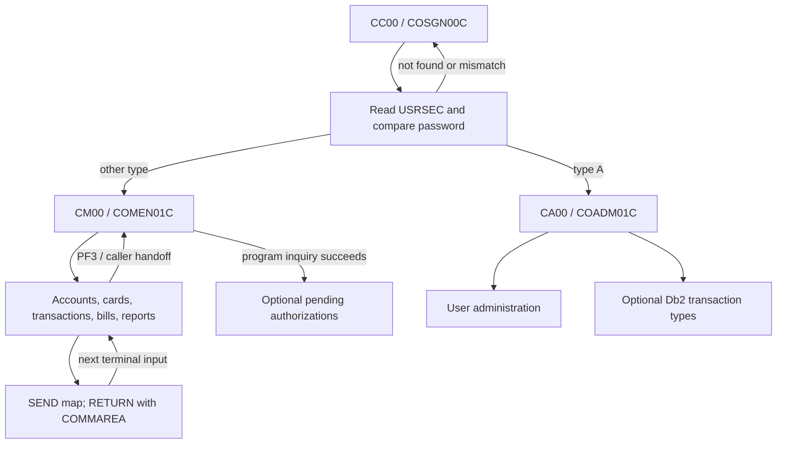
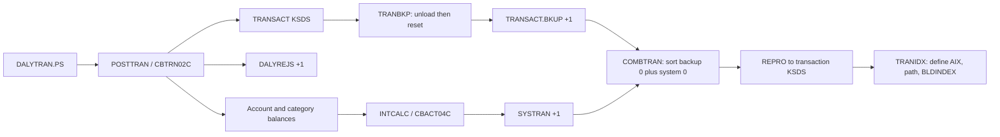
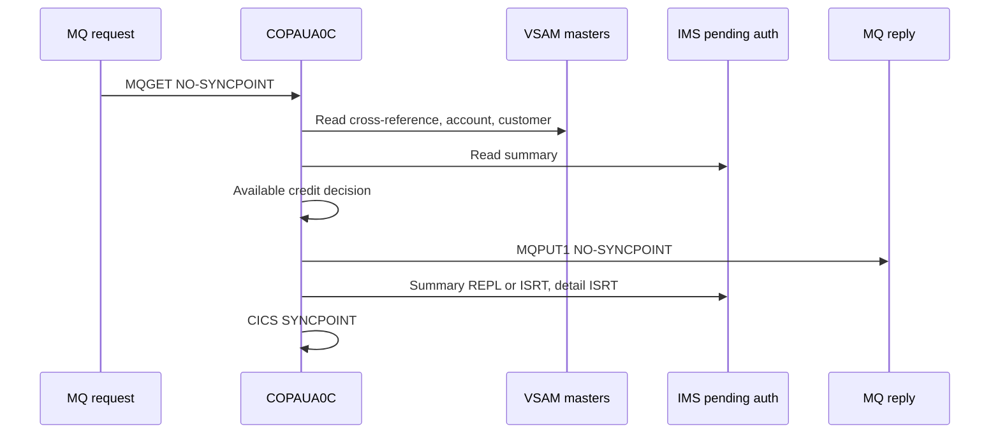

# 02 — End-to-end execution flows

[Artifact index and shared conventions](README.md)

## Purpose, evidence and scope

**Question answered:** What sequence of screens, programs, validations, data operations and outputs implements each CardDemo capability, and where does that sequence depend on installation or operator choices?

**Analyzed revision:** [`fbcb944af892dcb8c94c0549f2ee248945010ff8`](https://github.com/codev-workshops/uc-legacy-modernization-cobol-to-java/commit/fbcb944af892dcb8c94c0549f2ee248945010ff8).

**Evidence status:** source-only reverse engineering. No CICS, JES, VSAM, Db2, IMS or MQ workload was executed. Numbered steps below are **source-confirmed** unless marked otherwise. A source-confirmed call or resource definition does not establish that the resource is installed, the job is accepted, or the operation succeeds. **README/comment claims** are identified separately; **inferences** and **unknowns** are explicit. Diagrams summarize the cited steps and do not add runtime observations.

Coverage includes core online COBOL, its BMS/COMMAREA and CSD handoffs, batch COBOL and JCL/procedures/control members, refresh/import/export, scheduler and submission scripts, and all three optional source families: transaction types in Db2, pending authorizations in IMS/Db2/MQ, and MQ account/date inquiries. Abbreviated application dataset names omit `AWS.M2.CARDDEMO.`; literal exceptions such as the Db2 maintenance input are identified explicitly. DD names and CICS file names are separate identifiers. These names describe the checked-in source, not a verified deployment.

Companion documents: [system inventory](01_SYSTEM_OVERVIEW_AND_INVENTORY.md), [business rules](03_BUSINESS_RULES_CATALOG.md), [data dictionary and lineage](04_DATA_MODEL_DICTIONARY_AND_LINEAGE.md), [interface contracts](05_INTERFACE_CONTRACTS.md), [runtime/failure semantics](06_RUNTIME_STATE_AND_FAILURE_SEMANTICS.md), and [behavioral evidence/open questions](07_BEHAVIORAL_EVIDENCE_AND_OPEN_QUESTIONS.md). This document owns execution order; those documents own the exhaustive inventories, field layouts, rule catalog and failure analysis.

### Flow map

| Area | Stable flow IDs |
| --- | --- |
| Session and online masters | [FLOW-SIGNON-NAVIGATION](#flow-signon-navigation), [FLOW-ACCOUNT-VIEW](#flow-account-view), [FLOW-ACCOUNT-UPDATE](#flow-account-update), [FLOW-CARD-LIST-VIEW](#flow-card-list-view), [FLOW-CARD-UPDATE](#flow-card-update) |
| Transactions and administration | [FLOW-TRANSACTION-LIST-VIEW](#flow-transaction-list-view), [FLOW-TRANSACTION-ADD](#flow-transaction-add), [FLOW-BILL-PAYMENT](#flow-bill-payment), [FLOW-USER-ADMINISTRATION](#flow-user-administration) |
| Batch and outputs | [FLOW-REPORT-SUBMISSION](#flow-report-submission), [FLOW-BATCH-REPORT](#flow-batch-report), [FLOW-FILE-COORDINATION](#flow-file-coordination), [FLOW-DATA-REFRESH](#flow-data-refresh), [FLOW-DAILY-POSTING](#flow-daily-posting), [FLOW-INTEREST-CYCLE](#flow-interest-cycle), [FLOW-TRANSACTION-REBUILD](#flow-transaction-rebuild), [FLOW-STATEMENTS](#flow-statements), [FLOW-EXPORT-IMPORT](#flow-export-import) |
| Optional modules | [FLOW-DB2-TRANSACTION-TYPES](#flow-db2-transaction-types), [FLOW-AUTHORIZATION-RECEIVE](#flow-authorization-receive), [FLOW-AUTHORIZATION-BROWSE-FRAUD](#flow-authorization-browse-fraud), [FLOW-AUTHORIZATION-PURGE](#flow-authorization-purge), [FLOW-MQ-INQUIRIES](#flow-mq-inquiries) |
| Operational orchestration | [FLOW-SCHEDULING](#flow-scheduling), [gaps and contradictions](#gaps-and-contradictions) |

## Online execution model

`CARDDEMO-COMMAREA` contains caller/destination transaction and program names, user ID/type, enter/reenter context, customer/account/card identifiers and last-map metadata. Several programs extend it with local paging, old/new record or selection state. Consequently, “return to screen” commonly means `XCTL` with an initialized entry context, while “wait for the next key” means `RETURN TRANSID(...) COMMAREA(...)`; it is not a retained COBOL call stack. The copybook and transaction-list entry/return code show this distinction. [COCOM01Y][commarea] [COTRN00C MAIN-PARA][trn-list-main] [RETURN-TO-PREV-SCREEN][trn-list-return]

The base CSD maps `CC00` to sign-on, `CM00`/`CA00` to user/admin menus, `CAVW`/`CAUP` to account view/update, `CCLI`/`CCDL`/`CCUP` to card list/view/update, `CT00`/`CT01`/`CT02` to transaction list/view/add, `CB00` to bill payment, `CR00` to reports, and `CU00`–`CU03` to user administration. These are **definition evidence**, not proof of installed transactions. [CARDDEMO.CSD transaction definitions][core-csd]

Text equivalent: sign-on reads security data and routes by stored role; menu selection transfers COMMAREA to a capability; terminal input resumes that capability through its transaction; PF3 generally transfers back to a caller/menu. Optional pending-authorization availability is checked by the main menu, whereas the admin menu directly transfers to its selected program. [Sign-on routing][signon-read] [COMEN01C PROCESS-ENTER-KEY][menu] [COADM01C PROCESS-ENTER-KEY][admin-menu]

### FLOW-SIGNON-NAVIGATION

1. **Trigger/screen:** `CC00` enters `COSGN00C`. `MAIN-PARA` sends `COSGN0A`/`COSGN00` on initial invocation, receives on Enter, and handles PF3 with a plain-text exit message. Missing user ID is reported before missing password. `PROCESS-ENTER-KEY` uppercases both inputs before lookup; do not assume case-sensitive password comparison. [COSGN00C MAIN-PARA and PROCESS-ENTER-KEY][signon-main]
2. **Read/decision:** `READ-USER-SEC-FILE` reads `USRSEC` by user ID, compares `SEC-USR-PWD`, stores the user/type/caller in COMMAREA, resets context to zero, then `XCTL`s to `COADM01C` for type `A`, otherwise `COMEN01C`. Not-found, wrong-password and other-read failures produce distinct screen messages. No sample credentials are reproduced here. [READ-USER-SEC-FILE][signon-read]
3. **Menu validation:** `COMEN01C` normalizes the option, checks numeric/nonzero/in-range, then rejects an option marked `A` for a type-`U` user. The current main-menu entries are marked `U`, including transaction add; the “Admin Only” wording beside add is commented out. `DUMMY...` targets produce a coming-soon message. For `COPAUS0C`, `INQUIRE PROGRAM` must return normal before transfer, otherwise the menu says the option is not installed. [PROCESS-ENTER-KEY][menu] [COMEN02Y entries][menu-options]
4. **Admin/navigation alternate:** admin options select user list/add/update/delete or Db2 transaction-type list/maintenance. `COADM01C` checks the option range and transfers directly. PF3 from either menu transfers to sign-on. Source routing is not evidence of external transaction authorization, nor a guarantee that direct invocation of every target repeats a role check. [COADM01C MAIN-PARA and PROCESS-ENTER-KEY][admin-menu] [COADM02Y][admin-options]

### FLOW-ACCOUNT-VIEW

1. **Trigger/state:** main-menu account view enters `COACTVWC` (`CAVW`). `0000-MAIN` restores COMMAREA, maps the key, and distinguishes initial display from input. PF3 returns to the caller/menu; Enter processes the account filter. [COACTVWC 0000-MAIN][acct-view-main]
2. **Ordered validation/reads:** `2210-EDIT-ACCOUNT` rejects blank, nonnumeric or zero account input. `9000-READ-ACCT` calls `9200-GETCARDXREF-BYACCT` through `CXACAIX`, then `9300-GETACCTDATA-BYACCT` through `ACCTDAT`, then `9400-GETCUSTDATA-BYCUST` through `CUSTDAT`, using the customer ID obtained from the cross-reference. A failed stage prevents subsequent dependent reads. [2210-EDIT-ACCOUNT through 9400-GETCUSTDATA-BYCUST][acct-view-read]
3. **Output/errors:** the account/customer details populate the view map; not-found/error flags determine messages and cursor placement. No master write is made by this view path. The account-to-customer relationship is therefore resolved through a card cross-reference rather than a direct customer key on the screen. [1200-SETUP-SCREEN-VARS][acct-view-screen] [Read chain][acct-view-read]

### FLOW-ACCOUNT-UPDATE

1. **Trigger/state:** `COACTUPC` (`CAUP`) retains old/new account and customer values across terminal returns. `0000-MAIN`, `1200-EDIT-MAP-INPUTS` and `2000-DECIDE-ACTION` implement fetch → display → edit → validated-but-unconfirmed → save. PF3 leaves; PF12 reloads/discards changes; PF5 saves only in the appropriate validated state. [0000-MAIN][acct-update-main] [2000-DECIDE-ACTION][acct-update-action]
2. **Validation order:** validate the account key before fetching; once details exist, compare old/new values, then validate changed fields. The edit family covers mandatory fields, Y/N, alphabetic/alphanumeric and numeric fields, signed decimal amounts, dates, phones, SSN, state, FICO and state/ZIP pairing. Errors return to the map rather than bypassing the confirmation state. This is a combined account/customer update, not an independent customer CRUD screen. [1200-EDIT-MAP-INPUTS][acct-update-validation] [1210–1280 edit paragraphs][acct-update-edits]
3. **Read/write order:** `9000-READ-ACCT` resolves cross-reference, account and customer. On confirmation, `9600-WRITE-PROCESSING` obtains update reads, calls `9700-CHECK-CHANGE-IN-REC` against saved original values, constructs records and rewrites account then customer. A changed underlying record sends the user back to review refreshed originals; lock/read/rewrite failures set distinct update states. The customer-rewrite failure branch explicitly requests `SYNCPOINT ROLLBACK`. Do not infer all deployment recovery settings from that request. [9000-READ-ACCT and dependent reads][acct-update-read] [9600/9700][acct-update-write]

### FLOW-CARD-LIST-VIEW

1. **List trigger:** `COCRDLIC` (`CCLI`) accepts account/card filters. `2200-EDIT-INPUTS` validates account, card and row-selection inputs; `9000-READ-FORWARD` and `9100-READ-BACKWARDS` browse cards and `9500-FILTER-RECORDS` applies filters. PF7/PF8 navigate, PF3 returns, and selected rows transfer to view/update with the selected identifiers and list context. [0000-MAIN][card-list-main] [Input edits and browse/filter paragraphs][card-list-read]
2. **View trigger:** direct view or selection enters `COCRDSLC` (`CCDL`). It restores identifiers from COMMAREA where provided, validates account/card filters, and `9000-READ-DATA` invokes `9100-GETCARD-BYACCTCARD`. Despite that paragraph name, the active `READ` uses the **card number key**; an account-key move is commented out. Do not treat the paragraph name or “account/card combo” message as proof that this read enforces ownership. [0000-MAIN][card-view-main] [Input validation and 9100-GETCARD-BYACCTCARD][card-view-read]
3. **Output/alternate:** view displays card details or lookup errors, and PF3 transfers to the remembered caller/menu. The view is read-only; modification goes through `COCRDUPC`. [COCRDSLC main and screen handling][card-view-main] [1200-SETUP-SCREEN-VARS][card-view-screen]

### FLOW-CARD-UPDATE

1. **Trigger/validation:** main menu or list enters `COCRDUPC` (`CCUP`). `1200-EDIT-MAP-INPUTS` checks account/card identifiers, then changed name, status and expiry inputs using `1230`–`1260`. Valid edits enter a confirmation state; PF5 confirms, PF12 reloads, PF3 exits. [0000-MAIN][card-update-main] [Input edit paragraphs][card-update-validation] [2000-DECIDE-ACTION][card-update-action]
2. **Write:** `9200-WRITE-PROCESSING` reads `CARDDAT` for update **by card number**, compares name/CVV/expiry/status with saved originals in `9300-CHECK-CHANGE-IN-REC`, and builds/re-writes the new card record. The new account ID comes from the screen/account state. If the comparison differs, refreshed original values are retained and the write is skipped; lock and rewrite failures produce separate states. [9200/9300][card-update-write]
3. **Output:** screen state reports completion, confirmation, stale data or failure; there is no new-card creation operation in this path. The view/update key behavior should be kept visible when defining future ownership checks rather than silently strengthened in a behavior-preserving migration. [2000-DECIDE-ACTION][card-update-action] [9200/9300][card-update-write]

### FLOW-TRANSACTION-LIST-VIEW

1. **Trigger/list:** `COTRN00C` (`CT00`) initializes list state, or restores the extended COMMAREA on reentry. Enter starts at the supplied transaction key, validates a selected row/action and may transfer its transaction ID to `COTRN01C`; PF7/PF8 perform previous/next-page browse operations. `STARTBR`/`READNEXT`/`READPREV`/`ENDBR` operate on `TRANSACT`. [MAIN-PARA through paging][trn-list-main] [Browse paragraphs][trn-list-browse]
2. **View:** `COTRN01C` (`CT01`) receives the selected ID or accepts a manually entered ID, rejects an empty lookup, then `READ-TRANSACT-FILE` reads the record and populates `COTRN1A`. Normal, not-found and other CICS response branches determine output. [COTRN01C MAIN-PARA and PROCESS-ENTER-KEY][trn-view-main] [READ-TRANSACT-FILE][trn-view-read]
3. **Alternate/cancel:** PF3 in list returns to the main menu; view uses its caller handoff. In view, PF4 clears and PF5 transfers to the transaction list. These paths carry selection/caller state; they do not post account balances. [COTRN00C return][trn-list-return] [COTRN01C key dispatch][trn-view-main]

### FLOW-TRANSACTION-ADD

1. **Trigger/lookup:** main-menu transaction add enters `COTRN02C` (`CT02`). `PROCESS-ENTER-KEY` invokes key validation first: a supplied account takes precedence and reads `CXACAIX`; otherwise a supplied card reads `CCXREF`; nonnumeric or absent identifiers produce messages. These lookups resolve the card/account, not the batch posting rules. [MAIN-PARA and key validation][trn-add-main] [Cross-reference reads][trn-add-xref]
2. **Ordered edits:** `VALIDATE-INPUT-DATA-FIELDS` checks required type/category/source/description/amount/dates/merchant fields, numeric type/category, the signed `±99999999.99` amount shape, date separators/digits, then calls `CSUTLDTC` on both dates; its message `2513` is exempted from the generic invalid-date branch. Merchant ID must be numeric. This code does not show Db2/VSAM reference-table validation of type/category existence. [VALIDATE-INPUT-DATA-FIELDS][trn-add-validation]
3. **Confirm/write:** confirmation `Y/y` reaches `ADD-TRANSACTION`; `N/n`, blank or low-values prompt for confirmation without clearing, and other values error. The program browses backward from a high transaction key, increments the last ID and writes the assembled record to `TRANSACT`. Duplicate-ID/file errors are surfaced by the write routine. This is a last-key-plus-one allocator, not evidence of a separately locked sequence. [PROCESS-ENTER-KEY][trn-add-main] [ADD-TRANSACTION][trn-add-write] [WRITE-TRANSACT-FILE][trn-add-errors]
4. **Alternate/state:** PF4 clears; PF5 copies the last transaction's editable fields after key validation; PF3 returns to the remembered program or main menu. The path writes a transaction but does not call `CBTRN02C`, rewrite `ACCTDAT` or update `TCATBALF`; daily posting is a separate flow with its own input dataset. [MAIN-PARA][trn-add-main] [ADD-TRANSACTION/COPY-LAST-TRAN-DATA][trn-add-write]

### FLOW-BILL-PAYMENT

1. **Trigger/validate:** `COBIL00C` (`CB00`) rejects a blank/low-values account ID, then interprets confirmation; this paragraph has no explicit numeric test. Blank confirmation reads the account for display; `Y/y` selects payment; `N/n` clears. `READ-ACCTDAT-FILE` uses `READ UPDATE`, including on the display/confirmation path. A balance less than or equal to zero produces a no-payment-needed message. [PROCESS-ENTER-KEY][bill-main] [READ-ACCTDAT-FILE][bill-io]
2. **Payment order:** read `CXACAIX` to obtain a card, browse `TRANSACT` backward to allocate last-ID-plus-one, create type `02`/category `2` with amount equal to current account balance and current timestamps, write the transaction, subtract that amount from `ACCT-CURR-BAL`, then rewrite the account. The resulting balance is zero when these operations succeed on the values read. This routine does not update the current-cycle debit/credit fields or category balances. [PROCESS-ENTER-KEY payment branch][bill-main] [Write/rewrite routines][bill-io]
3. **Output/errors/cancel:** PF3 returns and PF4 clears. Lookup, transaction-write and account-rewrite errors populate the map. The transaction-write routine sends a success/error screen and returns to its caller; no error-flag gate separates that call from balance subtraction and account rewrite. Thus a handled transaction-write failure can still reach the account rewrite, and the success screen precedes that rewrite. Source order does not establish an all-or-nothing result under every CICS file definition. See [payment failure semantics](06_RUNTIME_STATE_AND_FAILURE_SEMANTICS.md#6-bill-payment-and-transaction-addition) and scenario B3. [MAIN-PARA and PROCESS-ENTER-KEY][bill-main] [CICS I/O][bill-io]

### FLOW-USER-ADMINISTRATION

1. **List/select:** admin menu enters `COUSR00C` (`CU00`). Enter searches/selects security rows, PF7/PF8 browse `USRSEC`, and action selection transfers the user ID to update/delete. PF3 returns to the admin menu. [COUSR00C MAIN-PARA through paging][users-list]
2. **Add:** `COUSR01C` (`CU01`) checks nonblank first name, last name, user ID, password, then type, maps them into `SEC-USER-DATA`, and `WRITE-USER-SEC-FILE` writes `USRSEC`. Duplicate keys and other write errors return messages. This paragraph checks that type is present; it does **not** validate membership in `A/U` or uppercase the supplied credentials. [PROCESS-ENTER-KEY][users-add-main] [WRITE-USER-SEC-FILE][users-add-write]
3. **Update:** `COUSR02C` (`CU02`) Enter fetches a user and fills the edit fields, including the stored password field. PF5 invokes `UPDATE-USER-INFO`, checks nonblank edit fields, and rewrites through its `USRSEC` I/O routines. This describes the existing screen behavior without reproducing any stored value. [MAIN-PARA, PROCESS-ENTER-KEY, UPDATE-USER-INFO][users-update-main] [Read/rewrite][users-update-io]
4. **Delete:** `COUSR03C` (`CU03`) Enter reads/display details; PF5 invokes `DELETE-USER-INFO`, reads the target and issues `DELETE`. The delete routine reports success/not-found/other errors; cancellation uses PF3 or form clear rather than a batch job. [MAIN-PARA through DELETE-USER-INFO][users-delete-main] [Read/delete][users-delete-io]
5. **Boundary:** these are direct security-file mutations, independent of `DUSRSECJ` sample initialization. Role/menu routing is documented above; operational authorization and concurrent-update behavior belong to the runtime evidence gap. [Admin menu][admin-menu] [DUSRSECJ load][security-load]

## Reports and batch processing

### FLOW-REPORT-SUBMISSION

1. **Trigger/screen:** `CORPT00C` (`CR00`, `CORPT0A`) accepts monthly, yearly or custom date selection. `PROCESS-ENTER-KEY` tests monthly first, then yearly, then custom; multiple selected fields are not a separate mutually-exclusive selection proof. Monthly computes the current calendar month's first/last day; yearly uses current-year January 1 through December 31. Custom fields undergo required/numeric/date validation through `CSUTLDTC`. [PROCESS-ENTER-KEY][report-input]
2. **Confirmation/transfer:** `SUBMIT-JOB-TO-INTRDR` requires `Y/y`; `N/n` initializes the form. It copies the selected dates into the embedded JCL's `SYMNAMES` and `DATEPARM` overrides, then emits 80-byte lines using `WIRTE-JOBSUB-TDQ` (spelling in source) to TD queue `JOBS`. The loop marks `/*EOF` or a blank record as its end condition but still performs the write for that iteration. PF3 returns; PF4 clears. [Embedded JOB-DATA][report-jcl] [SUBMIT-JOB-TO-INTRDR and WIRTE-JOBSUB-TDQ][report-submit]
3. **Output/unknown:** a successful `WRITEQ TD` is evidence only of the requested queue write, not JES acceptance or report completion. The generated job calls `PROC=TRANREPT` with `STEP05R.SYMNAMES` and `STEP10R.DATEPARM` overrides. Installed TDQ-to-internal-reader routing, procedure library contents and spool monitoring remain unknown. [JOB-DATA][report-jcl] [Submission routine][report-submit]

### FLOW-BATCH-REPORT

1. **Trigger/unload:** submitted report JCL or `TRANREPT.jcl` uses `REPROC` to unload `TRANSACT.VSAM.KSDS` to a new `TRANSACT.BKUP(+1)`. `REPROC.prc` runs `IDCAMS` using `&CNTLLIB(REPROCT)`, whose control statement is `REPRO INFILE(FILEIN) OUTFILE(FILEOUT)`. [TRANREPT procedure][report-proc] [REPROC][reproc] [REPROCT][repro-control]
2. **Filter/sort:** `SORT` reads that generation with symbols `TRAN-CARD-NUM,263,16,ZD` and `TRAN-PROC-DT,305,10,CH`. `SORT FIELDS=(TRAN-CARD-NUM,A)` orders cards; `INCLUDE COND=(TRAN-PROC-DT,GE,PARM-START-DATE,AND,TRAN-PROC-DT,LE,PARM-END-DATE)` selects dates inclusively. Output is `TRANSACT.DALY(+1)`; submitted overrides supply selected dates, whereas the checked-in procedure/job defaults contain fixed 2022 dates. [TRANREPT.prc STEP05R][report-proc] [Standalone TRANREPT.jcl][report-job]
3. **Report program:** `CBTRN03C` opens transaction, cross-reference, type, category, date-parameter and report files; `0550-DATEPARM-READ` reads the date labels, then the main loop reads transactions and looks up card/account, type description and category description. Account/page/grand totals and detail/header records are written through `1111-WRITE-REPORT-REC` to `TRANREPT(+1)` (FB, 133 bytes). Missing lookup records and unexpected I/O statuses invoke the abend path. [CBTRN03C main and report paragraphs][report-program] [Reference reads and DATEPARM][report-lookups]
4. **Source contradictions:** `app/proc/TRANREPT.prc` starts with `//REPROC PROC`, although the submitter calls the member `TRANREPT`. The standalone JCL repeats step name `STEP05R` for unload and sort. These are literal source inconsistencies; no successful JCL conversion was observed. They must not be silently repaired in an execution trace. [Procedure][report-proc] [Standalone job][report-job]

### FLOW-FILE-COORDINATION

1. **Close:** `CLOSEFIL.jcl` runs `SDSF`, writes `/F CICSAWSA,'CEMT SET FIL(...) CLO'` commands for exactly `TRANSACT`, `CCXREF`, `ACCTDAT`, `CXACAIX`, `USRSEC`, and directs output to `ISFOUT`/`CMDOUT`. It does not enumerate every application file or stop all CICS transactions. [CLOSEFIL][close-files]
2. **Batch interval:** loaders/posting/rebuild jobs use their DD allocations after the submission sequence's close. Some loader jobs separately close/open their own files: `CARDFILE` handles its card resources and `CUSTFILE` handles `CUSTDAT`. The general close is therefore not an all-files barrier. None of the five general close commands is a source-level acknowledgement loop. [CARDFILE][card-load] [CUSTFILE][customer-load] [CLOSEFIL][close-files]
3. **Wait/open:** `WAITSTEP` runs `COBSWAIT`, passing `00003600` through **SYSIN**, not an EXEC PARM. `COBSWAIT` accepts the first eight characters and calls `MVSWAIT`; the assembler passes the value to `ASMWAIT`, which expands to `STIMER WAIT,BINTVL=&B`. `OPENFIL` sends matching `OPE` commands for the same five CICS names. The COBOL comment describes centiseconds; successful waits, file closure and operator permissions have not been observed. [WAITSTEP][wait-job] [COBSWAIT][wait-cobol] [MVSWAIT][wait-asm] [ASMWAIT][wait-macro] [OPENFIL][open-files]
4. **Operational boundary:** scripts use sleeps rather than job-completion checks; scheduler exports show dependency conditions/triggers. Neither source form proves the region name, file-to-dataset mapping, lock availability or successful CEMT outcomes at a particular installation. See FLOW-SCHEDULING for the differing graphs. [Posting script][script-posting] [Control-M][controlm-daily] [CA7][ca7-daily]

### FLOW-DATA-REFRESH

These jobs replace or load source datasets; they are materially different from processing one day's new transactions.

1. **Trigger:** README presents initialization and run-order tables; `run_full_batch.sh` submits refresh jobs before posting. The common loader shape is delete → define KSDS → `IDCAMS REPRO` from a sequential dataset. Delete return codes are sometimes normalized (`MAXCC <= 8` or unconditional `SET MAXCC=0`); those statements should not be generalized into a common success policy. [README batch table][readme-batch] [Full-batch script][script-full] [ACCTFILE][account-load] [TCATBALF][category-balance-load]
2. **Input/output bindings:** the table shows actual JCL source/destination suffixes and important extra work.

   | Job | Source suffix → destination suffix | Additional sequence/evidence |
   | --- | --- | --- |
   | `ACCTFILE` | `ACCTDATA.PS` → `ACCTDATA.VSAM.KSDS` | Delete/define/repro. [JCL][account-load] |
   | `CARDFILE` | `CARDDATA.PS` → `CARDDATA.VSAM.KSDS` | Own CICS close/open, define account AIX/path and `BLDINDEX`. [JCL][card-load] |
   | `CUSTFILE` | `CUSTDATA.PS` → `CUSTDATA.VSAM.KSDS` | Own CICS close/open. [JCL][customer-load] |
   | `XREFFILE` | `CARDXREF.PS` → `CARDXREF.VSAM.KSDS` | Rebuild account AIX/path. [JCL][xref-load] |
   | `DISCGRP`, `TCATBALF` | Corresponding `.PS` → `.VSAM.KSDS` | Inputs later used by interest/posting. [DISCGRP][disclosure-load] [TCATBALF][category-balance-load] |
   | `TRANTYPE`, `TRANCATG` | Corresponding `.PS` → `.VSAM.KSDS` | Optional `TRANEXTR` can produce the sequential inputs, but loaders do not invoke it. [TRANTYPE][type-load] [TRANCATG][category-load] |
   | `TRANFILE` | `DALYTRAN.PS.INIT` → `TRANSACT.VSAM.KSDS` | Close, recreate, load, define AIX/path/build, reopen. [JCL][transaction-load] |
   | `DUSRSECJ` | Inline sample records → `USRSEC.PS` → `USRSEC.VSAM.KSDS` | `IEBGENER`, then IDCAMS define/repro; no credentials reproduced. [JCL allocation/load][security-load] |

3. **Boundary/error handling:** the source contains no common validation service that makes all these loads atomic. A normalized deletion RC does not validate record contents; `REPRO`, dataset definitions and per-step conditions control progression. Diagnostic jobs such as `READACCT`, `READCARD`, `READCUST`, `READXREF` and `PRTCATBL` are separate read/print utilities, not replacements for the business posting flow. CA7 explicitly places them in a separate chain. [CA7 read/print paths][ca7-refresh] [CA7 statement/category report paths][ca7-statements]

### FLOW-DAILY-POSTING

1. **Trigger/DD map:** `POSTTRAN` executes `CBTRN02C`. Input `DALYTRAN` is `DALYTRAN.PS`; `XREFFILE` is `CARDXREF.VSAM.KSDS`; the mutable `TRANFILE`, `ACCTFILE`, `TCATBALF` map to transaction/account/category-balance KSDS datasets. `DALYREJS` allocates `DALYREJS(+1)` with 430-byte records. This input is not the online transaction-add screen or the `TRANSACT` master itself. [POSTTRAN][posting-job]
2. **Loop/ordered validation:** open files, read a daily record, reset its failure reason and run `1500-VALIDATE-TRAN`. It checks card cross-reference first, then account availability, then computes `ACCT-CURR-CYC-CREDIT - ACCT-CURR-CYC-DEBIT + DALYTRAN-AMT` against credit limit and compares account expiration with the transaction's original-date portion. Expiry can overwrite an earlier overlimit reason in the account-validation paragraph. A failure goes to `2500-WRITE-REJECT-REC`; accepted records go to posting. There is no prior duplicate transaction-ID lookup in this validation path. [CBTRN02C main][posting-main] [1500 validation family][posting-validation]
3. **Accepted writes:** `2000-POST-TRANSACTION` assembles the transaction, updates/inserts the account/type/category balance through `2700-UPDATE-TCATBAL`, then `2800-UPDATE-ACCOUNT-REC` rewrites the account, then `2900-WRITE-TRANSACTION-FILE` writes `TRANFILE`. Account current balance increases by the amount; cycle credit increases for nonnegative amounts, cycle debit for negative amounts. Preserve these signs and field names rather than substituting accounting terminology. A duplicate-key failure at the final write can therefore follow balance writes; do not describe duplicates as harmless validation rejects. [2000/2500/2700/2800/2900][posting-writes]
4. **Output/errors:** reject output includes the daily transaction and reason/description; counters are displayed and files closed at EOF, with `RETURN-CODE=4` if any validation rejects occurred. Many unexpected file-status failures invoke the abend routine. However, account rewrite's invalid-key branch merely sets reason `109`; the caller does not recheck that reason before the transaction write. Multiple sequential writes occur without a source checkpoint/restart protocol in this program. [Main/close sequence][posting-main] [Posting/reject writes][posting-writes] [Abend routine][posting-abend]

### FLOW-INTEREST-CYCLE

1. **Trigger/DD map:** `INTCALC` runs `CBACT04C,PARM='2022071800'`. It reads `TCATBALF`, cross-reference via account AIX (`XREFFIL1`), disclosure groups (`DISCGRP`), updates `ACCTFILE`, and writes new 350-byte `SYSTRAN(+1)` records through DD `TRANSACT`. `XREFFILE` is also allocated in JCL; the program's SELECT assignment determines which DD is used. [INTCALC][interest-job] [CBACT04C SELECT/linkage/main][interest-main]
2. **Grouped processing:** read category balances sequentially; on account change, update the previous account and reset accumulated interest, then read the new account/cross-reference. Lookup the account-group/type/category disclosure rate; a missing group-rate record retries with group `DEFAULT`. Missing default/unexpected I/O follows abend handling. [Main][interest-main] [1050 through 1200-A][interest-reads]
3. **Calculate/write:** for nonzero rate, `1300-COMPUTE-INTEREST` calculates `(TRAN-CAT-BAL * DIS-INT-RATE) / 1200`, accumulates interest and calls `1300-B-WRITE-TX`. The generated transaction ID combines the ten-character PARM with a counter; timestamp fields use current date/time. `1400-COMPUTE-FEES` is a stub. `1050-UPDATE-ACCOUNT` adds accumulated interest and resets both cycle totals at an account change. **Control-flow inference:** the apparent final update sits in the outer `IF END-OF-FILE = 'N'` ELSE inside a test-before `PERFORM UNTIL END-OF-FILE = 'Y'`. The read sets EOF, the inner processing branch is skipped, and the next loop test exits without reaching that ELSE. The last account is therefore not flushed on the normal EOF transition; see `BR-INTEREST-FINAL-GROUP` and scenario I2. [1050-UPDATE-ACCOUNT][interest-reads] [1300/1400][interest-calculation] [Loop and EOF placement][interest-main]
4. **Downstream:** system transactions have not yet been merged into the transaction KSDS merely because interest completed. `TRANBKP`/`COMBTRAN`/`TRANIDX` provide the separate rebuild path below. Missing rates, missing masters or write errors can prevent completion; exact recovery requires runtime evidence. [Interest I/O/error paths][interest-reads] [Interest script][script-interest]

### FLOW-TRANSACTION-REBUILD

1. **Backup/reset:** `TRANBKP` executes `REPROC` to create `TRANSACT.BKUP(+1)`, then deletes the transaction KSDS and its AIX, normalizing delete RCs `<= 8`. It defines an empty KSDS (`KEYS(16 0)`, record size 350) under `COND=(4,LT)`. This is **backup plus destructive reset**, not a read-only backup. Its delete step has no explicit condition tying it to a successful unload. [TRANBKP][transaction-backup] [REPROC][reproc]
2. **Combine/load:** `COMBTRAN` concatenates `TRANSACT.BKUP(0)` and `SYSTRAN(0)`, sorts on transaction ID bytes 1–16 ascending, writes `TRANSACT.COMBINED(+1)`, then `IDCAMS REPRO`s that generation into the transaction KSDS. No duplicate-removal control statement is supplied. The `(0)` operands resolve to whatever generation is current at execution, not a correlation key to a specific interest run. [COMBTRAN][transaction-combine]
3. **Index:** `TRANIDX` defines a nonunique, upgrade-maintained AIX on bytes 305–330 (`KEYS(26 304)`), defines its path and runs `BLDINDEX`. Source scripts explicitly submit it after posting or combining; other scheduler graphs omit it. [TRANIDX][transaction-index] [Posting/interest scripts][script-posting] [Interest script][script-interest]
4. **GDG lifecycle/conditions:** `DEFGDGB` defines backup, daily-extract, report, category-backup, system-transaction and combined bases with `LIMIT(5) SCRATCH`, and clears `MAXCC` on `LASTCC=12`. `DALYREJS.jcl` separately defines the reject base. `DEFGDGD` deletes the bases, so it is lifecycle setup/teardown, not part of each posting record. JCL `COND=(4,LT)` bypasses a step if a prior RC exceeds 4; `COND=(0,NE)` bypasses for a nonzero prior RC. These conditions are step-level gates, not evidence of cross-job serialization. [DEFGDGB][gdg-create] [DALYREJS][reject-gdg] [DEFGDGD][gdg-delete]

Text equivalent: posting writes accepted transactions and balances; interest consumes balances and emits system transactions; backup/reset and combine rebuild the master; index creation is separate. This is the full-script/data-dependency path, **not a single authoritative scheduler calendar**. [Full-batch script][script-full] [POSTTRAN][posting-job] [INTCALC][interest-job] [TRANBKP][transaction-backup] [COMBTRAN][transaction-combine]

### FLOW-STATEMENTS

1. **Prepare:** `CREASTMT.JCL` deletes/redefines a staging transaction KSDS with `KEYS(32 0)` and clears `MAXCC`. `SORT FIELDS=(263,16,CH,A,1,16,CH,A)` orders by card then transaction ID; `OUTREC FIELDS=(1:263,16,17:1,262,279:279,50)` places card number first. `STEP020` loads the staging KSDS; `COND=(0,NE)` skips that and later conditioned steps when an earlier tested return code is nonzero. There is no date-selection `INCLUDE` in this sort. [CREASTMT DELDEF01–STEP020][statement-job]
2. **Generate:** `STEP040` runs `CBSTM03A` with `TRNXFILE` bound to staging and cross-reference/account/customer masters bound to their KSDSs. `8100-TRNXFILE-OPEN` and `8500-READTRNX-READ` load transactions into working tables through `CBSTM03B`; `1000-MAINLINE` then loops over cross-references, gets customer/account data, and `5000-CREATE-STATEMENT` writes the header and matching card transactions/totals. `CBSTM03B` dispatches on DD name and operation, returning file status to the caller; missing/unexpected statuses follow caller error branches. [CBSTM03A initialization/main][statement-main] [Open/preload][statement-preload] [CBSTM03B dispatch][statement-io] [Statement matching/output][statement-write]
3. **Outputs:** `STMTFILE` is `STATEMNT.PS` (80-byte records), `HTMLFILE` is `STATEMNT.HTML` (100-byte records). Prior outputs are deleted through an `IEFBR14` allocation step. `TXT2PDF1.JCL` separately calls external `%TXT2PDF` under `IKJEFT1B`, reads `STATEMNT.PS` and names `STATEMNT.PS.PDF`; CA7 includes this later job. Availability of its external load/exec libraries is unknown. [CREASTMT STEP030/040][statement-job] [TXT2PDF1][statement-pdf] [CA7][ca7-statements]
4. **Source issue:** `CREASTMT.JCL` line 90 has trailing malformed-looking text after the `SPACE` parameter. The file is uppercase `.JCL`; scripts' lower-case filename assumptions elsewhere cannot prove filesystem portability. A working production statement job or converter result was not supplied. [Literal STMTFILE allocation][statement-job]

### FLOW-EXPORT-IMPORT

1. **Export trigger/allocation:** `CBEXPORT.jcl` deletes/redefines `EXPORT.DATA` as an **indexed** 500-byte dataset with `KEYS(4 28)` and executes `CBEXPORT`. DDs bind customer, account, cross-reference, transaction and card masters plus `EXPFILE`. `1100-OPEN-FILES` opens all inputs and the indexed sequential-access export output. [Export JCL][export-job] [CBEXPORT file definitions/main/open][export-main]
2. **Export sequence:** `0000-MAIN-PROCESSING` exports all customers, then accounts, cross-references, transactions, cards. Each record initializes `CVEXPORT`, sets type `C/A/X/T/D`, timestamp, incrementing sequence and hard-coded branch/region metadata, maps fields and writes. It does not select one branch's related records through a cross-file join. Unexpected read/write status calls `CEE3ABD`; finalization closes and displays counters. [Customer mapping and later record families][export-records] [Finalization][export-final]
3. **Import dispatch:** `CBIMPORT` opens `EXPFILE` for input and sequential outputs for all five families plus errors. It reads the export in order, dispatches by record type, maps values back and writes `CUSTOUT`, `ACCTOUT`, `XREFOUT`, `TRNXOUT`, `CARDOUT`; unknown type is written to `ERROUT`. These outputs are `.IMPORT` datasets, **not automatic writes back into the master KSDSs**. [CBIMPORT definitions][import-definitions] [Open/dispatch/mapping][import-program] [Import JCL][import-job]
4. **Validation/output gaps:** `3000-VALIDATE-IMPORT` only displays validation-completed/no-errors text; it does not perform reconciliation. `CBIMPORT.jcl` omits `CARDOUT` although code opens it. `CVEXPORT` declares a mixed binary/packed/display layout and comments “sequential”; both code and JCL instead use indexed organization for export. The declared key offset must be reconciled with the actual compiled sequence-field offset before claiming an interoperable round trip. No compiler-dependent size or codepage was assumed here. [Import validation/finalization][import-validation] [Import JCL][import-job] [CVEXPORT][export-layout] [Export SELECT][export-main] [Export key definition][export-job]

## Optional integration flows

### FLOW-DB2-TRANSACTION-TYPES

1. **Online list:** admin menu enters `COTRTLIC` (`CTLI`). `1200-EDIT-INPUTS` validates filters and row actions, rejects multiple simultaneous actions, and checks edited descriptions. Forward/backward SQL cursors page through `CARDDEMO.TRANSACTION_TYPE`; `SQLCODE +100` terminates the page. PF7/PF8 page; PF2 transfers to maintenance; PF3 returns. Enter stages row edits/deletes and PF10 executes the pending action through `9200-UPDATE-RECORD` or `9300-DELETE-RECORD`. Successful updates explicitly issue CICS `SYNCPOINT`; `+100`, `-911`, referential constraint and other SQL errors become screen messages. [List dispatch/edit][db2-list-main] [List cursors/write/delete][db2-list-io]
2. **Single-type CRUD:** `COTRTUPC` (`CTTU`) reads by type using `9100-GET-TRANSACTION-TYPE`, stores the original description, compares edited values and uses a confirm state before `9600-WRITE-PROCESSING`. PF4 selects deletion in the relevant state; PF5 confirms an update or starts create for a missing type; PF12 reloads/cancels according to state; PF3 returns through COMMAREA. `9700-INSERT-RECORD` and `9800-DELETE-PROCESSING` provide the other mutations. `SQLCODE +100` on update invokes insert, `-911` reports lock/deadlock and delete `-532` reports a referenced-row failure. The update's SQL predicate contains type only; the old/new screen comparison is not a database stale-record comparison. [Maintenance key/state handling][db2-maint-main] [Input edits][db2-maint-edits] [Read/CRUD SQL][db2-maint-io]
3. **Batch maintenance:** `MNTTRDB2` invokes `IKJEFT01` → `DSN SYSTEM(DAZ1)` → `COBTUPDT` under plan `CARDDEMO`, binding `INPFILE` to the literal dataset `INPFILE`. The input layout is action/type/description. `1003-TREAT-RECORD` dispatches `A/U/D`, ignores `*`, and routes invalid action/SQL errors to `9999-ABEND`. Despite its name, that paragraph displays the message and sets `RETURN-CODE=4`; it does not issue an abend or stop the loop. A missing update/delete yields a no-record message. [MNTTRDB2][db2-maint-job] [COBTUPDT dispatch/SQL][db2-batch]
4. **Extract bridge:** `TRANEXTR` first backs up `TRANTYPE.PS` to `TRANTYPE.BKUP(+1)` and `TRANCATG.PS` to `TRANCATG.PS.BKUP(+1)` with `IEBGENER`, then deletes the prior sequential files. `DSNTIAUL` under `IKJEFT01` extracts two ordered `CHAR(60)` projections: type + padded description + filler, and type/category + padded category data + filler. `STEP20/30/40` use `COND=(0,NE)` (skip for a nonzero earlier tested RC); `STEP50` uses `COND=(4,LT)` (skip if an earlier tested RC exceeds 4). These are step-bypass predicates, not acceptance of abended jobs. Downstream `TRANTYPE`/`TRANCATG` loaders are separate submissions that populate the VSAM lookup datasets used by reports. Thus a successful online Db2 edit is not itself a VSAM report-reference refresh. [TRANEXTR][db2-extract] [TRANTYPE loader][type-load] [TRANCATG loader][category-load]
5. **Installation boundary:** DDL/control and `CREADB21` supply creation/load intentions; subsystem, plan/package, CICS-Db2 attachment and grants require installation evidence. Admin menu does not use the main menu's optional-program check for these targets. [CREADB21][db2-create-job] [DB2CREAT control][db2-ddl] [Admin dispatch][admin-menu]

### FLOW-AUTHORIZATION-RECEIVE

1. **Trigger/resources:** optional CSD associates `CP00` with `COPAUA0C`. `1000-INITIALIZE` retrieves MQ trigger data, obtains the input queue, sets a 5000-ms wait, opens it input-shared and gets the first request. `2000-MAIN-PROCESS` loops until no message or processing-limit termination; `WS-REQSTS-PROCESS-LIMIT` is initialized to 500 and tested with `>` after increment, so the source comparison permits a 501st processed message. [Optional CSD][auth-csd] [Limit declaration][auth-limit] [Initialization/loop][auth-init]
2. **Parse/read order:** `2100-EXTRACT-REQUEST-MSG` unstrings comma-delimited date/time, card, auth type, expiry, message/source, processing code, amount and merchant/POS/transaction fields into the request layout. `5000-PROCESS-AUTH` schedules the IMS PSB, reads card cross-reference, account, customer and existing pending summary; `5600-READ-PROFILE-DATA` is `CONTINUE`. This is not evidence of a completed fraud-profile lookup or comprehensive malformed-message validation. [Parse/MQGET/process order][auth-parse] [VSAM/IMS reads and profile stub][auth-reads]
3. **Decision:** `6000-MAKE-DECISION` defaults approval, declines missing cross-reference/account cases, and compares requested amount to available credit. With an existing summary, available amount is `PA-CREDIT-LIMIT - PA-CREDIT-BALANCE`; otherwise it is `ACCT-CREDIT-LIMIT - ACCT-CURR-BAL`. Response-reason branches also name inactive card, closed account, card/merchant fraud and other cases, but the presence of reason labels must not be mistaken for implemented checks setting all of them. [6000-MAKE-DECISION and response construction][auth-decision]
4. **Reply before persistence:** `6000-MAKE-DECISION` builds the comma-delimited reply; `7100-SEND-RESPONSE` calls `MQPUT1` using request reply-to/correlation information. Then, only if the cross-reference was found, `8000-WRITE-AUTH-TO-DB` updates/inserts summary and inserts detail. `8400-UPDATE-SUMMARY` adjusts approved/declined counts/amounts and pending credit balance for approval. `8500-INSERT-AUTH` stores detail with its authorization key. [Process order][auth-parse] [Response construction][auth-decision] [Reply/IMS writes][auth-write]
5. **Unit-of-work/error boundary:** `MQGET` uses `MQGMO-NO-SYNCPOINT`; `MQPUT1` uses `MQPMO-NO-SYNCPOINT`. The later per-message CICS `SYNCPOINT` therefore must not be described as an atomic receive + reply + IMS transaction. MQ/IMS failures are routed to `9500-LOG-ERROR`, and critical errors terminate through the source error path. **Inference:** a failure after reply and before IMS completion can leave an acknowledged response without the corresponding persisted detail; no runtime replay experiment establishes its frequency or recovery procedure. [MQGET][auth-parse] [MQPUT1/IMS][auth-write] [Error handling][auth-errors]

Text equivalent: remove request outside syncpoint, read masters/summary, decide, send reply outside syncpoint, persist summary/detail, then CICS syncpoint. The diagram shows the found-cross-reference path; missing cross-reference suppresses IMS writes. [5000-PROCESS-AUTH][auth-parse] [Writes][auth-write] [Loop][auth-init]

### FLOW-AUTHORIZATION-BROWSE-FRAUD

1. **Summary/list:** main-menu option enters `COPAUS0C` (`CPVS`, map `COPAU0A`). Enter requires a nonblank numeric account, gathers account/customer information and IMS pending summary, then pages five authorization rows. PF7 restores a prior-page key saved in the extended COMMAREA; PF8 starts after the last key. Enter on a selected row transfers its authorization key and account/customer state to `COPAUS1C`. PF3 returns. [COPAUS0C MAIN-PARA and input/paging][auth-list-main] [IMS reads and account gathering][auth-list-reads]
2. **Detail:** `COPAUS1C` (`CPVD`, map `COPAU1A`) reads the selected IMS summary/detail through `READ-AUTH-RECORD`, formats the detail, and keeps selected-key state in COMMAREA. PF8 reads next detail; EOF displays “already at the last” instead of silently wrapping. PF3 returns to the previous screen. [Detail main/key handling][auth-detail-main] [Detail reads][auth-detail-read]
3. **Fraud action:** PF5 calls `MARK-AUTH-FRAUD`, rereads the selected detail, toggles confirmed/removed fraud state, and `LINK`s `COPAUS2C` with `WS-FRAUD-DATA`. `COPAUS2C` formats the auth timestamp and attempts to insert `CARDDEMO.AUTHFRDS` using the supplied action. SQL `-803` invokes `FRAUD-UPDATE` to change the existing flag/date; other negative results return failure. It returns success/failure in COMMAREA. This fraud record path is separate from the receiver's unimplemented profile lookup. [MARK-AUTH-FRAUD][auth-detail-main] [COPAUS2C SQL/return fields][auth-fraud]
4. **Complete/rollback:** only a successful link and returned Db2 success leads to IMS `REPL PAUTDTL1`; success takes a CICS syncpoint and displays the fraud result. Link/Db2 failure or IMS replacement error calls `SYNCPOINT ROLLBACK`. Cross-resource recovery still depends on installed resource-manager integration. [UPDATE-AUTH-DETAILS/ROLL-BACK][auth-detail-write]

### FLOW-AUTHORIZATION-PURGE

1. **Trigger/parameters:** `CBPAUP0J` executes IMS `DFSRRC00` with `PARM='BMP,CBPAUP0C,PSBPAUTB'`. Its SYSIN is `00,00001,00001,Y`: expiry days, checkpoint frequency, checkpoint-display frequency and debug flag. Blank/zero checkpoint settings default to 5/10; a nonnumeric expiry defaults to 5, but numeric `00` is retained. JCL still contains a placeholder application load library. [CBPAUP0J][purge-job] [1000-INITIALIZE][purge-main]
2. **Read/qualify/delete:** `2000-FIND-NEXT-AUTH-SUMMARY` gets each root, `3000-FIND-NEXT-AUTH-DTL` traverses children with `GNP`. `4000-CHECK-IF-EXPIRED` reconstructs `99999 - PA-AUTH-DATE-9C`, subtracts that YYDDD number from current YYDDD and compares to expiry days. Qualifying details decrement approved or declined count/amount fields in memory before `5000-DELETE-AUTH-DTL` issues `DLET`. This numeric YYDDD subtraction is not a calendar-aware day-count conversion across years. [Main/read/qualification][purge-main] [Expiry/deletes][purge-delete]
3. **Summary/checkpoints:** main tests `PA-APPROVED-AUTH-CNT <= 0` **twice**, not approved and declined, before `6000-DELETE-AUTH-SUMMARY`. The program contains no summary `REPL` to persist the in-memory adjustments on a retained summary, and does not reduce `PA-CREDIT-BALANCE` in the expiry paragraph. Checkpoint occurs when processed-summary count is `>` the configured frequency, plus a final `CHKP`; errors invoke the abend routine. These are source discrepancies, not corrected pseudocode. [Main duplicate condition][purge-main] [Full delete/checkpoint tail][purge-delete]
4. **Output/unknowns:** displays totals for summaries/details read/deleted and checkpoint diagnostics. No source-only claim can establish the resulting IMS tree after every parent delete, restart position, retention policy or recovery configuration. The checked-in zero-day SYSIN must not be described as a verified production retention period. [Main totals][purge-main] [SYSIN][purge-job]

### FLOW-MQ-INQUIRIES

1. **Trigger/open:** optional CSD maps `CDRA` → `COACCT01`, `CDRD` → `CODATE01`. Each `1000-CONTROL` gets trigger context with CICS `RETRIEVE`, takes the input queue from `MQTM-QNAME`, and opens input, reply and error queues. Reply targets are fixed `CARD.DEMO.REPLY.ACCT` or `CARD.DEMO.REPLY.DATE` in this trigger path. Installation of MQ triggering and the region adapter is unknown. [CSD][mq-csd] [COACCT01 initialization][mq-account-init] [CODATE01 initialization][mq-date-init]
2. **Receive/transaction boundary:** `3000-GET-REQUEST` calls `MQGET` with syncpoint options, saves the incoming correlation ID, and calls the processor; `4000-MAIN-PROCESS` takes CICS syncpoints through the processing loop. No-message exits via termination; other MQ errors go to the error-queue handler. This differs from authorization receive's explicit no-syncpoint options. [Account get/loop][mq-account-get] [Date get/loop][mq-date-get]
3. **Account request:** `4000-PROCESS-REQUEST-REPLY` tests `WS-FUNC = 'INQA'` and `WS-KEY > ZEROES`, then reads the account dataset by the supplied key. Normal response maps account ID/status, balances/limits, dates, cycle totals and group into the reply. Not-found or invalid function/key returns invalid-request text; other CICS read failures go to the error routine and termination. The predicate is not a comprehensive numeric-input validator. No account mutation occurs. [Account request/reply][mq-account-process]
4. **Date request:** `CODATE01` uses `ASKTIME`/`FORMATTIME` to produce `MMDDYYYY` with `-` date separators and a time, then sends `SYSTEM DATE ... SYSTEM TIME ...`; this paragraph does not validate an operation code from the payload. [Date formatter][mq-date-process]
5. **Reply/close:** `4100-PUT-REPLY` restores saved correlation ID and uses `MQPMO-SYNCPOINT`; `8000-TERMINATION` closes resources tracked as open. Error-queue records contain the source operation/condition/reason information. Neither a queue declaration nor this correlation copy proves the behavior of an external consumer. [Account reply/error/close][mq-account-close] [Date reply/error/close][mq-date-close]

## FLOW-SCHEDULING

The checked-in artifacts are competing operational descriptions. Their folder names, dates, hosts and schedule IDs are source data, not proof that any one definition is active.

1. **README path (descriptive):** the “Running Batch Jobs” table orders close, master refreshes, transaction reset, optional Db2 extract, posting, interest, backup, combine, statements, index, open. Its component table says `CLOSEFIL`/`OPENFIL` use `IEFBR14`; the actual jobs run `SDSF`. Use README for orientation and the JCL for execution. [README run table][readme-batch] [README components][readme-components] [Close JCL][close-files] [Open JCL][open-files]
2. **Submission scripts (executable source):** all three connect via `tnftp localhost 2121`, switch to JES submission and issue relative `put jcl/...` commands. They neither query job IDs/RCs nor abort later submissions based on earlier JES outcomes. Their relative path assumes an appropriate working directory; running directly from the repository root does not make `jcl/` equal `app/jcl/`. [Posting script][script-posting] [Interest script][script-interest] [Full script][script-full]

   | Script | Submission order, omitting `sleep` only | Material consequence |
   | --- | --- | --- |
   | `run_posting.sh` | `CLOSEFIL → ACCTFILE → TCATBALF → TRANBKP → POSTTRAN → TRANIDX → OPENFIL` | Resets masters/transaction file before posting; not merely incremental posting. |
   | `run_interest_calc.sh` | `CLOSEFIL → INTCALC → TRANBKP → COMBTRAN → TRANIDX → OPENFIL` | Backs up/resets after interest and rebuilds AIX. |
   | `run_full_batch.sh` | `CLOSEFIL → ACCTFILE → CARDFILE → XREFFILE → CUSTFILE → TRANBKP → DISCGRP → TCATBALF → TRANTYPE → DUSRSECJ → POSTTRAN → INTCALC → TRANBKP → COMBTRAN → TRANIDX → OPENFIL` | No statement job, Db2 extract or transaction-category loader appears in this script, despite broader README sequence. |

3. **Control-M dependencies:** the daily folder is `CLOSEFIL → TRANBKP → WAITSTEP → OPENFIL`; it includes neither posting nor index rebuild. Monthly is `CLOSEFIL → INTCALC → COMBTRAN → WAITSTEP → OPENFIL`, omitting the backup/reset and index jobs present in the interest script. Weekly `MNTTRDB2` emits a condition consumed by both disclosure refresh (`CLOSEFIL → DISCGRP → WAITSTEP → OPENFIL`) and `TRANEXTR`; no VSAM type/category loader follows extract in that export. `INCOND`/`OUTCOND` encode these edges; folder labels alone do not establish a production schedule. [Daily][controlm-daily] [Weekly][controlm-weekly] [Monthly][controlm-monthly]
4. **CA7 listings:** one displayed chain is `CLOSEFIL → CBPAUP0J → POSTTRAN → WAITSTEP → OPENFIL` under schedule ID 030. Later fragments reuse job names with different successors: type refresh branches through schedule IDs 031/032 for category and category-balance refresh; another chain reads account/card/customer/xref; another creates statements, converts PDF, then prints category balances under another schedule ID. Treat each listing fragment and schedule ID separately, not as one graph with all repeated names collapsed. No `INTCALC`/`COMBTRAN`/`TRANIDX` job appears in this checked-in listing. [Daily fragment][ca7-daily] [Refresh/read fragments][ca7-refresh] [Statement fragments][ca7-statements]
5. **Conflicts that affect results:** `TRANBKP` empties the master, so the Control-M daily path can reach reopen without a shown reload; the monthly path consumes current backup/system GDGs without a shown backup/reset; the scripts instead rebuild and index explicitly. CA7 daily adds authorization purge before posting, unlike the posting script. These differences are source-confirmed; whether an omitted external predecessor, local override or inactive sample explains them is unknown. There is insufficient evidence to nominate an authoritative production calendar. [TRANBKP][transaction-backup] [Control-M daily/monthly][controlm-daily] [Monthly][controlm-monthly] [CA7 daily][ca7-daily]

## Gaps and contradictions

| Question for implementers/operators | Source evidence and consequence |
| --- | --- |
| Which resource definitions and operational graph are installed? | All flows are source-only. CICS region/file names, TDQ `JOBS`, JES/procedure search path, Db2 plans/subsystem/grants, IMS PSBs/DBDs and MQ queue/trigger configuration require deployment evidence. See corresponding flow citations. |
| What is the intended online-to-posting feed? | Online add writes `TRANSACT`; posting reads `DALYTRAN.PS`. No direct handoff between those operations is implemented in the traced programs. [Add][trn-add-write] [Posting DDs][posting-job] |
| What is the recovery policy for partially posted records? | Category/account writes precede transaction insertion; duplicate IDs are not screened first, and account rewrite reason `109` is not rechecked by its caller. A rerun cannot be assumed idempotent. [Posting validation][posting-validation] [Write order][posting-writes] |
| What enforces card/account association and security outside menu routing? | Card reads use the card key; user add accepts any nonblank type and copies credential case, while sign-on uppercases. External CICS authorization is unknown. [Card view][card-view-read] [User add][users-add-main] [Sign-on][signon-main] |
| Which report/statement JCL is deployable? | Procedure-name mismatch, repeated standalone report step name and statement-allocation trailing text are present. Queue write is not proof of job completion. [Report procedure][report-proc] [Report job][report-job] [Statement job][statement-job] |
| Can exported records be imported successfully? | Indexed export key/layout needs compiler-aware reconciliation; import JCL lacks `CARDOUT`; “validation” is a display-only paragraph. No round-trip was executed. [Export][export-job] [Layout][export-layout] [Import][import-job] [Validation][import-validation] |
| What should authorization purge retain and reconcile? | Zero-day sample SYSIN, YYDDD arithmetic, repeated approved-count predicate, no retained-summary `REPL`, and no pending-credit-balance reduction prevent inferring a complete expiry reconciliation policy. [Purge][purge-main] [Delete tail][purge-delete] |
| How are replied-but-unpersisted authorizations handled? | Receive/reply are no-syncpoint and reply precedes IMS writes. Fraud-profile read is a stub. Recovery/replay and full decision requirements need separate evidence. [Receive][auth-parse] [Writes][auth-write] [Stub][auth-reads] |
| Are close/open commands and waits sufficient operationally? | General close names five resources, not all masters; scripts sleep without checking job completion. An installed scheduler may add controls, but none are assumed. [Close][close-files] [Scripts][script-full] |

Analysis boundaries: no personal identifiers or passwords are reproduced. BMS/copybooks and CSD were used for screen/resource handoffs, not to claim a tested terminal experience. Assembler/maclib wait support, scheduler exports and procedures inform the batch traces; exhaustive deployment inventory belongs to the inventory document. No Java/Spring target, operational SLA, compiler option, codepage or successful runtime result is inferred.

## Pinned source references

All links below refer to the analyzed commit. COBOL line numbers are physical repository lines, not the sequence-area numbers printed inside some source files.

[commarea]: https://github.com/codev-workshops/uc-legacy-modernization-cobol-to-java/blob/fbcb944af892dcb8c94c0549f2ee248945010ff8/app/cpy/COCOM01Y.cpy#L18-L47
[core-csd]: https://github.com/codev-workshops/uc-legacy-modernization-cobol-to-java/blob/fbcb944af892dcb8c94c0549f2ee248945010ff8/app/csd/CARDDEMO.CSD#L306-L488
[signon-main]: https://github.com/codev-workshops/uc-legacy-modernization-cobol-to-java/blob/fbcb944af892dcb8c94c0549f2ee248945010ff8/app/cbl/COSGN00C.cbl#L73-L174
[signon-read]: https://github.com/codev-workshops/uc-legacy-modernization-cobol-to-java/blob/fbcb944af892dcb8c94c0549f2ee248945010ff8/app/cbl/COSGN00C.cbl#L209-L260
[menu]: https://github.com/codev-workshops/uc-legacy-modernization-cobol-to-java/blob/fbcb944af892dcb8c94c0549f2ee248945010ff8/app/cbl/COMEN01C.cbl#L75-L205
[menu-options]: https://github.com/codev-workshops/uc-legacy-modernization-cobol-to-java/blob/fbcb944af892dcb8c94c0549f2ee248945010ff8/app/cpy/COMEN02Y.cpy#L18-L101
[admin-menu]: https://github.com/codev-workshops/uc-legacy-modernization-cobol-to-java/blob/fbcb944af892dcb8c94c0549f2ee248945010ff8/app/cbl/COADM01C.cbl#L75-L173
[admin-options]: https://github.com/codev-workshops/uc-legacy-modernization-cobol-to-java/blob/fbcb944af892dcb8c94c0549f2ee248945010ff8/app/cpy/COADM02Y.cpy#L18-L62
[acct-view-main]: https://github.com/codev-workshops/uc-legacy-modernization-cobol-to-java/blob/fbcb944af892dcb8c94c0549f2ee248945010ff8/app/cbl/COACTVWC.cbl#L262-L408
[acct-view-read]: https://github.com/codev-workshops/uc-legacy-modernization-cobol-to-java/blob/fbcb944af892dcb8c94c0549f2ee248945010ff8/app/cbl/COACTVWC.cbl#L649-L870
[acct-view-screen]: https://github.com/codev-workshops/uc-legacy-modernization-cobol-to-java/blob/fbcb944af892dcb8c94c0549f2ee248945010ff8/app/cbl/COACTVWC.cbl#L460-L592
[acct-update-main]: https://github.com/codev-workshops/uc-legacy-modernization-cobol-to-java/blob/fbcb944af892dcb8c94c0549f2ee248945010ff8/app/cbl/COACTUPC.cbl#L859-L1021
[acct-update-action]: https://github.com/codev-workshops/uc-legacy-modernization-cobol-to-java/blob/fbcb944af892dcb8c94c0549f2ee248945010ff8/app/cbl/COACTUPC.cbl#L2562-L2643
[acct-update-validation]: https://github.com/codev-workshops/uc-legacy-modernization-cobol-to-java/blob/fbcb944af892dcb8c94c0549f2ee248945010ff8/app/cbl/COACTUPC.cbl#L1429-L1777
[acct-update-edits]: https://github.com/codev-workshops/uc-legacy-modernization-cobol-to-java/blob/fbcb944af892dcb8c94c0549f2ee248945010ff8/app/cbl/COACTUPC.cbl#L1783-L2558
[acct-update-read]: https://github.com/codev-workshops/uc-legacy-modernization-cobol-to-java/blob/fbcb944af892dcb8c94c0549f2ee248945010ff8/app/cbl/COACTUPC.cbl#L3608-L3797
[acct-update-write]: https://github.com/codev-workshops/uc-legacy-modernization-cobol-to-java/blob/fbcb944af892dcb8c94c0549f2ee248945010ff8/app/cbl/COACTUPC.cbl#L3888-L4193
[card-list-main]: https://github.com/codev-workshops/uc-legacy-modernization-cobol-to-java/blob/fbcb944af892dcb8c94c0549f2ee248945010ff8/app/cbl/COCRDLIC.cbl#L298-L621
[card-list-read]: https://github.com/codev-workshops/uc-legacy-modernization-cobol-to-java/blob/fbcb944af892dcb8c94c0549f2ee248945010ff8/app/cbl/COCRDLIC.cbl#L985-L1409
[card-view-main]: https://github.com/codev-workshops/uc-legacy-modernization-cobol-to-java/blob/fbcb944af892dcb8c94c0549f2ee248945010ff8/app/cbl/COCRDSLC.cbl#L248-L408
[card-view-read]: https://github.com/codev-workshops/uc-legacy-modernization-cobol-to-java/blob/fbcb944af892dcb8c94c0549f2ee248945010ff8/app/cbl/COCRDSLC.cbl#L608-L775
[card-view-screen]: https://github.com/codev-workshops/uc-legacy-modernization-cobol-to-java/blob/fbcb944af892dcb8c94c0549f2ee248945010ff8/app/cbl/COCRDSLC.cbl#L457-L578
[card-update-main]: https://github.com/codev-workshops/uc-legacy-modernization-cobol-to-java/blob/fbcb944af892dcb8c94c0549f2ee248945010ff8/app/cbl/COCRDUPC.cbl#L367-L560
[card-update-validation]: https://github.com/codev-workshops/uc-legacy-modernization-cobol-to-java/blob/fbcb944af892dcb8c94c0549f2ee248945010ff8/app/cbl/COCRDUPC.cbl#L641-L945
[card-update-action]: https://github.com/codev-workshops/uc-legacy-modernization-cobol-to-java/blob/fbcb944af892dcb8c94c0549f2ee248945010ff8/app/cbl/COCRDUPC.cbl#L948-L1029
[card-update-write]: https://github.com/codev-workshops/uc-legacy-modernization-cobol-to-java/blob/fbcb944af892dcb8c94c0549f2ee248945010ff8/app/cbl/COCRDUPC.cbl#L1420-L1521
[trn-list-main]: https://github.com/codev-workshops/uc-legacy-modernization-cobol-to-java/blob/fbcb944af892dcb8c94c0549f2ee248945010ff8/app/cbl/COTRN00C.cbl#L95-L379
[trn-list-browse]: https://github.com/codev-workshops/uc-legacy-modernization-cobol-to-java/blob/fbcb944af892dcb8c94c0549f2ee248945010ff8/app/cbl/COTRN00C.cbl#L591-L699
[trn-list-return]: https://github.com/codev-workshops/uc-legacy-modernization-cobol-to-java/blob/fbcb944af892dcb8c94c0549f2ee248945010ff8/app/cbl/COTRN00C.cbl#L510-L525
[trn-view-main]: https://github.com/codev-workshops/uc-legacy-modernization-cobol-to-java/blob/fbcb944af892dcb8c94c0549f2ee248945010ff8/app/cbl/COTRN01C.cbl#L86-L211
[trn-view-read]: https://github.com/codev-workshops/uc-legacy-modernization-cobol-to-java/blob/fbcb944af892dcb8c94c0549f2ee248945010ff8/app/cbl/COTRN01C.cbl#L267-L299
[trn-add-main]: https://github.com/codev-workshops/uc-legacy-modernization-cobol-to-java/blob/fbcb944af892dcb8c94c0549f2ee248945010ff8/app/cbl/COTRN02C.cbl#L107-L233
[trn-add-validation]: https://github.com/codev-workshops/uc-legacy-modernization-cobol-to-java/blob/fbcb944af892dcb8c94c0549f2ee248945010ff8/app/cbl/COTRN02C.cbl#L235-L440
[trn-add-xref]: https://github.com/codev-workshops/uc-legacy-modernization-cobol-to-java/blob/fbcb944af892dcb8c94c0549f2ee248945010ff8/app/cbl/COTRN02C.cbl#L576-L640
[trn-add-write]: https://github.com/codev-workshops/uc-legacy-modernization-cobol-to-java/blob/fbcb944af892dcb8c94c0549f2ee248945010ff8/app/cbl/COTRN02C.cbl#L442-L514
[trn-add-errors]: https://github.com/codev-workshops/uc-legacy-modernization-cobol-to-java/blob/fbcb944af892dcb8c94c0549f2ee248945010ff8/app/cbl/COTRN02C.cbl#L642-L752
[bill-main]: https://github.com/codev-workshops/uc-legacy-modernization-cobol-to-java/blob/fbcb944af892dcb8c94c0549f2ee248945010ff8/app/cbl/COBIL00C.cbl#L99-L287
[bill-io]: https://github.com/codev-workshops/uc-legacy-modernization-cobol-to-java/blob/fbcb944af892dcb8c94c0549f2ee248945010ff8/app/cbl/COBIL00C.cbl#L343-L550
[users-list]: https://github.com/codev-workshops/uc-legacy-modernization-cobol-to-java/blob/fbcb944af892dcb8c94c0549f2ee248945010ff8/app/cbl/COUSR00C.cbl#L93-L380
[users-add-main]: https://github.com/codev-workshops/uc-legacy-modernization-cobol-to-java/blob/fbcb944af892dcb8c94c0549f2ee248945010ff8/app/cbl/COUSR01C.cbl#L67-L160
[users-add-write]: https://github.com/codev-workshops/uc-legacy-modernization-cobol-to-java/blob/fbcb944af892dcb8c94c0549f2ee248945010ff8/app/cbl/COUSR01C.cbl#L238-L295
[users-update-main]: https://github.com/codev-workshops/uc-legacy-modernization-cobol-to-java/blob/fbcb944af892dcb8c94c0549f2ee248945010ff8/app/cbl/COUSR02C.cbl#L78-L253
[users-update-io]: https://github.com/codev-workshops/uc-legacy-modernization-cobol-to-java/blob/fbcb944af892dcb8c94c0549f2ee248945010ff8/app/cbl/COUSR02C.cbl#L320-L398
[users-delete-main]: https://github.com/codev-workshops/uc-legacy-modernization-cobol-to-java/blob/fbcb944af892dcb8c94c0549f2ee248945010ff8/app/cbl/COUSR03C.cbl#L78-L200
[users-delete-io]: https://github.com/codev-workshops/uc-legacy-modernization-cobol-to-java/blob/fbcb944af892dcb8c94c0549f2ee248945010ff8/app/cbl/COUSR03C.cbl#L267-L338
[report-jcl]: https://github.com/codev-workshops/uc-legacy-modernization-cobol-to-java/blob/fbcb944af892dcb8c94c0549f2ee248945010ff8/app/cbl/CORPT00C.cbl#L42-L161
[report-input]: https://github.com/codev-workshops/uc-legacy-modernization-cobol-to-java/blob/fbcb944af892dcb8c94c0549f2ee248945010ff8/app/cbl/CORPT00C.cbl#L163-L460
[report-submit]: https://github.com/codev-workshops/uc-legacy-modernization-cobol-to-java/blob/fbcb944af892dcb8c94c0549f2ee248945010ff8/app/cbl/CORPT00C.cbl#L462-L594
[report-proc]: https://github.com/codev-workshops/uc-legacy-modernization-cobol-to-java/blob/fbcb944af892dcb8c94c0549f2ee248945010ff8/app/proc/TRANREPT.prc#L1-L82
[report-job]: https://github.com/codev-workshops/uc-legacy-modernization-cobol-to-java/blob/fbcb944af892dcb8c94c0549f2ee248945010ff8/app/jcl/TRANREPT.jcl#L18-L84
[reproc]: https://github.com/codev-workshops/uc-legacy-modernization-cobol-to-java/blob/fbcb944af892dcb8c94c0549f2ee248945010ff8/app/proc/REPROC.prc#L18-L32
[repro-control]: https://github.com/codev-workshops/uc-legacy-modernization-cobol-to-java/blob/fbcb944af892dcb8c94c0549f2ee248945010ff8/app/ctl/REPROCT.ctl#L1-L15
[report-program]: https://github.com/codev-workshops/uc-legacy-modernization-cobol-to-java/blob/fbcb944af892dcb8c94c0549f2ee248945010ff8/app/cbl/CBTRN03C.cbl#L156-L374
[report-lookups]: https://github.com/codev-workshops/uc-legacy-modernization-cobol-to-java/blob/fbcb944af892dcb8c94c0549f2ee248945010ff8/app/cbl/CBTRN03C.cbl#L376-L512
[close-files]: https://github.com/codev-workshops/uc-legacy-modernization-cobol-to-java/blob/fbcb944af892dcb8c94c0549f2ee248945010ff8/app/jcl/CLOSEFIL.jcl#L18-L33
[open-files]: https://github.com/codev-workshops/uc-legacy-modernization-cobol-to-java/blob/fbcb944af892dcb8c94c0549f2ee248945010ff8/app/jcl/OPENFIL.jcl#L18-L33
[wait-job]: https://github.com/codev-workshops/uc-legacy-modernization-cobol-to-java/blob/fbcb944af892dcb8c94c0549f2ee248945010ff8/app/jcl/WAITSTEP.jcl#L18-L27
[wait-cobol]: https://github.com/codev-workshops/uc-legacy-modernization-cobol-to-java/blob/fbcb944af892dcb8c94c0549f2ee248945010ff8/app/cbl/COBSWAIT.cbl#L18-L39
[wait-asm]: https://github.com/codev-workshops/uc-legacy-modernization-cobol-to-java/blob/fbcb944af892dcb8c94c0549f2ee248945010ff8/app/asm/MVSWAIT.asm#L17-L30
[wait-macro]: https://github.com/codev-workshops/uc-legacy-modernization-cobol-to-java/blob/fbcb944af892dcb8c94c0549f2ee248945010ff8/app/maclib/ASMWAIT.mac#L17-L20
[account-load]: https://github.com/codev-workshops/uc-legacy-modernization-cobol-to-java/blob/fbcb944af892dcb8c94c0549f2ee248945010ff8/app/jcl/ACCTFILE.jcl#L22-L65
[card-load]: https://github.com/codev-workshops/uc-legacy-modernization-cobol-to-java/blob/fbcb944af892dcb8c94c0549f2ee248945010ff8/app/jcl/CARDFILE.jcl#L22-L128
[customer-load]: https://github.com/codev-workshops/uc-legacy-modernization-cobol-to-java/blob/fbcb944af892dcb8c94c0549f2ee248945010ff8/app/jcl/CUSTFILE.jcl#L22-L84
[xref-load]: https://github.com/codev-workshops/uc-legacy-modernization-cobol-to-java/blob/fbcb944af892dcb8c94c0549f2ee248945010ff8/app/jcl/XREFFILE.jcl#L22-L106
[disclosure-load]: https://github.com/codev-workshops/uc-legacy-modernization-cobol-to-java/blob/fbcb944af892dcb8c94c0549f2ee248945010ff8/app/jcl/DISCGRP.jcl#L22-L65
[category-balance-load]: https://github.com/codev-workshops/uc-legacy-modernization-cobol-to-java/blob/fbcb944af892dcb8c94c0549f2ee248945010ff8/app/jcl/TCATBALF.jcl#L22-L65
[type-load]: https://github.com/codev-workshops/uc-legacy-modernization-cobol-to-java/blob/fbcb944af892dcb8c94c0549f2ee248945010ff8/app/jcl/TRANTYPE.jcl#L22-L65
[category-load]: https://github.com/codev-workshops/uc-legacy-modernization-cobol-to-java/blob/fbcb944af892dcb8c94c0549f2ee248945010ff8/app/jcl/TRANCATG.jcl#L22-L65
[transaction-load]: https://github.com/codev-workshops/uc-legacy-modernization-cobol-to-java/blob/fbcb944af892dcb8c94c0549f2ee248945010ff8/app/jcl/TRANFILE.jcl#L22-L125
[security-load]: https://github.com/codev-workshops/uc-legacy-modernization-cobol-to-java/blob/fbcb944af892dcb8c94c0549f2ee248945010ff8/app/jcl/DUSRSECJ.jcl#L46-L88
[posting-job]: https://github.com/codev-workshops/uc-legacy-modernization-cobol-to-java/blob/fbcb944af892dcb8c94c0549f2ee248945010ff8/app/jcl/POSTTRAN.jcl#L18-L45
[posting-main]: https://github.com/codev-workshops/uc-legacy-modernization-cobol-to-java/blob/fbcb944af892dcb8c94c0549f2ee248945010ff8/app/cbl/CBTRN02C.cbl#L164-L368
[posting-validation]: https://github.com/codev-workshops/uc-legacy-modernization-cobol-to-java/blob/fbcb944af892dcb8c94c0549f2ee248945010ff8/app/cbl/CBTRN02C.cbl#L370-L422
[posting-writes]: https://github.com/codev-workshops/uc-legacy-modernization-cobol-to-java/blob/fbcb944af892dcb8c94c0549f2ee248945010ff8/app/cbl/CBTRN02C.cbl#L424-L580
[posting-abend]: https://github.com/codev-workshops/uc-legacy-modernization-cobol-to-java/blob/fbcb944af892dcb8c94c0549f2ee248945010ff8/app/cbl/CBTRN02C.cbl#L707-L714
[interest-job]: https://github.com/codev-workshops/uc-legacy-modernization-cobol-to-java/blob/fbcb944af892dcb8c94c0549f2ee248945010ff8/app/jcl/INTCALC.jcl#L18-L44
[interest-main]: https://github.com/codev-workshops/uc-legacy-modernization-cobol-to-java/blob/fbcb944af892dcb8c94c0549f2ee248945010ff8/app/cbl/CBACT04C.cbl#L27-L232
[interest-reads]: https://github.com/codev-workshops/uc-legacy-modernization-cobol-to-java/blob/fbcb944af892dcb8c94c0549f2ee248945010ff8/app/cbl/CBACT04C.cbl#L350-L460
[interest-calculation]: https://github.com/codev-workshops/uc-legacy-modernization-cobol-to-java/blob/fbcb944af892dcb8c94c0549f2ee248945010ff8/app/cbl/CBACT04C.cbl#L462-L520
[transaction-backup]: https://github.com/codev-workshops/uc-legacy-modernization-cobol-to-java/blob/fbcb944af892dcb8c94c0549f2ee248945010ff8/app/jcl/TRANBKP.jcl#L18-L71
[transaction-combine]: https://github.com/codev-workshops/uc-legacy-modernization-cobol-to-java/blob/fbcb944af892dcb8c94c0549f2ee248945010ff8/app/jcl/COMBTRAN.jcl#L18-L48
[transaction-index]: https://github.com/codev-workshops/uc-legacy-modernization-cobol-to-java/blob/fbcb944af892dcb8c94c0549f2ee248945010ff8/app/jcl/TRANIDX.jcl#L18-L58
[gdg-create]: https://github.com/codev-workshops/uc-legacy-modernization-cobol-to-java/blob/fbcb944af892dcb8c94c0549f2ee248945010ff8/app/jcl/DEFGDGB.jcl#L18-L63
[reject-gdg]: https://github.com/codev-workshops/uc-legacy-modernization-cobol-to-java/blob/fbcb944af892dcb8c94c0549f2ee248945010ff8/app/jcl/DALYREJS.jcl#L18-L32
[gdg-delete]: https://github.com/codev-workshops/uc-legacy-modernization-cobol-to-java/blob/fbcb944af892dcb8c94c0549f2ee248945010ff8/app/jcl/DEFGDGD.jcl#L18-L60
[statement-job]: https://github.com/codev-workshops/uc-legacy-modernization-cobol-to-java/blob/fbcb944af892dcb8c94c0549f2ee248945010ff8/app/jcl/CREASTMT.JCL#L22-L96
[statement-main]: https://github.com/codev-workshops/uc-legacy-modernization-cobol-to-java/blob/fbcb944af892dcb8c94c0549f2ee248945010ff8/app/cbl/CBSTM03A.CBL#L267-L415
[statement-preload]: https://github.com/codev-workshops/uc-legacy-modernization-cobol-to-java/blob/fbcb944af892dcb8c94c0549f2ee248945010ff8/app/cbl/CBSTM03A.CBL#L730-L853
[statement-io]: https://github.com/codev-workshops/uc-legacy-modernization-cobol-to-java/blob/fbcb944af892dcb8c94c0549f2ee248945010ff8/app/cbl/CBSTM03B.CBL#L98-L229
[statement-write]: https://github.com/codev-workshops/uc-legacy-modernization-cobol-to-java/blob/fbcb944af892dcb8c94c0549f2ee248945010ff8/app/cbl/CBSTM03A.CBL#L416-L612
[statement-pdf]: https://github.com/codev-workshops/uc-legacy-modernization-cobol-to-java/blob/fbcb944af892dcb8c94c0549f2ee248945010ff8/app/jcl/TXT2PDF1.JCL#L24-L41
[export-job]: https://github.com/codev-workshops/uc-legacy-modernization-cobol-to-java/blob/fbcb944af892dcb8c94c0549f2ee248945010ff8/app/jcl/CBEXPORT.jcl#L20-L72
[export-main]: https://github.com/codev-workshops/uc-legacy-modernization-cobol-to-java/blob/fbcb944af892dcb8c94c0549f2ee248945010ff8/app/cbl/CBEXPORT.cbl#L34-L241
[export-records]: https://github.com/codev-workshops/uc-legacy-modernization-cobol-to-java/blob/fbcb944af892dcb8c94c0549f2ee248945010ff8/app/cbl/CBEXPORT.cbl#L243-L552
[export-final]: https://github.com/codev-workshops/uc-legacy-modernization-cobol-to-java/blob/fbcb944af892dcb8c94c0549f2ee248945010ff8/app/cbl/CBEXPORT.cbl#L554-L580
[export-layout]: https://github.com/codev-workshops/uc-legacy-modernization-cobol-to-java/blob/fbcb944af892dcb8c94c0549f2ee248945010ff8/app/cpy/CVEXPORT.cpy#L1-L103
[import-job]: https://github.com/codev-workshops/uc-legacy-modernization-cobol-to-java/blob/fbcb944af892dcb8c94c0549f2ee248945010ff8/app/jcl/CBIMPORT.jcl#L20-L68
[import-definitions]: https://github.com/codev-workshops/uc-legacy-modernization-cobol-to-java/blob/fbcb944af892dcb8c94c0549f2ee248945010ff8/app/cbl/CBIMPORT.cbl#L34-L109
[import-program]: https://github.com/codev-workshops/uc-legacy-modernization-cobol-to-java/blob/fbcb944af892dcb8c94c0549f2ee248945010ff8/app/cbl/CBIMPORT.cbl#L165-L447
[import-validation]: https://github.com/codev-workshops/uc-legacy-modernization-cobol-to-java/blob/fbcb944af892dcb8c94c0549f2ee248945010ff8/app/cbl/CBIMPORT.cbl#L449-L485
[db2-list-main]: https://github.com/codev-workshops/uc-legacy-modernization-cobol-to-java/blob/fbcb944af892dcb8c94c0549f2ee248945010ff8/app/app-transaction-type-db2/cbl/COTRTLIC.cbl#L506-L1269
[db2-list-io]: https://github.com/codev-workshops/uc-legacy-modernization-cobol-to-java/blob/fbcb944af892dcb8c94c0549f2ee248945010ff8/app/app-transaction-type-db2/cbl/COTRTLIC.cbl#L1600-L1952
[db2-maint-main]: https://github.com/codev-workshops/uc-legacy-modernization-cobol-to-java/blob/fbcb944af892dcb8c94c0549f2ee248945010ff8/app/app-transaction-type-db2/cbl/COTRTUPC.cbl#L358-L613
[db2-maint-edits]: https://github.com/codev-workshops/uc-legacy-modernization-cobol-to-java/blob/fbcb944af892dcb8c94c0549f2ee248945010ff8/app/app-transaction-type-db2/cbl/COTRTUPC.cbl#L649-L1083
[db2-maint-io]: https://github.com/codev-workshops/uc-legacy-modernization-cobol-to-java/blob/fbcb944af892dcb8c94c0549f2ee248945010ff8/app/app-transaction-type-db2/cbl/COTRTUPC.cbl#L1447-L1664
[db2-maint-job]: https://github.com/codev-workshops/uc-legacy-modernization-cobol-to-java/blob/fbcb944af892dcb8c94c0549f2ee248945010ff8/app/app-transaction-type-db2/jcl/MNTTRDB2.jcl#L8-L30
[db2-batch]: https://github.com/codev-workshops/uc-legacy-modernization-cobol-to-java/blob/fbcb944af892dcb8c94c0549f2ee248945010ff8/app/app-transaction-type-db2/cbl/COBTUPDT.cbl#L75-L237
[db2-extract]: https://github.com/codev-workshops/uc-legacy-modernization-cobol-to-java/blob/fbcb944af892dcb8c94c0549f2ee248945010ff8/app/app-transaction-type-db2/jcl/TRANEXTR.jcl#L25-L122
[db2-create-job]: https://github.com/codev-workshops/uc-legacy-modernization-cobol-to-java/blob/fbcb944af892dcb8c94c0549f2ee248945010ff8/app/app-transaction-type-db2/jcl/CREADB21.jcl#L18-L84
[db2-ddl]: https://github.com/codev-workshops/uc-legacy-modernization-cobol-to-java/blob/fbcb944af892dcb8c94c0549f2ee248945010ff8/app/app-transaction-type-db2/ctl/DB2CREAT.ctl#L1-L74
[auth-csd]: https://github.com/codev-workshops/uc-legacy-modernization-cobol-to-java/blob/fbcb944af892dcb8c94c0549f2ee248945010ff8/app/app-authorization-ims-db2-mq/csd/CRDDEMO2.csd#L11-L68
[auth-limit]: https://github.com/codev-workshops/uc-legacy-modernization-cobol-to-java/blob/fbcb944af892dcb8c94c0549f2ee248945010ff8/app/app-authorization-ims-db2-mq/cbl/COPAUA0C.cbl#L35-L45
[auth-init]: https://github.com/codev-workshops/uc-legacy-modernization-cobol-to-java/blob/fbcb944af892dcb8c94c0549f2ee248945010ff8/app/app-authorization-ims-db2-mq/cbl/COPAUA0C.cbl#L220-L347
[auth-parse]: https://github.com/codev-workshops/uc-legacy-modernization-cobol-to-java/blob/fbcb944af892dcb8c94c0549f2ee248945010ff8/app/app-authorization-ims-db2-mq/cbl/COPAUA0C.cbl#L351-L468
[auth-reads]: https://github.com/codev-workshops/uc-legacy-modernization-cobol-to-java/blob/fbcb944af892dcb8c94c0549f2ee248945010ff8/app/app-authorization-ims-db2-mq/cbl/COPAUA0C.cbl#L472-L653
[auth-decision]: https://github.com/codev-workshops/uc-legacy-modernization-cobol-to-java/blob/fbcb944af892dcb8c94c0549f2ee248945010ff8/app/app-authorization-ims-db2-mq/cbl/COPAUA0C.cbl#L657-L734
[auth-write]: https://github.com/codev-workshops/uc-legacy-modernization-cobol-to-java/blob/fbcb944af892dcb8c94c0549f2ee248945010ff8/app/app-authorization-ims-db2-mq/cbl/COPAUA0C.cbl#L738-L935
[auth-errors]: https://github.com/codev-workshops/uc-legacy-modernization-cobol-to-java/blob/fbcb944af892dcb8c94c0549f2ee248945010ff8/app/app-authorization-ims-db2-mq/cbl/COPAUA0C.cbl#L940-L1024
[auth-list-main]: https://github.com/codev-workshops/uc-legacy-modernization-cobol-to-java/blob/fbcb944af892dcb8c94c0549f2ee248945010ff8/app/app-authorization-ims-db2-mq/cbl/COPAUS0C.cbl#L178-L486
[auth-list-reads]: https://github.com/codev-workshops/uc-legacy-modernization-cobol-to-java/blob/fbcb944af892dcb8c94c0549f2ee248945010ff8/app/app-authorization-ims-db2-mq/cbl/COPAUS0C.cbl#L750-L1000
[auth-detail-main]: https://github.com/codev-workshops/uc-legacy-modernization-cobol-to-java/blob/fbcb944af892dcb8c94c0549f2ee248945010ff8/app/app-authorization-ims-db2-mq/cbl/COPAUS1C.cbl#L157-L371
[auth-detail-read]: https://github.com/codev-workshops/uc-legacy-modernization-cobol-to-java/blob/fbcb944af892dcb8c94c0549f2ee248945010ff8/app/app-authorization-ims-db2-mq/cbl/COPAUS1C.cbl#L431-L518
[auth-detail-write]: https://github.com/codev-workshops/uc-legacy-modernization-cobol-to-java/blob/fbcb944af892dcb8c94c0549f2ee248945010ff8/app/app-authorization-ims-db2-mq/cbl/COPAUS1C.cbl#L520-L571
[auth-fraud]: https://github.com/codev-workshops/uc-legacy-modernization-cobol-to-java/blob/fbcb944af892dcb8c94c0549f2ee248945010ff8/app/app-authorization-ims-db2-mq/cbl/COPAUS2C.cbl#L89-L244
[purge-job]: https://github.com/codev-workshops/uc-legacy-modernization-cobol-to-java/blob/fbcb944af892dcb8c94c0549f2ee248945010ff8/app/app-authorization-ims-db2-mq/jcl/CBPAUP0J.jcl#L24-L47
[purge-main]: https://github.com/codev-workshops/uc-legacy-modernization-cobol-to-java/blob/fbcb944af892dcb8c94c0549f2ee248945010ff8/app/app-authorization-ims-db2-mq/cbl/CBPAUP0C.cbl#L136-L273
[purge-delete]: https://github.com/codev-workshops/uc-legacy-modernization-cobol-to-java/blob/fbcb944af892dcb8c94c0549f2ee248945010ff8/app/app-authorization-ims-db2-mq/cbl/CBPAUP0C.cbl#L277-L385
[mq-csd]: https://github.com/codev-workshops/uc-legacy-modernization-cobol-to-java/blob/fbcb944af892dcb8c94c0549f2ee248945010ff8/app/app-vsam-mq/csd/CRDDEMOM.csd#L1-L41
[mq-account-init]: https://github.com/codev-workshops/uc-legacy-modernization-cobol-to-java/blob/fbcb944af892dcb8c94c0549f2ee248945010ff8/app/app-vsam-mq/cbl/COACCT01.cbl#L178-L323
[mq-account-get]: https://github.com/codev-workshops/uc-legacy-modernization-cobol-to-java/blob/fbcb944af892dcb8c94c0549f2ee248945010ff8/app/app-vsam-mq/cbl/COACCT01.cbl#L325-L388
[mq-account-process]: https://github.com/codev-workshops/uc-legacy-modernization-cobol-to-java/blob/fbcb944af892dcb8c94c0549f2ee248945010ff8/app/app-vsam-mq/cbl/COACCT01.cbl#L390-L460
[mq-account-close]: https://github.com/codev-workshops/uc-legacy-modernization-cobol-to-java/blob/fbcb944af892dcb8c94c0549f2ee248945010ff8/app/app-vsam-mq/cbl/COACCT01.cbl#L462-L617
[mq-date-init]: https://github.com/codev-workshops/uc-legacy-modernization-cobol-to-java/blob/fbcb944af892dcb8c94c0549f2ee248945010ff8/app/app-vsam-mq/cbl/CODATE01.cbl#L127-L272
[mq-date-get]: https://github.com/codev-workshops/uc-legacy-modernization-cobol-to-java/blob/fbcb944af892dcb8c94c0549f2ee248945010ff8/app/app-vsam-mq/cbl/CODATE01.cbl#L274-L337
[mq-date-process]: https://github.com/codev-workshops/uc-legacy-modernization-cobol-to-java/blob/fbcb944af892dcb8c94c0549f2ee248945010ff8/app/app-vsam-mq/cbl/CODATE01.cbl#L339-L364
[mq-date-close]: https://github.com/codev-workshops/uc-legacy-modernization-cobol-to-java/blob/fbcb944af892dcb8c94c0549f2ee248945010ff8/app/app-vsam-mq/cbl/CODATE01.cbl#L366-L521
[readme-batch]: https://github.com/codev-workshops/uc-legacy-modernization-cobol-to-java/blob/fbcb944af892dcb8c94c0549f2ee248945010ff8/README.md#L207-L233
[readme-components]: https://github.com/codev-workshops/uc-legacy-modernization-cobol-to-java/blob/fbcb944af892dcb8c94c0549f2ee248945010ff8/README.md#L296-L324
[script-posting]: https://github.com/codev-workshops/uc-legacy-modernization-cobol-to-java/blob/fbcb944af892dcb8c94c0549f2ee248945010ff8/scripts/run_posting.sh#L1-L36
[script-interest]: https://github.com/codev-workshops/uc-legacy-modernization-cobol-to-java/blob/fbcb944af892dcb8c94c0549f2ee248945010ff8/scripts/run_interest_calc.sh#L1-L36
[script-full]: https://github.com/codev-workshops/uc-legacy-modernization-cobol-to-java/blob/fbcb944af892dcb8c94c0549f2ee248945010ff8/scripts/run_full_batch.sh#L1-L68
[controlm-daily]: https://github.com/codev-workshops/uc-legacy-modernization-cobol-to-java/blob/fbcb944af892dcb8c94c0549f2ee248945010ff8/app/scheduler/CardDemo.controlm#L1-L24
[controlm-weekly]: https://github.com/codev-workshops/uc-legacy-modernization-cobol-to-java/blob/fbcb944af892dcb8c94c0549f2ee248945010ff8/app/scheduler/CardDemo.controlm#L25-L63
[controlm-monthly]: https://github.com/codev-workshops/uc-legacy-modernization-cobol-to-java/blob/fbcb944af892dcb8c94c0549f2ee248945010ff8/app/scheduler/CardDemo.controlm#L64-L93
[ca7-daily]: https://github.com/codev-workshops/uc-legacy-modernization-cobol-to-java/blob/fbcb944af892dcb8c94c0549f2ee248945010ff8/app/scheduler/CardDemo.ca7#L18-L148
[ca7-refresh]: https://github.com/codev-workshops/uc-legacy-modernization-cobol-to-java/blob/fbcb944af892dcb8c94c0549f2ee248945010ff8/app/scheduler/CardDemo.ca7#L159-L455
[ca7-statements]: https://github.com/codev-workshops/uc-legacy-modernization-cobol-to-java/blob/fbcb944af892dcb8c94c0549f2ee248945010ff8/app/scheduler/CardDemo.ca7#L465-L571
