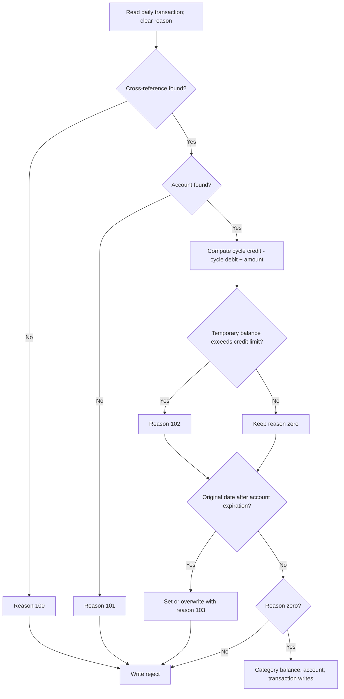

# Business rules catalog

## Purpose, revision, and evidence

**Question answered:** What decisions, validations, calculations, defaults, and state changes does the current CardDemo source implement, including behavior that differs from a plausible credit-card policy?

**Analyzed revision:** [`fbcb944af892dcb8c94c0549f2ee248945010ff8`](https://github.com/codev-workshops/uc-legacy-modernization-cobol-to-java/tree/fbcb944af892dcb8c94c0549f2ee248945010ff8).

**Evidence status:** Static source analysis only. No legacy program, transaction, batch job, terminal, database, or queue was executed. “Accepts,” “rejects,” and “writes” below describe branches in source, not observed production results. All examples are synthetic. Compiler options, actual data, deployed program versions, resource definitions, and transaction recovery behavior remain unknown.

**Coverage:** Core posting (`CBTRN02C`), interest/cycle processing (`CBACT04C`), bill payment (`COBIL00C`), account/customer maintenance (`COACTUPC`), card maintenance (`COCRDUPC`), transaction entry (`COTRN02C`), sign-on/menu/user maintenance, reports and statements (`CORPT00C`, `CBTRN03C`, `CBSTM03A/B`), import/export (`CBIMPORT`, `CBEXPORT`), and the optional DB2 transaction-type, IMS/DB2/MQ authorization/fraud/purge, and VSAM/MQ inquiry families. Relevant copybooks and selected job contracts inform the rules. This is not an inventory of every screen-layout attribute or every I/O error paragraph.

Related documents, with deliberately unguessed anchors:

- [System overview and inventory](01_SYSTEM_OVERVIEW_AND_INVENTORY.md)
- [End-to-end execution flows](02_END_TO_END_EXECUTION_FLOWS.md)
- [Data model, dictionary, and lineage](04_DATA_MODEL_DICTIONARY_AND_LINEAGE.md)
- [Interface contracts](05_INTERFACE_CONTRACTS.md)
- [Runtime, state, and failure semantics](06_RUNTIME_STATE_AND_FAILURE_SEMANTICS.md)
- [Behavioral evidence and open questions](07_BEHAVIORAL_EVIDENCE_AND_OPEN_QUESTIONS.md)

### Reading conventions

- **Source-confirmed:** Executable statements or declarations directly establish the rule. Unless qualified otherwise, catalog rows have this status.
- **Derived:** A consequence calculated from those statements, assuming valid numeric data and successful I/O. Boundary examples use this status.
- **Observation requiring disposition:** A surprising branch, omission, stub, or suspected defect. It must not be silently corrected when preserving behavior.
- **Intent only:** Comments or README descriptions. These do not establish executable policy.
- **Unknown:** Requires runtime, compiler, installation, or business-owner evidence.

Rule identifiers belong to this document and use semantic names rather than source line numbers. References name the program/paragraph and link to the analyzed commit. A check implemented in one entry point must not be assumed to protect another entry point.

## 1. Numeric and representation rules

| Rule ID | Source-confirmed rule and consequence | Evidence |
| --- | --- | --- |
| BR-NUM-ACCOUNT | `ACCT-ID` is `9(11)`. Current balance, credit limit, cash credit limit, and cycle credit/debit are **signed display numeric** `S9(10)V99`; they are not declared `COMP-3` in the base account copybook. The decimal is implied. Dates are ten-character fields, so a comparison of them is not by itself calendar validation. | `CVACT01Y`, `ACCOUNT-RECORD` [layout][account-layout]. |
| BR-NUM-TRANSACTION | Transaction ID and card number are `X(16)`, type is `X(2)`, category is `9(4)`, and amount is `S9(9)V99`. Daily input uses the corresponding two-decimal amount. Category balances are `S9(9)V99`; disclosure rates are `S9(4)V99`. Account amounts therefore have one more integer digit than transaction/category amounts. | `CVTRA05Y`, `CVTRA06Y`, `CVTRA01Y`, `CVTRA02Y` [transaction][transaction-layout], [daily][daily-layout], [category][category-layout], [rate][rate-layout]. |
| BR-NUM-RECEIVERS | Posting temporary balance and interest monthly/total receivers are `S9(9)V99`. The inspected posting, interest, and payment arithmetic has no `ROUNDED` or `ON SIZE ERROR` clause. For representable values, extra fractional digits are discarded at receiving precision rather than rounded to nearest cent. Overflow/invalid numeric data outcomes must not be invented without compiler evidence. | `CBTRN02C`, `WS-TEMP-BAL` [declaration][post-numeric]; `CBACT04C`, `WS-MONTHLY-INT`, `WS-TOTAL-INT` [declarations][interest-numeric], [calculation][interest-calculate]; `COBIL00C`, `PROCESS-ENTER-KEY` [payment calculation][pay-main]. |

Derived boundary: `100.00 × 1.00 / 1200 = 0.08333…` produces `0.08` in the two-decimal monthly-interest receiver. This is a per-category truncation before accumulation, not a rounding rule applied once to an account-wide unrounded sum.

## 2. Daily transaction posting

### Decision sequence

Text equivalent: Each input starts with no rejection. Card cross-reference failure prevents account validation. A found account is checked for limit first and expiration second; expiration can replace the limit error. Only reason zero enters the three-write posting path. This follows `1500-VALIDATE-TRAN`, `1500-A-LOOKUP-XREF`, `1500-B-LOOKUP-ACCT`, and `2000-POST-TRANSACTION` [validation][post-validation] [posting][post-write].

| Rule ID | Preconditions, condition, and ordered outcome | Evidence |
| --- | --- | --- |
| BR-POST-LOOKUP | For every daily record, look up its card in the cross-reference. `INVALID KEY` sets `100 / INVALID CARD NUMBER FOUND`. Only if reason remains zero, read the account identified by the cross-reference; `INVALID KEY` sets `101 / ACCOUNT RECORD NOT FOUND`. These are not independent accumulated errors. | `CBTRN02C`, `1500-VALIDATE-TRAN` through `1500-B-LOOKUP-ACCT` [source][post-validation]. |
| BR-POST-LIMIT | On successful account read, set `WS-TEMP-BAL = ACCT-CURR-CYC-CREDIT - ACCT-CURR-CYC-DEBIT + DALYTRAN-AMT`. Accept the limit check when `ACCT-CREDIT-LIMIT >= WS-TEMP-BAL`; otherwise reason `102`. This does **not** use current account balance. | `1500-B-LOOKUP-ACCT` [source][post-validation]. |
| BR-POST-EXPIRATION | After the limit test, compare account expiration with `DALYTRAN-ORIG-TS(1:10)`. Expiration greater than or equal to that string passes; otherwise set `103 / TRANSACTION RECEIVED AFTER ACCT EXPIRATION`, overwriting `102` if previously set. The routine performs no calendar parser call. | `1500-B-LOOKUP-ACCT` [source][post-validation]. |
| BR-POST-SIDE-EFFECTS | Accepted records copy input fields to the transaction, replace processing timestamp with a generated current timestamp, then update category balance, update account, and write transaction, in that order. Category key is account + type + category. Missing category (`23`) creates an initialized category balance; an existing category adds the amount and rewrites. | `2000-POST-TRANSACTION`, `2700-UPDATE-TCATBAL`, `2700-A-CREATE-TCATBAL-REC`, `2700-B-UPDATE-TCATBAL-REC` [construction][post-write] [category update][post-category]. |
| BR-POST-SIGN | Add the signed amount to account current balance. Amount `>= 0` adds to cycle **credit**; negative amount adds, still negative, to cycle **debit**. There is no absolute-value conversion. No transaction-type-specific payment sign reversal appears in this routine. | `2800-UPDATE-ACCOUNT-REC` [source][post-account]. |
| BR-POST-FAILURE | Nonzero validation reasons write original daily data plus the validation trailer to rejects; any rejected records make final `RETURN-CODE = 4`. Daily `00` continues, `10` ends input, other read statuses take the abend path. Account rewrite invalid key assigns `109`, but this occurs **after** the main reject decision: that paragraph has no status-to-abend branch or caller recheck, so the transaction write follows. This is not a normal validation reject. Transaction-write failure itself abends. | Main loop [source][post-main], `1000-DALYTRAN-GET-NEXT` [source][post-read], `2500-WRITE-REJECT-REC` [source][post-write], `2800/2900` [source][post-account]. |
| BR-POST-VALIDATION-SCOPE | The validator ends with a comment “ADD MORE VALIDATIONS HERE.” Implemented checks above do not test active card/account status, positive amount, or existence of type/category definitions. The comment is extension intent, not an implemented policy. | `1500-VALIDATE-TRAN` and its only two callees [source][post-validation]. |

Derived boundaries and observations:

- Credit `80.00`, debit `0.00`, amount `20.00`, limit `100.00`: limit passes at equality. Amount `20.01` fails.
- Credit `80.00`, debit `-20.00`, amount `20.00`: temporary balance is `120.00`, even though the debit is negative. This is a source consequence; changing subtraction or storing an absolute debit is a business decision.
- An over-limit transaction dated one day after expiration ends with reason `103`, not two reasons. The expiration date itself passes for valid ISO-shaped strings.
- The three writes are not described here as atomic or restart-safe. A category change can precede a later write failure in source order; recovery depends on the runtime and job configuration.

## 3. Interest and cycle processing

| Rule ID | Preconditions, calculation, and side effects | Evidence |
| --- | --- | --- |
| BR-INTEREST-GROUP | Process transaction-category balances sequentially. A changed account key causes update of the preceding account (except first time), resets total interest, and reads the new account and account cross-reference. Disclosure lookup key combines account group, category type, and category code. | `CBACT04C`, main loop [source][interest-main]. |
| BR-INTEREST-DEFAULT | If disclosure lookup returns `23`, change only the group component to literal `DEFAULT` and reread. Default read must return `00`; missing default or other file errors abend. There is no zero-rate fallback for a missing default. | `1200-GET-INTEREST-RATE`, `1200-A-GET-DEFAULT-INT-RATE` [source][interest-default]. |
| BR-INTEREST-AMOUNT | Only a rate not equal to zero invokes interest and fee paragraphs. Compute `(TRAN-CAT-BAL * DIS-INT-RATE) / 1200` into `S9(9)V99`, add that received value to account total interest, and write an interest transaction. No daily accrual, minimum balance, positive-balance restriction, or `ROUNDED` clause appears here. Negative balance/rate is not separately rejected. | Main loop [source][interest-main]; `1300-COMPUTE-INTEREST` [source][interest-calculate]; [PICs][interest-numeric]. |
| BR-INTEREST-TRANSACTION | Increment a six-digit suffix and concatenate ten-character `PARM-DATE` + suffix into the 16-character ID. Write type `01`, category `05`, source `System`, description beginning `Int. for a/c` followed by a space, calculated amount, card from account cross-reference, zero merchant ID, blank merchant text, and generated original/processing timestamps. A zero calculated amount still writes if the rate is nonzero. | `1300-B-WRITE-TX` [source][interest-calculate]; [suffix and parameter][interest-numeric]. |
| BR-INTEREST-RESET | `1050-UPDATE-ACCOUNT` adds accumulated interest to current balance and sets both cycle credit and cycle debit to zero, then rewrites the account. The routine does not clear category balances. A zero-rate category can still belong to an account reaching this update at the next group transition. | `1050-UPDATE-ACCOUNT` [source][interest-update]; main loop [source][interest-main]. |
| BR-INTEREST-FEE-STUB | `1400-COMPUTE-FEES` contains “To be implemented” and `EXIT`. No late, annual, over-limit, or other fee rule is executable in this paragraph. | `1400-COMPUTE-FEES` [source][interest-fee]. |
| BR-INTEREST-FINAL-GROUP | **Observation requiring disposition:** the loop tests `END-OF-FILE = 'N'` before reading. The read can change it to `Y`, which skips inner processing; the outer `ELSE` containing final account update was selected only when the flag was already not `N`. The loop then terminates. Thus normal EOF does not reach that final-update branch, while prior accounts update at group transitions. | Main loop [source][interest-main] and `1000-TCATBALF-GET-NEXT` [source][interest-read]. |

Derived examples: At balance `1,000.00` and rate `12.00`, monthly interest is `10.00`. At balance `0.01` and rate `1.00`, it is `0.00`, but a transaction is still constructed. For one account in the entire input, interest transactions can be written while the account balance/reset update is missed by the final-group control flow. These are static predictions, not runtime test results.

## 4. Online bill payment

| Rule ID | Preconditions, condition, and outcome | Evidence |
| --- | --- | --- |
| BR-PAY-CONFIRM | Require account input, then interpret `Y/y` as confirmation, `N/n` as clear/cancel with error flag, blank/low-values as an account read without confirmation, and anything else as invalid Y/N input. Account is read with `UPDATE`. Balance `<= 0` produces “You have nothing to pay...” before the payment block. | `COBIL00C`, `PROCESS-ENTER-KEY` [source][pay-main]; `READ-ACCTDAT-FILE` [source][pay-account]. |
| BR-PAY-FULL-BALANCE | Confirmed payment copies **the entire current balance** into `TRAN-AMT`, writes the transaction, computes `ACCT-CURR-BAL = ACCT-CURR-BAL - TRAN-AMT`, and rewrites the account. There is no user-entered partial payment or minimum-payment formula. Cycle credit/debit and category balances are not changed by this payment block. | `PROCESS-ENTER-KEY` [source][pay-main]. |
| BR-PAY-ID-AND-FIELDS | Read account cross-reference, browse transactions from high-values, `READPREV`, then increment the numeric ID. `READPREV` EOF supplies zero. Construct type `02`, category `2`, source `POS TERM`, description `BILL PAYMENT - ONLINE`, positive balance-derived amount, synthetic merchant values, and current timestamps. This is separate from the batch posting sign convention. | `PROCESS-ENTER-KEY` [source][pay-main]; `READPREV-TRANSACT-FILE` [source][pay-write]. |
| BR-PAY-ERRORS | Transaction `DUPKEY/DUPREC` produces “Tran ID already exist...”; other write errors produce “Unable to Add Bill pay Transaction...”. Account rewrite distinguishes `NOTFND` and other errors. The calling block has no additional error-flag test between transaction write and account subtraction. Its error paths call a screen sender that does not terminate the transaction, so subtraction/rewrite can follow a reported transaction-write failure if CICS calls return normally. Recovery is runtime-dependent. | `WRITE-TRANSACT-FILE` [source][pay-write]; `UPDATE-ACCTDAT-FILE` [source][pay-account]; caller [source][pay-main]; `SEND-BILLPAY-SCREEN` [source][pay-send]. |
| BR-PAY-PRECISION | “Entire balance” is bounded by the receiver: account has ten integer digits, transaction amount nine. For balances representable in both, e.g. `125.25`, subtracting the copied amount yields zero. A balance of `1,000,000,000.00` does not fit the transaction amount; there is no local range check or size-error clause. Do not promise zero balance for that case. | [Account layout][account-layout], [transaction layout][transaction-layout], [payment moves][pay-main]. |

## 5. Account and customer maintenance

### Input lifecycle and validation order

`COACTUPC` first validates the search account, fetches data, then compares old/new details before editing changed data. Unchanged, already-confirmed, or completed states skip the full validation pass. If edits pass, the state asks for confirmation; PF5 in that state invokes the write routine. Source: `1200-EDIT-MAP-INPUTS`, `1205-COMPARE-OLD-NEW`, `2000-DECIDE-ACTION` [entry][account-edit-entry] [comparison][account-compare] [confirmation][account-confirm].

**BR-ACCOUNT-ORDER:** The full pass calls editors in this order: account status → open date → credit limit → expiry date → cash credit limit → reissue date → current balance → cycle credit → cycle debit → SSN → birth date → FICO → first name → optional middle name → last name → address line 1 → state (including state-code lookup) → ZIP → city → country → phone 1 → phone 2 → EFT account ID → primary-holder flag → state/ZIP combination. Each field can acquire an error flag; many editors write the shared message only when `WS-RETURN-MSG-OFF`, retaining the first reported error rather than replacing it with each later error. Evidence: `1200-EDIT-MAP-INPUTS` [account fields][account-edit-one] [customer fields][account-edit-two], generic editors [required][account-required] [numeric][account-numeric].

| Rule ID | Condition, scope, and outcome | Evidence |
| --- | --- | --- |
| BR-ACCOUNT-KEY | Account search is required; spaces/low-values prompt for an account. The 11-character key must be numeric and nonzero. Invalid input clears the account selection and blocks the search. | `1210-EDIT-ACCOUNT` [source][account-key]. |
| BR-ACCOUNT-MISSING-FIELDS | `1100-RECEIVE-MAP` initializes new details and converts literal `*` or spaces in many inputs to low-values. **This is not a general patch/“leave existing value” contract:** required editors reject low-values, and old/new comparison compares the resulting values. Optional fields need their own treatment; no blanket merge of missing fields with old data is established. | `1100-RECEIVE-MAP` [normalization][account-input], `1205-COMPARE-OLD-NEW` [comparison][account-compare], `1215-EDIT-MANDATORY` [required][account-required]. |
| BR-ACCOUNT-STATUS | Account active status and primary-holder flag use the Y/N editor: blank, low-values, or zero fail; the condition-name values are uppercase `Y` and `N`. This is a field-domain check, not an enforced closed-account financial lifecycle. | `FLG-YES-NO-ISVALID` [domain][account-yesno-domain]; `1220-EDIT-YESNO` [editor][account-yesno]. |
| BR-ACCOUNT-MONEY | Credit limit, cash limit, current balance, cycle credit, and cycle debit use `TEST-NUMVAL-C(...) = 0` after a required-value check, and receive converted values via `NUMVAL-C`. The editor does not impose positivity, cash limit ≤ credit limit, or balance ≤ credit limit. These must not be imported as assumed policy. | `1250-EDIT-SIGNED-9V2` [source][account-money], `1100-RECEIVE-MAP` [conversion][account-input], [call sites][account-edit-one]. |
| BR-ACCOUNT-NAMES-ADDRESS | First/last names, city, and country invoke required alphabetic editors; address line 1 invokes mandatory/nonblank validation. State is two-character alphabetic plus a supported-state condition. ZIP uses the first five characters with required numeric/nonzero validation; EFT ID uses ten characters with the same editor. State + first two ZIP digits must match the declared combination list. | `1200-EDIT-MAP-INPUTS` [calls][account-edit-two], `1225-EDIT-ALPHA-REQD` [alphabetic][account-alpha], `1245-EDIT-NUM-REQD` [numeric][account-numeric], `1270/1280` [state][account-state] [ZIP combination][account-fico-zip]. |
| BR-ACCOUNT-SSN-PHONE | SSN uses the shared numeric editor for 3-, 2-, and 4-character groups, including nonzero rejection; its first group additionally excludes 666 and 900..999. Parts 2/3 are inside the outer part-1-valid branch. Each phone is checked as area, prefix, and line-number groups; blank, nonnumeric, and zero components fail. These are shape/domain checks, not identity or telephone-assignment verification. | `1260-EDIT-US-PHONE-NUM` [source][account-phone], `1265-EDIT-US-SSN` [source][account-ssn], `INVALID-SSN-PART1` [domain][account-ssn-domain]. |
| BR-ACCOUNT-FICO | Numeric/nonzero validation precedes range validation. Three-digit score range is inclusive `300 THROUGH 850`. Synthetic boundaries: 299 and 851 fail; 300 and 850 pass this range test. No credit-limit decision is derived from the score here. | [condition-name][account-fico-domain], `1275-EDIT-FICO-SCORE` [source][account-fico-zip], [call site][account-edit-two]. |
| BR-ACCOUNT-SAVE | A confirmed changed record is reread for update, along with its customer; old/current comparison detects intervening changes. If unchanged, prepare and rewrite account, then customer. Lock/read/change failures stop this save path. Customer rewrite failure explicitly issues `SYNCPOINT ROLLBACK`; do not infer that every other failure has the same explicit rollback. | `9600-WRITE-PROCESSING`, `9700-CHECK-CHANGE-IN-REC` [lock and comparison][account-lock] [rewrites][account-rewrite] [change comparison][account-concurrent]. |

### Shared date rules

| Rule ID | Exact rule and important boundary | Evidence |
| --- | --- | --- |
| BR-DATE-CALENDAR | The account caller performs `EDIT-DATE-CCYYMMDD THRU EDIT-DATE-CCYYMMDD-EXIT`: component checks in year/month/day order require century 19 or 20, month/day ranges, 30-day-month restrictions, and February restrictions. For February 29, years ending `00` are divided by 400; other years by 4, requiring remainder zero. The performed range also includes `EDIT-DATE-LE`, calling `CSUTLDTC` and treating nonzero severity as error. | `CSUTLDPY`, `EDIT-YEAR-CCYY` through `EDIT-DATE-CCYYMMDD-EXIT` [components][date-components] [calendar][date-calendar] [utility and range exit][date-utility]; `CSUTLDWY`, `THIS-CENTURY/LAST-CENTURY` [domains][date-domains]; account [call sites][account-edit-one]. |
| BR-DATE-BIRTH | Birth-date check requires `current-date-integer > birth-date-integer`. Today therefore fails as well as future dates, although the message says “cannot be in the future.” This is not an age-of-majority check. | `CSUTLDPY`, `EDIT-DATE-OF-BIRTH` [source][date-birth]; `COACTUPC` [call site][account-edit-two]. |

## 6. Card and transaction maintenance

| Rule ID | Implemented behavior | Evidence |
| --- | --- | --- |
| BR-CARD-ORDER | On initial card search, edit account then card key; with details present, compare old/new values, then edit embossed name, status, expiry month, expiry year. No-change and confirmation states skip repeat editing. Missing values are normalized to low-values, not automatically merged with old values. | `COCRDUPC`, `1100-RECEIVE-MAP`, `1200-EDIT-MAP-INPUTS` [source][card-input]. |
| BR-CARD-FIELDS | Name must be nonblank/nonzero and consist of permitted letters/spaces. Status is `Y/N`; month is `1..12`; year is `1950..2099`. The shown edit chain does not validate day against the chosen month/year or require expiry after today. The update reconstructs `year-month-day` using the retained day. | `1230-EDIT-NAME` through `1260-EDIT-EXPIRY-YEAR` [source][card-edit]; [domains][card-domain]; `9200-WRITE-PROCESSING` update construction [source][card-update]. |
| BR-CARD-KEY-SCOPE | `9100-GETCARD-BYACCTCARD` is named as if it reads a compound relationship, but the CICS read key is only card number. A successful read sets found status without an account-equality test in this paragraph. Account/card ownership enforcement cannot be inferred from the paragraph name or error text. | `9100-GETCARD-BYACCTCARD` [source][card-read]. |
| BR-CARD-SAVE | Save reads with update intent, checks for record changes, then rewrites; failures set input/lock/update flags. New data includes account ID, CVV, name, expiry, and status. This is maintenance of an existing card record; no issuance/activation workflow should be inferred. | `9200-WRITE-PROCESSING`, `9300-CHECK-CHANGE-IN-REC` [source][card-update] [change comparison][card-lock]. |
| BR-TRAN-KEY-PRECEDENCE | If account is supplied, numeric-check it, convert with `NUMVAL`, look up the account cross-reference, and populate card. Only otherwise does supplied card take the card-key lookup path and populate account. If both are supplied, account takes precedence; this routine does not cross-validate two independently entered keys. Neither supplied produces a required-key error. | `COTRN02C`, `VALIDATE-INPUT-KEY-FIELDS` [source][tran-key]. |
| BR-TRAN-EDIT-ORDER | After key validation, required fields are tested in order: type, category, source, description, amount, original date, processing date, merchant ID/name/city/ZIP. Then type/category numeric checks, amount shape, original-date shape, processing-date shape, amount conversion, and date utility calls. Error branches send the screen; they do not implement an error collection API. | `VALIDATE-INPUT-DATA-FIELDS` [required fields][tran-required] [formats and utility][tran-formats]. |
| BR-TRAN-AMOUNT | Amount shape is exactly sign `+/-`, eight digits, decimal point, two digits (`-99999999.99` message); then `NUMVAL-C` converts to `WS-TRAN-AMT-N S9(9)V99`. No positive-only restriction appears. Shape does not imply type/category eligibility or a limit check. | `VALIDATE-INPUT-DATA-FIELDS` [source][tran-formats], [receiver][tran-numeric]. |
| BR-TRAN-DATES | Both dates first require `YYYY-MM-DD` character shape, then `CSUTLDTC`. A nonzero severity is rejected unless message number is `2513`, which is explicitly ignored. Dates are moved into the larger 26-character transaction timestamp fields; no time-of-day input is synthesized in this add paragraph. | Date checks [source][tran-formats]; `ADD-TRANSACTION` [moves][tran-write]; [timestamp PICs][transaction-layout]. |
| BR-TRAN-CREATE | Y/y confirmation performs add; N/n/blank asks for confirmation. Add browses to highest transaction ID, reads previous, increments a numeric ID, and writes a transaction. The add path does not update account/category balances. Duplicate ID and general write failure have separate messages; no collision retry appears. Copy-last reuses the last browsed transaction's entry fields rather than calculating new financial values. | `PROCESS-ENTER-KEY` [confirmation][tran-confirm], `ADD-TRANSACTION`, `COPY-LAST-TRAN-DATA` [source][tran-write], `WRITE-TRANSACT-FILE` [errors][tran-errors]. |

Derived boundaries: `+00000000.00` passes the amount shape; `1.00` does not. February with retained day `31` is not rejected by the card month/year editor chain alone. Neither statement proves an actual screen submission succeeds, because the remaining checks and runtime are prerequisites.

## 7. Sign-on, roles, and user lifecycle

| Rule ID | Implemented business/security check | Evidence |
| --- | --- | --- |
| BR-USER-SIGNON | Reject blank user ID and then blank password; uppercase both supplied fields. Read security record and compare supplied password to stored password. Successful administrator sign-on routes to `COADM01C`; other users route to `COMEN01C`. This is source-level password comparison; the routine provides no basis for a password hashing or lockout claim. | `COSGN00C`, `PROCESS-ENTER-KEY`, `READ-USER-SEC-FILE` [input][user-signon-input] [comparison/routing][user-signon-read]. |
| BR-USER-MENU | Menu selection must be numeric, nonzero, and within option count. The regular menu rejects a user whose commarea type is user when selected option requires `A`. Administrator menu handles a `DUMMY` program as not installed. These are menu-path checks; they do not establish protection of direct CICS transactions by installed security products. | `COMEN01C`, `PROCESS-ENTER-KEY` [role check][user-menu]; `COADM01C`, `PROCESS-ENTER-KEY` [admin option check][user-admin]. |
| BR-USER-LIST | On the user list, the first nonblank row selection in order is used. `U/u` routes to update; `D/d` to delete; other selection values report the allowed U/D choices. | `COUSR00C`, `PROCESS-ENTER-KEY` [source][user-list]. |
| BR-USER-ADD | Required checks are first name → last name → user ID → password → user type. When no error is set, fields populate the security record and it is written. The required user-type check is not itself an A/U whitelist; do not infer one from the prompt. `DUPKEY/DUPREC` reports existing ID; other write errors report inability to add. | `COUSR01C`, `PROCESS-ENTER-KEY` [validation][user-add], `WRITE-USER-SEC-FILE` [outcomes][user-add-errors]. |
| BR-USER-UPDATE | Require ID for lookup. Update validation requires first/last name, password, and user type. Read security file with update intent, compare input fields with stored fields, replace changed values, and rewrite when changed; unchanged input has a distinct outcome. No password-strength/history rule is present in those field checks. | `COUSR02C`, `PROCESS-ENTER-KEY`, `UPDATE-USER-INFO`, `READ-USER-SEC-FILE`, `UPDATE-USER-SEC-FILE` [validation][user-update-input] [read/replace][user-update-write]. |
| BR-USER-DELETE | PF5 calls deletion, which requires nonblank ID, reads the security record for update, then deletes. `NOTFND` reports unknown ID; success clears fields. No “cannot delete yourself/last administrator” condition is in this deletion path. | `COUSR03C`, main AID dispatch, `DELETE-USER-INFO`, `READ-USER-SEC-FILE`, `DELETE-USER-SEC-FILE` [dispatch/input][user-delete-input] [delete][user-delete-write]. |

## 8. Reports and statements

| Rule ID | Selection, aggregation, and limits | Evidence |
| --- | --- | --- |
| BR-REPORT-RANGE | Monthly report selects **first through last day of the current month**: set day 1, increment month with year rollover, then subtract one day to form end date. Yearly selects January 1 through December 31 of current year. Monthly/yearly/custom are checked in that precedence order. | `CORPT00C`, `PROCESS-ENTER-KEY` [source][report-ranges]. |
| BR-REPORT-CUSTOM | Custom dates undergo required component and shape checks and `CSUTLDTC`; nonzero severity is ignored for message `2513`, as in transaction entry. Submission fills date parameters and sends job records to the internal reader. A displayed “submitted” message is not evidence that the job completed. | `PROCESS-ENTER-KEY` [custom validation][report-custom], `SUBMIT-JOB-TO-INTRDR` [submission][report-submit]. |
| BR-REPORT-INCLUSION | Batch report includes records with `TRAN-PROC-TS(1:10) >= start` and `<= end`; original timestamp is not the filter. Account-total breaks are triggered by **card-number changes**, with account identified via cross-reference. Correct grouping therefore depends on input ordering and card/account relationships. | `CBTRN03C`, main loop [source][report-main]. |
| BR-REPORT-TOTALS | Each detail adds signed amount to page and account totals. Page flush adds page total to grand total and clears page total; account flush writes/clears account total. EOF branch also adds `TRAN-AMT` before page/grand flush, even though it follows a failed EOF read; final total behavior depends on retained record area and the preceding date test. **Observation requiring disposition:** do not present the totals as independently verified reconciliation. | `1100-WRITE-TRANSACTION-REPORT`, `1110-WRITE-PAGE-TOTALS`, `1120-WRITE-ACCOUNT-TOTALS`, `1110-WRITE-GRAND-TOTALS` [source][report-totals]; EOF branch [source][report-main]. |
| BR-REPORT-STATEMENT | For every cross-reference, retrieve customer/account, create statement header (including balance/FICO), reset transaction total, and output transactions matching the current card. Sum their signed amounts into `WS-TOTAL-AMT S9(9)V99 COMP-3`, then output total to statement/HTML. The balance shown comes from account data; it is not recalculated from that card's displayed sum. | `CBSTM03A`, `1000-MAINLINE`, `4000-TRNXFILE-GET`, `5000-CREATE-STATEMENT` [iteration][statement-main] [sum][statement-sum] [header][statement-header]; [total PIC][statement-numeric]. |
| BR-REPORT-STATEMENT-CAPACITY | Transaction cache has 51 card slots and 10 transactions per card. Load code increments subscripts without a capacity guard in that path. It records the final card's transaction count at `8599-EXIT`; final-group handling is therefore distinct from the interest-loop omission. Overflow outcome depends on compiler/runtime bounds checking. `CBSTM03B` returns file statuses to the caller; it supplies I/O, not another interest/payment calculation. | `CBSTM03A`, transaction table [source][statement-table], `8500-READTRNX-READ`, `8599-EXIT` [loading][statement-load]; `CBSTM03B`, dispatch/I/O [source][statement-io]. |

Derived examples: A transaction on either requested boundary is included by the date predicate. A current-month report requested on its first day still targets that month's last day, not yesterday. Eleven transactions for a cached card exceed the declared second dimension; the source does not define a clean “too many transactions” business response.

## 9. Import/export semantics

| Rule ID | Ordering, defaults, and validation | Evidence |
| --- | --- | --- |
| BR-EXPORT-ORDER | Export customer, account, cross-reference, transaction, then card records. Types are `C/A/X/T/D`. For each output initialize export record, set shared run timestamp, increment sequence, and set branch `0001` and region `NORTH`. Those literals are not derived from customer address. | `CBEXPORT`, `0000-MAIN-PROCESSING`, `2200-CREATE-CUSTOMER-EXP-REC`, corresponding type writers [order][export-main] [metadata][export-customer] [account][export-account] [other types][export-types]. |
| BR-EXPORT-REPRESENTATION | `CVEXPORT` declares common type, 26-character timestamp, nine-digit `COMP` sequence, branch/region, and 460-byte payload, with customer/account/transaction/xref/card redefinitions. Numeric fields mix display, binary `COMP`, and packed `COMP-3`. Copying decoded values is required; this is not an all-text interchange format. The 500-byte record comment is intent/layout context, not a guarantee across arbitrary compiler storage choices. | `CVEXPORT`, `EXPORT-RECORD` and redefinitions [source][export-layout]. |
| BR-IMPORT-DISPATCH | Read export input sequentially by its declared indexed sequence key. `C/A/X/T/D` dispatch to entity-specific conversion. Initialize native record, move mapped fields, and write the appropriate **sequential output**, rather than update existing keyed live records. Each type increments its own count; write failures call abend. | `CBIMPORT`, file control [source][import-files], `2200-PROCESS-RECORD-BY-TYPE` and record processors [dispatch/customer][import-dispatch] [other entities][import-entities]. |
| BR-IMPORT-UNKNOWN | Unknown type increments unknown-type count and writes an error record including timestamp, type, sequence, and “Unknown record type encountered.” Recognized-type field values do not pass through the online account/card/customer editors. | `2700-PROCESS-UNKNOWN-RECORD` [source][import-unknown]; [entity moves][import-entities]. |
| BR-IMPORT-VALIDATION-STUB | `3000-VALIDATE-IMPORT` only displays “Import validation completed” and “No validation errors detected.” It performs no reconciliation, referential integrity, balance validation, or comparison of error counters. The message must not be treated as proof that imported data is valid. | `3000-VALIDATE-IMPORT` [source][import-stub]. |

Derived boundary: A nonblank export type other than the five recognized values becomes an error record. A known account type with a negative credit limit is moved to output by the account processor; no online positivity policy is applied there.

## 10. Optional DB2 transaction types

| Rule ID | Executable rule | Evidence |
| --- | --- | --- |
| BR-DB2-TYPE-BATCH | Input operation is one character, type two, description fifty. `A` inserts, `U` updates by type, `D` deletes by type, `*` ignores a comment. Unknown operation reports `ERROR: TYPE NOT VALID`. **Despite its name**, `9999-ABEND` displays the message, sets return code 4, and `EXIT`s; it is not a termination/abend call. The input loop can continue. | `COBTUPDT`, input layouts, `1001-READ-NEXT-RECORDS`, `1003-TREAT-RECORD`, SQL paragraphs, `9999-ABEND` [dispatch][db2-batch-main] [SQL/error routine][db2-batch-sql]. |
| BR-DB2-TYPE-SQL | Batch SQL zero is success; update/delete `+100` produce not-found messages; negative codes call the above return-code routine. Add does not locally turn a duplicate into an update. DB2 constraints and installed table contents supply additional enforcement. | `COBTUPDT`, `10031-INSERT-DB`, `10032-UPDATE-DB`, `10033-DELETE-DB` [source][db2-batch-sql]. |
| BR-DB2-TYPE-ONLINE | Online editor checks two-character type with `TEST-NUMVAL`, rejecting missing/zero conversion, then required fifty-character description with allowed alphanumeric/space conversion. This is the actual utility-based numeric condition; it should not be casually strengthened to a two-digit-only regular expression. | `COTRTUPC`, `1200-EDIT-MAP-INPUTS`, `1230-EDIT-ALPHANUM-REQD`, `1245-EDIT-NUM-REQD` [call order][db2-edit-order] [description][db2-description] [type][db2-numeric]. |
| BR-DB2-TYPE-CONFIRM | Online maintenance distinguishes requested/confirmed/done states and PF5 confirmation before updates. In list maintenance, delete SQL zero syncpoints; `-532` tells the user to delete associated child records first; other outcomes format a failure. SQL failure codes are not all equivalent to “not found.” | `COTRTUPC`, AID dispatch [confirmation][db2-confirm]; `COTRTLIC`, `9300-DELETE-RECORD` [delete][db2-delete]. |
| BR-DB2-TYPE-JOB | Supplied maintenance job runs `COBTUPDT` under `IKJEFT01` / `DSN`, plan `CARDDEMO`, using `INPFILE`. It supplies no alternate validation logic; the input operation and return-code rules remain those of the program. This is a checked-in job contract, not evidence of an installed DB2 plan. | `MNTTRDB2`, `STEP1`, `SYSTSIN` [job][db2-job]. |

## 11. Optional authorization decisions

Authorization policy here is separate from batch posting and online transaction entry. Its existence in source does not prove the IMS/DB2/MQ module is installed.

| Rule ID | Preconditions, decision, and outcome | Evidence |
| --- | --- | --- |
| BR-AUTH-INPUT | Comma-delimited request is unpacked into date/time, card, authorization type, expiry, message type/source, processing code, amount, merchant fields, and transaction ID. Amount uses `NUMVAL`. A supplied field is not evidence of its validation: the decision paragraph does not test request expiry or merchant identity. | `COPAUA0C`, `2100-EXTRACT-REQUEST-MSG` [source][auth-input], `6000-MAKE-DECISION` [source][auth-decision]. |
| BR-AUTH-ORDER | Begin with approval state; read cross-reference. If found, read account, customer, pending summary, then profile paragraph. Decide, send response, then (when cross-reference exists) update summary and insert detail. Profile paragraph is `CONTINUE`, a stub. | `5000-PROCESS-AUTH` [order][auth-order], `5600-READ-PROFILE-DATA` [stub][auth-profile], `8000-WRITE-AUTH-TO-DB` [writes][auth-summary]. |
| BR-AUTH-AVAILABLE | If pending summary found: available = summary credit limit − summary credit balance. Otherwise, if account found: available = account credit limit − current balance. Requested amount **greater than** available sets decline/insufficient-fund; equality passes. If neither summary nor account is available, decline. Available receiver is `S9(9)V99 COMP-3`, while request working amount has ten integer digits. | `6000-MAKE-DECISION` [source][auth-decision]; [working fields][auth-numeric]. |
| BR-AUTH-RESPONSE | Decline sets response `05`, approved amount zero; approval sets `00`, approved amount equal to request. Reason initializes `0000`. Only for declines, first matching reason wins: missing card/account/customer `3100`; insufficient funds `4100`; inactive card `4200`; closed account `4300`; card fraud `5100`; merchant fraud `5200`; otherwise `9000`. These mappings do not prove all those conditions are set by executable checks. | `6000-MAKE-DECISION` [source][auth-decision]. |
| BR-AUTH-POLICY-GAPS | **Observation requiring disposition:** the inspected decision path implements the available-funds check and missing-account fallback; profile lookup does nothing. It does not execute card-active, account-closed, merchant-fraud, card-fraud, or expiry checks merely because reason values exist. Missing customer sets a lookup flag but does not itself set decline in its read paragraph; the later funds decision can therefore still approve. | `5300-READ-CUST-RECORD` [missing customer][auth-customer], [profile stub][auth-profile], [decision][auth-decision]. |
| BR-AUTH-SUMMARY | Missing summary is initialized with numeric zeros and account/customer keys, then account credit/cash limits are copied. Approval increments approved count/amount, adds approved amount to credit balance, and sets cash balance zero. Decline increments declined count and adds `PA-TRANSACTION-AMT` from the detail area. Summary update precedes insertion/construction of the current detail; that decline accumulator operand is a suspected stale-data defect, not a confirmed current-request amount. | `8000-WRITE-AUTH-TO-DB`, `8400-UPDATE-SUMMARY`, `8500-INSERT-AUTH` [ordering and counters][auth-summary] [detail construction][auth-detail]. |
| BR-AUTH-BASELINE | **Observation requiring disposition:** creation of a new summary does not seed its credit balance with `ACCT-CURR-BAL`; after an initial approval it contains the approved amount. Later requests use the summary branch rather than the account branch. No synchronization with posted balance is established by this program. | `8400-UPDATE-SUMMARY` [source][auth-summary] and `6000-MAKE-DECISION` [source][auth-decision]. |
| BR-AUTH-COMMIT | Message loop processes until no messages or processing limit condition; it issues CICS syncpoint per processed message. Response send appears before database update in program order. MQ/IMS critical errors use the error termination path. Atomic externally visible response/database effects require runtime resource/recovery evidence. | Main loop [source][auth-loop], `5000-PROCESS-AUTH` [order][auth-order], `7100-SEND-RESPONSE` [MQ failure][auth-send]. |

Derived boundaries:

- Available `100.00`: request `100.00` passes; `100.01` declines. A negative request is not rejected by the `>` condition alone.
- With account limit `1,000.00`, current balance `800.00`, no summary, and request `100.00`, account-based available is `200.00`. The newly initialized summary then has credit balance `100.00`, making the next summary-based available `900.00`, assuming successful writes and no other updater. This exposes the baseline discrepancy without asserting intended policy.
- Reason `3100` has priority over `4100` **when decline is already set**; missing-customer reason mapping alone is not a mandatory-decline check.

## 12. Authorization purge and fraud lifecycle

| Rule ID | Executable rule and disposition | Evidence |
| --- | --- | --- |
| BR-PURGE-DEFAULTS | Numeric expiry-days input is used, including zero; otherwise default 5. Blank/zero/low checkpoint frequency becomes 5; display frequency becomes 10. Debug flag is `N` unless exactly `Y`. | `CBPAUP0C`, `1000-INITIALIZE` [source][purge-init]. |
| BR-PURGE-AGE | Recover date as `99999 - PA-AUTH-DATE-9C`, then `WS-DAY-DIFF = CURRENT-YYDDD - WS-AUTH-DATE`; delete-qualified when difference `>= expiry-days`. This subtracts encoded year/day numbers, not integer calendar-day values. Year rollover therefore needs disposition: `24001 - 23365 = 636`, despite consecutive calendar dates in that example. | `4000-CHECK-IF-EXPIRED` [source][purge-expired]. |
| BR-PURGE-COUNTERS | Qualified approved (`00`) details decrement approved count and approved amount; all other response codes decrement declined count and requested amount. Detail deletion then executes. The routine does not subtract the expired approved amount from summary credit balance. Modified summary counters are working-area mutations; the shown main loop has no summary `REPL` for retained roots. | `4000-CHECK-IF-EXPIRED`, `5000-DELETE-AUTH-DTL` [source][purge-expired]; [main traversal][purge-main]. |
| BR-PURGE-SUMMARY | Summary deletion condition repeats `PA-APPROVED-AUTH-CNT <= 0` twice, rather than testing declined count. A root with no approved authorizations and remaining declines can enter delete-summary. Detail/root DLI deletion failures abend. This is a suspected defect, not a policy to discard all declines. | Main loop [source][purge-main], `6000-DELETE-AUTH-SUMMARY` [source][purge-delete]. |
| BR-FRAUD-TOGGLE | Selected detail is reread. Confirmed fraud toggles to removed; otherwise to confirmed. Link to the DB2 fraud program with report/remove operation, then replace IMS detail when successful; successful replace takes syncpoint, failure rollback. This is a manual lifecycle path, not evidence of automatic fraud detection in authorization. | `COPAUS1C`, `MARK-AUTH-FRAUD`, `UPDATE-AUTH-DETAILS` [toggle][fraud-toggle] [replace/rollback][fraud-update]. |
| BR-FRAUD-DB2 | `COPAUS2C` inserts fraud row in `CARDDEMO.AUTHFRDS`; insert duplicate `-803` performs update. Other SQL failures set unsuccessful result. Removal is represented by updating fraud status rather than assuming physical deletion of the audit row. | `MAIN-PARA`, `FRAUD-UPDATE` [source][fraud-db2]. |
| BR-PURGE-JOB-OVERRIDE | Supplied `CBPAUP0J` invokes `CBPAUP0C` with `SYSIN` `00,00001,00001,Y`: numeric zero expiry overrides the program's five-day fallback, checkpoint/display frequencies are one, and debug is Y. Thus the supplied job qualifies same-day details at age zero. It is not evidence that a production scheduler uses these settings. | `CBPAUP0J`, `STEP01/SYSIN` [job][purge-job]; `CBPAUP0C`, parameter layout [fields][purge-parameters], `1000-INITIALIZE` [defaults][purge-init]. |

Derived boundaries: With threshold 5, same-year numeric day difference 4 is retained and 5 is qualified. With approved count 0 and declined count 3, the repeated-approved-count predicate still qualifies summary deletion. These examples deliberately preserve source quirks.

## 13. Optional VSAM/MQ services

| Rule ID | Executable rule | Evidence |
| --- | --- | --- |
| BR-VSAM-ACCOUNT | `COACCT01` processes account inquiry when function is `INQA` and account key is greater than zero. Read success returns account ID/status/balance/limits/dates/cycle values/group. Invalid function/key and account `NOTFND` both reply `INVALID REQUEST PARAMETERS`; other read errors log CICS codes and terminate. This is a read service, not authorization or account maintenance. | `COACCT01`, `4000-PROCESS-REQUEST-REPLY` [source][vsam-account]. |
| BR-VSAM-DATE | `CODATE01` obtains CICS system date/time, formats date `MM-DD-YYYY` and time, and sends a text reply. Its MQ read loop distinguishes no-message-available from other MQ failures; this does not define a financial effective-date override. | `CODATE01`, message processing/reply [source][vsam-date], MQ receive [source][vsam-mq]. |

## 14. Cross-entry-point differences to preserve

These are derived comparisons of the rules above, not an additional shared rules engine:

| Concern | Different current behaviors |
| --- | --- |
| Available funds | Posting uses cycle credit − signed cycle debit + amount (`BR-POST-LIMIT`). Authorization uses pending summary or current balance (`BR-AUTH-AVAILABLE`). Manual transaction entry lacks those checks (`BR-TRAN-CREATE`). |
| Payment effect | Bill payment writes positive transaction amount and directly subtracts balance (`BR-PAY-FULL-BALANCE`). Batch posting adds signed amount (`BR-POST-SIGN`). Feeding that payment record back through posting is not established as a supported lifecycle. |
| Date validity | Posting compares strings (`BR-POST-EXPIRATION`); transaction/report date utilities ignore message 2513 (`BR-TRAN-DATES`, `BR-REPORT-CUSTOM`); account birth date is strictly before today (`BR-DATE-BIRTH`); card edit checks month/year but not full calendar validity (`BR-CARD-FIELDS`). |
| Error precedence | Posting expiration overwrites over-limit (`BR-POST-EXPIRATION`); account editors generally preserve first shared message (`BR-ACCOUNT-ORDER`); authorization reason order applies only after decline (`BR-AUTH-RESPONSE`). |
| Validation reuse | Import moves recognized records without online editors (`BR-IMPORT-DISPATCH`). DB2 batch type maintenance has different checks/error continuation from online editing (`BR-DB2-TYPE-BATCH`, `BR-DB2-TYPE-ONLINE`). |

## 15. Gaps, suspected defects, and questions requiring disposition

No item here is silently repaired or elevated into intended business policy.

| Question / observation | Source basis and next evidence needed |
| --- | --- |
| Should final interest account update/reset occur at EOF? | `BR-INTEREST-FINAL-GROUP` establishes the static control-flow omission. A one-account and two-account runtime fixture would distinguish source behavior from deployed variants. |
| Should failed posting/payment writes stop later financial side effects? | Posting reason 109 is set after the reject decision without a caller recheck (`BR-POST-FAILURE`). Bill payment can continue after transaction-write failure (`BR-PAY-ERRORS`). Recovery fixtures must cover each ordered write. |
| Is signed cycle debit subtraction intended? | `BR-POST-SIGN` and `BR-POST-LIMIT` combine to subtract an already negative debit. Confirm accounting meaning with data owners; retain both signs until disposition. |
| What happens for amount overflow and nonnumeric data? | Account/transaction/temporary/authorization PIC widths differ (`BR-NUM-*`, `BR-PAY-PRECISION`, `BR-AUTH-AVAILABLE`). Obtain compiler options, codepage, decimal behavior, and representative binary fixtures. |
| Is full-balance payment ever larger than transaction capacity, or replayed through posting? | `BR-PAY-PRECISION` and cross-entry-point differences identify risks, not observed incidents. Establish supported transaction lifecycle and reconciliation evidence. |
| Are account/card field omissions actually intended as patch semantics? | Receive-map code converts blank/asterisk to low-values; required editors reject them (`BR-ACCOUNT-MISSING-FIELDS`, `BR-CARD-ORDER`). BMS terminal behavior and real submissions are needed; do not document blanket “unchanged” semantics. |
| How are authorization pending balance and account balance reconciled? | New-summary baseline and stale decline operand (`BR-AUTH-BASELINE`, `BR-AUTH-SUMMARY`) need fixtures spanning multiple requests. Missing-customer/profile/status rules also need explicit business disposition. |
| Does purge delete roots with retained declines and persist retained-root counters? | Repeated approved-count predicate, encoded-date subtraction, and lack of retained-root rewrite are separate observations (`BR-PURGE-*`). Confirm IMS effects and restart/checkpoint behavior. |
| Are statement/report totals complete and bounded? | Report EOF arithmetic uses retained `TRAN-AMT`; statement cache has fixed dimensions. `CBSTM03A` does store terminal-group count, so do not conflate its boundary behavior with interest EOF. Test zero/one/multiple groups and over-capacity inputs. |
| Which fees, profile checks, and import validation should exist? | Fee and profile paragraphs and import validation are stubs (`BR-INTEREST-FEE-STUB`, `BR-AUTH-ORDER`, `BR-IMPORT-VALIDATION-STUB`). Comments and success text supply no missing policy. |
| Are user authorization, lock release, atomicity, and duplicate-ID races protected externally? | Menu role checks, browse-and-increment IDs, and ordered writes are source-confirmed; installed CICS/DB2/IMS/MQ recovery/security definitions and concurrent behavior are unknown. See the runtime/state sibling. |
| What exact representation is portable across export/import environments? | Mixed display/COMP/COMP-3 payloads (`BR-EXPORT-REPRESENTATION`) require compiler/storage evidence and bytes, not an assumed UTF-8/CSV/JSON schema. |

### Coverage limits and handoff

The catalog owns rule IDs and financial/validation predicates. The flow document owns complete job/transaction sequences, the data document owns exhaustive fields/keys and byte layouts, and the interface/runtime documents own deployment contracts, resource bindings, and failure/restart detail. This catalog does not claim the optional modules are installed, that the batch schedule ran, that reports reconciled, or that comments describing product capabilities have been demonstrated.

Validation of this document is source-link/range review, rule-to-branch review, synthetic arithmetic, and Markdown/scope checks. There is **no runtime-observed evidence**. The behavioral-evidence sibling should distinguish these synthetic boundaries from any future executed test cases.

## Source references

[account-layout]: https://github.com/codev-workshops/uc-legacy-modernization-cobol-to-java/blob/fbcb944af892dcb8c94c0549f2ee248945010ff8/app/cpy/CVACT01Y.cpy#L4-L17
[transaction-layout]: https://github.com/codev-workshops/uc-legacy-modernization-cobol-to-java/blob/fbcb944af892dcb8c94c0549f2ee248945010ff8/app/cpy/CVTRA05Y.cpy#L4-L18
[daily-layout]: https://github.com/codev-workshops/uc-legacy-modernization-cobol-to-java/blob/fbcb944af892dcb8c94c0549f2ee248945010ff8/app/cpy/CVTRA06Y.cpy#L4-L18
[category-layout]: https://github.com/codev-workshops/uc-legacy-modernization-cobol-to-java/blob/fbcb944af892dcb8c94c0549f2ee248945010ff8/app/cpy/CVTRA01Y.cpy#L4-L10
[rate-layout]: https://github.com/codev-workshops/uc-legacy-modernization-cobol-to-java/blob/fbcb944af892dcb8c94c0549f2ee248945010ff8/app/cpy/CVTRA02Y.cpy#L4-L10
[post-numeric]: https://github.com/codev-workshops/uc-legacy-modernization-cobol-to-java/blob/fbcb944af892dcb8c94c0549f2ee248945010ff8/app/cbl/CBTRN02C.cbl#L182-L190
[post-main]: https://github.com/codev-workshops/uc-legacy-modernization-cobol-to-java/blob/fbcb944af892dcb8c94c0549f2ee248945010ff8/app/cbl/CBTRN02C.cbl#L193-L234
[post-read]: https://github.com/codev-workshops/uc-legacy-modernization-cobol-to-java/blob/fbcb944af892dcb8c94c0549f2ee248945010ff8/app/cbl/CBTRN02C.cbl#L345-L369
[post-validation]: https://github.com/codev-workshops/uc-legacy-modernization-cobol-to-java/blob/fbcb944af892dcb8c94c0549f2ee248945010ff8/app/cbl/CBTRN02C.cbl#L370-L422
[post-write]: https://github.com/codev-workshops/uc-legacy-modernization-cobol-to-java/blob/fbcb944af892dcb8c94c0549f2ee248945010ff8/app/cbl/CBTRN02C.cbl#L424-L465
[post-category]: https://github.com/codev-workshops/uc-legacy-modernization-cobol-to-java/blob/fbcb944af892dcb8c94c0549f2ee248945010ff8/app/cbl/CBTRN02C.cbl#L467-L542
[post-account]: https://github.com/codev-workshops/uc-legacy-modernization-cobol-to-java/blob/fbcb944af892dcb8c94c0549f2ee248945010ff8/app/cbl/CBTRN02C.cbl#L545-L579
[interest-numeric]: https://github.com/codev-workshops/uc-legacy-modernization-cobol-to-java/blob/fbcb944af892dcb8c94c0549f2ee248945010ff8/app/cbl/CBACT04C.cbl#L166-L178
[interest-main]: https://github.com/codev-workshops/uc-legacy-modernization-cobol-to-java/blob/fbcb944af892dcb8c94c0549f2ee248945010ff8/app/cbl/CBACT04C.cbl#L180-L237
[interest-read]: https://github.com/codev-workshops/uc-legacy-modernization-cobol-to-java/blob/fbcb944af892dcb8c94c0549f2ee248945010ff8/app/cbl/CBACT04C.cbl#L323-L350
[interest-update]: https://github.com/codev-workshops/uc-legacy-modernization-cobol-to-java/blob/fbcb944af892dcb8c94c0549f2ee248945010ff8/app/cbl/CBACT04C.cbl#L351-L376
[interest-default]: https://github.com/codev-workshops/uc-legacy-modernization-cobol-to-java/blob/fbcb944af892dcb8c94c0549f2ee248945010ff8/app/cbl/CBACT04C.cbl#L415-L460
[interest-calculate]: https://github.com/codev-workshops/uc-legacy-modernization-cobol-to-java/blob/fbcb944af892dcb8c94c0549f2ee248945010ff8/app/cbl/CBACT04C.cbl#L462-L514
[interest-fee]: https://github.com/codev-workshops/uc-legacy-modernization-cobol-to-java/blob/fbcb944af892dcb8c94c0549f2ee248945010ff8/app/cbl/CBACT04C.cbl#L516-L520
[pay-main]: https://github.com/codev-workshops/uc-legacy-modernization-cobol-to-java/blob/fbcb944af892dcb8c94c0549f2ee248945010ff8/app/cbl/COBIL00C.cbl#L147-L244
[pay-account]: https://github.com/codev-workshops/uc-legacy-modernization-cobol-to-java/blob/fbcb944af892dcb8c94c0549f2ee248945010ff8/app/cbl/COBIL00C.cbl#L343-L403
[pay-write]: https://github.com/codev-workshops/uc-legacy-modernization-cobol-to-java/blob/fbcb944af892dcb8c94c0549f2ee248945010ff8/app/cbl/COBIL00C.cbl#L472-L549
[pay-send]: https://github.com/codev-workshops/uc-legacy-modernization-cobol-to-java/blob/fbcb944af892dcb8c94c0549f2ee248945010ff8/app/cbl/COBIL00C.cbl#L289-L302
[account-yesno-domain]: https://github.com/codev-workshops/uc-legacy-modernization-cobol-to-java/blob/fbcb944af892dcb8c94c0549f2ee248945010ff8/app/cbl/COACTUPC.cbl#L74-L80
[account-fico-domain]: https://github.com/codev-workshops/uc-legacy-modernization-cobol-to-java/blob/fbcb944af892dcb8c94c0549f2ee248945010ff8/app/cbl/COACTUPC.cbl#L843-L849
[account-input]: https://github.com/codev-workshops/uc-legacy-modernization-cobol-to-java/blob/fbcb944af892dcb8c94c0549f2ee248945010ff8/app/cbl/COACTUPC.cbl#L1039-L1157
[account-edit-entry]: https://github.com/codev-workshops/uc-legacy-modernization-cobol-to-java/blob/fbcb944af892dcb8c94c0549f2ee248945010ff8/app/cbl/COACTUPC.cbl#L1429-L1470
[account-edit-one]: https://github.com/codev-workshops/uc-legacy-modernization-cobol-to-java/blob/fbcb944af892dcb8c94c0549f2ee248945010ff8/app/cbl/COACTUPC.cbl#L1472-L1537
[account-edit-two]: https://github.com/codev-workshops/uc-legacy-modernization-cobol-to-java/blob/fbcb944af892dcb8c94c0549f2ee248945010ff8/app/cbl/COACTUPC.cbl#L1533-L1679
[account-compare]: https://github.com/codev-workshops/uc-legacy-modernization-cobol-to-java/blob/fbcb944af892dcb8c94c0549f2ee248945010ff8/app/cbl/COACTUPC.cbl#L1681-L1779
[account-key]: https://github.com/codev-workshops/uc-legacy-modernization-cobol-to-java/blob/fbcb944af892dcb8c94c0549f2ee248945010ff8/app/cbl/COACTUPC.cbl#L1783-L1822
[account-required]: https://github.com/codev-workshops/uc-legacy-modernization-cobol-to-java/blob/fbcb944af892dcb8c94c0549f2ee248945010ff8/app/cbl/COACTUPC.cbl#L1824-L1854
[account-yesno]: https://github.com/codev-workshops/uc-legacy-modernization-cobol-to-java/blob/fbcb944af892dcb8c94c0549f2ee248945010ff8/app/cbl/COACTUPC.cbl#L1856-L1896
[account-alpha]: https://github.com/codev-workshops/uc-legacy-modernization-cobol-to-java/blob/fbcb944af892dcb8c94c0549f2ee248945010ff8/app/cbl/COACTUPC.cbl#L1898-L1969
[account-numeric]: https://github.com/codev-workshops/uc-legacy-modernization-cobol-to-java/blob/fbcb944af892dcb8c94c0549f2ee248945010ff8/app/cbl/COACTUPC.cbl#L2109-L2178
[account-money]: https://github.com/codev-workshops/uc-legacy-modernization-cobol-to-java/blob/fbcb944af892dcb8c94c0549f2ee248945010ff8/app/cbl/COACTUPC.cbl#L2180-L2223
[account-phone]: https://github.com/codev-workshops/uc-legacy-modernization-cobol-to-java/blob/fbcb944af892dcb8c94c0549f2ee248945010ff8/app/cbl/COACTUPC.cbl#L2225-L2429
[account-ssn]: https://github.com/codev-workshops/uc-legacy-modernization-cobol-to-java/blob/fbcb944af892dcb8c94c0549f2ee248945010ff8/app/cbl/COACTUPC.cbl#L2431-L2489
[account-ssn-domain]: https://github.com/codev-workshops/uc-legacy-modernization-cobol-to-java/blob/fbcb944af892dcb8c94c0549f2ee248945010ff8/app/cbl/COACTUPC.cbl#L117-L123
[account-state]: https://github.com/codev-workshops/uc-legacy-modernization-cobol-to-java/blob/fbcb944af892dcb8c94c0549f2ee248945010ff8/app/cbl/COACTUPC.cbl#L2479-L2512
[account-fico-zip]: https://github.com/codev-workshops/uc-legacy-modernization-cobol-to-java/blob/fbcb944af892dcb8c94c0549f2ee248945010ff8/app/cbl/COACTUPC.cbl#L2514-L2559
[account-confirm]: https://github.com/codev-workshops/uc-legacy-modernization-cobol-to-java/blob/fbcb944af892dcb8c94c0549f2ee248945010ff8/app/cbl/COACTUPC.cbl#L2562-L2642
[account-lock]: https://github.com/codev-workshops/uc-legacy-modernization-cobol-to-java/blob/fbcb944af892dcb8c94c0549f2ee248945010ff8/app/cbl/COACTUPC.cbl#L3889-L3952
[account-rewrite]: https://github.com/codev-workshops/uc-legacy-modernization-cobol-to-java/blob/fbcb944af892dcb8c94c0549f2ee248945010ff8/app/cbl/COACTUPC.cbl#L4063-L4104
[account-concurrent]: https://github.com/codev-workshops/uc-legacy-modernization-cobol-to-java/blob/fbcb944af892dcb8c94c0549f2ee248945010ff8/app/cbl/COACTUPC.cbl#L4109-L4193
[date-components]: https://github.com/codev-workshops/uc-legacy-modernization-cobol-to-java/blob/fbcb944af892dcb8c94c0549f2ee248945010ff8/app/cpy/CSUTLDPY.cpy#L18-L169
[date-domains]: https://github.com/codev-workshops/uc-legacy-modernization-cobol-to-java/blob/fbcb944af892dcb8c94c0549f2ee248945010ff8/app/cpy/CSUTLDWY.cpy#L4-L35
[date-calendar]: https://github.com/codev-workshops/uc-legacy-modernization-cobol-to-java/blob/fbcb944af892dcb8c94c0549f2ee248945010ff8/app/cpy/CSUTLDPY.cpy#L170-L281
[date-utility]: https://github.com/codev-workshops/uc-legacy-modernization-cobol-to-java/blob/fbcb944af892dcb8c94c0549f2ee248945010ff8/app/cpy/CSUTLDPY.cpy#L284-L331
[date-birth]: https://github.com/codev-workshops/uc-legacy-modernization-cobol-to-java/blob/fbcb944af892dcb8c94c0549f2ee248945010ff8/app/cpy/CSUTLDPY.cpy#L341-L371
[card-domain]: https://github.com/codev-workshops/uc-legacy-modernization-cobol-to-java/blob/fbcb944af892dcb8c94c0549f2ee248945010ff8/app/cbl/COCRDUPC.cbl#L85-L102
[card-input]: https://github.com/codev-workshops/uc-legacy-modernization-cobol-to-java/blob/fbcb944af892dcb8c94c0549f2ee248945010ff8/app/cbl/COCRDUPC.cbl#L586-L715
[card-edit]: https://github.com/codev-workshops/uc-legacy-modernization-cobol-to-java/blob/fbcb944af892dcb8c94c0549f2ee248945010ff8/app/cbl/COCRDUPC.cbl#L806-L953
[card-read]: https://github.com/codev-workshops/uc-legacy-modernization-cobol-to-java/blob/fbcb944af892dcb8c94c0549f2ee248945010ff8/app/cbl/COCRDUPC.cbl#L1376-L1417
[card-update]: https://github.com/codev-workshops/uc-legacy-modernization-cobol-to-java/blob/fbcb944af892dcb8c94c0549f2ee248945010ff8/app/cbl/COCRDUPC.cbl#L1420-L1497
[card-lock]: https://github.com/codev-workshops/uc-legacy-modernization-cobol-to-java/blob/fbcb944af892dcb8c94c0549f2ee248945010ff8/app/cbl/COCRDUPC.cbl#L1498-L1523
[tran-numeric]: https://github.com/codev-workshops/uc-legacy-modernization-cobol-to-java/blob/fbcb944af892dcb8c94c0549f2ee248945010ff8/app/cbl/COTRN02C.cbl#L50-L62
[tran-confirm]: https://github.com/codev-workshops/uc-legacy-modernization-cobol-to-java/blob/fbcb944af892dcb8c94c0549f2ee248945010ff8/app/cbl/COTRN02C.cbl#L164-L188
[tran-key]: https://github.com/codev-workshops/uc-legacy-modernization-cobol-to-java/blob/fbcb944af892dcb8c94c0549f2ee248945010ff8/app/cbl/COTRN02C.cbl#L193-L230
[tran-required]: https://github.com/codev-workshops/uc-legacy-modernization-cobol-to-java/blob/fbcb944af892dcb8c94c0549f2ee248945010ff8/app/cbl/COTRN02C.cbl#L235-L337
[tran-formats]: https://github.com/codev-workshops/uc-legacy-modernization-cobol-to-java/blob/fbcb944af892dcb8c94c0549f2ee248945010ff8/app/cbl/COTRN02C.cbl#L339-L439
[tran-write]: https://github.com/codev-workshops/uc-legacy-modernization-cobol-to-java/blob/fbcb944af892dcb8c94c0549f2ee248945010ff8/app/cbl/COTRN02C.cbl#L442-L494
[tran-errors]: https://github.com/codev-workshops/uc-legacy-modernization-cobol-to-java/blob/fbcb944af892dcb8c94c0549f2ee248945010ff8/app/cbl/COTRN02C.cbl#L673-L751
[user-signon-input]: https://github.com/codev-workshops/uc-legacy-modernization-cobol-to-java/blob/fbcb944af892dcb8c94c0549f2ee248945010ff8/app/cbl/COSGN00C.cbl#L112-L140
[user-signon-read]: https://github.com/codev-workshops/uc-legacy-modernization-cobol-to-java/blob/fbcb944af892dcb8c94c0549f2ee248945010ff8/app/cbl/COSGN00C.cbl#L202-L257
[user-menu]: https://github.com/codev-workshops/uc-legacy-modernization-cobol-to-java/blob/fbcb944af892dcb8c94c0549f2ee248945010ff8/app/cbl/COMEN01C.cbl#L108-L145
[user-admin]: https://github.com/codev-workshops/uc-legacy-modernization-cobol-to-java/blob/fbcb944af892dcb8c94c0549f2ee248945010ff8/app/cbl/COADM01C.cbl#L109-L161
[user-list]: https://github.com/codev-workshops/uc-legacy-modernization-cobol-to-java/blob/fbcb944af892dcb8c94c0549f2ee248945010ff8/app/cbl/COUSR00C.cbl#L149-L215
[user-add]: https://github.com/codev-workshops/uc-legacy-modernization-cobol-to-java/blob/fbcb944af892dcb8c94c0549f2ee248945010ff8/app/cbl/COUSR01C.cbl#L115-L160
[user-add-errors]: https://github.com/codev-workshops/uc-legacy-modernization-cobol-to-java/blob/fbcb944af892dcb8c94c0549f2ee248945010ff8/app/cbl/COUSR01C.cbl#L237-L274
[user-update-input]: https://github.com/codev-workshops/uc-legacy-modernization-cobol-to-java/blob/fbcb944af892dcb8c94c0549f2ee248945010ff8/app/cbl/COUSR02C.cbl#L143-L246
[user-update-write]: https://github.com/codev-workshops/uc-legacy-modernization-cobol-to-java/blob/fbcb944af892dcb8c94c0549f2ee248945010ff8/app/cbl/COUSR02C.cbl#L320-L391
[user-delete-input]: https://github.com/codev-workshops/uc-legacy-modernization-cobol-to-java/blob/fbcb944af892dcb8c94c0549f2ee248945010ff8/app/cbl/COUSR03C.cbl#L107-L192
[user-delete-write]: https://github.com/codev-workshops/uc-legacy-modernization-cobol-to-java/blob/fbcb944af892dcb8c94c0549f2ee248945010ff8/app/cbl/COUSR03C.cbl#L245-L336
[report-ranges]: https://github.com/codev-workshops/uc-legacy-modernization-cobol-to-java/blob/fbcb944af892dcb8c94c0549f2ee248945010ff8/app/cbl/CORPT00C.cbl#L208-L256
[report-custom]: https://github.com/codev-workshops/uc-legacy-modernization-cobol-to-java/blob/fbcb944af892dcb8c94c0549f2ee248945010ff8/app/cbl/CORPT00C.cbl#L258-L435
[report-submit]: https://github.com/codev-workshops/uc-legacy-modernization-cobol-to-java/blob/fbcb944af892dcb8c94c0549f2ee248945010ff8/app/cbl/CORPT00C.cbl#L445-L569
[report-main]: https://github.com/codev-workshops/uc-legacy-modernization-cobol-to-java/blob/fbcb944af892dcb8c94c0549f2ee248945010ff8/app/cbl/CBTRN03C.cbl#L159-L217
[report-totals]: https://github.com/codev-workshops/uc-legacy-modernization-cobol-to-java/blob/fbcb944af892dcb8c94c0549f2ee248945010ff8/app/cbl/CBTRN03C.cbl#L274-L322
[statement-numeric]: https://github.com/codev-workshops/uc-legacy-modernization-cobol-to-java/blob/fbcb944af892dcb8c94c0549f2ee248945010ff8/app/cbl/CBSTM03A.CBL#L59-L70
[statement-table]: https://github.com/codev-workshops/uc-legacy-modernization-cobol-to-java/blob/fbcb944af892dcb8c94c0549f2ee248945010ff8/app/cbl/CBSTM03A.CBL#L225-L233
[statement-main]: https://github.com/codev-workshops/uc-legacy-modernization-cobol-to-java/blob/fbcb944af892dcb8c94c0549f2ee248945010ff8/app/cbl/CBSTM03A.CBL#L316-L329
[statement-sum]: https://github.com/codev-workshops/uc-legacy-modernization-cobol-to-java/blob/fbcb944af892dcb8c94c0549f2ee248945010ff8/app/cbl/CBSTM03A.CBL#L416-L456
[statement-header]: https://github.com/codev-workshops/uc-legacy-modernization-cobol-to-java/blob/fbcb944af892dcb8c94c0549f2ee248945010ff8/app/cbl/CBSTM03A.CBL#L458-L504
[statement-load]: https://github.com/codev-workshops/uc-legacy-modernization-cobol-to-java/blob/fbcb944af892dcb8c94c0549f2ee248945010ff8/app/cbl/CBSTM03A.CBL#L818-L853
[statement-io]: https://github.com/codev-workshops/uc-legacy-modernization-cobol-to-java/blob/fbcb944af892dcb8c94c0549f2ee248945010ff8/app/cbl/CBSTM03B.CBL#L116-L155
[export-main]: https://github.com/codev-workshops/uc-legacy-modernization-cobol-to-java/blob/fbcb944af892dcb8c94c0549f2ee248945010ff8/app/cbl/CBEXPORT.cbl#L149-L196
[export-customer]: https://github.com/codev-workshops/uc-legacy-modernization-cobol-to-java/blob/fbcb944af892dcb8c94c0549f2ee248945010ff8/app/cbl/CBEXPORT.cbl#L269-L309
[export-account]: https://github.com/codev-workshops/uc-legacy-modernization-cobol-to-java/blob/fbcb944af892dcb8c94c0549f2ee248945010ff8/app/cbl/CBEXPORT.cbl#L338-L372
[export-types]: https://github.com/codev-workshops/uc-legacy-modernization-cobol-to-java/blob/fbcb944af892dcb8c94c0549f2ee248945010ff8/app/cbl/CBEXPORT.cbl#L402-L550
[export-layout]: https://github.com/codev-workshops/uc-legacy-modernization-cobol-to-java/blob/fbcb944af892dcb8c94c0549f2ee248945010ff8/app/cpy/CVEXPORT.cpy#L1-L100
[import-files]: https://github.com/codev-workshops/uc-legacy-modernization-cobol-to-java/blob/fbcb944af892dcb8c94c0549f2ee248945010ff8/app/cbl/CBIMPORT.cbl#L34-L71
[import-dispatch]: https://github.com/codev-workshops/uc-legacy-modernization-cobol-to-java/blob/fbcb944af892dcb8c94c0549f2ee248945010ff8/app/cbl/CBIMPORT.cbl#L252-L319
[import-entities]: https://github.com/codev-workshops/uc-legacy-modernization-cobol-to-java/blob/fbcb944af892dcb8c94c0549f2ee248945010ff8/app/cbl/CBIMPORT.cbl#L323-L425
[import-unknown]: https://github.com/codev-workshops/uc-legacy-modernization-cobol-to-java/blob/fbcb944af892dcb8c94c0549f2ee248945010ff8/app/cbl/CBIMPORT.cbl#L425-L446
[import-stub]: https://github.com/codev-workshops/uc-legacy-modernization-cobol-to-java/blob/fbcb944af892dcb8c94c0549f2ee248945010ff8/app/cbl/CBIMPORT.cbl#L449-L452
[db2-batch-main]: https://github.com/codev-workshops/uc-legacy-modernization-cobol-to-java/blob/fbcb944af892dcb8c94c0549f2ee248945010ff8/app/app-transaction-type-db2/cbl/COBTUPDT.cbl#L40-L130
[db2-batch-sql]: https://github.com/codev-workshops/uc-legacy-modernization-cobol-to-java/blob/fbcb944af892dcb8c94c0549f2ee248945010ff8/app/app-transaction-type-db2/cbl/COBTUPDT.cbl#L132-L236
[db2-edit-order]: https://github.com/codev-workshops/uc-legacy-modernization-cobol-to-java/blob/fbcb944af892dcb8c94c0549f2ee248945010ff8/app/app-transaction-type-db2/cbl/COTRTUPC.cbl#L698-L776
[db2-description]: https://github.com/codev-workshops/uc-legacy-modernization-cobol-to-java/blob/fbcb944af892dcb8c94c0549f2ee248945010ff8/app/app-transaction-type-db2/cbl/COTRTUPC.cbl#L849-L905
[db2-numeric]: https://github.com/codev-workshops/uc-legacy-modernization-cobol-to-java/blob/fbcb944af892dcb8c94c0549f2ee248945010ff8/app/app-transaction-type-db2/cbl/COTRTUPC.cbl#L907-L975
[db2-confirm]: https://github.com/codev-workshops/uc-legacy-modernization-cobol-to-java/blob/fbcb944af892dcb8c94c0549f2ee248945010ff8/app/app-transaction-type-db2/cbl/COTRTUPC.cbl#L492-L538
[db2-job]: https://github.com/codev-workshops/uc-legacy-modernization-cobol-to-java/blob/fbcb944af892dcb8c94c0549f2ee248945010ff8/app/app-transaction-type-db2/jcl/MNTTRDB2.jcl#L21-L30
[db2-delete]: https://github.com/codev-workshops/uc-legacy-modernization-cobol-to-java/blob/fbcb944af892dcb8c94c0549f2ee248945010ff8/app/app-transaction-type-db2/cbl/COTRTLIC.cbl#L1896-L1940
[auth-numeric]: https://github.com/codev-workshops/uc-legacy-modernization-cobol-to-java/blob/fbcb944af892dcb8c94c0549f2ee248945010ff8/app/app-authorization-ims-db2-mq/cbl/COPAUA0C.cbl#L55-L67
[auth-loop]: https://github.com/codev-workshops/uc-legacy-modernization-cobol-to-java/blob/fbcb944af892dcb8c94c0549f2ee248945010ff8/app/app-authorization-ims-db2-mq/cbl/COPAUA0C.cbl#L323-L345
[auth-input]: https://github.com/codev-workshops/uc-legacy-modernization-cobol-to-java/blob/fbcb944af892dcb8c94c0549f2ee248945010ff8/app/app-authorization-ims-db2-mq/cbl/COPAUA0C.cbl#L343-L383
[auth-order]: https://github.com/codev-workshops/uc-legacy-modernization-cobol-to-java/blob/fbcb944af892dcb8c94c0549f2ee248945010ff8/app/app-authorization-ims-db2-mq/cbl/COPAUA0C.cbl#L438-L466
[auth-customer]: https://github.com/codev-workshops/uc-legacy-modernization-cobol-to-java/blob/fbcb944af892dcb8c94c0549f2ee248945010ff8/app/app-authorization-ims-db2-mq/cbl/COPAUA0C.cbl#L567-L613
[auth-profile]: https://github.com/codev-workshops/uc-legacy-modernization-cobol-to-java/blob/fbcb944af892dcb8c94c0549f2ee248945010ff8/app/app-authorization-ims-db2-mq/cbl/COPAUA0C.cbl#L647-L654
[auth-decision]: https://github.com/codev-workshops/uc-legacy-modernization-cobol-to-java/blob/fbcb944af892dcb8c94c0549f2ee248945010ff8/app/app-authorization-ims-db2-mq/cbl/COPAUA0C.cbl#L657-L730
[auth-send]: https://github.com/codev-workshops/uc-legacy-modernization-cobol-to-java/blob/fbcb944af892dcb8c94c0549f2ee248945010ff8/app/app-authorization-ims-db2-mq/cbl/COPAUA0C.cbl#L757-L779
[auth-summary]: https://github.com/codev-workshops/uc-legacy-modernization-cobol-to-java/blob/fbcb944af892dcb8c94c0549f2ee248945010ff8/app/app-authorization-ims-db2-mq/cbl/COPAUA0C.cbl#L786-L854
[auth-detail]: https://github.com/codev-workshops/uc-legacy-modernization-cobol-to-java/blob/fbcb944af892dcb8c94c0549f2ee248945010ff8/app/app-authorization-ims-db2-mq/cbl/COPAUA0C.cbl#L858-L937
[purge-main]: https://github.com/codev-workshops/uc-legacy-modernization-cobol-to-java/blob/fbcb944af892dcb8c94c0549f2ee248945010ff8/app/app-authorization-ims-db2-mq/cbl/CBPAUP0C.cbl#L136-L180
[purge-init]: https://github.com/codev-workshops/uc-legacy-modernization-cobol-to-java/blob/fbcb944af892dcb8c94c0549f2ee248945010ff8/app/app-authorization-ims-db2-mq/cbl/CBPAUP0C.cbl#L183-L210
[purge-expired]: https://github.com/codev-workshops/uc-legacy-modernization-cobol-to-java/blob/fbcb944af892dcb8c94c0549f2ee248945010ff8/app/app-authorization-ims-db2-mq/cbl/CBPAUP0C.cbl#L277-L325
[purge-delete]: https://github.com/codev-workshops/uc-legacy-modernization-cobol-to-java/blob/fbcb944af892dcb8c94c0549f2ee248945010ff8/app/app-authorization-ims-db2-mq/cbl/CBPAUP0C.cbl#L328-L350
[purge-parameters]: https://github.com/codev-workshops/uc-legacy-modernization-cobol-to-java/blob/fbcb944af892dcb8c94c0549f2ee248945010ff8/app/app-authorization-ims-db2-mq/cbl/CBPAUP0C.cbl#L95-L108
[purge-job]: https://github.com/codev-workshops/uc-legacy-modernization-cobol-to-java/blob/fbcb944af892dcb8c94c0549f2ee248945010ff8/app/app-authorization-ims-db2-mq/jcl/CBPAUP0J.jcl#L24-L37
[fraud-toggle]: https://github.com/codev-workshops/uc-legacy-modernization-cobol-to-java/blob/fbcb944af892dcb8c94c0549f2ee248945010ff8/app/app-authorization-ims-db2-mq/cbl/COPAUS1C.cbl#L230-L280
[fraud-update]: https://github.com/codev-workshops/uc-legacy-modernization-cobol-to-java/blob/fbcb944af892dcb8c94c0549f2ee248945010ff8/app/app-authorization-ims-db2-mq/cbl/COPAUS1C.cbl#L520-L569
[fraud-db2]: https://github.com/codev-workshops/uc-legacy-modernization-cobol-to-java/blob/fbcb944af892dcb8c94c0549f2ee248945010ff8/app/app-authorization-ims-db2-mq/cbl/COPAUS2C.cbl#L91-L243
[vsam-account]: https://github.com/codev-workshops/uc-legacy-modernization-cobol-to-java/blob/fbcb944af892dcb8c94c0549f2ee248945010ff8/app/app-vsam-mq/cbl/COACCT01.cbl#L390-L460
[vsam-date]: https://github.com/codev-workshops/uc-legacy-modernization-cobol-to-java/blob/fbcb944af892dcb8c94c0549f2ee248945010ff8/app/app-vsam-mq/cbl/CODATE01.cbl#L338-L372
[vsam-mq]: https://github.com/codev-workshops/uc-legacy-modernization-cobol-to-java/blob/fbcb944af892dcb8c94c0549f2ee248945010ff8/app/app-vsam-mq/cbl/CODATE01.cbl#L283-L332
