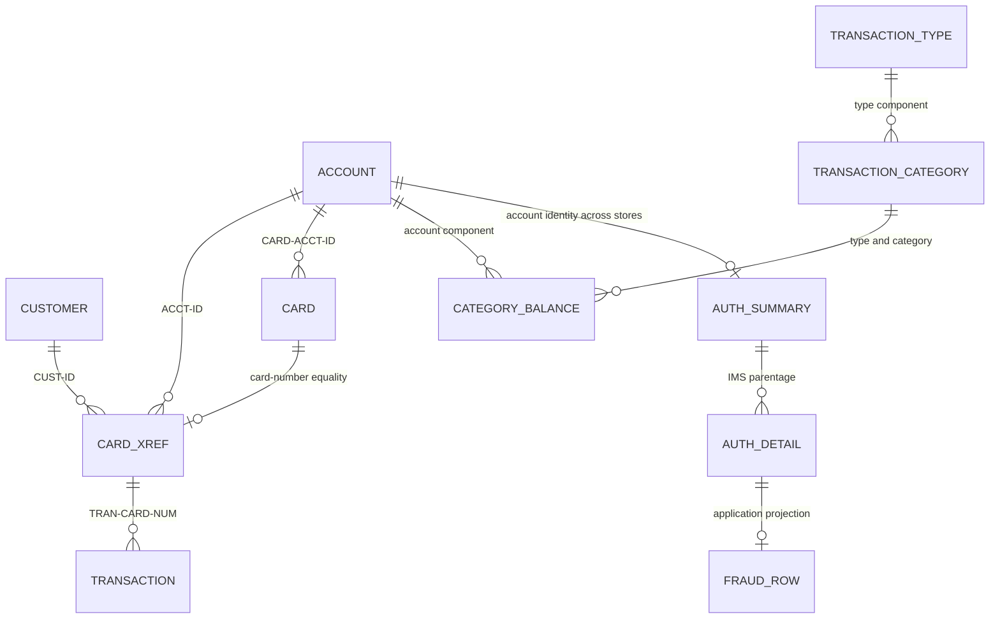
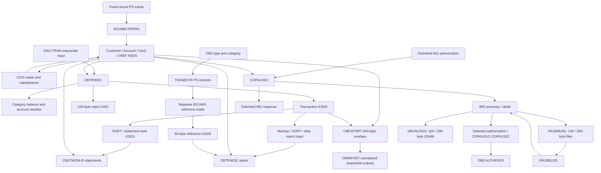

# 04 — Data model, record dictionary and lineage

## Purpose and evidence boundary

**Question answered:** What data does the current CardDemo source store or exchange, how are its bytes and keys arranged, and which programs move or change it?

**Analyzed revision:** [`fbcb944af892dcb8c94c0549f2ee248945010ff8`](https://github.com/codev-workshops/uc-legacy-modernization-cobol-to-java/tree/fbcb944af892dcb8c94c0549f2ee248945010ff8). All source citations below are pinned to this revision.

**Coverage:** core VSAM and sequential records; account/customer/card/XREF relationships; transactions, rejects, category balances and reference data; user security; statement/report and export/import records; CICS conversation scope; optional DB2 reference/fraud tables; IMS authorization segments and unload/GSAM records; optional MQ staging and account inquiry messages.

**Evidence status:** source-only. **Source-confirmed** means a declaration, statement, job definition or checked-in artifact establishes the claim. **Calculated** means an **inference** from those declarations under the storage assumptions below. **Inferred relationship** means a program uses matching identifiers without a database foreign key. **Runtime-observed: none. Unknown:** installed modules, live catalog, compiler listing/options, actual CCSID, data values and successful execution. The committed LISTCAT is historical source evidence, not a query of the present environment. Comments and README claims do not establish deployment or execution.

Sibling documents: [system inventory](01_SYSTEM_OVERVIEW_AND_INVENTORY.md), [execution flows](02_END_TO_END_EXECUTION_FLOWS.md), [business rules](03_BUSINESS_RULES_CATALOG.md), [interface contracts](05_INTERFACE_CONTRACTS.md), [runtime/failure semantics](06_RUNTIME_STATE_AND_FAILURE_SEMANTICS.md), and [behavioral evidence/open questions](07_BEHAVIORAL_EVIDENCE_AND_OPEN_QUESTIONS.md). This document defines existing data; it does not propose a replacement schema.

## Contents

1. [Storage conventions](#1-storage-conventions)
2. [Logical model and constraints](#2-logical-model-and-constraints)
3. [Store, key and catalog cross-check](#3-store-key-and-catalog-cross-check)
4. [Core record dictionary](#4-core-record-dictionary)
5. [Export and import](#5-export-and-import)
6. [DB2 tables and host structures](#6-db2-tables-and-host-structures)
7. [IMS segments, sequential unloads and GSAM](#7-ims-segments-sequential-unloads-and-gsam)
8. [Statement and transaction-report records](#8-statement-and-transaction-report-records)
9. [Conversation and MQ data](#9-conversation-and-mq-data)
10. [Data lineage](#10-data-lineage)
11. [Contradictions and compatibility boundaries](#11-contradictions-and-compatibility-boundaries)
12. [Coverage, validation and open questions](#12-coverage-validation-and-open-questions)

## 1. Storage conventions

All dictionary offsets are **zero-based byte displacements from the start of the named record**, excluding VSAM control information, block descriptors, IMS internal prefixes, MQ headers and DB2 storage-engine metadata. A row at offset `o` with length `n` occupies `[o, o+n)`. IDCAMS `KEYS(length displacement)` uses this displacement convention; DFSORT positions and IMS `START=` are **one-based**. Thus transaction card offset 262 corresponds to SORT position 263. Export overlays use absolute offsets within the 500-byte record.

PIC cells reproduce elementary picture clauses; omitted USAGE means `DISPLAY`. The following rules supply **sign, scale and encoding metadata for every row**, rather than repeating it in each table.

| Declaration | Storage calculation and interpretation |
|---|---|
| `X(n)` | `n` single-byte character positions; no numeric sign or scale. Not UTF-8 by declaration. |
| `9(n)` without USAGE | `n` display digits, unsigned, scale 0. An identifier remains an identifier: preserve leading zero positions. |
| `S9(i)V9(s)` / `S9(i)V99` without USAGE | `i+s` display bytes; signed zoned decimal, scale `s`. `S` and implied decimal `V` consume no separate byte. Under the IBM convention assumed here, the sign is carried in the trailing digit zone, not an extra `+`/`-` character. No `SIGN ... SEPARATE` is declared in these record layouts. |
| `COMP` / `BINARY` | IBM-style binary: 1–4 decimal digits → 2 bytes, 5–9 → 4, 10–18 → 8; count digits on both sides of `V`. `S` makes it signed; `V` sets scale, including scale 2 for export cycle debit. Mainframe big-endian interpretation is an assumption, not a measured file property. |
| `COMP-3` | Packed decimal: `ceil((digits+1)/2)` bytes, including the sign nibble. Example: `S9(10)V99` → 12 digits → 7 bytes; `S9(9)V99` → 11 digits → 6. Unsigned PIC still has packed sign storage; do not assume a particular positive sign nibble without compiler/data evidence. |
| Edited numeric, e.g. `+9(10).99` | Display text with explicit sign and decimal point: 14 bytes, two fraction positions. `9(9).99-` and `Z(9).99-` are 13 bytes. Unlike `V`, a literal decimal point consumes storage. |
| Groups / `REDEFINES` / `OCCURS` | Groups concatenate children. Redefinition overlays share the target's start; never add alternatives together. `OCCURS n` repeats the element/group stride `n` times. 88-level condition names consume zero bytes and are not database constraints. |
| Filler | Included in every total and offset. It is not evidence of initialized spaces, nulls or a future schema. Different writers can initialize/preserve it differently. |

**Calculation assumptions:** single-byte DISPLAY, the IBM widths above, no implicit padding or alignment beyond declarations, no external record prefix included. The selected structures have no `SYNCHRONIZED` clauses. Sample compilation procedures invoke `IGYCRCTL`; one DB2 bind procedure specifies `ENCODING(EBCDIC)` ([batch compile][compile-batch], [online compile][compile-online], [DB2 bind][db2-bind]). These do **not** establish the active compiler release, default `TRUNC`/numeric options, runtime CCSID or the encoding of every file. The source tree also carries separate ASCII/EBCDIC sample-data directories; their existence is not proof that a deployed store matches either sample. Do not transcode binary/packed fields as characters.

Dates declared `X(10)`, timestamps `X(26)`, authorization dates `X(6)` and expiry `X(4)` remain byte strings unless a reader/writer supplies a format. Their names alone do not enforce valid calendars, separators, time zones or chronology. In particular the source spelling `EXPIRAION` is preserved below.

## 2. Logical model and constraints

The diagram expresses **program-level joins and expected cardinality**, not verified sample cardinality or universal referential integrity. DB2 and IMS constraints are distinguished explicitly below.



**Text equivalent and enforcement:**

| Association | Evidence and strength |
|---|---|
| Card → account; XREF → customer/account | Source fields hold the identifiers ([card][card-layout], [XREF][xref-layout]). `CBTRN02C:1500-A/B` reads XREF by card, then account by `XREF-ACCT-ID` ([posting lookups][posting-lookup]). Existence checks are in programs; VSAM has no declarative cross-file FK here. |
| Customer ↔ account through card XREF | Inferred many-to-many capability of the record model, not an assertion that sample data exercises it. Neither account nor customer contains the other's key. The same account can have multiple card/XREF records because their primary keys are card numbers and their account AIX keys are nonunique. |
| Card ↔ XREF | Each file can have at most one record per own card primary key. Equality across files, and equality between `CARD-ACCT-ID` and `XREF-ACCT-ID`, are not catalog constraints. |
| Transaction → XREF/account | Transactions store card number, not account/customer ID. Posting resolves the account through XREF; reports and statements also perform lookups. A missing lookup is possible in source control flow. |
| Account/category balance/disclosure | `TRANCAT-ACCT-ID + TYPE + CATEGORY` is the balance key; account group + type + category is the interest-rate lookup. `CBACT04C` reads disclosure data and falls back to group `DEFAULT` ([interest reads/calculation][interest-rules]). This is an application association, not an FK. |
| Type → category | DB2 DDL declares a type PK, a `(type, category)` PK and a category-to-type FK with `ON DELETE RESTRICT` ([type DDL][type-ddl], [category DDL][category-ddl]). Separate VSAM reference files enforce their own keys only. |
| Account → authorization summary → detail | Across VSAM and IMS the account association is inferred from moves; IMS enforces declared summary/detail parentage and sequence uniqueness within the hierarchy ([IMS DBD][ims-dbd], [authorization writes][auth-write]). One IMS root per unique account key is declared. |
| Authorization detail → fraud row | `COPAUS2C` projects a selected detail plus account/customer context into DB2. Fraud PK is `(CARD_NUM, AUTH_TS)`; there is no FK to IMS or VSAM in the supplied DDL ([fraud DDL][fraud-ddl], [fraud mapping][fraud-map]). The projection is not a lossless copy or an automatically maintained foreign relationship. |
| User security → conversation | User ID/type are passed in the COMMAREA; the security record does not contain a customer/account FK ([security][security-layout], [COMMAREA][comm-layout]). A logged-in user is not declared to be the cardholder entity. |

## 3. Store, key and catalog cross-check

Here `H` abbreviates the literal JCL prefix `AWS.M2.CARDDEMO`; it is notation, not a discovered environment variable. `KEYS` is `(length, zero-based displacement)`. **Calculated totals agree with the following core cluster definitions.**

| Logical store / dataset suffix under `H` | Bytes | Primary key | Definition / historical LISTCAT evidence |
|---|---:|---|---|
| Account, `ACCTDATA.VSAM.KSDS` | 300 | `ACCT-ID`, `(11,0)` | [ACCTFILE][acct-jcl]; [catalog][cat-acct] |
| Customer, `CUSTDATA.VSAM.KSDS` | 500 | `CUST-ID`, `(9,0)` | [CUSTFILE][cust-jcl]; [catalog][cat-cust] |
| Card, `CARDDATA.VSAM.KSDS` | 150 | `CARD-NUM`, `(16,0)` | [CARDFILE][card-jcl]; [catalog][cat-card] |
| XREF, `CARDXREF.VSAM.KSDS` | 50 | `XREF-CARD-NUM`, `(16,0)` | [XREFFILE][xref-jcl]; [catalog][cat-xref] |
| Transaction, `TRANSACT.VSAM.KSDS` | 350 | `TRAN-ID`, `(16,0)` | [TRANFILE][tran-jcl]; [catalog][cat-tran] |
| Category balance, `TCATBALF.VSAM.KSDS` | 50 | `TRAN-CAT-KEY`, `(17,0)` | [TCATBALF][bal-jcl]; [catalog][cat-bal] |
| Disclosure, `DISCGRP.VSAM.KSDS` | 50 | `DIS-GROUP-KEY`, `(16,0)` | [DISCGRP][disc-jcl]; [catalog][cat-disc] |
| Type, `TRANTYPE.VSAM.KSDS` | 60 | `TRAN-TYPE`, `(2,0)` | [TRANTYPE][type-jcl]; [catalog][cat-type] |
| Category, `TRANCATG.VSAM.KSDS` | 60 | type + category, `(6,0)` | [TRANCATG][category-jcl]; [catalog][cat-category] |
| Security, `USRSEC.VSAM.KSDS` | 80 | `SEC-USR-ID`, `(8,0)` | [DUSRSECJ][security-jcl]; [catalog][cat-security] |
| Statement work store, `TRXFL.VSAM.KSDS` | 350 | card + transaction ID, `(32,0)` | [CREASTMT definition][statement-job] |
| Export, `EXPORT.DATA` | 500 | JCL `(4,28)`; calculated sequence `(4,27)` | [CBEXPORT job][export-job]; mismatch discussed in §5/§11 |

LISTCAT values above are from **DATA component** attributes. Index-component `MAXLRECL` values (for example 505) describe index records, not an alternative application-record length. The listing's header is dated `09/01/22`; it does not establish current deployment ([header][cat-header]).

### Alternate indexes and CICS mappings

| Base | AIX key in base record | Duplicates / maintenance | PATH and catalog interpretation |
|---|---|---|---|
| `CARDDATA.VSAM.KSDS` | `CARD-ACCT-ID`, length 11, offset 16 | `NONUNIQUEKEY`, `UPGRADE` | `CARDDATA.VSAM.AIX.PATH` → `CARDDATA.VSAM.AIX` → base; [JCL][card-aix]. LISTCAT shows `KEYLEN=11`, `RKP=5`, **`AXRKP=16`** ([catalog][cat-card-aix]). |
| `CARDXREF.VSAM.KSDS` | `XREF-ACCT-ID`, length 11, offset 25 | `NONUNIQUEKEY`, `UPGRADE` | `CARDXREF.VSAM.AIX.PATH` → `CARDXREF.VSAM.AIX` → base; [JCL][xref-aix]. `RKP=5`, **`AXRKP=25`** ([catalog][cat-xref-aix]). |
| `TRANSACT.VSAM.KSDS` | `TRAN-PROC-TS`, length 26, offset 304 | `NONUNIQUEKEY`, `UPGRADE` | `TRANSACT.VSAM.AIX.PATH` → `TRANSACT.VSAM.AIX` → base; [TRANIDX][tran-aix]. `RKP=5`, **`AXRKP=304`** ([catalog][cat-tran-aix]). |

`AXRKP` is the alternate key's position in the **base** data record; AIX `RKP=5` must not be substituted into the application dictionary. Multiple cards per account and multiple transactions with an identical processed timestamp are permitted by these alternate-key declarations. PATH access returns base records; an AIX is not a second customer/account entity. `UPGRADE` declares maintenance with base changes; it is not evidence that deployed indexes are built or synchronized. Each job also supplies `BLDINDEX` steps ([card AIX][card-aix], [XREF AIX][xref-aix], [transaction AIX][tran-aix]).

The CSD maps CICS names to datasets: `ACCTDAT` → account; `CARDDAT` → card; `CARDAIX` → card AIX path; `CCXREF` → XREF; `CXACAIX` → XREF account AIX path; `CUSTDAT` → customer; `TRANSACT` → transactions; `USRSEC` → security ([CSD file definitions][csd-files]). It specifies `RECORDFORMAT(V)` for these resources while the clusters have equal minimum/maximum record sizes. Do not infer an extra per-record length field in the copybooks from this CSD property. The supplied CSD does not provide a transaction-timestamp AIX FILE mapping in that file block.

`ESDSRRDS` additionally defines 80-byte user-security **ESDS** (`NONINDEXED`) and **RRDS** (`NUMBERED`) examples. Their addressing differs from the KSDS user-ID key; the CSD above still points to the KSDS ([alternate security stores][security-alt]). No equivalence or ongoing replication among these stores is established.

## 4. Core record dictionary

Every table in this section is a **calculated byte map** of the cited source declaration. All fields use DISPLAY unless the table says otherwise.

### 4.1 Account — `CVACT01Y`, 300 bytes

Source: [`ACCOUNT-RECORD`][account-layout]. Primary key occupies `[0,11)`; account group occupies `[112,122)`.

| Offset | Bytes | Field | PIC |
|---:|---:|---|---|
| 0 | 11 | `ACCT-ID` | `9(11)` |
| 11 | 1 | `ACCT-ACTIVE-STATUS` | `X(01)` |
| 12 | 12 | `ACCT-CURR-BAL` | `S9(10)V99` |
| 24 | 12 | `ACCT-CREDIT-LIMIT` | `S9(10)V99` |
| 36 | 12 | `ACCT-CASH-CREDIT-LIMIT` | `S9(10)V99` |
| 48 | 10 | `ACCT-OPEN-DATE` | `X(10)` |
| 58 | 10 | `ACCT-EXPIRAION-DATE` | `X(10)` |
| 68 | 10 | `ACCT-REISSUE-DATE` | `X(10)` |
| 78 | 12 | `ACCT-CURR-CYC-CREDIT` | `S9(10)V99` |
| 90 | 12 | `ACCT-CURR-CYC-DEBIT` | `S9(10)V99` |
| 102 | 10 | `ACCT-ADDR-ZIP` | `X(10)` |
| 112 | 10 | `ACCT-GROUP-ID` | `X(10)` |
| 122 | 178 | `FILLER` | `X(178)` |

All five money fields are signed, scale 2. Their sign is part of the last display digit, so a character-only numeric parser is insufficient. Dates are strings; posting compares expiry against the first ten origin-timestamp characters ([posting validation][posting-lookup]).

### 4.2 Customer — `CVCUS01Y`, 500 bytes

Source: [`CUSTOMER-RECORD`][customer-layout]. Primary key `[0,9)`. No values from sample customer data are reproduced here.

| Offset | Bytes | Field | PIC |
|---:|---:|---|---|
| 0 | 9 | `CUST-ID` | `9(09)` |
| 9 | 25 | `CUST-FIRST-NAME` | `X(25)` |
| 34 | 25 | `CUST-MIDDLE-NAME` | `X(25)` |
| 59 | 25 | `CUST-LAST-NAME` | `X(25)` |
| 84 | 50 | `CUST-ADDR-LINE-1` | `X(50)` |
| 134 | 50 | `CUST-ADDR-LINE-2` | `X(50)` |
| 184 | 50 | `CUST-ADDR-LINE-3` | `X(50)` |
| 234 | 2 | `CUST-ADDR-STATE-CD` | `X(02)` |
| 236 | 3 | `CUST-ADDR-COUNTRY-CD` | `X(03)` |
| 239 | 10 | `CUST-ADDR-ZIP` | `X(10)` |
| 249 | 15 | `CUST-PHONE-NUM-1` | `X(15)` |
| 264 | 15 | `CUST-PHONE-NUM-2` | `X(15)` |
| 279 | 9 | `CUST-SSN` | `9(09)` |
| 288 | 20 | `CUST-GOVT-ISSUED-ID` | `X(20)` |
| 308 | 10 | `CUST-DOB-YYYY-MM-DD` | `X(10)` |
| 318 | 10 | `CUST-EFT-ACCOUNT-ID` | `X(10)` |
| 328 | 1 | `CUST-PRI-CARD-HOLDER-IND` | `X(01)` |
| 329 | 3 | `CUST-FICO-CREDIT-SCORE` | `9(03)` |
| 332 | 168 | `FILLER` | `X(168)` |

**Duplicate layout:** [`CUSTREC`][customer-variant], used by `CBSTM03A`, has the same field lengths/order and total but calls the offset-308 field `CUST-DOB-YYYYMMDD`, still `X(10)`. The symbol does not make it an eight-byte date. This is a naming/maintenance discrepancy, not a demonstrated 500-byte record-length mismatch. `CBSTM03A`'s COPY statements identify that variant ([statement inputs][statement-fd]).

### 4.3 Card and cross-reference — 150 and 50 bytes

Sources: [`CARD-RECORD`][card-layout], [`CARD-XREF-RECORD`][xref-layout].

| Record | Offset | Bytes | Field | PIC / key role |
|---|---:|---:|---|---|
| Card | 0 | 16 | `CARD-NUM` | `X(16)`; primary |
| Card | 16 | 11 | `CARD-ACCT-ID` | `9(11)`; nonunique AIX |
| Card | 27 | 3 | `CARD-CVV-CD` | `9(03)`; not a key |
| Card | 30 | 50 | `CARD-EMBOSSED-NAME` | `X(50)` |
| Card | 80 | 10 | `CARD-EXPIRAION-DATE` | `X(10)` |
| Card | 90 | 1 | `CARD-ACTIVE-STATUS` | `X(01)` |
| Card | 91 | 59 | `FILLER` | `X(59)` |
| XREF | 0 | 16 | `XREF-CARD-NUM` | `X(16)`; primary |
| XREF | 16 | 9 | `XREF-CUST-ID` | `9(09)`; no customer AIX declared here |
| XREF | 25 | 11 | `XREF-ACCT-ID` | `9(11)`; nonunique AIX |
| XREF | 36 | 14 | `FILLER` | `X(14)` |

Card numbers are `X(16)` in these stores, despite numeric views used in some conversations and SORT controls. Byte equality and leading zero preservation matter more than choosing an integer representation.

### 4.4 Transactions and daily transactions — 350 bytes each

Sources: [`CVTRA05Y:TRAN-RECORD`][transaction-layout] and [`CVTRA06Y:DALYTRAN-RECORD`][daily-layout]. The following suffixes have identical PIC/offsets in the two records; use prefix `TRAN-` or `DALYTRAN-`. Filler has no prefix.

| Offset | Bytes | Field suffix | PIC / key role |
|---:|---:|---|---|
| 0 | 16 | `ID` | `X(16)`; transaction master primary key |
| 16 | 2 | `TYPE-CD` | `X(02)` |
| 18 | 4 | `CAT-CD` | `9(04)` |
| 22 | 10 | `SOURCE` | `X(10)` |
| 32 | 100 | `DESC` | `X(100)` |
| 132 | 11 | `AMT` | `S9(09)V99`; signed, scale 2 |
| 143 | 9 | `MERCHANT-ID` | `9(09)` |
| 152 | 50 | `MERCHANT-NAME` | `X(50)` |
| 202 | 50 | `MERCHANT-CITY` | `X(50)` |
| 252 | 10 | `MERCHANT-ZIP` | `X(10)` |
| 262 | 16 | `CARD-NUM` | `X(16)` |
| 278 | 26 | `ORIG-TS` | `X(26)` |
| 304 | 26 | `PROC-TS` | `X(26)`; master nonunique AIX |
| 330 | 20 | `FILLER` | `X(20)` |

Daily sequential input is not given a KSDS uniqueness constraint by its copybook. `CBTRN02C:2000-POST-TRANSACTION` maps the daily fields to the master and replaces processed timestamp with a generated value; it updates category balance and account before the transaction write ([posting implementation][posting-write]). Thus the two layouts are byte-compatible, but their values and write semantics need not be identical.

### 4.5 Rejects — 430 bytes, including validation trailer

**Source-confirmed:** the reject is **not merely the 350-byte transaction**. Both the FD and working-storage `REJECT-RECORD` include an additional 80-byte trailer; `2500-WRITE-REJECT-REC` fills both parts before writing. The 430-byte JCL allocation agrees ([reject FD][reject-fd], [reject structure][reject-layout], [reject write][reject-write], [POSTTRAN allocation][posting-job]).

| Offset | Bytes | Field | PIC / interpretation |
|---:|---:|---|---|
| 0 | 350 | `REJECT-TRAN-DATA` | `X(350)`; complete `DALYTRAN-RECORD`, nested offsets from §4.4 |
| 350 | 80 | `VALIDATION-TRAILER` | `X(80)`; group content below overlays these bytes |
| 350 | 4 | `WS-VALIDATION-FAIL-REASON` | `9(04)` |
| 354 | 76 | `WS-VALIDATION-FAIL-REASON-DESC` | `X(76)` |

The last two rows describe the separately built `WS-VALIDATION-TRAILER` moved into the 80-byte region; do not add them again. `DALYREJS.jcl` defines a GDG with `LIMIT(5)` ([reject GDG][reject-gdg]); retention in a live installation is unknown.

### 4.6 Category balances, disclosure groups and reference records

Sources: [`CVTRA01Y`][balance-layout], [`CVTRA02Y`][disclosure-layout], [`CVTRA03Y`][type-layout], [`CVTRA04Y`][category-layout].

| Record / total | Offset | Bytes | Field | PIC / key role |
|---|---:|---:|---|---|
| Category balance / 50 | 0 | 11 | `TRANCAT-ACCT-ID` | `9(11)`; key component |
| | 11 | 2 | `TRANCAT-TYPE-CD` | `X(02)`; key component |
| | 13 | 4 | `TRANCAT-CD` | `9(04)`; key component |
| | 17 | 11 | `TRAN-CAT-BAL` | `S9(09)V99` |
| | 28 | 22 | `FILLER` | `X(22)` |
| Disclosure / 50 | 0 | 10 | `DIS-ACCT-GROUP-ID` | `X(10)`; key component |
| | 10 | 2 | `DIS-TRAN-TYPE-CD` | `X(02)`; key component |
| | 12 | 4 | `DIS-TRAN-CAT-CD` | `9(04)`; key component |
| | 16 | 6 | `DIS-INT-RATE` | `S9(04)V99`; signed, scale 2 |
| | 22 | 28 | `FILLER` | `X(28)` |
| Type / 60 | 0 | 2 | `TRAN-TYPE` | `X(02)`; primary |
| | 2 | 50 | `TRAN-TYPE-DESC` | `X(50)` |
| | 52 | 8 | `FILLER` | `X(08)` |
| Category / 60 | 0 | 2 | `TRAN-TYPE-CD` | `X(02)`; key component |
| | 2 | 4 | `TRAN-CAT-CD` | `9(04)`; key component |
| | 6 | 50 | `TRAN-CAT-TYPE-DESC` | `X(50)` |
| | 56 | 4 | `FILLER` | `X(04)` |

Balance/disclosure keys total 17/16 bytes respectively. Interest uses `TRAN-CAT-BAL * DIS-INT-RATE / 1200`, making the scale and numeric representation operationally relevant; see [the implementation][interest-rules] for behavior rather than inferring it from field labels.

### 4.7 User security — 80 bytes

Source: [`SEC-USER-DATA`][security-layout]. This documents storage names and widths only; no sample passwords or user details are reproduced.

| Offset | Bytes | Field | PIC |
|---:|---:|---|---|
| 0 | 8 | `SEC-USR-ID` | `X(08)`; primary key |
| 8 | 20 | `SEC-USR-FNAME` | `X(20)` |
| 28 | 20 | `SEC-USR-LNAME` | `X(20)` |
| 48 | 8 | `SEC-USR-PWD` | `X(08)` |
| 56 | 1 | `SEC-USR-TYPE` | `X(01)` |
| 57 | 23 | `SEC-USR-FILLER` | `X(23)` |

The maintenance program moves map input into `SEC-USR-PWD` and rewrites the record ([user update][user-update]); the layout is not evidence of an external identity provider, password-hash format or encrypted field.

## 5. Export and import

### 5.1 Shared 500-byte envelope

[`CVEXPORT`][export-layout] declares one envelope and five **overlays**, not five appended payloads. `CBEXPORT` writes 500-byte indexed records; `CBIMPORT` reads them and dispatches `C/A/X/T/D` to customer/account/XREF/transaction/card mappings ([export FD/control][export-fd], [import dispatch/mapping][import-mapping]).

| Offset | Bytes | Field | PIC / interpretation |
|---:|---:|---|---|
| 0 | 1 | `EXPORT-REC-TYPE` | `X(1)`; `C`, `A`, `T`, `X`, `D` in implementation |
| 1 | 26 | `EXPORT-TIMESTAMP` | `X(26)` |
| 1 / 11 / 12 | 10 / 1 / 15 | `EXPORT-DATE`, `EXPORT-DATE-TIME-SEP`, `EXPORT-TIME` | `X(10)`, `X(1)`, `X(15)`; redefine timestamp |
| 27 | 4 | `EXPORT-SEQUENCE-NUM` | `9(9) COMP`; unsigned binary, scale 0 |
| 31 | 4 | `EXPORT-BRANCH-ID` | `X(4)` |
| 35 | 5 | `EXPORT-REGION-CODE` | `X(5)` |
| 40 | 460 | `EXPORT-RECORD-DATA` | `X(460)`; each alternative below redefines this region |

Header = 40; every payload = 460; record = **500**, regardless of type. Neither the date subfields nor alternative payloads increase that size. The exporter increments a shared sequence while processing customers, accounts, XREFs, transactions and cards in that order ([export main][export-main], [mapping/write paragraphs][export-writes]). These are source behaviors, not observed successful exports.

### 5.2 Customer payload (`C`)

Field names below have prefix `EXP-CUST-` except filler. Source: [`EXPORT-CUSTOMER-DATA`][export-customer].

| Offset | Bytes | Field suffix | PIC / USAGE |
|---:|---:|---|---|
| 40 | 4 | `ID` | `9(09) COMP` |
| 44 / 69 / 94 | 25 each | `FIRST-NAME`, `MIDDLE-NAME`, `LAST-NAME` | `X(25)` |
| 119 / 169 / 219 | 50 each | `ADDR-LINE(1..3)` within `ADDR-LINES OCCURS 3` | `X(50)` |
| 269 | 2 | `ADDR-STATE-CD` | `X(02)` |
| 271 | 3 | `ADDR-COUNTRY-CD` | `X(03)` |
| 274 | 10 | `ADDR-ZIP` | `X(10)` |
| 284 / 299 | 15 each | `PHONE-NUM(1..2)` within `PHONE-NUMS OCCURS 2` | `X(15)` |
| 314 | 9 | `SSN` | `9(09)` |
| 323 | 20 | `GOVT-ISSUED-ID` | `X(20)` |
| 343 | 10 | `DOB-YYYY-MM-DD` | `X(10)` |
| 353 | 10 | `EFT-ACCOUNT-ID` | `X(10)` |
| 363 | 1 | `PRI-CARD-HOLDER-IND` | `X(01)` |
| 364 | 2 | `FICO-CREDIT-SCORE` | `9(03) COMP-3` |
| 366 | 134 | `FILLER` | `X(134)` |

### 5.3 Account payload (`A`)

Prefix `EXP-ACCT-`; source [`EXPORT-ACCOUNT-DATA`][export-account]. This is deliberately heterogeneous numeric storage in the current source.

| Offset | Bytes | Field suffix | PIC / USAGE |
|---:|---:|---|---|
| 40 | 11 | `ID` | `9(11)` |
| 51 | 1 | `ACTIVE-STATUS` | `X(01)` |
| 52 | 7 | `CURR-BAL` | `S9(10)V99 COMP-3` |
| 59 | 12 | `CREDIT-LIMIT` | `S9(10)V99` |
| 71 | 7 | `CASH-CREDIT-LIMIT` | `S9(10)V99 COMP-3` |
| 78 / 88 / 98 | 10 each | `OPEN-DATE`, `EXPIRAION-DATE`, `REISSUE-DATE` | `X(10)` |
| 108 | 12 | `CURR-CYC-CREDIT` | `S9(10)V99` |
| 120 | 8 | `CURR-CYC-DEBIT` | `S9(10)V99 COMP` |
| 128 / 138 | 10 each | `ADDR-ZIP`, `GROUP-ID` | `X(10)` |
| 148 | 352 | `FILLER` | `X(352)` |

### 5.4 Transaction payload (`T`)

Prefix `EXP-TRAN-`; source [`EXPORT-TRANSACTION-DATA`][export-transaction].

| Offset | Bytes | Field suffix | PIC / USAGE |
|---:|---:|---|---|
| 40 | 16 | `ID` | `X(16)` |
| 56 | 2 | `TYPE-CD` | `X(02)` |
| 58 | 4 | `CAT-CD` | `9(04)` |
| 62 | 10 | `SOURCE` | `X(10)` |
| 72 | 100 | `DESC` | `X(100)` |
| 172 | 6 | `AMT` | `S9(09)V99 COMP-3` |
| 178 | 4 | `MERCHANT-ID` | `9(09) COMP` |
| 182 / 232 | 50 each | `MERCHANT-NAME`, `MERCHANT-CITY` | `X(50)` |
| 282 | 10 | `MERCHANT-ZIP` | `X(10)` |
| 292 | 16 | `CARD-NUM` | `X(16)` |
| 308 / 334 | 26 each | `ORIG-TS`, `PROC-TS` | `X(26)` |
| 360 | 140 | `FILLER` | `X(140)` |

### 5.5 XREF (`X`) and card (`D`) payloads

Source: [`EXPORT-CARD-XREF-DATA` and `EXPORT-CARD-DATA`][export-card].

| Type | Offset | Bytes | Field | PIC / USAGE |
|---|---:|---:|---|---|
| X | 40 | 16 | `EXP-XREF-CARD-NUM` | `X(16)` |
| X | 56 | 9 | `EXP-XREF-CUST-ID` | `9(09)` |
| X | 65 | 8 | `EXP-XREF-ACCT-ID` | `9(11) COMP` |
| X | 73 | 427 | `FILLER` | `X(427)` |
| D | 40 | 16 | `EXP-CARD-NUM` | `X(16)` |
| D | 56 | 8 | `EXP-CARD-ACCT-ID` | `9(11) COMP` |
| D | 64 | 2 | `EXP-CARD-CVV-CD` | `9(03) COMP` |
| D | 66 | 50 | `EXP-CARD-EMBOSSED-NAME` | `X(50)` |
| D | 116 | 10 | `EXP-CARD-EXPIRAION-DATE` | `X(10)` |
| D | 126 | 1 | `EXP-CARD-ACTIVE-STATUS` | `X(01)` |
| D | 127 | 373 | `FILLER` | `X(373)` |

### 5.6 Import outputs and defects in the supplied contract

`CBIMPORT` declares sequential outputs using the original core copybooks: customer 500, account 300, XREF 50, transaction 350 and card 150. These are **files to be loaded elsewhere**, not direct updates of master KSDS datasets. The job allocates `CUSTDATA.IMPORT`, `ACCTDATA.IMPORT`, `CARDXREF.IMPORT`, `TRANSACT.IMPORT` and `IMPORT.ERRORS`, but omits `CARDOUT` even though the program opens/writes it ([import FD][import-fd], [import job][import-job], [import mapping][import-mapping]).

The 132-byte error output has this calculated map ([`WS-ERROR-RECORD`][import-errors]):

| Offset | Bytes | Field | PIC |
|---:|---:|---|---|
| 0 | 26 | `ERR-TIMESTAMP` | `X(26)` |
| 26 | 1 | delimiter filler | `X(01)` |
| 27 | 1 | `ERR-RECORD-TYPE` | `X(01)` |
| 28 | 1 | delimiter filler | `X(01)` |
| 29 | 7 | `ERR-SEQUENCE` | `9(07)` |
| 36 | 1 | delimiter filler | `X(01)` |
| 37 | 50 | `ERR-MESSAGE` | `X(50)` |
| 87 | 43 | trailing filler | `X(43)` |
| 130 | 2 | receiving-record tail | not declared in `WS-ERROR-RECORD`; target FD is `X(132)` |

The source group totals **130**, not 132. `WRITE ... FROM` moves it into the larger alphanumeric FD area; the final two bytes are receiving-field padding under normal COBOL move semantics, not declared business fields. `ERR-SEQUENCE` is seven digits while the export sequence is nine: the error representation cannot retain every possible sequence value. `ERR-TIMESTAMP` receives `FUNCTION CURRENT-DATE` directly, unlike the exporter's separately formatted timestamp ([unknown-type handling][import-error-write]).

Two additional source conflicts matter before treating export/import as a functioning interchange:

- `KEYS(4 28)` in the export job is displaced one byte from the calculated binary sequence at 27; it spans the final three sequence bytes and first branch byte under the assumptions above.
- Both SELECTs name `EXPORT-SEQUENCE-NUM`, but `CVEXPORT` is included in **WORKING-STORAGE**, while the file record is opaque `X(500)`. Indexed record-key association with the FD is therefore a compile-time contract concern in ordinary IBM COBOL. No compiler run was performed, so no specific compiler diagnostic or runtime outcome is claimed ([export declarations][export-fd], [import declarations][import-fd]).

The field-by-field moves demonstrate intended numeric conversions; they do not make the 500-byte export an all-text format or prove a successful round trip.

## 6. DB2 tables and host structures

**No DB2 on-disk byte offsets are asserted.** SQL rows, VARCHARs, nullability and engine metadata are not COBOL concatenations. Offsets below belong only to the supplied **DCLGEN host groups**, whose maximum capacities can be calculated. VARCHAR length fields are binary host metadata, not characters included in the text. SQL `NOT NULL`/PK/FK definitions apply only if that DDL was installed.

### 6.1 Transaction type and category

| SQL table/column | SQL type / constraint | Host field; offset, bytes, PIC |
|---|---|---|
| `CARDDEMO.TRANSACTION_TYPE.TR_TYPE` | `CHAR(2) NOT NULL`, PK | `DCL-TR-TYPE`; 0, 2, `X(2)` |
| `.TR_DESCRIPTION` | `VARCHAR(50) NOT NULL` | `DCL-TR-DESCRIPTION-LEN`; 2, 2, `S9(4) COMP`; `...-TEXT`; 4, 50, `X(50)` |
| `CARDDEMO.TRANSACTION_TYPE_CATEGORY.TRC_TYPE_CODE` | `CHAR(2) NOT NULL`, PK part, FK to type | `DCL-TRC-TYPE-CODE`; 0, 2, `X(2)` |
| `.TRC_TYPE_CATEGORY` | `CHAR(4) NOT NULL`, PK part | `DCL-TRC-TYPE-CATEGORY`; 2, 4, `X(4)` |
| `.TRC_CAT_DATA` | `VARCHAR(50) NOT NULL` | `DCL-TRC-CAT-DATA-LEN`; 6, 2, `S9(4) COMP`; `...-TEXT`; 8, 50, `X(50)` |

Calculated host totals: **54** for type and **58** for category. Both VARCHAR payloads have capacity 50, with valid used length supplied separately. Category is `CHAR(4)` in SQL/DCL but `9(04)` in the VSAM copybook. The SQL DDL itself does not require all four characters to be digits ([DDL][category-ddl], [type DCL][type-dcl], [category DCL][category-dcl]). Unique indexes mirror the PK columns ([type index][type-index], [category index][category-index]).

`COTRTUPC` contains UPDATE/INSERT/DELETE for the **type table** ([type SQL writes][type-writes], including `9700-INSERT-RECORD` and `9800-DELETE-PROCESSING`). Do not infer a category-maintenance screen simply because a category DCL exists.

**Duplicated reference data and refresh boundary:**

```text
DB2 type/category tables
    -> TRANEXTR: DSNTIAUL SELECT with CHAR casts and ordering
    -> TRANTYPE.PS / TRANCATG.PS, 60-byte compatible records
    -> separate TRANTYPE / TRANCATG jobs: IDCAMS REPRO
    -> TRANTYPE.VSAM.KSDS / TRANCATG.VSAM.KSDS
    -> CBTRN03C indexed reference reads -> report descriptions
```

The type extract expression is `type(2) + CHAR(description,50) + '0'×8`; category is `type(2) + category(4) + CHAR(data,50) + '0'×4`. Its filler is explicitly **character zeroes**, not necessarily spaces. `TRANEXTR` writes PS files and backups; it does **not** itself REPRO them into the KSDS files ([extract SQL/job][reference-extract], [type load][type-jcl], [category load][category-jcl], [report reads][report-lookups]). Live synchronization is unknown. The JCL **comment** says daily; the supplied Control-M artifact places `TRANEXTR` in a weekly transaction-type refresh folder ([comment][reference-extract], [scheduler declaration][reference-schedule]). Neither establishes actual cadence.

### 6.2 Fraud table and `DCLAUTHFRDS`

SQL source: [`AUTHFRDS.ddl`][fraud-ddl]; COBOL source: [`AUTHFRDS.dcl`][fraud-dcl]. Only `CARD_NUM` and `AUTH_TS` are explicitly `NOT NULL`; all other columns permit null under this DDL. The host group below has **no null-indicator fields embedded in it**. A host value of spaces/zero is not itself a SQL null.

| Host offset | Host bytes | SQL column / host name (underscore → hyphen) | SQL type | Host PIC / USAGE |
|---:|---:|---|---|---|
| 0 | 16 | `CARD_NUM` | `CHAR(16)`, PK part | `X(16)` |
| 16 | 26 | `AUTH_TS` | `TIMESTAMP`, PK part | `X(26)` |
| 42 | 4 | `AUTH_TYPE` | `CHAR(4)` | `X(4)` |
| 46 | 4 | `CARD_EXPIRY_DATE` | `CHAR(4)` | `X(4)` |
| 50 | 6 | `MESSAGE_TYPE` | `CHAR(6)` | `X(6)` |
| 56 | 6 | `MESSAGE_SOURCE` | `CHAR(6)` | `X(6)` |
| 62 | 6 | `AUTH_ID_CODE` | `CHAR(6)` | `X(6)` |
| 68 | 2 | `AUTH_RESP_CODE` | `CHAR(2)` | `X(2)` |
| 70 | 4 | `AUTH_RESP_REASON` | `CHAR(4)` | `X(4)` |
| 74 | 6 | `PROCESSING_CODE` | `CHAR(6)` | `X(6)` |
| 80 | 7 | `TRANSACTION_AMT` | `DECIMAL(12,2)` | `S9(10)V9(2) COMP-3` |
| 87 | 7 | `APPROVED_AMT` | `DECIMAL(12,2)` | `S9(10)V9(2) COMP-3` |
| 94 | 4 | `MERCHANT_CATAGORY_CODE` | `CHAR(4)` | `X(4)` |
| 98 | 3 | `ACQR_COUNTRY_CODE` | `CHAR(3)` | `X(3)` |
| 101 | 2 | `POS_ENTRY_MODE` | `SMALLINT` | `S9(4) COMP` |
| 103 | 15 | `MERCHANT_ID` | `CHAR(15)` | `X(15)` |
| 118 | 2 | `MERCHANT_NAME-LEN` | host length for `VARCHAR(22)` | `S9(4) COMP` |
| 120 | 22 | `MERCHANT_NAME-TEXT` | `VARCHAR(22)` capacity | `X(22)` |
| 142 | 13 | `MERCHANT_CITY` | `CHAR(13)` | `X(13)` |
| 155 | 2 | `MERCHANT_STATE` | `CHAR(2)` | `X(2)` |
| 157 | 9 | `MERCHANT_ZIP` | `CHAR(9)` | `X(9)` |
| 166 | 15 | `TRANSACTION_ID` | `CHAR(15)` | `X(15)` |
| 181 | 1 | `MATCH_STATUS` | `CHAR(1)` | `X(1)` |
| 182 | 1 | `AUTH_FRAUD` | `CHAR(1)` | `X(1)` |
| 183 | 10 | `FRAUD_RPT_DATE` | `DATE` | `X(10)` |
| 193 | 6 | `ACCT_ID` | `DECIMAL(11,0)` | `S9(11)V COMP-3`; scale 0 |
| 199 | 5 | `CUST_ID` | `DECIMAL(9,0)` | `S9(9)V COMP-3`; scale 0 |

Calculated host total **204**. `MERCHANT_NAME-LEN/TEXT` in the table denote source `MERCHANT-NAME-LEN/TEXT`; the SQL column is only `MERCHANT_NAME`. The unique index is `(CARD_NUM ASC, AUTH_TS DESC)` ([index][fraud-index]). The generated DCL header/comment names `AWSTSSC.AUTHFRDS`, but its executable `DECLARE` and the DDL both name `CARDDEMO.AUTHFRDS`; this is a **comment discrepancy**, not evidence of two installed tables.

`COPAUS2C` constructs timestamp text from the request's original date plus time recovered from the complemented authorization time key, then calls `TIMESTAMP_FORMAT`. It does not copy an IMS timestamp field byte-for-byte. It sets merchant VARCHAR length from the 22-byte IMS name capacity. The SQL fraud-report date uses **`CURRENT DATE`**, while the IMS detail's eight-character fraud date is separately set with CICS `FORMATTIME`. Duplicate insert SQLCODE `-803` leads to an UPDATE of fraud status/date keyed by card/timestamp ([mapping/insert][fraud-map], [update][fraud-update]). The supplied DDL does not bind account/customer IDs to their VSAM masters.

## 7. IMS segments, sequential unloads and GSAM

### 7.1 Hierarchy and key declarations

```text
DBPAUTP0 (HIDAM, VSAM)
  PAUTSUM0 root, 100 bytes
    ACCNTID: START=1, BYTES=6, TYPE=P, SEQ,U
    |
    +-- PAUTDTL1 child, 200 bytes
          PAUT9CTS: START=1, BYTES=8, TYPE=C, SEQ,U

DBPAUTX0 (INDEX, VSAM, PROT)
  PAUTINDX, 6 bytes: INDXSEQ START=1, TYPE=P, SEQ,U
  LCHILD targets PAUTSUM0 / INDEX=ACCNTID
```

These are [DBD declarations][ims-dbd], [index DBD declarations][ims-index]. `DBPAUTX0` is the companion **HIDAM root index** shown by these definitions; calling it a separate business secondary index would overstate the source. No additional secondary-index/search-field definition is supplied in these two DBDs. The child key is two packed quantities at the COBOL level, but declared an eight-byte **character sequence field** in the DBD. Root key length 6 plus child key length 8 explains PCB `KEYLEN=14`; it is not a 14-byte field prepended to every detail segment.

`PSBPAUTB` exposes root and child with `PROCOPT=AP`, `KEYLEN=14`; `DLIGSAMP` exposes the database with `PROCOPT=GOTP` and GSAM PCBs for `PASFLDBD`/`PADFLDBD` with `PROCOPT=LS` ([batch PSB][ims-psb], [GSAM PSB][gsam-psb]). Actual PSB generation and scheduling are unobserved.

### 7.2 Summary — `CIPAUSMY`, 100 bytes

The copybook begins at level 05 and is included beneath a program-specific level 01. Offsets are relative to that containing segment. Source: [`PENDING-AUTH-SUMMARY` fields][ims-summary].

| Offset | Bytes | Field | PIC / USAGE |
|---:|---:|---|---|
| 0 | 6 | `PA-ACCT-ID` | `S9(11) COMP-3`; root key |
| 6 | 9 | `PA-CUST-ID` | `9(09)` |
| 15 | 1 | `PA-AUTH-STATUS` | `X(01)` |
| 16 / 18 / 20 / 22 / 24 | 2 each | `PA-ACCOUNT-STATUS(1..5)` | `X(02) OCCURS 5` |
| 26 | 6 | `PA-CREDIT-LIMIT` | `S9(09)V99 COMP-3` |
| 32 | 6 | `PA-CASH-LIMIT` | `S9(09)V99 COMP-3` |
| 38 | 6 | `PA-CREDIT-BALANCE` | `S9(09)V99 COMP-3` |
| 44 | 6 | `PA-CASH-BALANCE` | `S9(09)V99 COMP-3` |
| 50 | 2 | `PA-APPROVED-AUTH-CNT` | `S9(04) COMP` |
| 52 | 2 | `PA-DECLINED-AUTH-CNT` | `S9(04) COMP` |
| 54 | 6 | `PA-APPROVED-AUTH-AMT` | `S9(09)V99 COMP-3` |
| 60 | 6 | `PA-DECLINED-AUTH-AMT` | `S9(09)V99 COMP-3` |
| 66 | 34 | `FILLER` | `X(34)` |

These summary money fields have **nine integer digits**, whereas core account limits/balances have ten. Field moves are numeric conversions with differing capacities. An account/customer identity alone does not imply all other stored values remain synchronized after later master edits.

### 7.3 Detail — `CIPAUDTY`, 200 bytes

Source: [`PENDING-AUTH-DETAILS` fields][ims-detail]. The five-entry status array belongs to the **summary**, not this detail.

| Offset | Bytes | Field | PIC / USAGE |
|---:|---:|---|---|
| 0 | 3 | `PA-AUTH-DATE-9C` | `S9(05) COMP-3`; key part |
| 3 | 5 | `PA-AUTH-TIME-9C` | `S9(09) COMP-3`; key part |
| 8 / 14 | 6 each | `PA-AUTH-ORIG-DATE`, `PA-AUTH-ORIG-TIME` | `X(06)` |
| 20 | 16 | `PA-CARD-NUM` | `X(16)` |
| 36 / 40 | 4 each | `PA-AUTH-TYPE`, `PA-CARD-EXPIRY-DATE` | `X(04)` |
| 44 / 50 / 56 | 6 each | `PA-MESSAGE-TYPE`, `PA-MESSAGE-SOURCE`, `PA-AUTH-ID-CODE` | `X(06)` |
| 62 | 2 | `PA-AUTH-RESP-CODE` | `X(02)` |
| 64 | 4 | `PA-AUTH-RESP-REASON` | `X(04)` |
| 68 | 6 | `PA-PROCESSING-CODE` | `9(06)` |
| 74 / 81 | 7 each | `PA-TRANSACTION-AMT`, `PA-APPROVED-AMT` | `S9(10)V99 COMP-3` |
| 88 | 4 | `PA-MERCHANT-CATAGORY-CODE` | `X(04)` |
| 92 | 3 | `PA-ACQR-COUNTRY-CODE` | `X(03)` |
| 95 | 2 | `PA-POS-ENTRY-MODE` | `9(02)` |
| 97 | 15 | `PA-MERCHANT-ID` | `X(15)` |
| 112 | 22 | `PA-MERCHANT-NAME` | `X(22)` |
| 134 | 13 | `PA-MERCHANT-CITY` | `X(13)` |
| 147 | 2 | `PA-MERCHANT-STATE` | `X(02)` |
| 149 | 9 | `PA-MERCHANT-ZIP` | `X(09)` |
| 158 | 15 | `PA-TRANSACTION-ID` | `X(15)` |
| 173 | 1 | `PA-MATCH-STATUS` | `X(01)` |
| 174 | 1 | `PA-AUTH-FRAUD` | `X(01)` |
| 175 | 8 | `PA-FRAUD-RPT-DATE` | `X(08)` |
| 183 | 17 | `FILLER` | `X(17)` |

The key's date and time quantities are calculated as `99999 - YYDDD` and `999999999 - (HHMMSS*1000 + milliseconds)` from the service's current time, while original date/time come from the request ([key construction][auth-key]). This explains descending-time intent without treating the packed key as a conventional timestamp. Collision handling and effective uniqueness belong to execution/failure analysis, not an assumption that request transaction ID is the IMS key.

88-level names declare response `00` as approved; match statuses `P/D/E/M`; fraud states `F/R` ([detail conditions][ims-detail]). They do not prohibit other bytes at the database level. IMS transaction ID is **15 characters**, while core posted transaction ID is **16**; merchant ID is 15 alphanumeric here versus nine display digits in posted transactions. A common business identity cannot be established merely by matching field labels.

### 7.4 Sequential unload/load versus GSAM

| Channel | Physical application record | Program and storage evidence |
|---|---|---|
| `PAUTDB.ROOT.FILEO` / `OUTFIL1` / `INFILE1` | 100 bytes, direct summary map from §7.2 | `PAUDBUNL` FD + `PAUDBLOD` FD; [unload layout][ims-unload-fd], [load layout][ims-load-fd], [JCL LRECL][ims-unload-job] |
| `PAUTDB.CHILD.FILEO` / `OUTFIL2` / `INFILE2` | 206 bytes: offset 0 `ROOT-SEG-KEY S9(11) COMP-3` (6); offset 6 `CHILD-SEG-REC X(200)` | Detail field offsets = §7.3 offset + 6. The explicit root prefix preserves parent association for reload. |
| `PASFILIP/PASFILOP` via `PASFLDBD` | GSAM fixed 100 bytes | [summary DBD][gsam-summary-dbd]; `DBUNLDGS` passes `PENDING-AUTH-SUMMARY` directly |
| `PADFILIP/PADFILOP` via `PADFLDBD` | GSAM fixed **200** bytes | [detail DBD][gsam-detail-dbd]; `DBUNLDGS` passes `PENDING-AUTH-DETAILS` directly |

`PAUDBLOD` reads the six-byte root prefix and uses it in a qualified SSA before inserting a child ([load implementation][ims-load]); the load job selects the `.FILEO` datasets ([load job][ims-load-job]).

`DBUNLDGS:2000/3000` uses `GN`/`GNP` to traverse the hierarchy, then `3100/3200` uses `ISRT` against GSAM PCBs ([GSAM traversal and inserts][gsam-write]). Although its working storage retains a 206-byte `OPFIL2-REC`, the active GSAM call **does not pass that record**; it passes the 200-byte detail. The commented sequential writes must not be counted as live GSAM behavior. `UNLDGSAM` maps existing `.ROOT.GSAM` and `.CHILD.GSAM` datasets with `DISP=OLD` and does not allocate a 206-byte child file ([GSAM job][gsam-job]). No standalone root key is serialized in each GSAM detail; a consumer would need additional association context. The sequential unload and GSAM products are therefore not interchangeable.

## 8. Statement and transaction-report records

### 8.1 Statement transaction work record — 350 bytes

[`COSTM01:TRNX-RECORD`][statement-layout] relocates card number to the start. `TRNX-KEY` is the first 32 bytes. It is a materialized ordering copy, not a new transaction entity.

| Offset | Bytes | Field | PIC |
|---:|---:|---|---|
| 0 | 16 | `TRNX-CARD-NUM` | `X(16)`; key part |
| 16 | 16 | `TRNX-ID` | `X(16)`; key part |
| 32 | 2 | `TRNX-TYPE-CD` | `X(02)` |
| 34 | 4 | `TRNX-CAT-CD` | `9(04)` |
| 38 | 10 | `TRNX-SOURCE` | `X(10)` |
| 48 | 100 | `TRNX-DESC` | `X(100)` |
| 148 | 11 | `TRNX-AMT` | `S9(09)V99` |
| 159 | 9 | `TRNX-MERCHANT-ID` | `9(09)` |
| 168 / 218 | 50 each | `TRNX-MERCHANT-NAME`, `TRNX-MERCHANT-CITY` | `X(50)` |
| 268 | 10 | `TRNX-MERCHANT-ZIP` | `X(10)` |
| 278 / 304 | 26 each | `TRNX-ORIG-TS`, `TRNX-PROC-TS` | `X(26)` |
| 330 | 20 | `FILLER` | `X(20)` |

`CREASTMT` sorts on source positions `(263,16,CH)` then `(1,16,CH)` and uses `OUTREC FIELDS=(1:263,16,17:1,262,279:279,50)` ([sort and allocation][statement-job]). This expression explicitly populates **328** output bytes: 16+262+50. The copybook expects 350, including **52** timestamp bytes plus 20 filler after offset 278. Consequently the final two processed-timestamp characters and filler are not copied by the control statement. The JCL declares `LRECL=350`; utility padding/acceptance must be checked in the actual DFSORT environment. Do not silently rewrite the expression to an intended 350-byte mapping.

### 8.2 Statement text and HTML

`CBSTM03A` writes `FD-STMTFILE-REC X(80)` and `FD-HTMLFILE-REC X(100)` ([FDs][statement-fd]); the producing DD allocations agree ([job][statement-job]). Individual lines are alternative records, not fields concatenated into one statement row.

| Text record | Byte map within that 80-byte line |
|---|---|
| `ST-LINE0` | fillers at 0/31, 31/18, 49/31 |
| `ST-LINE1` | `ST-NAME X(75)` at 0/75; filler at 75/5 |
| `ST-LINE2` | `ST-ADD1 X(50)` at 0/50; filler at 50/30 |
| `ST-LINE3` | `ST-ADD2 X(50)` at 0/50; filler at 50/30 |
| `ST-LINE4` | `ST-ADD3 X(80)` at 0/80 |
| `ST-LINE5` | filler `X(80)` at 0 |
| `ST-LINE6` | fillers at 0/33, 33/14, 47/33 |
| `ST-LINE7` | label filler at 0/20; `ST-ACCT-ID X(20)` at 20/20; filler at 40/40 |
| `ST-LINE8` | label filler at 0/20; `ST-CURR-BAL 9(9).99-` at 20/13; fillers at 33/7 and 40/40 |
| `ST-LINE9` | label filler at 0/20; `ST-FICO-SCORE X(20)` at 20/20; filler at 40/40 |
| `ST-LINE10`, `ST-LINE12` | filler `X(80)` at 0 |
| `ST-LINE11` | fillers at 0/30, 30/20, 50/30 |
| `ST-LINE13` | heading fillers at 0/16, 16/51, 67/13 |
| `ST-LINE14` | `ST-TRANID X(16)` at 0/16; separator at 16/1; `ST-TRANDT X(49)` at 17/49; currency character at 66/1; `ST-TRANAMT Z(9).99-` at 67/13 |
| `ST-LINE14A` | fillers at 0/10, 10/56, 66/1; `ST-TOTAL-TRAMT Z(9).99-` at 67/13 |
| `ST-LINE15` | fillers at 0/32, 32/16, 48/32 |

Notation `offset/length` in this table has the same zero-based convention. Source: [text line groups][statement-text]. These edited amounts have a decimal point and trailing sign position; they are not the zoned-decimal master layout.

HTML constants are 88-level values of `HTML-FIXED-LN X(100)`; the variable address/basic/transaction lines are separate `X(100)` buffers filled using `STRING`. They have a fixed **output capacity** but no stable per-business-field byte offsets: tag text and trimmed content determine positions. Two additional declared groups are `HTML-L11` (filler `X(34)` @0, `L11-ACCT X(20)` @34, filler `X(5)` @54; total 59) and `HTML-L23` (filler `X(26)` @0, `L23-NAME X(50)` @26; total 76). A short group written into `X(100)` receives normal alphanumeric padding; the declared working-storage capacity is not 100 for these two groups ([HTML declarations][statement-html], [HTML construction][statement-html-write]). Treat these as presentation text, not an interchange format for restoring entities.

### 8.3 Daily transaction report — 133-byte receiving records

`CVTRA07Y` defines **shorter presentation groups** written into the 133-byte FD, rather than every group being 133 bytes ([report layouts][report-layout], [report FD][report-fd]). `TRANREPT` allocates `LRECL=133` ([report job][report-job]).

| Detail offset | Bytes | `TRANSACTION-DETAIL-REPORT` field | PIC |
|---:|---:|---|---|
| 0 | 16 | `TRAN-REPORT-TRANS-ID` | `X(16)` |
| 16 | 1 | filler | `X(01)` |
| 17 | 11 | `TRAN-REPORT-ACCOUNT-ID` | `X(11)` |
| 28 | 1 | filler | `X(01)` |
| 29 | 2 | `TRAN-REPORT-TYPE-CD` | `X(02)` |
| 31 | 1 | filler | `X(01)` |
| 32 | 15 | `TRAN-REPORT-TYPE-DESC` | `X(15)` |
| 47 | 1 | filler | `X(01)` |
| 48 | 4 | `TRAN-REPORT-CAT-CD` | `9(04)` |
| 52 | 1 | filler | `X(01)` |
| 53 | 29 | `TRAN-REPORT-CAT-DESC` | `X(29)` |
| 82 | 1 | filler | `X(01)` |
| 83 | 10 | `TRAN-REPORT-SOURCE` | `X(10)` |
| 93 | 4 | filler | `X(04)` |
| 97 | 15 | `TRAN-REPORT-AMT` | `-ZZZ,ZZZ,ZZZ.ZZ` |
| 112 | 2 | filler | `X(02)` |
| 114 | 19 | receiving-record tail | padding when the 114-byte group is moved to the 133-byte FD |

The detail loses description capacity: type 50 → 15 and category 50 → 29. The source moves these fields before writing ([report mapping][report-map]); it is not a full fidelity transaction/reference export.

Other report groups from the same copybook:

| Group | Calculated map / total before receiving-record padding |
|---|---|
| `REPORT-NAME-HEADER` | `REPT-SHORT-NAME X(38)` @0; `REPT-LONG-NAME X(41)` @38; `REPT-DATE-HEADER X(12)` @79; `REPT-START-DATE X(10)` @91; filler `X(4)` @101; `REPT-END-DATE X(10)` @105; **115** |
| `TRANSACTION-HEADER-1` | fillers with lengths 17,12,19,35,14,1,16 at 0,17,29,48,83,97,98; **114** |
| `TRANSACTION-HEADER-2` | `X(133)`; **133** |
| `REPORT-PAGE-TOTALS` / `REPORT-GRAND-TOTALS` | filler `X(11)` @0, filler `X(86)` @11, `REPT-PAGE-TOTAL` / `REPT-GRAND-TOTAL PIC +ZZZ,ZZZ,ZZZ.ZZ` @97/15; **112** |
| `REPORT-ACCOUNT-TOTALS` | filler `X(13)` @0, filler `X(84)` @13, `REPT-ACCOUNT-TOTAL` with same edited PIC @97/15; **112** |

The input `DATEPARM` FD is `X(80)`, while `WS-DATEPARM-RECORD` interprets only start-date `X(10)` @0, filler `X(1)` @10 and end-date `X(10)` @11, a **21-byte** group ([date parameter declarations][report-dateparm]). Dates are compared by the program, not defined as native date fields in this record.

## 9. Conversation and MQ data

### 9.1 Base COMMAREA — 160 bytes, transient

[`COCOM01Y:CARDDEMO-COMMAREA`][comm-layout] is shared conversation state, not a persistent entity.

| Offset | Bytes | Field | PIC |
|---:|---:|---|---|
| 0 | 4 | `CDEMO-FROM-TRANID` | `X(04)` |
| 4 | 8 | `CDEMO-FROM-PROGRAM` | `X(08)` |
| 12 | 4 | `CDEMO-TO-TRANID` | `X(04)` |
| 16 | 8 | `CDEMO-TO-PROGRAM` | `X(08)` |
| 24 | 8 | `CDEMO-USER-ID` | `X(08)` |
| 32 | 1 | `CDEMO-USER-TYPE` | `X(01)` |
| 33 | 1 | `CDEMO-PGM-CONTEXT` | `9(01)` |
| 34 | 9 | `CDEMO-CUST-ID` | `9(09)` |
| 43 / 68 / 93 | 25 each | `CDEMO-CUST-FNAME`, `CDEMO-CUST-MNAME`, `CDEMO-CUST-LNAME` | `X(25)` |
| 118 | 11 | `CDEMO-ACCT-ID` | `9(11)` |
| 129 | 1 | `CDEMO-ACCT-STATUS` | `X(01)` |
| 130 | 16 | `CDEMO-CARD-NUM` | `9(16)` |
| 146 | 7 | `CDEMO-LAST-MAP` | `X(7)` |
| 153 | 7 | `CDEMO-LAST-MAPSET` | `X(7)` |

Group totals are 34 general + 84 customer + 12 account + 16 card + 14 map = **160**. Card number is display numeric here versus `X(16)` in persistent card/XREF records. The same byte width is not the same allowed value domain.

**Scope boundaries:**

- `COCRDLIC` separately declares `WS-THIS-PROGCOMMAREA`, concatenates it after the common area in `WS-COMMAREA X(2000)` and returns length 2000. Its linkage declares `OCCURS 1 TO 32767 DEPENDING ON EIBCALEN`. Consequently **160 is the common prefix, not a universal CICS payload length** ([card-list extension/receiver][comm-extension], [serialization][comm-return]).
- Authorization-list programs append pagination keys and selected-row state after `COPY COCOM01Y` and likewise receive an EIBCALEN-dependent area ([authorization conversation][auth-comm]). Such arrays are screen/navigation state, not IMS segments.
- `COPAUS2C`'s different `DFHCOMMAREA` is calculated as **272 bytes**: `WS-ACCT-ID 9(11)` @0, `WS-CUST-ID 9(9)` @11, `CIPAUDTY` detail @20/200, then `WS-FRD-ACTION X(1)` @220, `WS-FRD-UPDATE-STATUS X(1)` @221, `WS-FRD-ACT-MSG X(50)` @222 ([fraud linkage][fraud-linkage]).
- `CVCRD01Y` provides character/numeric `REDEFINES` of account/card/customer identifiers for screen processing ([numeric views][card-screen]). They do not declare duplicate persisted fields.
- BMS symbolic maps include binary length fields, flag/attribute overlays and separate input/output views. Example: `COACTVW` starts with filler `X(12)`, `TRNNAMEL S9(4) COMP`, and `TRNNAMEF` overlaid by `TRNNAMEA` ([symbolic map][bms-example]). These are terminal buffers; their map positions must not be used as master-record offsets.
- `CODATECN-REC` is an **80-byte call area**: input type `X` @0, input `X(20)` @1 with two REDEFINES formats, output type `X` @21, output `X(20)` @22 with overlays, error `X(38)` @42. Format alternatives do not add storage ([date conversion area][date-call]).
- The statement helper's `LK-M03B-AREA` is **1040 bytes** under the same DISPLAY assumptions: DD `X(8)` @0, operation `X` @8, return code `X(2)` @9, key `X(25)` @11, key length `S9(4)` @36 (**display**, four bytes), file-data buffer `X(1000)` @40 ([statement call area][statement-call]). It is an application call contract, not another file.

### 9.2 Authorization request/response staging and actual wire data

[`CCPAURQY`][auth-request-layout] and [`CCPAURLY`][auth-response-layout] define **153-byte request** and **57-byte response** staging groups. The copybooks do not define fixed wire records: `COPAUA0C` parses comma-delimited input from a 500-byte capacity buffer, and constructs delimited output in a 200-byte capacity buffer ([MQ buffers][auth-buffers], [UNSTRING][auth-parse], [STRING/MQPUT1][auth-response]).

Offsets below apply only **inside the request staging group**. Prefix every suffix with `PA-RQ-`.

| Offset | Bytes | Field suffix | PIC |
|---:|---:|---|---|
| 0 / 6 | 6 each | `AUTH-DATE`, `AUTH-TIME` | `X(06)` |
| 12 | 16 | `CARD-NUM` | `X(16)` |
| 28 / 32 | 4 each | `AUTH-TYPE`, `CARD-EXPIRY-DATE` | `X(04)` |
| 36 / 42 | 6 each | `MESSAGE-TYPE`, `MESSAGE-SOURCE` | `X(06)` |
| 48 | 6 | `PROCESSING-CODE` | `9(06)` |
| 54 | 14 | `TRANSACTION-AMT` | `+9(10).99`; explicit sign/decimal |
| 68 | 4 | `MERCHANT-CATAGORY-CODE` | `X(04)` |
| 72 | 3 | `ACQR-COUNTRY-CODE` | `X(03)` |
| 75 | 2 | `POS-ENTRY-MODE` | `9(02)` |
| 77 | 15 | `MERCHANT-ID` | `X(15)` |
| 92 | 22 | `MERCHANT-NAME` | `X(22)` |
| 114 | 13 | `MERCHANT-CITY` | `X(13)` |
| 127 | 2 | `MERCHANT-STATE` | `X(02)` |
| 129 | 9 | `MERCHANT-ZIP` | `X(09)` |
| 138 | 15 | `TRANSACTION-ID` | `X(15)` |

Request **wire offsets are variable**, since UNSTRING uses commas and runtime input lengths. The amount first lands in `WS-TRANSACTION-AMT-AN X(13)`, then `NUMVAL` converts it to the edited staging field; this 13-byte input capacity differs from its 14-byte staging destination. There is no CSV quoting/escaping implementation in the cited UNSTRING.

Response staging fields: `PA-RL-CARD-NUM X(16)` @0; `PA-RL-TRANSACTION-ID X(15)` @16; `PA-RL-AUTH-ID-CODE X(6)` @31; `PA-RL-AUTH-RESP-CODE X(2)` @37; `PA-RL-AUTH-RESP-REASON X(4)` @39; `PA-RL-APPROVED-AMT +9(10).99` @43/14. Actual STRING uses the first five fields and **`WS-APPROVED-AMT-DIS PIC -zzzzzzzzz9.99`**, with a comma after every value, including the final amount. `WS-RESP-LENGTH` is a STRING pointer passed as MQ buffer length; it is not `LENGTH OF` the response copybook. Exact message-length/pointer behavior is an interface/failure question, not grounds for presenting the 57-byte staging map as the emitted message ([formatting and send][auth-response]).

The copied IBM MQ API structures are metadata from external copy libraries. No invented offsets are supplied for those unavailable vendor structures.

### 9.3 Authorization error log — 122 bytes

[`CCPAUERY:ERROR-LOG-RECORD`][auth-error-layout] is written by CICS `WRITEQ TD FROM(ERROR-LOG-RECORD) LENGTH(LENGTH OF ...)`; it is **not** an MQ request or an IMS segment ([error write][auth-error-write]).

| Offset | Bytes | Field | PIC |
|---:|---:|---|---|
| 0 / 6 | 6 each | `ERR-DATE`, `ERR-TIME` | `X(06)` |
| 12 / 20 | 8 each | `ERR-APPLICATION`, `ERR-PROGRAM` | `X(08)` |
| 28 | 4 | `ERR-LOCATION` | `X(04)` |
| 32 / 33 | 1 each | `ERR-LEVEL`, `ERR-SUBSYSTEM` | `X(01)` |
| 34 / 43 | 9 each | `ERR-CODE-1`, `ERR-CODE-2` | `X(09)` |
| 52 | 50 | `ERR-MESSAGE` | `X(50)` |
| 102 | 20 | `ERR-EVENT-KEY` | `X(20)` |

Level conditions `L/I/W/C` and subsystem conditions `A/C/I/D/M/F` are named interpretations in the copybook. Their presence does not prove all values are emitted.

### 9.4 Optional VSAM–MQ account/date services

Both `COACCT01` and `CODATE01` declare `MQ-BUFFER X(1000)`, request/reply/error `X(1000)` buffers and `MQ-BUFFER-LENGTH`/`MQ-DATA-LENGTH S9(09) BINARY` (**four-byte API arguments outside the payload**). The request view is `WS-FUNC X(4)` @0, `WS-KEY 9(11)` @4, `WS-FILLER X(985)` @15, total **1000** ([account declarations][mq-account-layout], [date declarations][mq-date-layout]).

`COACCT01` checks function `INQA` and a positive key, reads account by its 11-byte key, moves values into the response group, then sends a 1000-byte reply. The account-success response is **252 bytes plus receiving-buffer padding to 1000**, not the raw 300-byte master ([processing][mq-account-process], [send][mq-account-send]).

| Offset | Bytes | Response field | PIC |
|---:|---:|---|---|
| 0 | 13 | `WS-ACCT-LBL` | `X(13)` |
| 13 | 11 | `WS-ACCT-ID` | `9(11)` |
| 24 | 17 | `WS-STATUS-LBL` | `X(17)` |
| 41 | 1 | `WS-ACCT-ACTIVE-STATUS` | `X(01)` |
| 42 | 10 | `WS-CURR-BAL-LBL` | `X(10)` |
| 52 | 12 | `WS-ACCT-CURR-BAL` | `S9(10)V99` |
| 64 | 15 | `WS-CRDT-LMT-LBL` | `X(15)` |
| 79 | 12 | `WS-ACCT-CREDIT-LIMIT` | `S9(10)V99` |
| 91 | 13 | `WS-CASH-LIMIT-LBL` | `X(13)` |
| 104 | 12 | `WS-ACCT-CASH-CREDIT-LIMIT` | `S9(10)V99` |
| 116 | 12 | `WS-OPEN-DATE-LBL` | `X(12)` |
| 128 | 10 | `WS-ACCT-OPEN-DATE` | `X(10)` |
| 138 | 12 | `WS-EXPR-DATE-LBL` | `X(12)` |
| 150 | 10 | `WS-ACCT-EXPIRAION-DATE` | `X(10)` |
| 160 | 12 | `WS-REISSUE-DT-LBL` | `X(12)` |
| 172 | 10 | `WS-ACCT-REISSUE-DATE` | `X(10)` |
| 182 | 13 | `WS-CURR-CYC-CREDIT-LBL` | `X(13)` |
| 195 | 12 | `WS-ACCT-CURR-CYC-CREDIT` | `S9(10)V99` |
| 207 | 12 | `WS-CURR-CYC-DEBIT-LBL` | `X(12)` |
| 219 | 12 | `WS-ACCT-CURR-CYC-DEBIT` | `S9(10)V99` |
| 231 | 11 | `WS-ACCT-GRP-LBL` | `X(11)` |
| 242 | 10 | `WS-ACCT-GROUP-ID` | `X(10)` |
| 252 | 748 | reply receiving-buffer tail | `X(748)` equivalent padding, no declared business fields |

The five amount fields are signed **zoned DISPLAY**, not edited decimal strings, even though the send sets `MQFMT-STRING`. The label lengths and values come from [the response declaration][mq-account-response]. The source also selects queue-manager CCSID for sending; the actual CCSID is unknown ([MQPUT][mq-account-send]). Invalid-request messages use STRING into the same buffer and do not share this success layout.

`CODATE01` builds a response from a 13-character date label @0, `WS-MMDDYYYY X(10)` @13, a 13-character time label @23 and `WS-TIME X(8)` @36: **44 meaningful characters**, then the remainder of the pre-spaced 1000-byte reply. CICS `FORMATTIME` supplies `MMDDYYYY`, `DATESEP('-')`, and `TIMESEP`; no account data is read on this response path ([date construction/send][mq-date-process]). Time zone is not declared by the data record.

## 10. Data lineage

Arrows denote explicit reads, moves, writes or job transformations, **not a guarantee of atomicity, completeness or successful execution**. The table supplies the evidence behind the diagram.



**Text equivalent, transformation and representative consumers/producers:**

| Path | Source → transformation → destination; reader/writer evidence |
|---|---|
| Core initial load | `.PS` customer/account/card/XREF → matching IDCAMS `REPRO` → KSDS. Definitions declare record widths and keys, not validation of cross-file relationships ([customer][cust-jcl], [account][acct-jcl], [card][card-jcl], [XREF][xref-jcl]). |
| Online master maintenance | CICS resource names from the CSD → core copybook buffers. `COACTUPC` rewrites account and customer; `COCRDUPC` rewrites card ([account/customer writes][account-update], [card write][card-update]). Read and write permissions in a CSD are capabilities, not proof that every program exercises them. |
| Security maintenance | `COUSR01C` creates, `COUSR02C` reads/rewrites, `COUSR03C` reads/deletes `USRSEC`, using the 8-byte `SEC-USR-ID` ([create][user-create], [update][user-update], [delete][user-delete]). |
| Daily posting | `POSTTRAN` DDs → `CBTRN02C` daily read → duplicate transaction check and XREF/account validation → category balance read/create/rewrite + account rewrite → accepted transaction write; failures go to 430-byte reject GDG ([job][posting-job], [validation][posting-lookup], [writes][posting-write], [reject][reject-write]). Source update ordering does not establish an all-or-nothing multi-file transaction. |
| Interest and system transactions | Category balance + account + disclosure → `CBACT04C` interest calculation, account rewrite and new transaction record → `SYSTRAN` sequential 350-byte file → `COMBTRAN` combines backup/system transactions and REPROs transaction KSDS ([interest code][interest-rules], [interest DDs][interest-job], [combine job][combine-job]). It is a second producer of transaction data. |
| Online bill payment | `COBIL00C` reads account and account-XREF AIX, builds a `TRAN-RECORD`, writes transaction KSDS and rewrites account balance ([bill path][bill-payment]). See business rules for signs/amount semantics; presence of a transaction is not proof it came through daily posting. |
| Daily reporting | Transaction KSDS backup → SORT card at position 263, date slice of processed timestamp at 305 → `TRANSACT.DALY(+1)` → `CBTRN03C`, with XREF/type/category lookups → 133-byte report. This generated report input is distinct from the incoming posting feed despite similar “daily” names ([job][report-job], [reads/mapping][report-lookups]). |
| Statements | Transaction KSDS → card+transaction work record → `TRXFL` KSDS → `CBSTM03B` file access for `CBSTM03A`, plus XREF/customer/account → 80-byte text and 100-byte HTML. The OUTREC omission in §8.1 remains part of this lineage ([job][statement-job], [helper FDs/reads][statement-helper], [text construction][statement-text-write]). |
| Reference refresh | DB2 editable type data and category table → `TRANEXTR` fixed PS projections → **separate** base load jobs → reference KSDS → reports. There is no CDC or simultaneous DB2/VSAM constraint declared here (§6.1). |
| Export/import | Five source stores → typed 500-byte overlays → import field-level numeric conversions → separate normalized sequential outputs. The code does not restore VSAM clusters; a later load is outside the supplied import job (§5). |
| Authorization | MQ delimited text → `COPAUA0C` XREF/account/customer lookups → numeric conversions → IMS summary creation/update and detail insertion → MQ response ([master reads][auth-master-reads], [IMS writes][auth-write], [reply][auth-response]). IMS limits/counters are separate stored state, not computed views of the core account on every read. |
| Fraud projection | Selected detail and account/customer context → `COPAUS1C` LINK to `COPAUS2C` → SQL insert or duplicate-key status/date update. This is an explicit UI-driven projection, not an insert for every MQ authorization ([caller][fraud-caller], [SQL][fraud-map]). |
| Authorization cleanup | `CBPAUP0C` reads authorization state, adjusts summary counters/amounts **in memory** and deletes qualifying detail/root segments. The cited path does not issue `REPL` to persist the adjusted totals of a surviving root; do not infer aggregate synchronization from those arithmetic statements ([purge implementation][auth-purge]). No matching DB2 cascade is declared in fraud DDL. |
| IMS interchange | IMS → `PAUDBUNL` sequential 100/206-byte files → `PAUDBLOD` using prefixed parent keys; separately IMS → `DBUNLDGS` fixed 100/200-byte GSAM. These paths preserve different association information (§7.4). |
| Account inquiry service | MQ fixed 1000-byte request → `COACCT01` account lookup → labelled, zoned-numeric success response padded to 1000. This path reads account; it is not a master-data update or raw-record export (§9.4). |

## 11. Contradictions and compatibility boundaries

These are source findings, **not fixes**. Their effects on deployed programs require compiler/job/runtime evidence.

| Boundary | Confirmed discrepancy or limitation | Implication |
|---|---|---|
| Export key | Header arithmetic puts four-byte sequence at 27; JCL declares 28; SELECT key is in working storage, not opaque FD (§5). | Validate compile and cluster contract before relying on sequence ordering or round-trip claims. |
| Import outputs | `CARDOUT` exists in COBOL but not supplied JCL; error group 130 versus FD 132; sequence in error log 7 versus export 9 digits (§5). | Missing allocation and representation differences are not solved by matching the five payload layouts. |
| Statement sort | OUTREC explicitly emits 328 meaningful positions versus 350-byte allocation/copybook (§8). | Last two processed-timestamp bytes are omitted by the specified slice; actual padding/utility diagnostics are unknown. |
| Customer variants | Same 500 bytes, DOB names `...YYYY-MM-DD` versus `...YYYYMMDD`, both ten characters (§4). | Field names must not be used as format specifications. |
| Card/category representations | Card `X(16)` in storage, `9(16)` in base COMMAREA, and `ZD` in report SORT; SQL category `CHAR(4)` versus VSAM `9(04)` (§3/§6/§9). | Definitions permit different domains. `[0-9]` validation cannot be inferred from the character stores. |
| Master versus IMS amounts | Ten integer digits in account versus nine in summary; core transaction ID 16 versus authorization 15; several merchant widths/domains differ (§4/§7). | Byte copies and assumed one-to-one transaction matching would lose information. |
| DB2 reference duplication | Extract writes PS, not KSDS; JCL comment says daily while scheduler artifact says weekly (§6). | Report freshness is not established by a DB2 update or a successful extract alone. |
| Fraud timestamp/date | Original request date plus server-derived complemented time feed SQL timestamp; SQL report date uses `CURRENT DATE`, separate from IMS `X(8)` date (§6). | DB2 PK cannot be described as simply the IMS eight-byte key rendered as a timestamp. |
| Fraud DCL comments | Generated comment says `AWSTSSC`, executable DCL/DDL say `CARDDEMO` (§6). | Evidence supports one supplied SQL schema name, not two live tables. |
| GSAM versus file unload | Active GSAM detail is 200 bytes without prefixed account key; sequential detail is 206 with prefix (§7). | Neither file can be substituted for the other without an association/format contract. |
| AIX and catalog | AIX `RKP=5` and base-record `AXRKP` are different coordinates (§3). | Using 5 as the card/XREF/timestamp position corrupts key interpretation. |
| Presentation and MQ | Report groups shorter than FD, HTML dynamically assembled, auth delimited buffers versus fixed staging, account “string” response containing signed DISPLAY amounts (§8/§9). | A single fixed textual parser is not valid for all external data. |

## 12. Coverage, validation and open questions

### Coverage and validation method

- **Declarations:** all core persistent copybooks above; export overlays; report/statement and reject FDs; DB2 DDL/DCL and indexes; IMS DBD/PSB; GSAM; COMMAREA variants; MQ application buffers. Calculated lengths were independently summed from PIC/USAGE, including repeated fields and overlays, then checked against relevant FD/JCL/DBD declarations.
- **Storage evidence:** IDCAMS base clusters/AIX/path definitions, CICS CSD mapping, committed LISTCAT DATA attributes, sequential record allocations, DB2 PK/FK/unique indexes, IMS hierarchy and sequence definitions. Catalog entries are treated as historical artifacts.
- **Behavior evidence:** representative current readers/writers and mapping paragraphs were inspected for each data family in §10; comments were separated from executable statements. Sibling documents own exhaustive program inventory, business rules, scheduling/recovery and interface sequencing.
- **Source validation:** citations resolve to files and line ranges at the analyzed revision; no runtime outputs, sample customer values or passwords are included. The record arithmetic is conditional on §1, not a substitute for a compiler-generated offset listing.
- **Out of scope for offsets:** DB2 disk pages, VSAM control/index internals, IMS internal segment prefixes, external MQ vendor structures, pointer-based OS blocks and every individual BMS terminal field. Their sizes cannot safely be inferred as application records. Variable/EIBCALEN-dependent areas, overlays and dynamic HTML/wire positions are explicitly marked.

### Open questions for environment owners or later evidence collection

1. Which compiler release/options, DISPLAY sign conventions, codepage/CCSID and transfer/conversion steps produced each installed file? Are offsets available in production compiler listings?
2. Do installed clusters, AIX paths, CICS resource definitions and module builds match this revision, or differ from the historical LISTCAT?
3. Has export/import been compiled and run with the supplied FD/SELECT definitions, key displacement and missing card DD? What is the authoritative interchange contract?
4. What does the installed sort utility do with the 328-byte statement OUTREC and 350-byte allocation? Is a different production control card used?
5. What job actually loads DB2 extracts into the reference KSDS files, and at what cadence? How are stale or nonnumeric category values handled?
6. Are account/XREF/card/customer relationships validated outside the inspected program paths? Is there any reconciliation across core account balances, IMS summary aggregates and DB2 fraud rows?
7. What consumer reads the 200-byte GSAM child output, and how does it recover parent association? No six-byte parent key is present in that emitted record.
8. Which null-indicator conventions, DB2 date settings, MQ CCSIDs and response-length handling apply in the deployed authorization path?

There is no evidence here of runtime-observed cardinalities, maximum balances, actual retention, production data quality or successful round trips. Those remain unknown rather than being replaced with assumptions about the sample data.

## Source references

Reference ranges identify declaration blocks, paragraphs or job steps named in the text; they are pinned to the analyzed revision. Multiple claims using the same record map share its reference.

[compile-batch]: https://github.com/codev-workshops/uc-legacy-modernization-cobol-to-java/blob/fbcb944af892dcb8c94c0549f2ee248945010ff8/samples/proc/BUILDBAT.prc#L31-L41
[compile-online]: https://github.com/codev-workshops/uc-legacy-modernization-cobol-to-java/blob/fbcb944af892dcb8c94c0549f2ee248945010ff8/samples/proc/BUILDONL.prc#L35-L44
[db2-bind]: https://github.com/codev-workshops/uc-legacy-modernization-cobol-to-java/blob/fbcb944af892dcb8c94c0549f2ee248945010ff8/samples/proc/BLDCIDB2.prc#L137-L175
[account-layout]: https://github.com/codev-workshops/uc-legacy-modernization-cobol-to-java/blob/fbcb944af892dcb8c94c0549f2ee248945010ff8/app/cpy/CVACT01Y.cpy#L4-L17
[card-layout]: https://github.com/codev-workshops/uc-legacy-modernization-cobol-to-java/blob/fbcb944af892dcb8c94c0549f2ee248945010ff8/app/cpy/CVACT02Y.cpy#L4-L11
[xref-layout]: https://github.com/codev-workshops/uc-legacy-modernization-cobol-to-java/blob/fbcb944af892dcb8c94c0549f2ee248945010ff8/app/cpy/CVACT03Y.cpy#L4-L8
[customer-layout]: https://github.com/codev-workshops/uc-legacy-modernization-cobol-to-java/blob/fbcb944af892dcb8c94c0549f2ee248945010ff8/app/cpy/CVCUS01Y.cpy#L4-L23
[customer-variant]: https://github.com/codev-workshops/uc-legacy-modernization-cobol-to-java/blob/fbcb944af892dcb8c94c0549f2ee248945010ff8/app/cpy/CUSTREC.cpy#L4-L23
[transaction-layout]: https://github.com/codev-workshops/uc-legacy-modernization-cobol-to-java/blob/fbcb944af892dcb8c94c0549f2ee248945010ff8/app/cpy/CVTRA05Y.cpy#L4-L18
[daily-layout]: https://github.com/codev-workshops/uc-legacy-modernization-cobol-to-java/blob/fbcb944af892dcb8c94c0549f2ee248945010ff8/app/cpy/CVTRA06Y.cpy#L4-L18
[balance-layout]: https://github.com/codev-workshops/uc-legacy-modernization-cobol-to-java/blob/fbcb944af892dcb8c94c0549f2ee248945010ff8/app/cpy/CVTRA01Y.cpy#L4-L10
[disclosure-layout]: https://github.com/codev-workshops/uc-legacy-modernization-cobol-to-java/blob/fbcb944af892dcb8c94c0549f2ee248945010ff8/app/cpy/CVTRA02Y.cpy#L4-L10
[type-layout]: https://github.com/codev-workshops/uc-legacy-modernization-cobol-to-java/blob/fbcb944af892dcb8c94c0549f2ee248945010ff8/app/cpy/CVTRA03Y.cpy#L4-L7
[category-layout]: https://github.com/codev-workshops/uc-legacy-modernization-cobol-to-java/blob/fbcb944af892dcb8c94c0549f2ee248945010ff8/app/cpy/CVTRA04Y.cpy#L4-L9
[security-layout]: https://github.com/codev-workshops/uc-legacy-modernization-cobol-to-java/blob/fbcb944af892dcb8c94c0549f2ee248945010ff8/app/cpy/CSUSR01Y.cpy#L17-L23
[acct-jcl]: https://github.com/codev-workshops/uc-legacy-modernization-cobol-to-java/blob/fbcb944af892dcb8c94c0549f2ee248945010ff8/app/jcl/ACCTFILE.jcl#L36-L62
[cust-jcl]: https://github.com/codev-workshops/uc-legacy-modernization-cobol-to-java/blob/fbcb944af892dcb8c94c0549f2ee248945010ff8/app/jcl/CUSTFILE.jcl#L46-L72
[card-jcl]: https://github.com/codev-workshops/uc-legacy-modernization-cobol-to-java/blob/fbcb944af892dcb8c94c0549f2ee248945010ff8/app/jcl/CARDFILE.jcl#L50-L76
[xref-jcl]: https://github.com/codev-workshops/uc-legacy-modernization-cobol-to-java/blob/fbcb944af892dcb8c94c0549f2ee248945010ff8/app/jcl/XREFFILE.jcl#L39-L65
[tran-jcl]: https://github.com/codev-workshops/uc-legacy-modernization-cobol-to-java/blob/fbcb944af892dcb8c94c0549f2ee248945010ff8/app/jcl/TRANFILE.jcl#L49-L75
[bal-jcl]: https://github.com/codev-workshops/uc-legacy-modernization-cobol-to-java/blob/fbcb944af892dcb8c94c0549f2ee248945010ff8/app/jcl/TCATBALF.jcl#L36-L62
[disc-jcl]: https://github.com/codev-workshops/uc-legacy-modernization-cobol-to-java/blob/fbcb944af892dcb8c94c0549f2ee248945010ff8/app/jcl/DISCGRP.jcl#L36-L62
[type-jcl]: https://github.com/codev-workshops/uc-legacy-modernization-cobol-to-java/blob/fbcb944af892dcb8c94c0549f2ee248945010ff8/app/jcl/TRANTYPE.jcl#L36-L62
[category-jcl]: https://github.com/codev-workshops/uc-legacy-modernization-cobol-to-java/blob/fbcb944af892dcb8c94c0549f2ee248945010ff8/app/jcl/TRANCATG.jcl#L36-L62
[security-jcl]: https://github.com/codev-workshops/uc-legacy-modernization-cobol-to-java/blob/fbcb944af892dcb8c94c0549f2ee248945010ff8/app/jcl/DUSRSECJ.jcl#L55-L87
[security-alt]: https://github.com/codev-workshops/uc-legacy-modernization-cobol-to-java/blob/fbcb944af892dcb8c94c0549f2ee248945010ff8/app/jcl/ESDSRRDS.jcl#L56-L120
[card-aix]: https://github.com/codev-workshops/uc-legacy-modernization-cobol-to-java/blob/fbcb944af892dcb8c94c0549f2ee248945010ff8/app/jcl/CARDFILE.jcl#L78-L112
[xref-aix]: https://github.com/codev-workshops/uc-legacy-modernization-cobol-to-java/blob/fbcb944af892dcb8c94c0549f2ee248945010ff8/app/jcl/XREFFILE.jcl#L67-L102
[tran-aix]: https://github.com/codev-workshops/uc-legacy-modernization-cobol-to-java/blob/fbcb944af892dcb8c94c0549f2ee248945010ff8/app/jcl/TRANIDX.jcl#L20-L54
[cat-header]: https://github.com/codev-workshops/uc-legacy-modernization-cobol-to-java/blob/fbcb944af892dcb8c94c0549f2ee248945010ff8/app/catlg/LISTCAT.txt#L1-L22
[cat-acct]: https://github.com/codev-workshops/uc-legacy-modernization-cobol-to-java/blob/fbcb944af892dcb8c94c0549f2ee248945010ff8/app/catlg/LISTCAT.txt#L47-L67
[cat-card]: https://github.com/codev-workshops/uc-legacy-modernization-cobol-to-java/blob/fbcb944af892dcb8c94c0549f2ee248945010ff8/app/catlg/LISTCAT.txt#L190-L210
[cat-xref]: https://github.com/codev-workshops/uc-legacy-modernization-cobol-to-java/blob/fbcb944af892dcb8c94c0549f2ee248945010ff8/app/catlg/LISTCAT.txt#L393-L414
[cat-cust]: https://github.com/codev-workshops/uc-legacy-modernization-cobol-to-java/blob/fbcb944af892dcb8c94c0549f2ee248945010ff8/app/catlg/LISTCAT.txt#L620-L640
[cat-disc]: https://github.com/codev-workshops/uc-legacy-modernization-cobol-to-java/blob/fbcb944af892dcb8c94c0549f2ee248945010ff8/app/catlg/LISTCAT.txt#L886-L906
[cat-bal]: https://github.com/codev-workshops/uc-legacy-modernization-cobol-to-java/blob/fbcb944af892dcb8c94c0549f2ee248945010ff8/app/catlg/LISTCAT.txt#L1361-L1381
[cat-category]: https://github.com/codev-workshops/uc-legacy-modernization-cobol-to-java/blob/fbcb944af892dcb8c94c0549f2ee248945010ff8/app/catlg/LISTCAT.txt#L1465-L1485
[cat-tran]: https://github.com/codev-workshops/uc-legacy-modernization-cobol-to-java/blob/fbcb944af892dcb8c94c0549f2ee248945010ff8/app/catlg/LISTCAT.txt#L3583-L3603
[cat-type]: https://github.com/codev-workshops/uc-legacy-modernization-cobol-to-java/blob/fbcb944af892dcb8c94c0549f2ee248945010ff8/app/catlg/LISTCAT.txt#L3769-L3789
[cat-security]: https://github.com/codev-workshops/uc-legacy-modernization-cobol-to-java/blob/fbcb944af892dcb8c94c0549f2ee248945010ff8/app/catlg/LISTCAT.txt#L3873-L3893
[cat-card-aix]: https://github.com/codev-workshops/uc-legacy-modernization-cobol-to-java/blob/fbcb944af892dcb8c94c0549f2ee248945010ff8/app/catlg/LISTCAT.txt#L271-L293
[cat-xref-aix]: https://github.com/codev-workshops/uc-legacy-modernization-cobol-to-java/blob/fbcb944af892dcb8c94c0549f2ee248945010ff8/app/catlg/LISTCAT.txt#L472-L494
[cat-tran-aix]: https://github.com/codev-workshops/uc-legacy-modernization-cobol-to-java/blob/fbcb944af892dcb8c94c0549f2ee248945010ff8/app/catlg/LISTCAT.txt#L3664-L3686
[csd-files]: https://github.com/codev-workshops/uc-legacy-modernization-cobol-to-java/blob/fbcb944af892dcb8c94c0549f2ee248945010ff8/app/csd/CARDDEMO.CSD#L1-L99
[posting-job]: https://github.com/codev-workshops/uc-legacy-modernization-cobol-to-java/blob/fbcb944af892dcb8c94c0549f2ee248945010ff8/app/jcl/POSTTRAN.jcl#L23-L42
[posting-lookup]: https://github.com/codev-workshops/uc-legacy-modernization-cobol-to-java/blob/fbcb944af892dcb8c94c0549f2ee248945010ff8/app/cbl/CBTRN02C.cbl#L345-L422
[posting-write]: https://github.com/codev-workshops/uc-legacy-modernization-cobol-to-java/blob/fbcb944af892dcb8c94c0549f2ee248945010ff8/app/cbl/CBTRN02C.cbl#L424-L578
[reject-fd]: https://github.com/codev-workshops/uc-legacy-modernization-cobol-to-java/blob/fbcb944af892dcb8c94c0549f2ee248945010ff8/app/cbl/CBTRN02C.cbl#L81-L84
[reject-layout]: https://github.com/codev-workshops/uc-legacy-modernization-cobol-to-java/blob/fbcb944af892dcb8c94c0549f2ee248945010ff8/app/cbl/CBTRN02C.cbl#L176-L182
[reject-write]: https://github.com/codev-workshops/uc-legacy-modernization-cobol-to-java/blob/fbcb944af892dcb8c94c0549f2ee248945010ff8/app/cbl/CBTRN02C.cbl#L446-L465
[reject-gdg]: https://github.com/codev-workshops/uc-legacy-modernization-cobol-to-java/blob/fbcb944af892dcb8c94c0549f2ee248945010ff8/app/jcl/DALYREJS.jcl#L20-L29
[interest-rules]: https://github.com/codev-workshops/uc-legacy-modernization-cobol-to-java/blob/fbcb944af892dcb8c94c0549f2ee248945010ff8/app/cbl/CBACT04C.cbl#L350-L516
[interest-job]: https://github.com/codev-workshops/uc-legacy-modernization-cobol-to-java/blob/fbcb944af892dcb8c94c0549f2ee248945010ff8/app/jcl/INTCALC.jcl#L22-L42
[combine-job]: https://github.com/codev-workshops/uc-legacy-modernization-cobol-to-java/blob/fbcb944af892dcb8c94c0549f2ee248945010ff8/app/jcl/COMBTRAN.jcl#L22-L49
[bill-payment]: https://github.com/codev-workshops/uc-legacy-modernization-cobol-to-java/blob/fbcb944af892dcb8c94c0549f2ee248945010ff8/app/cbl/COBIL00C.cbl#L207-L537
[account-update]: https://github.com/codev-workshops/uc-legacy-modernization-cobol-to-java/blob/fbcb944af892dcb8c94c0549f2ee248945010ff8/app/cbl/COACTUPC.cbl#L4045-L4105
[card-update]: https://github.com/codev-workshops/uc-legacy-modernization-cobol-to-java/blob/fbcb944af892dcb8c94c0549f2ee248945010ff8/app/cbl/COCRDUPC.cbl#L1462-L1494
[user-create]: https://github.com/codev-workshops/uc-legacy-modernization-cobol-to-java/blob/fbcb944af892dcb8c94c0549f2ee248945010ff8/app/cbl/COUSR01C.cbl#L238-L270
[user-update]: https://github.com/codev-workshops/uc-legacy-modernization-cobol-to-java/blob/fbcb944af892dcb8c94c0549f2ee248945010ff8/app/cbl/COUSR02C.cbl#L317-L382
[user-delete]: https://github.com/codev-workshops/uc-legacy-modernization-cobol-to-java/blob/fbcb944af892dcb8c94c0549f2ee248945010ff8/app/cbl/COUSR03C.cbl#L264-L330
[export-layout]: https://github.com/codev-workshops/uc-legacy-modernization-cobol-to-java/blob/fbcb944af892dcb8c94c0549f2ee248945010ff8/app/cpy/CVEXPORT.cpy#L1-L19
[export-customer]: https://github.com/codev-workshops/uc-legacy-modernization-cobol-to-java/blob/fbcb944af892dcb8c94c0549f2ee248945010ff8/app/cpy/CVEXPORT.cpy#L24-L42
[export-account]: https://github.com/codev-workshops/uc-legacy-modernization-cobol-to-java/blob/fbcb944af892dcb8c94c0549f2ee248945010ff8/app/cpy/CVEXPORT.cpy#L47-L60
[export-transaction]: https://github.com/codev-workshops/uc-legacy-modernization-cobol-to-java/blob/fbcb944af892dcb8c94c0549f2ee248945010ff8/app/cpy/CVEXPORT.cpy#L65-L79
[export-card]: https://github.com/codev-workshops/uc-legacy-modernization-cobol-to-java/blob/fbcb944af892dcb8c94c0549f2ee248945010ff8/app/cpy/CVEXPORT.cpy#L84-L100
[export-fd]: https://github.com/codev-workshops/uc-legacy-modernization-cobol-to-java/blob/fbcb944af892dcb8c94c0549f2ee248945010ff8/app/cbl/CBEXPORT.cbl#L34-L96
[export-main]: https://github.com/codev-workshops/uc-legacy-modernization-cobol-to-java/blob/fbcb944af892dcb8c94c0549f2ee248945010ff8/app/cbl/CBEXPORT.cbl#L149-L158
[export-writes]: https://github.com/codev-workshops/uc-legacy-modernization-cobol-to-java/blob/fbcb944af892dcb8c94c0549f2ee248945010ff8/app/cbl/CBEXPORT.cbl#L268-L551
[export-job]: https://github.com/codev-workshops/uc-legacy-modernization-cobol-to-java/blob/fbcb944af892dcb8c94c0549f2ee248945010ff8/app/jcl/CBEXPORT.jcl#L22-L55
[import-fd]: https://github.com/codev-workshops/uc-legacy-modernization-cobol-to-java/blob/fbcb944af892dcb8c94c0549f2ee248945010ff8/app/cbl/CBIMPORT.cbl#L36-L113
[import-errors]: https://github.com/codev-workshops/uc-legacy-modernization-cobol-to-java/blob/fbcb944af892dcb8c94c0549f2ee248945010ff8/app/cbl/CBIMPORT.cbl#L151-L160
[import-error-write]: https://github.com/codev-workshops/uc-legacy-modernization-cobol-to-java/blob/fbcb944af892dcb8c94c0549f2ee248945010ff8/app/cbl/CBIMPORT.cbl#L426-L446
[import-mapping]: https://github.com/codev-workshops/uc-legacy-modernization-cobol-to-java/blob/fbcb944af892dcb8c94c0549f2ee248945010ff8/app/cbl/CBIMPORT.cbl#L270-L421
[import-job]: https://github.com/codev-workshops/uc-legacy-modernization-cobol-to-java/blob/fbcb944af892dcb8c94c0549f2ee248945010ff8/app/jcl/CBIMPORT.jcl#L22-L60
[type-ddl]: https://github.com/codev-workshops/uc-legacy-modernization-cobol-to-java/blob/fbcb944af892dcb8c94c0549f2ee248945010ff8/app/app-transaction-type-db2/ddl/TRNTYPE.ddl#L1-L3
[category-ddl]: https://github.com/codev-workshops/uc-legacy-modernization-cobol-to-java/blob/fbcb944af892dcb8c94c0549f2ee248945010ff8/app/app-transaction-type-db2/ddl/TRNTYCAT.ddl#L1-L7
[type-index]: https://github.com/codev-workshops/uc-legacy-modernization-cobol-to-java/blob/fbcb944af892dcb8c94c0549f2ee248945010ff8/app/app-transaction-type-db2/ddl/XTRNTYPE.ddl#L1-L5
[category-index]: https://github.com/codev-workshops/uc-legacy-modernization-cobol-to-java/blob/fbcb944af892dcb8c94c0549f2ee248945010ff8/app/app-transaction-type-db2/ddl/XTRNTYCAT.ddl#L1-L5
[type-dcl]: https://github.com/codev-workshops/uc-legacy-modernization-cobol-to-java/blob/fbcb944af892dcb8c94c0549f2ee248945010ff8/app/app-transaction-type-db2/dcl/DCLTRTYP.dcl#L26-L46
[category-dcl]: https://github.com/codev-workshops/uc-legacy-modernization-cobol-to-java/blob/fbcb944af892dcb8c94c0549f2ee248945010ff8/app/app-transaction-type-db2/dcl/DCLTRCAT.dcl#L26-L51
[type-writes]: https://github.com/codev-workshops/uc-legacy-modernization-cobol-to-java/blob/fbcb944af892dcb8c94c0549f2ee248945010ff8/app/app-transaction-type-db2/cbl/COTRTUPC.cbl#L1538-L1664
[reference-extract]: https://github.com/codev-workshops/uc-legacy-modernization-cobol-to-java/blob/fbcb944af892dcb8c94c0549f2ee248945010ff8/app/app-transaction-type-db2/jcl/TRANEXTR.jcl#L19-L115
[reference-schedule]: https://github.com/codev-workshops/uc-legacy-modernization-cobol-to-java/blob/fbcb944af892dcb8c94c0549f2ee248945010ff8/app/scheduler/CardDemo.controlm#L55-L63
[fraud-ddl]: https://github.com/codev-workshops/uc-legacy-modernization-cobol-to-java/blob/fbcb944af892dcb8c94c0549f2ee248945010ff8/app/app-authorization-ims-db2-mq/ddl/AUTHFRDS.ddl#L1-L28
[fraud-index]: https://github.com/codev-workshops/uc-legacy-modernization-cobol-to-java/blob/fbcb944af892dcb8c94c0549f2ee248945010ff8/app/app-authorization-ims-db2-mq/ddl/XAUTHFRD.ddl#L1-L4
[fraud-dcl]: https://github.com/codev-workshops/uc-legacy-modernization-cobol-to-java/blob/fbcb944af892dcb8c94c0549f2ee248945010ff8/app/app-authorization-ims-db2-mq/dcl/AUTHFRDS.dcl#L17-L86
[fraud-map]: https://github.com/codev-workshops/uc-legacy-modernization-cobol-to-java/blob/fbcb944af892dcb8c94c0549f2ee248945010ff8/app/app-authorization-ims-db2-mq/cbl/COPAUS2C.cbl#L89-L216
[fraud-update]: https://github.com/codev-workshops/uc-legacy-modernization-cobol-to-java/blob/fbcb944af892dcb8c94c0549f2ee248945010ff8/app/app-authorization-ims-db2-mq/cbl/COPAUS2C.cbl#L221-L229
[fraud-caller]: https://github.com/codev-workshops/uc-legacy-modernization-cobol-to-java/blob/fbcb944af892dcb8c94c0549f2ee248945010ff8/app/app-authorization-ims-db2-mq/cbl/COPAUS1C.cbl#L237-L259
[fraud-linkage]: https://github.com/codev-workshops/uc-legacy-modernization-cobol-to-java/blob/fbcb944af892dcb8c94c0549f2ee248945010ff8/app/app-authorization-ims-db2-mq/cbl/COPAUS2C.cbl#L73-L86
[ims-summary]: https://github.com/codev-workshops/uc-legacy-modernization-cobol-to-java/blob/fbcb944af892dcb8c94c0549f2ee248945010ff8/app/app-authorization-ims-db2-mq/cpy/CIPAUSMY.cpy#L19-L31
[ims-detail]: https://github.com/codev-workshops/uc-legacy-modernization-cobol-to-java/blob/fbcb944af892dcb8c94c0549f2ee248945010ff8/app/app-authorization-ims-db2-mq/cpy/CIPAUDTY.cpy#L19-L54
[ims-dbd]: https://github.com/codev-workshops/uc-legacy-modernization-cobol-to-java/blob/fbcb944af892dcb8c94c0549f2ee248945010ff8/app/app-authorization-ims-db2-mq/ims/DBPAUTP0.dbd#L18-L41
[ims-index]: https://github.com/codev-workshops/uc-legacy-modernization-cobol-to-java/blob/fbcb944af892dcb8c94c0549f2ee248945010ff8/app/app-authorization-ims-db2-mq/ims/DBPAUTX0.dbd#L18-L34
[ims-psb]: https://github.com/codev-workshops/uc-legacy-modernization-cobol-to-java/blob/fbcb944af892dcb8c94c0549f2ee248945010ff8/app/app-authorization-ims-db2-mq/ims/PSBPAUTB.psb#L17-L21
[gsam-psb]: https://github.com/codev-workshops/uc-legacy-modernization-cobol-to-java/blob/fbcb944af892dcb8c94c0549f2ee248945010ff8/app/app-authorization-ims-db2-mq/ims/DLIGSAMP.PSB#L17-L24
[gsam-summary-dbd]: https://github.com/codev-workshops/uc-legacy-modernization-cobol-to-java/blob/fbcb944af892dcb8c94c0549f2ee248945010ff8/app/app-authorization-ims-db2-mq/ims/PASFLDBD.DBD#L17-L30
[gsam-detail-dbd]: https://github.com/codev-workshops/uc-legacy-modernization-cobol-to-java/blob/fbcb944af892dcb8c94c0549f2ee248945010ff8/app/app-authorization-ims-db2-mq/ims/PADFLDBD.DBD#L17-L30
[ims-unload-fd]: https://github.com/codev-workshops/uc-legacy-modernization-cobol-to-java/blob/fbcb944af892dcb8c94c0549f2ee248945010ff8/app/app-authorization-ims-db2-mq/cbl/PAUDBUNL.CBL#L27-L48
[ims-unload-job]: https://github.com/codev-workshops/uc-legacy-modernization-cobol-to-java/blob/fbcb944af892dcb8c94c0549f2ee248945010ff8/app/app-authorization-ims-db2-mq/jcl/UNLDPADB.JCL#L39-L56
[ims-load-fd]: https://github.com/codev-workshops/uc-legacy-modernization-cobol-to-java/blob/fbcb944af892dcb8c94c0549f2ee248945010ff8/app/app-authorization-ims-db2-mq/cbl/PAUDBLOD.CBL#L27-L48
[ims-load]: https://github.com/codev-workshops/uc-legacy-modernization-cobol-to-java/blob/fbcb944af892dcb8c94c0549f2ee248945010ff8/app/app-authorization-ims-db2-mq/cbl/PAUDBLOD.CBL#L222-L336
[ims-load-job]: https://github.com/codev-workshops/uc-legacy-modernization-cobol-to-java/blob/fbcb944af892dcb8c94c0549f2ee248945010ff8/app/app-authorization-ims-db2-mq/jcl/LOADPADB.JCL#L29-L47
[gsam-write]: https://github.com/codev-workshops/uc-legacy-modernization-cobol-to-java/blob/fbcb944af892dcb8c94c0549f2ee248945010ff8/app/app-authorization-ims-db2-mq/cbl/DBUNLDGS.CBL#L225-L324
[gsam-job]: https://github.com/codev-workshops/uc-legacy-modernization-cobol-to-java/blob/fbcb944af892dcb8c94c0549f2ee248945010ff8/app/app-authorization-ims-db2-mq/jcl/UNLDGSAM.JCL#L24-L48
[auth-key]: https://github.com/codev-workshops/uc-legacy-modernization-cobol-to-java/blob/fbcb944af892dcb8c94c0549f2ee248945010ff8/app/app-authorization-ims-db2-mq/cbl/COPAUA0C.cbl#L854-L881
[auth-write]: https://github.com/codev-workshops/uc-legacy-modernization-cobol-to-java/blob/fbcb944af892dcb8c94c0549f2ee248945010ff8/app/app-authorization-ims-db2-mq/cbl/COPAUA0C.cbl#L795-L924
[auth-master-reads]: https://github.com/codev-workshops/uc-legacy-modernization-cobol-to-java/blob/fbcb944af892dcb8c94c0549f2ee248945010ff8/app/app-authorization-ims-db2-mq/cbl/COPAUA0C.cbl#L472-L611
[auth-purge]: https://github.com/codev-workshops/uc-legacy-modernization-cobol-to-java/blob/fbcb944af892dcb8c94c0549f2ee248945010ff8/app/app-authorization-ims-db2-mq/cbl/CBPAUP0C.cbl#L215-L345
[statement-layout]: https://github.com/codev-workshops/uc-legacy-modernization-cobol-to-java/blob/fbcb944af892dcb8c94c0549f2ee248945010ff8/app/cpy/COSTM01.CPY#L20-L37
[statement-job]: https://github.com/codev-workshops/uc-legacy-modernization-cobol-to-java/blob/fbcb944af892dcb8c94c0549f2ee248945010ff8/app/jcl/CREASTMT.JCL#L22-L96
[statement-fd]: https://github.com/codev-workshops/uc-legacy-modernization-cobol-to-java/blob/fbcb944af892dcb8c94c0549f2ee248945010ff8/app/cbl/CBSTM03A.CBL#L29-L57
[statement-text]: https://github.com/codev-workshops/uc-legacy-modernization-cobol-to-java/blob/fbcb944af892dcb8c94c0549f2ee248945010ff8/app/cbl/CBSTM03A.CBL#L85-L146
[statement-text-write]: https://github.com/codev-workshops/uc-legacy-modernization-cobol-to-java/blob/fbcb944af892dcb8c94c0549f2ee248945010ff8/app/cbl/CBSTM03A.CBL#L458-L502
[statement-html]: https://github.com/codev-workshops/uc-legacy-modernization-cobol-to-java/blob/fbcb944af892dcb8c94c0549f2ee248945010ff8/app/cbl/CBSTM03A.CBL#L148-L223
[statement-html-write]: https://github.com/codev-workshops/uc-legacy-modernization-cobol-to-java/blob/fbcb944af892dcb8c94c0549f2ee248945010ff8/app/cbl/CBSTM03A.CBL#L504-L718
[statement-helper]: https://github.com/codev-workshops/uc-legacy-modernization-cobol-to-java/blob/fbcb944af892dcb8c94c0549f2ee248945010ff8/app/cbl/CBSTM03B.CBL#L28-L225
[statement-call]: https://github.com/codev-workshops/uc-legacy-modernization-cobol-to-java/blob/fbcb944af892dcb8c94c0549f2ee248945010ff8/app/cbl/CBSTM03B.CBL#L99-L116
[report-layout]: https://github.com/codev-workshops/uc-legacy-modernization-cobol-to-java/blob/fbcb944af892dcb8c94c0549f2ee248945010ff8/app/cpy/CVTRA07Y.cpy#L4-L69
[report-fd]: https://github.com/codev-workshops/uc-legacy-modernization-cobol-to-java/blob/fbcb944af892dcb8c94c0549f2ee248945010ff8/app/cbl/CBTRN03C.cbl#L28-L94
[report-dateparm]: https://github.com/codev-workshops/uc-legacy-modernization-cobol-to-java/blob/fbcb944af892dcb8c94c0549f2ee248945010ff8/app/cbl/CBTRN03C.cbl#L87-L125
[report-job]: https://github.com/codev-workshops/uc-legacy-modernization-cobol-to-java/blob/fbcb944af892dcb8c94c0549f2ee248945010ff8/app/jcl/TRANREPT.jcl#L23-L80
[report-map]: https://github.com/codev-workshops/uc-legacy-modernization-cobol-to-java/blob/fbcb944af892dcb8c94c0549f2ee248945010ff8/app/cbl/CBTRN03C.cbl#L278-L345
[report-lookups]: https://github.com/codev-workshops/uc-legacy-modernization-cobol-to-java/blob/fbcb944af892dcb8c94c0549f2ee248945010ff8/app/cbl/CBTRN03C.cbl#L484-L513
[comm-layout]: https://github.com/codev-workshops/uc-legacy-modernization-cobol-to-java/blob/fbcb944af892dcb8c94c0549f2ee248945010ff8/app/cpy/COCOM01Y.cpy#L19-L44
[comm-extension]: https://github.com/codev-workshops/uc-legacy-modernization-cobol-to-java/blob/fbcb944af892dcb8c94c0549f2ee248945010ff8/app/cbl/COCRDLIC.cbl#L229-L331
[comm-return]: https://github.com/codev-workshops/uc-legacy-modernization-cobol-to-java/blob/fbcb944af892dcb8c94c0549f2ee248945010ff8/app/cbl/COCRDLIC.cbl#L604-L620
[auth-comm]: https://github.com/codev-workshops/uc-legacy-modernization-cobol-to-java/blob/fbcb944af892dcb8c94c0549f2ee248945010ff8/app/app-authorization-ims-db2-mq/cbl/COPAUS0C.cbl#L116-L200
[card-screen]: https://github.com/codev-workshops/uc-legacy-modernization-cobol-to-java/blob/fbcb944af892dcb8c94c0549f2ee248945010ff8/app/cpy/CVCRD01Y.cpy#L34-L42
[bms-example]: https://github.com/codev-workshops/uc-legacy-modernization-cobol-to-java/blob/fbcb944af892dcb8c94c0549f2ee248945010ff8/app/cpy-bms/COACTVW.CPY#L1-L31
[date-call]: https://github.com/codev-workshops/uc-legacy-modernization-cobol-to-java/blob/fbcb944af892dcb8c94c0549f2ee248945010ff8/app/cpy/CODATECN.cpy#L17-L52
[auth-request-layout]: https://github.com/codev-workshops/uc-legacy-modernization-cobol-to-java/blob/fbcb944af892dcb8c94c0549f2ee248945010ff8/app/app-authorization-ims-db2-mq/cpy/CCPAURQY.cpy#L19-L36
[auth-response-layout]: https://github.com/codev-workshops/uc-legacy-modernization-cobol-to-java/blob/fbcb944af892dcb8c94c0549f2ee248945010ff8/app/app-authorization-ims-db2-mq/cpy/CCPAURLY.cpy#L19-L24
[auth-error-layout]: https://github.com/codev-workshops/uc-legacy-modernization-cobol-to-java/blob/fbcb944af892dcb8c94c0549f2ee248945010ff8/app/app-authorization-ims-db2-mq/cpy/CCPAUERY.cpy#L19-L40
[auth-error-write]: https://github.com/codev-workshops/uc-legacy-modernization-cobol-to-java/blob/fbcb944af892dcb8c94c0549f2ee248945010ff8/app/app-authorization-ims-db2-mq/cbl/COPAUA0C.cbl#L981-L1006
[auth-buffers]: https://github.com/codev-workshops/uc-legacy-modernization-cobol-to-java/blob/fbcb944af892dcb8c94c0549f2ee248945010ff8/app/app-authorization-ims-db2-mq/cbl/COPAUA0C.cbl#L44-L108
[auth-parse]: https://github.com/codev-workshops/uc-legacy-modernization-cobol-to-java/blob/fbcb944af892dcb8c94c0549f2ee248945010ff8/app/app-authorization-ims-db2-mq/cbl/COPAUA0C.cbl#L351-L379
[auth-response]: https://github.com/codev-workshops/uc-legacy-modernization-cobol-to-java/blob/fbcb944af892dcb8c94c0549f2ee248945010ff8/app/app-authorization-ims-db2-mq/cbl/COPAUA0C.cbl#L720-L765
[mq-account-layout]: https://github.com/codev-workshops/uc-legacy-modernization-cobol-to-java/blob/fbcb944af892dcb8c94c0549f2ee248945010ff8/app/app-vsam-mq/cbl/COACCT01.cbl#L46-L129
[mq-account-response]: https://github.com/codev-workshops/uc-legacy-modernization-cobol-to-java/blob/fbcb944af892dcb8c94c0549f2ee248945010ff8/app/app-vsam-mq/cbl/COACCT01.cbl#L130-L169
[mq-account-process]: https://github.com/codev-workshops/uc-legacy-modernization-cobol-to-java/blob/fbcb944af892dcb8c94c0549f2ee248945010ff8/app/app-vsam-mq/cbl/COACCT01.cbl#L390-L440
[mq-account-send]: https://github.com/codev-workshops/uc-legacy-modernization-cobol-to-java/blob/fbcb944af892dcb8c94c0549f2ee248945010ff8/app/app-vsam-mq/cbl/COACCT01.cbl#L462-L486
[mq-date-layout]: https://github.com/codev-workshops/uc-legacy-modernization-cobol-to-java/blob/fbcb944af892dcb8c94c0549f2ee248945010ff8/app/app-vsam-mq/cbl/CODATE01.cbl#L31-L124
[mq-date-process]: https://github.com/codev-workshops/uc-legacy-modernization-cobol-to-java/blob/fbcb944af892dcb8c94c0549f2ee248945010ff8/app/app-vsam-mq/cbl/CODATE01.cbl#L339-L395
