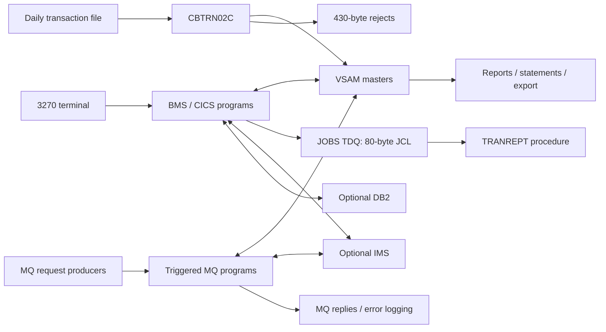

# 05 — Input, output and interface contracts

## Purpose and evidence

**Question answered:** What must an operator, terminal, batch producer, downstream file consumer, or MQ caller send to CardDemo, and what does the current implementation return or change?

**Analyzed revision:** [`fbcb944af892dcb8c94c0549f2ee248945010ff8`](https://github.com/codev-workshops/uc-legacy-modernization-cobol-to-java/tree/fbcb944af892dcb8c94c0549f2ee248945010ff8).

**Evidence status:** Source-only. No legacy application, compiler, CICS region, queue manager, database, scheduler, FTP transfer, or PDF converter was executed. Unless labelled otherwise, behavior below is **source-confirmed**: a definition or executable path exists at this revision. Calculated sizes and likely consequences are labelled **inferred**. Installed resources, deployment settings, and actual runtime results are **unknown**. README examples are not wire-format authority.

| Coverage | Inspected source families | Limits |
|---|---|---|
| Base online | CSD, all 17 base BMS mapsets, symbolic maps, COBOL handlers, menu/COMMAREA copybooks | Terminal byte streams, installed resources and compiler-generated maps not observed |
| Optional online | DB2 transaction-type and IMS authorization BMS/CSD/handlers | Presence in a menu does not establish installation |
| File and batch | COBOL FDs/copybooks; daily posting, reporting, statement, interest and import/export programs; JCL/PROC/catalog definitions | Allocation and utility completion not observed |
| MQ | Direct inspection of `CODATE01`, `COACCT01`, `COPAUA0C`; request/reply/error copybooks and optional CSD | No client or queue-manager configuration validated |
| Utility boundaries | SORT, IDCAMS, DB2 extracts, IMS unload/load, FTP, PDF, internal reader, online TDQ submission | External utility versions, recipients and operational schedules unknown |

Related documents: [system inventory](01_SYSTEM_OVERVIEW_AND_INVENTORY.md), [execution flows](02_END_TO_END_EXECUTION_FLOWS.md), [business rules](03_BUSINESS_RULES_CATALOG.md), [physical record dictionary and lineage](04_DATA_MODEL_DICTIONARY_AND_LINEAGE.md), [state and failure semantics](06_RUNTIME_STATE_AND_FAILURE_SEMANTICS.md), and [behavioral evidence/open questions](07_BEHAVIORAL_EVIDENCE_AND_OPEN_QUESTIONS.md). Document 04 owns detailed field offsets; the sizes and discriminators needed to recognize interfaces are repeated here.

## Navigation

1. [Boundary map and conventions](#1-boundary-map-and-conventions)
2. [Online transactions and screen contracts](#2-online-transactions-and-screen-contracts)
3. [COMMAREA and callable interfaces](#3-commarea-and-callable-interfaces)
4. [Data files and daily posting](#4-data-files-and-daily-posting)
5. [Reports, statements and submission](#5-reports-statements-and-submission)
6. [Import/export](#6-importexport)
7. [MQ interfaces](#7-mq-interfaces)
8. [Utility and optional batch boundaries](#8-utility-and-optional-batch-boundaries)
9. [Contradictions and deployment questions](#9-contradictions-and-deployment-questions)

## 1. Boundary map and conventions



Text equivalent: terminals exchange BMS maps with CICS; CICS reads or updates master files and can submit report JCL through `JOBS`. Optional screens use IMS and DB2. Batch reads daily records, updates masters, and writes rejects and reports. Triggered MQ programs consult VSAM and/or IMS and publish replies. Evidence: [online report submission][report-online], [posting loop][post-loop], [account MQ processing][mq-acct-process], [authorization processing][auth-process], [optional authorization detail][auth-detail-code], [DB2 type maintenance][type-update-code].

Lengths below are field capacities, not minimum entered text. `X(n)` means alphanumeric COBOL storage; `9(n)` means numeric DISPLAY unless a usage clause says otherwise. `COMP`/`BINARY` and `COMP-3` must retain their compiler representation. `RECFM=FB/F` is record-oriented; do not assume newline-delimited text. Names such as `ACCTDAT` are CICS resources, while `ACCTFILE` is a DD name. They are not interchangeable. See [master layouts][master-layouts], [posting SELECT/FD definitions][post-fds], and [CICS definitions][base-csd].

## 2. Online transactions and screen contracts

### 2.1 Transaction/program register

The producer is a terminal user, or another program transferring control with a COMMAREA. The consumer is the named CICS program. Trigger timing is initial transaction entry, followed by ENTER/PF-key submissions through pseudo-conversational `RETURN TRANSID`; optional MQ transactions instead consume trigger context.

| Transaction | Program | Mapset / role |
|---|---|---|
| `CC00` | `COSGN00C` | `COSGN00`, sign-on |
| `CM00` | `COMEN01C` | `COMEN01`, main menu |
| `CA00` | `COADM01C` | `COADM01`, administrator menu |
| `CAVW` / `CAUP` | `COACTVWC` / `COACTUPC` | `COACTVW` / `COACTUP`, account view/update |
| `CCLI` / `CCDL` / `CCUP` | `COCRDLIC` / `COCRDSLC` / `COCRDUPC` | `COCRDLI` / `COCRDSL` / `COCRDUP`, card list/view/update |
| `CT00` / `CT01` / `CT02` | `COTRN00C` / `COTRN01C` / `COTRN02C` | `COTRN00` / `COTRN01` / `COTRN02`, transaction list/view/add |
| `CB00` / `CR00` | `COBIL00C` / `CORPT00C` | `COBIL00` / `CORPT00`, payment/report request |
| `CU00` / `CU01` / `CU02` / `CU03` | `COUSR00C` / `COUSR01C` / `COUSR02C` / `COUSR03C` | `COUSR00`–`COUSR03`, security-user list/add/update/delete |
| `CDV1` | `COCRDSEC` | CSD resource exists; no matching base COBOL/BMS implementation in the inspected tree |
| `CTLI` / `CTTU` | `COTRTLIC` / `COTRTUPC` | Optional DB2 `COTRTLI` / `COTRTUP` |
| `CPVS` / `CPVD` | `COPAUS0C` / `COPAUS1C` | Optional authorization `COPAU00` / `COPAU01` |
| `CP00` | `COPAUA0C` | Optional authorization MQ service |
| `CDRA` / `CDRD` | `COACCT01` / `CODATE01` | Optional VSAM/MQ account/date services |

Sources: [base CSD TRANSACTION definitions][base-trans], [DB2 CSD][db2-csd], [authorization CSD][auth-csd], [VSAM/MQ CSD][mq-csd]. The `CDV1` implementation gap is a source-inventory observation, not a claim that an installed region cannot supply it.

### 2.2 How to read the screen field inventory

These are application-data fields, including display-only output; fixed labels are presentation text. BMS `ATTRB` defines the initial protection, while COBOL can change field attributes/cursor placement for a particular state. A field being `UNPROT` does not mean every state accepts a change. Generated symbolic-map suffixes carry lengths/flags/attributes and values (`...L`, `...F`, `...A`, `...I`, `...O`); these are not extra business inputs. Sources: [sign-on physical map][bms-sign], [sign-on symbolic map][symbol-sign], [account-update state machine][acct-update].

Common headers are `TRNNAME` 4, `TITLE01/02` 40 each, `CURDATE` 8, `PGMNAME` 8 and `CURTIME` 8 (9 on sign-on). `ERRMSG` is 78 characters except card detail/update (80); account/card/type list screens additionally have `INFOMSG` (45), and card detail/update use 40. Dynamic `FKEYS` fields are output legends, not input controls. [Sign-on][bms-sign] [account view][bms-account-view] [card detail][bms-card-detail] [DB2 list][bms-type-list].

### 2.3 Base BMS data fields

`I` = input-capable field in the map; `O` = protected output initially. Repeated row groups have the same shape; every numbered occurrence is included by the range.

| Mapset | Input fields and capacities | Output fields and capacities | BMS evidence |
|---|---|---|---|
| `COSGN00` | `USERID` 8, `PASSWD` 8 (dark input) | `APPLID` 8, `SYSID` 8, `ERRMSG` 78, headers | [DFHMDF declarations][bms-sign] |
| `COMEN01`, `COADM01` | `OPTION` 2 | `OPTN001`–`OPTN011` 40 each, `ERRMSG` 78, headers | [main][bms-main], [admin][bms-admin] |
| `COACTVW` | `ACCTSID` 11 | `ACSTTUS` 1; `ADTOPEN/AEXPDT/AREISDT` 10; `ACRDLIM/ACSHLIM/ACURBAL/ACRCYCR/ACRCYDB` 15; `AADDGRP` 10; customer fields described below; messages | [account view][bms-account-view] |
| `COACTUP` | `ACCTSID` 11, `ACSTTUS` 1; `OPN/EXP/RIS` + `YEAR/MON/DAY` 4/2/2; the same five amount fields 15, `AADDGRP` 10; customer fields below | `INFOMSG` 45, `ERRMSG` 78, `FKEYS` 21, `FKEY05` 7, `FKEY12` 10 | [account update][bms-account-update] |
| `COCRDLI` | `ACCTSID` 11, `CARDSID` 16; row selection attributes controlled by program | `PAGENO` 3; rows 1–7: `CRDSELn` 1, `ACCTNOn` 11, `CRDNUMn` 16, `CRDSTSn` 1; messages | [card list][bms-card-list] |
| `COCRDSL` | `ACCTSID` 11, `CARDSID` 16 | `CRDNAME` 50, `CRDSTCD` 1, `EXPMON` 2, `EXPYEAR` 4, `INFOMSG` 40, `ERRMSG` 80, `FKEYS` 75 | [card detail][bms-card-detail] |
| `COCRDUP` | `CARDSID` 16, `CRDNAME` 50, `CRDSTCD` 1, `EXPMON` 2, `EXPYEAR` 4 | `ACCTSID` 11, `EXPDAY` 2, `INFOMSG` 40, `ERRMSG` 80, `FKEYS` 21, `FKEYSC` 18 | [card update][bms-card-update] |
| `COTRN00` | `TRNIDIN` 16; `SEL0001`–`SEL0010` 1 each | `PAGENUM` 8; rows 01–10: `TRNIDnn` 16, `TDATEnn` 8, `TDESCnn` 26, `TAMTnnn` 12; `ERRMSG` 78 | [transaction list][bms-tran-list] |
| `COTRN01` | `TRNIDIN` 16 | `TRNID` 16, `CARDNUM` 16; transaction detail group below, `ERRMSG` 78 | [transaction view][bms-tran-view] |
| `COTRN02` | `ACTIDIN` 11, `CARDNIN` 16; transaction detail group below; `CONFIRM` 1 | `ERRMSG` 78 | [transaction add][bms-tran-add] |
| `COBIL00` | `ACTIDIN` 11, `CONFIRM` 1 | `CURBAL` 14, `ERRMSG` 78 | [bill payment][bms-bill] |
| `CORPT00` | `MONTHLY/YEARLY/CUSTOM` 1; `SDTMM/SDTDD/SDTYYYY` and `EDTMM/EDTDD/EDTYYYY` 2/2/4; `CONFIRM` 1 | `ERRMSG` 78 | [report selection][bms-report] |
| `COUSR00` | `USRIDIN` 8; `SEL0001`–`SEL0010` 1 | `PAGENUM` 8; rows 01–10: `USRIDnn` 8, `FNAMEnn/LNAMEnn` 20, `UTYPEnn` 1; `ERRMSG` 78 | [user list][bms-user-list] |
| `COUSR01` | `FNAME/LNAME` 20, `USERID/PASSWD` 8, `USRTYPE` 1 | `ERRMSG` 78 | [user add][bms-user-add] |
| `COUSR02` | `USRIDIN/PASSWD` 8, `FNAME/LNAME` 20, `USRTYPE` 1 | `ERRMSG` 78 | [user update][bms-user-update] |
| `COUSR03` | `USRIDIN` 8 | `FNAME/LNAME` 20, `USRTYPE` 1, `ERRMSG` 78 | [user delete][bms-user-delete] |

**Customer group, account view:** `ACSTNUM` 9, `ACSTSSN` 12, `ACSTDOB` 10, `ACSTFCO` 3; `ACSFNAM/ACSMNAM/ACSLNAM` 25; `ACSADL1/ACSADL2/ACSCITY` 50; `ACSSTTE` 2, `ACSZIPC` 5, `ACSCTRY` 3; `ACSPHN1/ACSPHN2` 13; `ACSGOVT` 20, `ACSEFTC` 10, `ACSPFLG` 1. **Update differences:** SSN is `ACTSSN1/2/3` 3/2/4, DOB is `DOBYEAR/MON/DAY` 4/2/2, phones are `ACSPH1A/B/C` and `ACSPH2A/B/C` 3/3/4. Remaining customer fields retain the view capacities. [View][bms-account-view] [update][bms-account-update].

**Transaction detail group:** `TTYPCD` 2, `TCATCD` 4, `TRNSRC` 10, `TDESC` 60, `TRNAMT` 12, `TORIGDT/TPROCDT` 10, `MID` 9, `MNAME` 30, `MCITY` 25, `MZIP` 10. These are output in view and input in add. A 16-character transaction search key is not an account/card search key. [View][bms-tran-view] [add][bms-tran-add].

### 2.4 Base actions, validation, side effects and messages

Messages are screen text, not stable numeric error codes. The linked paragraphs are the authority for exact punctuation and state-specific variants. Field-level errors ordinarily redisplay a map and position the cursor; failed file operations may use a screen error or a separate abend path. An apparent “back” key must be interpreted per program.

| Program / trigger | Actions and required validation | Output, changes and observable failures |
|---|---|---|
| `COSGN00C` sign-on | ENTER requires nonblank ID/password; both are uppercased before security-file comparison. PF3 sends plain thank-you text. Other keys are invalid. | Successful user type selects main/admin flow and populates COMMAREA. Messages: `Please enter User ID ...`, `Please enter Password ...`, `Wrong Password. Try again ...`, `User not found. Try again ...`, `Unable to verify the User ...`. [MAIN-PARA / PROCESS-ENTER-KEY][sign-code] |
| `COMEN01C`, `COADM01C` menus | ENTER checks a two-character selection against the active option count; PF3 returns to sign-on. Main menu checks option user-type restriction. | Main options 1–11 select account view/update, card list/view/update, transaction list/view/add, reports, payment, pending authorization. Admin options 1–6 select user list/add/update/delete and DB2 type list/maintenance. `Please enter a valid option number...`, `No access - Admin Only option...`. The current transaction-add entry is `U`; an old admin-only comment is not an enforced restriction. [menu handlers][menu-code] [admin handler][admin-code] [main option table][main-options] [admin option table][admin-options] |
| `COACTVWC` | ENTER validates an 11-digit account search; PF3 returns. Looks up account and associated customer through cross-reference. | Account/customer display, invalid/non-numeric key, no-account/no-customer and file-status messages; no update action. [input and lookup paths][acct-view] |
| `COACTUPC` | ENTER drives fetch/edit/review states; PF5 confirmation and PF12 fetch/reset paths are state-dependent; PF3 returns. Numeric account/customer fields, signed amounts, status/flag values, names, state/ZIP, date components, phone/SSN/FICO formats are individually validated. | Reads account/customer, checks changes and confirmation, updates records on the update path. Distinguishes invalid data, no changes, confirm changes, stale/locked/read/rewrite failures. Do not replace its state machine with unconditional PF5 save. [key handling, validation and update paragraphs][acct-update] |
| `COCRDLIC` | ENTER searches numeric account/card filters and processes row selection; PF3 returns; PF7/PF8 browse previous/next. | Seven-row pages, selected account/card retained for detail/update transfer. `NO PREVIOUS PAGES TO DISPLAY`, `NO MORE PAGES TO DISPLAY`, `NO MORE RECORDS TO SHOW`; bad account/card/selection and read/browse errors. [MAIN-PARA / browse paths][card-list-code] |
| `COCRDSLC` | ENTER retrieves matching account/card; PF3 returns. Validates numeric search keys. | Card details and not-found/mismatch/read errors. [MAIN-PARA / validation][card-detail-code] |
| `COCRDUPC` | ENTER fetches/validates changes; PF5 confirms eligible updates; PF12 cancels/resets according to state; PF3 returns. Validates card identity, name, status and expiry month/year. | Writes card change only through confirmation/update flow; invalid input, no changes, confirmation, record-lock and rewrite messages. [state machine / update paragraphs][card-update-code] |
| `COTRN00C` | ENTER searches transaction ID or selects a row; PF3 returns; PF7/PF8 browse. | Ten transaction rows per page, transfer to `COTRN01C`, no-previous/no-more-records and invalid-selection messages. [MAIN-PARA / browse routines][tran-list-code] |
| `COTRN01C` | ENTER reads transaction ID; PF3 returns to caller/menu; PF4 clears; PF5 returns to transaction list. | Full transaction detail; empty/nonexistent ID and file-read errors. [PROCESS-ENTER-KEY / READ-TRANSACT-FILE][tran-view-code] |
| `COTRN02C` | ENTER requires account **or** card; provided IDs numeric. Type/category nonblank and numeric; source/description nonblank; amount accepted in `-99999999.99` format; original/processing dates `YYYY-MM-DD`, checked through `CSUTLDTC`; merchant ID numeric and merchant name/city/ZIP nonblank. Confirmation `Y/y` writes, `N/n` cancels. PF3 returns, PF4 clears, PF5 copies last transaction data. | Creates a transaction record, reports its ID; missing fields, malformed amount/date, lookup failure and `Tran ID already exist...`. Account/card lookup uses `ACCTDAT`, `CCXREF`, `CXACAIX`; write uses `TRANSACT`. [PROCESS-ENTER-KEY / validation / write][tran-add-code] |
| `COBIL00C` | ENTER retrieves account and balance, accepts `Y/y`, `N/n`, or blank confirmation; rejects other values. PF3 returns; PF4 clears. | Confirmed full-balance payment creates type `02`, category `0002`, source `POS TERM`, description `BILL PAYMENT - ONLINE`, then reduces account balance. `Invalid value. Valid values are (Y/N)...`, no-account/no-transaction, duplicate ID, or `Payment successful. Your Transaction ID is ...` (assembled text). [payment and I/O paragraphs][bill-code] |
| `CORPT00C` | ENTER handles monthly/yearly/custom selection and date checks; `Y/y` submits, `N/n` cancels. PF3 returns; PF4 clears. | Sends JCL to `JOBS`; date-component, invalid-date, selection/confirmation errors or `Unable to Write TDQ (JOBS)...`. Completion means TDQ write path, not observed batch/report delivery. [PROCESS-ENTER-KEY / SUBMIT-JOB][report-online] |
| `COUSR00C` | ENTER searches user or processes update/delete row choice; PF3 returns; PF7/PF8 browse ten-row pages. | Security-user list and transfer to update/delete; invalid selection and page-boundary messages. [MAIN-PARA / browse routines][user-list-code] |
| `COUSR01C` | ENTER requires names, ID, password and user type; PF3 returns; PF4 clears. | Writes `USRSEC`; `User ID already exist...` for duplicate record; successful assembled `User ... has been added ...`. [PROCESS-ENTER-KEY / WRITE-USER-SEC-FILE][user-add-code] |
| `COUSR02C` | ENTER loads; PF4 clears; PF5 saves. **PF3 calls UPDATE-USER-INFO before returning.** PF12 returns without that save call. Requires ID, names, password, type on update path. | Rewrites security record; `Press PF5 key to save your updates ...`, `User ID NOT found...`, `User ... has been updated ...`; write errors. [MAIN-PARA / UPDATE-USER-INFO][user-update-code] |
| `COUSR03C` | ENTER loads; PF4 clears; PF5 deletes; PF3 returns to caller (administrator menu if blank); PF12 returns to administrator menu. Requires user ID. | Deletes `USRSEC` after read; user-not-found/read/delete errors and successful deletion message. [MAIN-PARA / DELETE-USER-INFO][user-delete-code] |

The shared invalid-key text and thank-you text are defined in [CSMSG01Y][shared-messages]. For detailed field-by-field decision rules, follow [document 03](03_BUSINESS_RULES_CATALOG.md); the executable validation paragraphs cited above are part of these contracts. Runtime resource authorization, terminal error responses, and whether optional menu destinations are actually installed remain unknown.

### 2.5 Optional BMS and online actions

| Mapset | Fields/capacities | Actions, outputs and errors |
|---|---|---|
| `COTRTLI` | `TRTYPE` 2, `TRDESC` 50; `PAGENO` 3; rows 1–7: `TRTSELn` 1, `TRTTYPn` 2, `TRTYPDn` 50; extra `TRTSELA` 1, `TRTTYPA` 2, `TRTDSCA` 50; `INFOMSG` 45 / `ERRMSG` 78; PF legends | ENTER searches/selects; PF2 transfers to add; PF10 confirms pending deletes/updates only when selection/filter state is unchanged, otherwise becomes ENTER; PF3 returns; PF7/PF8 paginate using SQL cursor state. Type search numeric; descriptions filtered/edited according to mode. SQLCODE `0` success, `+100` no records, `-911` deadlock; messages include `Record not found. Deleted by others ?`, `Deadlock. Someone else updating ?`. [BMS][bms-type-list] [COTRTLIC handler/SQL][type-list-code] |
| `COTRTUP` | `TRTYPCD` 2, `TRTYDSC` 50; `INFOMSG` 45, `ERRMSG` 78, `FKEYS` 21; `FKEY04/05/06/12` 9/8/6/10 | ENTER search/review; PF3 exit; PF4 requests then confirms delete; PF5 starts creation after not-found or saves confirmed changes; PF12 cancel/reset, depending on state. Create/change/delete flows use DB2 and display SQL errors; the PF6 “Add” legend has no corresponding accepted PF6 branch in `0001-CHECK-PFKEYS`. [BMS][bms-type-update] [state machine and SQL][type-update-code] |
| `COPAU00` | Input `ACCTID` 11 and five `SEL000n` 1; output `CNAME` 25, `CUSTID` 9, `ADDR001/002` 25, `ACCSTAT` 1, `PHONE1` 13, `APPRCNT/DECLCNT` 3, `CREDLIM/CREDBAL` 12, `CASHLIM/CASHBAL` 9, `APPRAMT/DECLAMT` 10; five rows: transaction ID 16, date/time 8/8, type 4, approval/status 1/1, amount 12; `ERRMSG` 78 | ENTER validates account and row `S`; PF3 menu; PF7/PF8 pagination. Reads IMS pending-authorization summary/detail plus account/customer information. `Invalid selection. Valid value is S`; IMS not-found/end and status errors. [BMS][bms-auth-list] [COPAUS0C][auth-list-code] |
| `COPAU01` | Output `CARDNUM` 16, `AUTHDT/AUTHTM` 10, `AUTHRSP` 1, `AUTHRSN` 20, `AUTHCD` 6, `AUTHAMT` 12, `POSEMD` 4, `AUTHSRC` 10, `MCCCD` 4, `CRDEXP` 5, `AUTHTYP` 14, `TRNID` 15, `AUTHMTC` 1, `AUTHFRD` 10, `MERNAME/MERCITY` 25, `MERID` 15, `MERST` 2, `MERZIP` 10; `ERRMSG` 78 | ENTER loads; PF3 summary; PF5 mark/remove fraud; PF8 next. Fraud processing invokes `COPAUS2C`; messages `AUTH FRAUD REMOVED...`, `AUTH MARKED FRAUD...`, invalid key and IMS/DB2 failures. [BMS][bms-auth-detail] [COPAUS1C][auth-detail-code] [fraud subprogram][auth-fraud-code] |

Authorization IMS status constants distinguish blank/`FW` success, `GE` not found, `II` duplicate, `GP` wrong parentage, `GB` end. These are subsystem status values, not interchangeable with MQ completion codes or DB2 SQLCODE. [COPAUS0C working storage][auth-list-code].

## 3. COMMAREA and callable interfaces

### 3.1 Base CARDDEMO-COMMAREA

The caller supplies this state to `XCTL`/`RETURN`; the receiving program checks `EIBCALEN` and context before displaying/re-entering a screen. The common record is all DISPLAY/alphanumeric fields: **160 bytes, inferred by summing the declared fields**. It contains no version or declared schema discriminator. [COCOM01Y][commarea].

| Group | Ordered fields |
|---|---|
| General, 34 bytes | `CDEMO-FROM-TRANID` X(4), `FROM-PROGRAM` X(8), `TO-TRANID` X(4), `TO-PROGRAM` X(8), `USER-ID` X(8), `USER-TYPE` X(1): `A` admin / `U` user; `PGM-CONTEXT` 9(1): `0` enter / `1` reenter |
| Customer, 84 bytes | `CDEMO-CUST-ID` 9(9); first/middle/last name X(25) each |
| Account, 12 bytes | `CDEMO-ACCT-ID` 9(11), `CDEMO-ACCT-STATUS` X(1) |
| Card, 16 bytes | `CDEMO-CARD-NUM` 9(16) |
| Last-screen, 14 bytes | `CDEMO-LAST-MAP` X(7), `CDEMO-LAST-MAPSET` X(7) |

The common fields total 34 + 84 + 12 + 16 + 14 bytes. Programs may append private state. The exact transmitted length depends on the sending program's CICS command, not a universal “COMMAREA size.” [COCOM01Y][commarea] [card list private state and RETURN][card-list-code] [authorization private state][auth-list-code].

Menu transitions set from/to program fields and context, then `XCTL PROGRAM(CDEMO-TO-PROGRAM) COMMAREA(...)`; missing destination falls back to sign-on in the return helper. Transaction/user list programs retain browsing/selection data beyond basic identity fields. The optional fraud service exchanges authorization-related state through its own linkage. Do not treat the common prefix as the complete card-list, transaction-list or authorization conversation. [menu transfer][menu-code] [user return helper][user-update-code] [fraud linkage][auth-fraud-code].

### 3.2 Other callable boundaries

| Producer → consumer | Input/output contract | Errors / qualification |
|---|---|---|
| Online date validation → `CSUTLDTC` | By-reference date X(10), format X(10), result text X(80); calls LE date services and returns severity through `RETURN-CODE` | Callers test returned result; installed LE behavior and supported runtime locale are unknown. [LINKAGE / A000-MAIN][date-call] |
| `CBSTM03A` → `CBSTM03B` | Ordered linkage: DD selector X(8), operation X(1), file status X(2), key X(25), key length S9(4) DISPLAY, record area X(1000). Selectors: `TRNXFILE`, `XREFFILE`, `CUSTFILE`, `ACCTFILE`; operation declarations: `O/C/R/K/W/Z` | Helper implements file-specific open/read/close paths and returns COBOL file status; operation declarations alone do not establish that every file supports writes. [caller][statement-code] [LINKAGE / dispatch][statement-helper] |
| `CBACT04C` interest batch | Linkage parameter length plus external date X(10), invoked by JCL `PARM`; file inputs in section 8 | No blanket assumption that other batch programs accept the same parameter. [CBACT04C linkage/process][interest-code] [INTCALC JCL][interest-jcl] |
| `COBSWAIT` → assembler `MVSWAIT` | `ACCEPT` X(8) from SYSIN, moved to `PIC 9(8) COMP`, then passed by reference | Comment calls it a wait in centiseconds; no input validation in the COBOL wrapper. Do not mistake this for a JCL `PARM` linkage. [COBSWAIT][wait-code] |

## 4. Data files and daily posting

### 4.1 Master and exchange files

Producers are initial/load utilities, online changes, or batch posting; consumers are online lookup, daily processing, reporting and export. DD allocations bind these to actual datasets. Detailed offsets and all filler fields belong in [document 04](04_DATA_MODEL_DICTIONARY_AND_LINEAGE.md).

| Logical record / length | Key and minimum schema | Producers / consumers and boundary |
|---|---|---|
| Account / 300 | Account ID 11; status, monetary fields, dates, cycle totals, group | `ACCTFILE` batch / `ACCTDAT` CICS; account update, payment and interest mutate; reports/MQ/export read. [account record][master-layouts] [posting FDs][post-fds] [account MQ][mq-acct-process] |
| Customer / 500 | Customer ID 9; names, address/contact/identity fields, DOB, flags/FICO | `CUSTFILE` / `CUSTDAT`; customer loading/account update → display/statements/export. [customer copybook][customer-layout] [statement helper][statement-helper] |
| Card / 150 | Card number 16; account ID 11, CVV, name, expiry, status | `CARDFILE` / `CARDDAT`, account alternate path `CARDAIX`; card update → display/export. [card copybook][card-layout] [card update][card-update-code] |
| Card cross-reference / 50 | Card number 16, customer ID 9, account ID 11, filler 14 | `XREFFILE` / `CCXREF`, account alternate path `CXACAIX`; load → posting, online, statement and MQ joins. [xref copybook][xref-layout] |
| Transaction / 350 | ID 16; type 2, category 4, source 10, description 100, amount S9(9)V99, merchant ID/name/city/ZIP, card 16, original and processing timestamps 26 each | `TRANFILE`/`TRANSACT`; posting, online add/payment/interest → list/report/statement/export/backup. Screen description is shorter than stored description. [CVTRA05Y][transaction-layout] |
| Daily transaction / 350 | Same declared business layout as transaction record under daily field names | External daily producer → `DALYTRAN`, consumed by reader and posting; producer/scheduler timing unknown. [CVTRA06Y][daily-layout] [CBTRN01C FDs/loop][daily-reader] |
| Category balance / 50 | Account 11 + type 2 + category 4 = 17-byte key; balance and filler | `TCATBALF`; posting → interest calculation. [CVTRA01Y][balance-layout] [posting write/update][post-updates] |
| Discount group / 50 | Group 10 + type 2 + category 4; interest rate and filler | `DISCGRP`; configured/load data → interest. [CVTRA02Y][discount-layout] [interest][interest-code] |
| Transaction type / 60 | Type 2, description 50, filler 8 | `TRANTYPE`; reference loads/optional DB2 extract → report lookups. [CVTRA03Y][type-layout] |
| Transaction category / 60 | Type 2 + category 4, description 50, filler 4 | `TRANCATG`; reference loads/DB2 extract → report lookups. [CVTRA04Y][category-layout] |
| Security user / 80 | User ID 8, first/last 20 each, password 8, type 1, filler | `USRSEC`; user maintenance → sign-on/list. Password is a field in the record; sample values are intentionally not reproduced. [CSUSR01Y][security-layout] [user write][user-add-code] |

Sequential readers (`CBACT01C/02C/03C`, `CBCUS01C`, `CBTRN01C`) expose DISPLAY/SYSOUT records and file-status/abend paths rather than new normalized output schemas. Their SELECT/FD definitions identify account/card/xref/customer/daily DD contracts. [Account reader][reader-account] [card reader][reader-card] [xref reader][reader-xref] [customer reader][reader-customer] [daily reader][daily-reader].

### 4.2 Posting and reject contract

`POSTTRAN` runs `CBTRN02C` with `DALYTRAN` input; master `TRANFILE`, `ACCTFILE`, `TCATBALF` are updated, `XREFFILE` is consulted, and `DALYREJS` is created as `AWS.M2.CARDDEMO.DALYREJS(+1)`, `RECFM=F,LRECL=430`. Trigger is job execution; a production daily schedule is not established by this JCL. [POSTTRAN DDs][post-jcl].

Reject structure is **original 350-byte input + 80-byte trailer**: `PIC 9(04)` reason and `PIC X(76)` description. Numeric values below occupy four DISPLAY positions, e.g. reason 100 is `0100`. [FD / trailer][post-reject-layout].

| Reason | Trigger / exact message family |
|---|---|
| 100 | Xref card lookup fails: `INVALID CARD NUMBER FOUND` |
| 101 | Account lookup fails: `ACCOUNT RECORD NOT FOUND` |
| 102 | Credit-limit validation fails: `OVERLIMIT TRANSACTION` |
| 103 | Original transaction date exceeds account expiration: `TRANSACTION RECEIVED AFTER ACCT EXPIRATION` |
| 109 | Transaction already exists on the posted transaction file; duplicate-check path |

[Validation paragraphs][post-validation] [existing-transaction check][post-duplicate].

The processing loop validates, then writes transaction and updates category/account balance, or writes a reject. It displays processed/rejected counts and sets **job `RETURN-CODE=4` if rejects exist**. I/O result variables `0`/`12` and EOF `16` are internal application values; they must not be reported as unconditional job return codes. Unrecoverable file failures display status and call the abend routine. There is no successful-retry guarantee in the reject format. [main loop / return code][post-loop] [reject write][post-validation] [abend][post-abend].

## 5. Reports, statements and submission

### 5.1 Transaction report: CBTRN03C / TRANREPT

| Aspect | Contract |
|---|---|
| Producer → consumer | `TRANFILE` plus `CARDXREF`, `TRANTYPE`, `TRANCATG`, `DATEPARM` → `CBTRN03C` → `TRANREPT` report dataset / downstream print consumer |
| Parameter | `DATEPARM`: start X(10), one ignored separator, end X(10). Comparison uses `TRAN-PROC-TS(1:10) >= start AND <= end`; it is inclusive string comparison, not a separate calendar-validation service |
| Sort/filter | PROC SORT uses card number at one-based byte 263, length 16, `ZD`, ascending; processing date byte 305, length 10, `CH`, inclusive bounds. PROC SYMNAMES and program DATEPARM must agree |
| Output | Fixed 133-byte records (`RECFM=FB`), headings, detail rows, blank lines and totals; dataset generation `AWS.M2.CARDDEMO.TRANREPT(+1)` |
| Detail | Transaction ID 16, account ID 11, type code 2 + description 15, category 4 + description 29, source 10, formatted amount; layout `CVTRA07Y` |
| Group/totals | Change detection uses **card number**, even though total variable/label calls it “account.” Emits account total on card change. EOF branch adds `TRAN-AMT` again to page/account accumulators, then emits page and grand totals, without calling the account-total paragraph. Final-group omission and possible retained-record double count require runtime characterization |
| Pagination | `WS-PAGE-SIZE=20`; line counter controls headers/page totals, so do not equate this blindly to exactly 20 transaction rows on every rendered page |
| Errors | Missing cross-reference/type/category is fatal: displays bad key, I/O status and abends. Open/read/write/close errors are not emitted as ordinary detail rows |

Sources: [CBTRN03C date/page definitions and main loop][report-code], [report layout][report-layout], [TRANREPT PROC][report-proc], [TRANREPT JCL][report-jcl], [lookup errors][report-errors].

### 5.2 Online report submission is another output interface

`CORPT00C` accepts one report selection and date range, then confirmation. It assembles **80-character JCL records** containing an EXEC of `PROC=TRANREPT`, SORT `SYMNAMES` overrides for the start/end dates, and `STEP10R.DATEPARM` data. It loops through a JCL template, stopping on `/*EOF`, spaces or low-values, and executes `WRITEQ TD QUEUE('JOBS') FROM(JCL-RECORD) LENGTH(LENGTH OF JCL-RECORD)`. `RESP/RESP2` detect failure and the screen gets `Unable to Write TDQ (JOBS)...`. [JCL definitions and SUBMIT-JOB][report-online].

Producer: online user/program. Consumer: CICS transient-data destination and the JES/internal-reader configuration behind it. Trigger: confirmed request. Output: job text, not the report itself. The repository does not establish that installed `JOBS` routes to JES, that the PROC is cataloged, or that the user has submit authority. A partial series of successful TDQ writes is not evidence of a completed batch job.

### 5.3 Statements, HTML and PDF

`CREASTMT` prepares a card/transaction keyed work file. SORT orders `(263,16,CH,A,1,16,CH,A)` and rearranges with `OUTREC FIELDS=(1:263,16,17:1,262,279:279,50)`. `CBSTM03B` expects an indexed record with composite key card 16 + transaction ID 16 and record size 350. Preserve the JCL's actual work-file allocation/load steps; the rearranged record is not the unchanged transaction-master schema. [CREASTMT sort/load][statement-jcl] [helper FDs][statement-helper].

`CBSTM03A` consumes that work file plus xref/customer/account through `CBSTM03B`. It writes `STMTFILE` text records X(80) and `HTMLFILE` records X(100); JCL binds these to `AWS.M2.CARDDEMO.STATEMNT.PS` (`FB/80`) and `.STATEMNT.HTML` (`FB/100`). Output contains customer name/address, account/balance/FICO, transaction headings and rows, per-statement accumulated transaction amount, and start/end markers. These are card-group statement transitions in the source, not evidence that customers receive one consolidated multi-card statement. There is no independently specified page-count contract comparable to the report's 20-line setting. [statement FDs/templates/processing][statement-code] [JCL outputs][statement-jcl].

`TXT2PDF1` consumes the text statement and produces `.STATEMNT.PS.PDF`; PDF generation is delegated to external REXX/utility libraries and control data. Its produced PDF bytes, fonts, page breaks and success status have not been observed. `FTPJCL` has a separate ASCII transfer boundary (section 8). An HTML `<meta charset="utf-8">` literal is present in the templates; that declaration does **not** prove the FB dataset bytes were encoded as UTF-8. [TXT2PDF1][pdf-jcl] [HTML template][statement-html].

## 6. Import/export

### 6.1 Envelope, order and physical representation

Producer `CBEXPORT` sequentially reads five indexed masters in order **customer → account → xref → transaction → card**, assigns incrementing sequence values, and writes `EXPFILE`. Consumer `CBIMPORT` reads `EXPFILE` sequentially by indexed-file definition and dispatches by type. This is a fixed-record **VSAM indexed export**, not CSV or a line-sequential flat file. Both FDs declare **500 characters**, both SELECT clauses say `ORGANIZATION IS INDEXED`; export JCL defines `RECORDSIZE(500 500)`, `KEYS(4 28)`. [export SELECT/FD/process][export-code] [import SELECT/FD/dispatch][import-code] [export cluster/JCL][export-jcl].

| Envelope field, in order | Declaration / meaning |
|---|---|
| `EXPORT-REC-TYPE` | X(1): `C` customer, `A` account, `X` xref, `T` transaction, `D` card |
| `EXPORT-TIMESTAMP` | X(26); filled by program current-date/time formatting |
| `EXPORT-SEQUENCE-NUM` | 9(9) COMP; binary indexed key |
| `EXPORT-BRANCH-ID` | X(4) |
| `EXPORT-REGION-CODE` | X(5) |
| `EXPORT-RECORD-DATA` | X(460), redefined by each record type |

[CVEXPORT header and payload definitions][export-layout].

**Representation is part of the contract.** Payloads are field-by-field remappings, not byte copies of master records: examples include binary customer ID, packed monetary fields, a nine-digit DISPLAY xref customer ID, and binary account/card relationship fields. The export transaction description is 100, merchant name/city 50/50, timestamps 26/26. Do not use the shorter BMS fields as the export schema. [CVEXPORT][export-layout] [export moves][export-code].

**Inferred payload sizes:** all five REDEFINES sum to 460 bytes with conventional COBOL binary/packed sizes, including each filler. Customer includes three X(50) address lines and filler X(134); transaction includes filler X(140). The FDs are X(500), and export uses `WRITE EXPORT-OUTPUT-RECORD FROM EXPORT-RECORD`. Native compiler layout and conversion still require deployment evidence. [CVEXPORT][export-layout] [export FD and writes][export-code] [import FD and working storage][import-code].

**Inferred key mismatch:** under the conventional four-byte representation of `9(9) COMP`, fields total 500 and sequence starts at zero-based offset **27** (1 + 26), whereas JCL defines offset **28**. The copybook does not contain a padding field before the sequence. Compiler settings and actual indexed-key behavior need validation; this document preserves both definitions rather than silently correcting one. [copybook][export-layout] [KEYS(4 28)][export-jcl].

### 6.2 Import outputs and errors

| Discriminator | Consumer/output DD | Record size | Effect |
|---|---|---:|---|
| `C` | `CUSTOUT` | 500 | Reconstruct customer record |
| `A` | `ACCTOUT` | 300 | Reconstruct account record |
| `X` | `XREFOUT` | 50 | Reconstruct xref record |
| `T` | `TRNXOUT` | 350 | Reconstruct transaction record |
| `D` | `CARDOUT` | 150 | Reconstruct card record; **missing DD in supplied CBIMPORT JCL** |
| Other | `ERROUT` | 132 | `Unknown record type encountered` diagnostic; continue processing path |

[CBIMPORT FDs/dispatch and reconstruction][import-code] [CBIMPORT JCL][import-jcl].

`ERROUT` record is timestamp X(26), `|`, type X(1), `|`, sequence 9(7), `|`, message X(50), filler X(43): 130 declared characters moved into X(132). The sequence diagnostic is narrower than the nine-digit export sequence. A write error displays its status; import statistics are displayed at completion. The `3000-VALIDATE-IMPORT` paragraph only displays “Import validation completed” and “No validation errors detected”; it does **not** perform the checksum validation claimed by the program's introductory comments. [error record definition][import-error-layout] [error write/validation/finalize][import-final].

No version negotiation, byte-order marker, newline convention, deployed CCSID or cross-platform binary representation is established here. Required consumer inputs are the declared numeric representations and record types; branch/region fields must not be invented from target-system concepts. Validate the native file first before treating it as a portable interchange.

## 7. MQ interfaces

### 7.1 Contract comparison

Producer is an external MQ requester; consumer is a triggered CICS program. All three derive the input queue from `MQTM-QNAME`; no production request queue name can be inferred solely from a README sample.

| Property | `CODATE01` / `CDRD` | `COACCT01` / `CDRA` | `COPAUA0C` / `CP00` |
|---|---|---|---|
| Input queue | Trigger queue `MQTM-QNAME` | Trigger queue `MQTM-QNAME` | Trigger queue `MQTM-QNAME` |
| Reply queue | Literal `CARD.DEMO.REPLY.DATE` opened for output | Literal `CARD.DEMO.REPLY.ACCT` opened for output | Request `MQMD-REPLYTOQ` saved to `WS-REPLY-QNAME`, used by `MQPUT1` |
| Error sink | `CARD.DEMO.ERROR` | `CARD.DEMO.ERROR` | `CSSL` CICS TDQ error record |
| Request/reply buffer | 1000 / 1000 | 1000 / 1000 | 500 / 200 |
| GET options | SYNCPOINT + FAIL-IF-QUIESCING + CONVERT + WAIT | Same | **NO-SYNCPOINT** + WAIT + CONVERT + FAIL-IF-QUIESCING |
| Wait | 5000 | 5000 | 5000 |
| PUT options | SYNCPOINT + DEFAULT-CONTEXT + FAIL-IF-QUIESCING | Same | **NO-SYNCPOINT** + DEFAULT-CONTEXT, `MQPUT1` |
| Correlation | Save and reuse incoming MsgId **and** CorrelId | Save and reuse incoming MsgId **and** CorrelId | Reuse incoming CorrelId; MsgId set `MQMI-NONE` |
| Format/CCSID | `MQFMT-STRING`; PUT uses `MQCCSI-Q-MGR` | Same | `MQFMT-STRING`; no explicit portable byte encoding established |
| Persistence/expiry | Do not infer durable persistence from defaults | Same | Explicit `MQPER-NOT-PERSISTENT`, expiry 50 |

Evidence: [date constants/open][mq-date-open], [date GET/process/PUT][mq-date-process], [account constants/open][mq-acct-open], [account GET/process/PUT][mq-acct-process], [authorization initialization/GET][auth-get], [authorization reply][auth-reply], [authorization logging][auth-log]. Options above are actual source constants; numeric MQ constant definitions and expiry units come from the deployed MQ API, not a local redefinition in these sources.

### 7.2 Date: literal text reply, no request discriminator enforcement

`CODATE01` declares a 1000-byte request overlay: four-character function, 11-digit key, 985-byte filler. Its processing paragraph does not validate `DATE` or use an eight-character request ID. It asks CICS for current time and formats `MMDDYYYY` with `-` date separators and time separators. Reply is assembled as:

```text
SYSTEM DATE : <10-character date>SYSTEM TIME : <8-character time>
```

There is no inserted separator beyond the literals. PUT sends the **whole 1000-byte reply buffer**, not just the text length. The saved request `ReplyToQ` is not used to replace the already-opened fixed reply queue. [declarations/open][mq-date-open] [3000-GET-REQUEST / 4000-PROCESS-REQUEST-REPLY / 4100-PUT-REPLY][mq-date-process].

On MQ errors the program retains completion/reason codes, displays its MQ error record, and invokes error/termination paragraphs; successful GET saves message and correlation IDs. An error message to `CARD.DEMO.ERROR` is not a structured success/date reply. Exact queue-manager rollback and redelivery behavior remains a runtime question. [date error paragraphs][mq-date-errors].

### 7.3 Account: fixed input positions, labelled text output

`COACCT01` interprets positions **1–4** as `WS-FUNC`, **5–15** as numeric `WS-KEY`, remainder 985 bytes as filler. Request processing accepts **`INQA` and key > zero**. The comparison is not an explicit length-and-numeric-class validator for arbitrary malformed byte streams. It reads `ACCTDAT ` with that account key. [request fields][mq-acct-open] [4000-PROCESS-REQUEST-REPLY][mq-acct-process].

Success serializes labels and values into X(1000), in order:

`ACCOUNT ID : `, `ACCOUNT STATUS : `, `BALANCE : `, `CREDIT LIMIT : `, `CASH LIMIT : `, `OPEN DATE : `, `EXPR DATE : `, `REIS DATE : `, `CREDIT BAL : `, `DEBIT BAL : `, `GROUP ID : `.

Account ID is 11, status 1, group 10; dates are 10; all five reply monetary fields are S9(10)V99 DISPLAY, with an implied decimal rather than an inserted decimal point. This is **not** the raw 300-byte account record and not the README's binary account-response group. Invalid parameters produce `INVALID REQUEST PARAMETERS ACCT ID : <key>FUNCTION : <function>`; failed read produces `ERROR WHILE READING ACCTFILE`. Whole-buffer PUT, fixed reply queue and saved MsgId/CorrelId semantics are as above. [reply declarations][mq-acct-open] [response builder / READ-ACCOUNT][mq-acct-process].

The code opens `CARD.DEMO.ERROR`, builds an error string, and reports MQ failures via its error/termination paragraphs. GET and reply/error PUT use syncpoint options. Do not combine this with authorization's no-syncpoint MQ semantics when specifying delivery guarantees. [error handling][mq-acct-errors].

### 7.4 Authorization request: comma-delimited fields

`COPAUA0C` retrieves at most the 500-byte input buffer, uses returned `W01-DATALEN`, and `UNSTRING ... DELIMITED BY ','` into these fields. There is **no CSV quoting/escaping implementation** in this extraction paragraph. Amount first goes into X(13), then `FUNCTION NUMVAL`. Capacities come from `CCPAURQY`; they are not proof of strict validation of each incoming token. [request copybook][auth-request-layout] [2100-EXTRACT-REQUEST-MSG][auth-extract].

| Order | Field | Receiving declaration |
|---:|---|---|
| 1–2 | Auth date, auth time | X(6), X(6) |
| 3 | Card number | X(16) |
| 4–5 | Auth type, card expiry | X(4), X(4) |
| 6–7 | Message type, message source | X(6), X(6) |
| 8 | Processing code | 9(6) |
| 9 | Amount | temporary X(13), converted to request `+9(10).99` |
| 10–12 | Merchant category, acquirer country, POS entry mode | X(4), X(3), 9(2) |
| 13–15 | Merchant ID, name, city | X(15), X(22), X(13) |
| 16–18 | Merchant state, ZIP, transaction ID | X(2), X(9), X(15) |

Processing reads card cross-reference, account and customer records and an IMS authorization summary. `6000-MAKE-DECISION` evaluates available funds using IMS summary limits/balance when found, otherwise account limits/balance. `5600-READ-PROFILE-DATA` is a `CONTINUE` stub: no direct DB2 profile query or card-master read is implemented in this request path. A malformed token is not guaranteed to receive a clean decline: there is no general input-schema reject envelope around `UNSTRING`/`NUMVAL`. [5000-PROCESS-AUTH and lookup paragraphs][auth-process] [6000-MAKE-DECISION][auth-reply].

### 7.5 Authorization reply and durability limits

`6000-MAKE-DECISION` sets card number and transaction ID from the request and uses the request's six-character auth time as auth ID/code. `7100-SEND-RESPONSE` stringifies **card number, transaction ID, auth ID, response code, reason, amount**, with a comma **after every field, including the last**. The response copybook widths are 16, 15, 6, 2, 4, and edited amount `+9(10).99`; the actual serialized amount comes from `WS-APPROVED-AMT-DIS PIC -zzzzzzzzz9.99`, not a copy of the response group. Leading spaces/sign editing therefore matter. [response copybook][auth-response-layout] [working-storage display field][auth-ws] [decision / response builder][auth-reply].

| Response code / reason | Source selection |
|---|---|
| `00` / `0000` | Approved; approved amount equals requested amount |
| `05` / `3100` | Card xref, account or customer missing |
| `05` / `4100` | Insufficient funds |
| `05` / `4200` | Card inactive |
| `05` / `4300` | Account closed |
| `05` / `5100` | Card fraud |
| `05` / `5200` | Merchant fraud |
| `05` / `9000` | Other decline |

These reason mappings describe the `EVALUATE` branches **after** the decline condition is set. They do not prove all conditions are reachable: no executable setter of card-inactive, account-closed, card-fraud or merchant-fraud flags was found in this program, and profile lookup is a stub. A customer-not-found flag alone is not used to set decline in `6000-MAKE-DECISION`. [flag definitions][auth-flags] [lookup/decision][auth-process] [reason selection][auth-reply].

Declines set approved amount zero. `MQPUT1` uses saved request CorrelId, `MQMI-NONE` MsgId, clears ReplyToQ/ReplyToQMgr, sets reply message type, nonpersistent delivery and expiry 50. The destination is the saved ReplyToQ, with no corresponding explicit request ReplyToQMgr routing shown. Reply is attempted **before** `8000-WRITE-AUTH-TO-DB` in `5000-PROCESS-AUTH`; receiving a reply is not proof of the later IMS update. [6000 / 7100 paragraphs][auth-reply] [reply/write order][auth-process].

**Source quirk requiring characterization:** `WS-RESP-LENGTH` is initialized to 1 and passed as the COBOL STRING pointer, then copied directly to PUT buffer length. STRING advances the pointer past the last byte. No reset of that pointer is present in the request loop. Inferred consequences are an extra transmitted position for the first response and accumulating offset/length on later responses; exact runtime results depend on execution and overflow behavior. Do not document an idealized fixed reply length as observed. [pointer declaration][auth-ws] [request loop][auth-loop] [STRING / PUT length][auth-reply].

The main loop issues a CICS `SYNCPOINT` after authorization processing, but **MQGET/MQPUT1 explicitly use NO-SYNCPOINT**. That CICS command does not make those MQ operations part of the same unit of work. A request can already have been removed when later processing/reply fails. The source loops until no message or its processing limit; configured limit is 500 and the check is `>` after increment, not `>=`. [request loop][auth-loop] [GET options][auth-get] [PUT options][auth-reply].

### 7.6 Authorization error record

`9500-LOG-ERROR` writes CICS TDQ `CSSL`. `CCPAUERY` carries date 6, time 6, application 8, program 8, location 4, level 1, subsystem 1, code1 9, code2 9, message 50 and event key 20 (**122 bytes inferred from fields**). Levels distinguish log/info/warning/critical; subsystem values distinguish application/CICS/IMS/DB2/MQ/file. MQ open/get/put errors populate location, completion and reason codes. A failed reply is logged; there is no guaranteed retry/compensating reply in that paragraph. [CCPAUERY][auth-error-layout] [logging routine][auth-log] [MQPUT1 failure][auth-reply].

## 8. Utility and optional batch boundaries

These jobs expose files even when no COBOL program owns the transformation. Dataset prefixes shown are source examples, not assertions about a site's catalog.

| Job / producer → consumer | Inputs, control and outputs | Ordering / errors / deployment caveat |
|---|---|---|
| IDCAMS definition/load families | Account/card/customer/xref/transaction/category/type/security/discount sequential data → defined KSDS and alternate indexes/paths; `REPRO INFILE/OUTFILE` or dataset operands | Key lengths and record sizes must match DD/copybook contracts. Jobs frequently delete/redefine then reset `MAXCC`; this is job control, not data validation. [account definition/load][account-load-jcl] [card definitions/AIX][card-load-jcl] [REPROC][reproc] |
| `PRTCATBL` | `TCATBALF` KSDS → `.TCATBALF.BKUP(+1)` FB/50 → `.TCATBALF.REPT` FB/40 | SORT by account/type/category ascending; OUTREC adds spaces and edits balance as `TTTTTTTTT.TT`; no aggregation or pagination control in this SORT. [REPROC/SORT/DDs][category-report-jcl] |
| `ESDSRRDS` | IEBGENER creates `.ESDSRRDS.PS` FB/80, then IDCAMS loads `.USRSEC.VSAM.ESDS` and `.USRSEC.VSAM.RRDS`, both 80-byte records | Demonstration allocations are distinct from keyed `USRSEC` sign-on storage; seed credentials are not reproduced. [allocations and REPRO][esds-jcl] |
| `TRANIDX` | Existing transaction KSDS → `.TRANSACT.VSAM.AIX` and path | IDCAMS DEFINE/BLDINDEX creates access structures, not a new business-record layout. [AIX/PATH/BLDINDEX][tran-index-jcl] |
| `CLOSEFIL` / `OPENFIL` | SDSF command input → CICS file state changes for `TRANSACT`, `CCXREF`, `ACCTDAT`, `CXACAIX`, `USRSEC`; `ISFOUT/CMDOUT` spool | Region identity and console authorization are deployment bindings; utility success is not observed. [close][close-files-jcl] [open][open-files-jcl] |
| `COMBTRAN` / `TRANBKP` | Combined transaction inputs sorted by transaction ID → combined daily file; VSAM transaction backup → FB/350 generation | Preserve `SORT FIELDS=(TRAN-ID,A)` and GDG generation references; retries can create different generations. [COMBTRAN][combine-jcl] [TRANBKP][backup-jcl] |
| `INTCALC` / `CBACT04C` | External date PARM; `TCATBALF`, `XREFFILE`, `ACCTFILE`, `DISCGRP`, `TRANSACT` | Interest processing writes transactions/updates account balances; input group/rate and balances must use physical numeric formats. File-status errors use DISPLAY/abend paths. [JCL][interest-jcl] [program][interest-code] |
| `CREASTMT` / `TXT2PDF1` | SORT work file → statements FB/80 and HTML FB/100 → PDF | Section 5 defines contract; no PDF byte/page guarantee from the utility invocation alone |
| `FTPJCL` | FTP control stream: ASCII `PUT` of `AWS.M2.CARDEMO.FTP.TEST` to a remote file | This source is a test-dataset transfer; the member does not wire the statement PDF into FTP. Connection/login/recipient values are site-specific and omitted. Text conversion, transfer success and permissions unobserved. [FTP transfer commands][ftp-jcl] |
| `INTRDRJ1` / `INTRDRJ2` | IDCAMS copies `.FTP.TEST` → `.FTP.TEST.BKUP`; IEBGENER sends the second JCL member to `SYSOUT=(A,INTRDR)`, LRECL 80; second job copies backup → `.FTP.TEST.BKUP.INTRDR` | Consumer is JES/internal reader plus preallocated datasets. Submission and completion are different events; spool class/routing depends on deployment. [job 1][intrdr1] [job 2][intrdr2] |
| `TRANEXTR` (DB2) | SQL extract transaction types/categories → 60-byte FB datasets; subsequent utility/load steps feed lookup files | Type extract `ORDER BY TR_TYPE`; category `ORDER BY TRC_TYPE_CODE, TRC_TYPE_CATEGORY`. DSN/plan/utility bindings are environment-specific. [TRANEXTR SQL/DDs][db2-extract] |
| `MNTTRDB2` / `COBTUPDT` | `INPFILE`: one type character + transaction type X(2) + description X(50), total 53 | `A` insert, `U` update, `D` delete, `*` comment; other type invokes error routine. SQL `+100` reports no records; negative SQL errors set return code 4. SQL diagnostic text, not a separate reject dataset. [input/dispatch][db2-maint-code] [SQL/status/return][db2-maint-errors] [JCL][db2-maint-jcl] |
| `CBPAUP0J` / `CBPAUP0C` | IMS expiration purge through DFSRRC00/PSB; SYSIN fixed positions: expiry days 9(2), separator X, checkpoint frequency X(5), separator X, checkpoint-display frequency X(5), separator X, debug X, trailing X. JCL supplies `00,00001,00001,Y` | Numeric expiry accepted, otherwise 5; blank/zero/low-value checkpoint frequencies default to 5/10; only `Y` enables debug. Compares current YYDDD against complemented stored auth date, deletes expired details and adjusts summary counts/amounts; checkpoints, displays counts; abend path sets RC 16. [JCL][auth-batch-jcl] [PRM-INFO / 1000-INITIALIZE / 4000-CHECK-IF-EXPIRED][auth-batch-code] |
| `DBPAUTP0` utility unload | IMS database → `DFSURGU1`, `AWS.M2.CARDDEMO.IMSDATA.DBPAUTP0`, `VB/27990`; print output FBA/133 | IMS utility format includes its own framing; not a 27990-character business-record schema. [DBPAUTP0 JCL][ims-utility-jcl] |
| `UNLDPADB` / `PAUDBUNL`, `LOADPADB` / `PAUDBLOD` | `OUTFIL1/2` root/child files → `INFILE1/2` reload; root FB/100, child FB/206 in JCL | Child record is root key S9(11) COMP-3 plus X(200) child; root is X(100). Actual load status, database state and consistency unknown. [unload JCL][ims-unload-jcl] [load JCL][ims-load-jcl] [unload program][ims-unload-code] [load program][ims-load-code] |
| `UNLDGSAM` / `DBUNLDGS` | DFSRRC00 executes GSAM unload with `DLIGSAMP`; root X(100), child root key S9(11) COMP-3 plus X(200) | Separate program/PSB/data routing from generic database unload. Validate dataset allocations and status before interchange. [UNLDGSAM JCL][ims-gsam-jcl] [GSAM record areas and calls][ims-gsam-code] |

Catalog, scheduler, assembler/macro and script families support these resource and job boundaries; they do not establish an installed scheduler, a public network API, or a supported cross-platform wire encoding. Exact production execution order, retries, calendar, record-delivery times and SLAs remain deployment questions.

## 9. Contradictions and deployment questions

### 9.1 Preserve these discrepancies during characterization

| Evidence conflict / quirk | What this document treats as authority |
|---|---|
| VSAM/MQ README shows `DATE` + request ID and structured date reply; program produces labelled date/time text | `CODATE01` GET/STRING/PUT, with 1000-byte buffers. [README example][mq-readme] [program][mq-date-process] |
| README account request shows `ACCT` + request ID + account; executable checks `INQA` at bytes 1–4 and key immediately afterward | `COACCT01`, plus fixed `CARD.DEMO.REPLY.ACCT` queue. [README][mq-readme] [program][mq-acct-process] |
| README sample queue names `CARDDEMO.REQUEST.QUEUE` / `CARDDEMO.RESPONSE.QUEUE` differ from executable reply/error constants | Input queue comes from trigger context; fixed date/account replies and `CARD.DEMO.ERROR` come from programs. [README queue examples][mq-readme] [date constants][mq-date-open] [account constants][mq-acct-open] |
| Import comments claim checksum/data-integrity validation | Actual `3000-VALIDATE-IMPORT` only emits two DISPLAY messages. [comments/FD][import-code] [paragraph][import-final] |
| Export key offset 28 in IDCAMS versus 27 inferred from copybook fields | Preserve and test both; compiler/native key layout unresolved. [JCL][export-jcl] [copybook][export-layout] |
| Import program opens/writes CARDOUT; import JCL allocates four business outputs and ERROUT only | Missing CARDOUT is an integration gap, not proof cards are intentionally excluded. [program][import-code] [JCL][import-jcl] |
| Authorization reply pointer passed as length and not reset in loop | Preserve current code for a focused multi-message characterization; do not claim a clean fixed reply size. [pointer][auth-ws] [loop][auth-loop] [reply][auth-reply] |
| Report “account total” boundary is card-number change; EOF adds amount again and skips final account-total paragraph | Consumers must not assume aggregation across all cards or mathematically correct final totals without characterization. [report loop][report-code] |
| Some PF3 actions save before leaving | Explicit user-update handler takes precedence over generic “PF3=back” expectations. [COUSR02C][user-update-code] |
| Optional modules appear in base menus | Menu entry is source-confirmed; installed program/database/MQ availability is unknown. [menu options][main-options] [admin options][admin-options] |

### 9.2 Unknowns and required follow-up evidence

1. **Deployment:** installed CICS transactions/maps/files, TDQs `JOBS`/`CSSL`, MQ triggers, fixed reply/error queues, queue managers, DB2 plans, IMS PSBs/DBDs, VSAM catalogs and optional modules.
2. **Bytes:** compiler numeric layout/options, EBCDIC/ASCII/UTF-8 translation, CCSIDs, sign conventions, endianness, RDW handling for VB, utility headers and FTP translation. `MQGMO-CONVERT` is explicit; successful conversion is not observed.
3. **Delivery:** commit/backout/redelivery policy, request deduplication, poison-message handling, ordering between concurrent consumers, retry after reply failure, persistence defaults for date/account MQ, client correlation expectations.
4. **Validation:** short/overlong MQ messages, nonnumeric account keys, commas in authorization fields, missing tokens, amount overflow and authorization reply pointer overflow. The source supplies no universal schema-error response.
5. **Files and outputs:** actual export key definition, CARDOUT allocation, import validation expectations, statement work-file compatibility, report date parameter synchronization, empty-file output and page rendering, PDF/FTP success and recipient expectations.
6. **Operations:** business cutoffs, schedules, dataset generation retention, terminal permissions, spool retention, job return-code interpretation and repair procedures.

These are questions for deployment inspection or approved runtime characterization, not requests to change code in this reverse-engineering pass. No runtime-observed output, personal identifier, password or connection credential is included.

## Source references

All references below are pinned to the analyzed revision. Links to whole program ranges are used where a table summarizes several named paragraphs; narrower links identify protocol-critical definitions.

[base-csd]: https://github.com/codev-workshops/uc-legacy-modernization-cobol-to-java/blob/fbcb944af892dcb8c94c0549f2ee248945010ff8/app/csd/CARDDEMO.CSD#L19-L305
[base-trans]: https://github.com/codev-workshops/uc-legacy-modernization-cobol-to-java/blob/fbcb944af892dcb8c94c0549f2ee248945010ff8/app/csd/CARDDEMO.CSD#L306-L482
[db2-csd]: https://github.com/codev-workshops/uc-legacy-modernization-cobol-to-java/blob/fbcb944af892dcb8c94c0549f2ee248945010ff8/app/app-transaction-type-db2/csd/CRDDEMOD.csd#L1-L60
[auth-csd]: https://github.com/codev-workshops/uc-legacy-modernization-cobol-to-java/blob/fbcb944af892dcb8c94c0549f2ee248945010ff8/app/app-authorization-ims-db2-mq/csd/CRDDEMO2.csd#L1-L79
[mq-csd]: https://github.com/codev-workshops/uc-legacy-modernization-cobol-to-java/blob/fbcb944af892dcb8c94c0549f2ee248945010ff8/app/app-vsam-mq/csd/CRDDEMOM.csd#L1-L41
[commarea]: https://github.com/codev-workshops/uc-legacy-modernization-cobol-to-java/blob/fbcb944af892dcb8c94c0549f2ee248945010ff8/app/cpy/COCOM01Y.cpy#L19-L44
[main-options]: https://github.com/codev-workshops/uc-legacy-modernization-cobol-to-java/blob/fbcb944af892dcb8c94c0549f2ee248945010ff8/app/cpy/COMEN02Y.cpy#L19-L98
[admin-options]: https://github.com/codev-workshops/uc-legacy-modernization-cobol-to-java/blob/fbcb944af892dcb8c94c0549f2ee248945010ff8/app/cpy/COADM02Y.cpy#L19-L59
[shared-messages]: https://github.com/codev-workshops/uc-legacy-modernization-cobol-to-java/blob/fbcb944af892dcb8c94c0549f2ee248945010ff8/app/cpy/CSMSG01Y.cpy#L17-L21
[bms-sign]: https://github.com/codev-workshops/uc-legacy-modernization-cobol-to-java/blob/fbcb944af892dcb8c94c0549f2ee248945010ff8/app/bms/COSGN00.bms#L19-L210
[symbol-sign]: https://github.com/codev-workshops/uc-legacy-modernization-cobol-to-java/blob/fbcb944af892dcb8c94c0549f2ee248945010ff8/app/cpy-bms/COSGN00.CPY#L1-L152
[bms-main]: https://github.com/codev-workshops/uc-legacy-modernization-cobol-to-java/blob/fbcb944af892dcb8c94c0549f2ee248945010ff8/app/bms/COMEN01.bms#L19-L167
[bms-admin]: https://github.com/codev-workshops/uc-legacy-modernization-cobol-to-java/blob/fbcb944af892dcb8c94c0549f2ee248945010ff8/app/bms/COADM01.bms#L19-L167
[bms-account-view]: https://github.com/codev-workshops/uc-legacy-modernization-cobol-to-java/blob/fbcb944af892dcb8c94c0549f2ee248945010ff8/app/bms/COACTVW.bms#L19-L378
[bms-account-update]: https://github.com/codev-workshops/uc-legacy-modernization-cobol-to-java/blob/fbcb944af892dcb8c94c0549f2ee248945010ff8/app/bms/COACTUP.bms#L19-L512
[bms-card-list]: https://github.com/codev-workshops/uc-legacy-modernization-cobol-to-java/blob/fbcb944af892dcb8c94c0549f2ee248945010ff8/app/bms/COCRDLI.bms#L19-L344
[bms-card-detail]: https://github.com/codev-workshops/uc-legacy-modernization-cobol-to-java/blob/fbcb944af892dcb8c94c0549f2ee248945010ff8/app/bms/COCRDSL.bms#L19-L157
[bms-card-update]: https://github.com/codev-workshops/uc-legacy-modernization-cobol-to-java/blob/fbcb944af892dcb8c94c0549f2ee248945010ff8/app/bms/COCRDUP.bms#L19-L172
[bms-tran-list]: https://github.com/codev-workshops/uc-legacy-modernization-cobol-to-java/blob/fbcb944af892dcb8c94c0549f2ee248945010ff8/app/bms/COTRN00.bms#L19-L464
[bms-tran-view]: https://github.com/codev-workshops/uc-legacy-modernization-cobol-to-java/blob/fbcb944af892dcb8c94c0549f2ee248945010ff8/app/bms/COTRN01.bms#L19-L273
[bms-tran-add]: https://github.com/codev-workshops/uc-legacy-modernization-cobol-to-java/blob/fbcb944af892dcb8c94c0549f2ee248945010ff8/app/bms/COTRN02.bms#L19-L307
[bms-bill]: https://github.com/codev-workshops/uc-legacy-modernization-cobol-to-java/blob/fbcb944af892dcb8c94c0549f2ee248945010ff8/app/bms/COBIL00.bms#L19-L141
[bms-report]: https://github.com/codev-workshops/uc-legacy-modernization-cobol-to-java/blob/fbcb944af892dcb8c94c0549f2ee248945010ff8/app/bms/CORPT00.bms#L19-L231
[bms-user-list]: https://github.com/codev-workshops/uc-legacy-modernization-cobol-to-java/blob/fbcb944af892dcb8c94c0549f2ee248945010ff8/app/bms/COUSR00.bms#L19-L463
[bms-user-add]: https://github.com/codev-workshops/uc-legacy-modernization-cobol-to-java/blob/fbcb944af892dcb8c94c0549f2ee248945010ff8/app/bms/COUSR01.bms#L19-L164
[bms-user-update]: https://github.com/codev-workshops/uc-legacy-modernization-cobol-to-java/blob/fbcb944af892dcb8c94c0549f2ee248945010ff8/app/bms/COUSR02.bms#L19-L169
[bms-user-delete]: https://github.com/codev-workshops/uc-legacy-modernization-cobol-to-java/blob/fbcb944af892dcb8c94c0549f2ee248945010ff8/app/bms/COUSR03.bms#L19-L153
[bms-type-list]: https://github.com/codev-workshops/uc-legacy-modernization-cobol-to-java/blob/fbcb944af892dcb8c94c0549f2ee248945010ff8/app/app-transaction-type-db2/bms/COTRTLI.bms#L19-L338
[bms-type-update]: https://github.com/codev-workshops/uc-legacy-modernization-cobol-to-java/blob/fbcb944af892dcb8c94c0549f2ee248945010ff8/app/app-transaction-type-db2/bms/COTRTUP.bms#L19-L137
[bms-auth-list]: https://github.com/codev-workshops/uc-legacy-modernization-cobol-to-java/blob/fbcb944af892dcb8c94c0549f2ee248945010ff8/app/app-authorization-ims-db2-mq/bms/COPAU00.bms#L19-L515
[bms-auth-detail]: https://github.com/codev-workshops/uc-legacy-modernization-cobol-to-java/blob/fbcb944af892dcb8c94c0549f2ee248945010ff8/app/app-authorization-ims-db2-mq/bms/COPAU01.bms#L19-L294
[sign-code]: https://github.com/codev-workshops/uc-legacy-modernization-cobol-to-java/blob/fbcb944af892dcb8c94c0549f2ee248945010ff8/app/cbl/COSGN00C.cbl#L55-L260
[menu-code]: https://github.com/codev-workshops/uc-legacy-modernization-cobol-to-java/blob/fbcb944af892dcb8c94c0549f2ee248945010ff8/app/cbl/COMEN01C.cbl#L70-L308
[admin-code]: https://github.com/codev-workshops/uc-legacy-modernization-cobol-to-java/blob/fbcb944af892dcb8c94c0549f2ee248945010ff8/app/cbl/COADM01C.cbl#L70-L288
[acct-view]: https://github.com/codev-workshops/uc-legacy-modernization-cobol-to-java/blob/fbcb944af892dcb8c94c0549f2ee248945010ff8/app/cbl/COACTVWC.cbl#L260-L941
[acct-update]: https://github.com/codev-workshops/uc-legacy-modernization-cobol-to-java/blob/fbcb944af892dcb8c94c0549f2ee248945010ff8/app/cbl/COACTUPC.cbl#L560-L4236
[card-list-code]: https://github.com/codev-workshops/uc-legacy-modernization-cobol-to-java/blob/fbcb944af892dcb8c94c0549f2ee248945010ff8/app/cbl/COCRDLIC.cbl#L90-L1459
[card-detail-code]: https://github.com/codev-workshops/uc-legacy-modernization-cobol-to-java/blob/fbcb944af892dcb8c94c0549f2ee248945010ff8/app/cbl/COCRDSLC.cbl#L270-L887
[card-update-code]: https://github.com/codev-workshops/uc-legacy-modernization-cobol-to-java/blob/fbcb944af892dcb8c94c0549f2ee248945010ff8/app/cbl/COCRDUPC.cbl#L375-L1560
[tran-list-code]: https://github.com/codev-workshops/uc-legacy-modernization-cobol-to-java/blob/fbcb944af892dcb8c94c0549f2ee248945010ff8/app/cbl/COTRN00C.cbl#L70-L699
[tran-view-code]: https://github.com/codev-workshops/uc-legacy-modernization-cobol-to-java/blob/fbcb944af892dcb8c94c0549f2ee248945010ff8/app/cbl/COTRN01C.cbl#L90-L330
[tran-add-code]: https://github.com/codev-workshops/uc-legacy-modernization-cobol-to-java/blob/fbcb944af892dcb8c94c0549f2ee248945010ff8/app/cbl/COTRN02C.cbl#L95-L783
[bill-code]: https://github.com/codev-workshops/uc-legacy-modernization-cobol-to-java/blob/fbcb944af892dcb8c94c0549f2ee248945010ff8/app/cbl/COBIL00C.cbl#L99-L572
[report-online]: https://github.com/codev-workshops/uc-legacy-modernization-cobol-to-java/blob/fbcb944af892dcb8c94c0549f2ee248945010ff8/app/cbl/CORPT00C.cbl#L65-L649
[user-list-code]: https://github.com/codev-workshops/uc-legacy-modernization-cobol-to-java/blob/fbcb944af892dcb8c94c0549f2ee248945010ff8/app/cbl/COUSR00C.cbl#L65-L695
[user-add-code]: https://github.com/codev-workshops/uc-legacy-modernization-cobol-to-java/blob/fbcb944af892dcb8c94c0549f2ee248945010ff8/app/cbl/COUSR01C.cbl#L70-L299
[user-update-code]: https://github.com/codev-workshops/uc-legacy-modernization-cobol-to-java/blob/fbcb944af892dcb8c94c0549f2ee248945010ff8/app/cbl/COUSR02C.cbl#L80-L414
[user-delete-code]: https://github.com/codev-workshops/uc-legacy-modernization-cobol-to-java/blob/fbcb944af892dcb8c94c0549f2ee248945010ff8/app/cbl/COUSR03C.cbl#L80-L359
[type-list-code]: https://github.com/codev-workshops/uc-legacy-modernization-cobol-to-java/blob/fbcb944af892dcb8c94c0549f2ee248945010ff8/app/app-transaction-type-db2/cbl/COTRTLIC.cbl#L300-L2098
[type-update-code]: https://github.com/codev-workshops/uc-legacy-modernization-cobol-to-java/blob/fbcb944af892dcb8c94c0549f2ee248945010ff8/app/app-transaction-type-db2/cbl/COTRTUPC.cbl#L300-L1702
[auth-list-code]: https://github.com/codev-workshops/uc-legacy-modernization-cobol-to-java/blob/fbcb944af892dcb8c94c0549f2ee248945010ff8/app/app-authorization-ims-db2-mq/cbl/COPAUS0C.cbl#L30-L1032
[auth-detail-code]: https://github.com/codev-workshops/uc-legacy-modernization-cobol-to-java/blob/fbcb944af892dcb8c94c0549f2ee248945010ff8/app/app-authorization-ims-db2-mq/cbl/COPAUS1C.cbl#L30-L604
[auth-fraud-code]: https://github.com/codev-workshops/uc-legacy-modernization-cobol-to-java/blob/fbcb944af892dcb8c94c0549f2ee248945010ff8/app/app-authorization-ims-db2-mq/cbl/COPAUS2C.cbl#L30-L244
[date-call]: https://github.com/codev-workshops/uc-legacy-modernization-cobol-to-java/blob/fbcb944af892dcb8c94c0549f2ee248945010ff8/app/cbl/CSUTLDTC.cbl#L82-L157
[wait-code]: https://github.com/codev-workshops/uc-legacy-modernization-cobol-to-java/blob/fbcb944af892dcb8c94c0549f2ee248945010ff8/app/cbl/COBSWAIT.cbl#L22-L41
[master-layouts]: https://github.com/codev-workshops/uc-legacy-modernization-cobol-to-java/blob/fbcb944af892dcb8c94c0549f2ee248945010ff8/app/cpy/CVACT01Y.cpy#L1-L20
[customer-layout]: https://github.com/codev-workshops/uc-legacy-modernization-cobol-to-java/blob/fbcb944af892dcb8c94c0549f2ee248945010ff8/app/cpy/CVCUS01Y.cpy#L1-L26
[card-layout]: https://github.com/codev-workshops/uc-legacy-modernization-cobol-to-java/blob/fbcb944af892dcb8c94c0549f2ee248945010ff8/app/cpy/CVACT02Y.cpy#L1-L14
[xref-layout]: https://github.com/codev-workshops/uc-legacy-modernization-cobol-to-java/blob/fbcb944af892dcb8c94c0549f2ee248945010ff8/app/cpy/CVACT03Y.cpy#L1-L11
[transaction-layout]: https://github.com/codev-workshops/uc-legacy-modernization-cobol-to-java/blob/fbcb944af892dcb8c94c0549f2ee248945010ff8/app/cpy/CVTRA05Y.cpy#L1-L21
[daily-layout]: https://github.com/codev-workshops/uc-legacy-modernization-cobol-to-java/blob/fbcb944af892dcb8c94c0549f2ee248945010ff8/app/cpy/CVTRA06Y.cpy#L1-L21
[balance-layout]: https://github.com/codev-workshops/uc-legacy-modernization-cobol-to-java/blob/fbcb944af892dcb8c94c0549f2ee248945010ff8/app/cpy/CVTRA01Y.cpy#L1-L13
[discount-layout]: https://github.com/codev-workshops/uc-legacy-modernization-cobol-to-java/blob/fbcb944af892dcb8c94c0549f2ee248945010ff8/app/cpy/CVTRA02Y.cpy#L1-L13
[type-layout]: https://github.com/codev-workshops/uc-legacy-modernization-cobol-to-java/blob/fbcb944af892dcb8c94c0549f2ee248945010ff8/app/cpy/CVTRA03Y.cpy#L1-L10
[category-layout]: https://github.com/codev-workshops/uc-legacy-modernization-cobol-to-java/blob/fbcb944af892dcb8c94c0549f2ee248945010ff8/app/cpy/CVTRA04Y.cpy#L1-L12
[security-layout]: https://github.com/codev-workshops/uc-legacy-modernization-cobol-to-java/blob/fbcb944af892dcb8c94c0549f2ee248945010ff8/app/cpy/CSUSR01Y.cpy#L1-L26
[reader-account]: https://github.com/codev-workshops/uc-legacy-modernization-cobol-to-java/blob/fbcb944af892dcb8c94c0549f2ee248945010ff8/app/cbl/CBACT01C.cbl#L24-L145
[reader-card]: https://github.com/codev-workshops/uc-legacy-modernization-cobol-to-java/blob/fbcb944af892dcb8c94c0549f2ee248945010ff8/app/cbl/CBACT02C.cbl#L24-L178
[reader-xref]: https://github.com/codev-workshops/uc-legacy-modernization-cobol-to-java/blob/fbcb944af892dcb8c94c0549f2ee248945010ff8/app/cbl/CBACT03C.cbl#L24-L178
[reader-customer]: https://github.com/codev-workshops/uc-legacy-modernization-cobol-to-java/blob/fbcb944af892dcb8c94c0549f2ee248945010ff8/app/cbl/CBCUS01C.cbl#L24-L178
[daily-reader]: https://github.com/codev-workshops/uc-legacy-modernization-cobol-to-java/blob/fbcb944af892dcb8c94c0549f2ee248945010ff8/app/cbl/CBTRN01C.cbl#L24-L240
[post-fds]: https://github.com/codev-workshops/uc-legacy-modernization-cobol-to-java/blob/fbcb944af892dcb8c94c0549f2ee248945010ff8/app/cbl/CBTRN02C.cbl#L24-L98
[post-reject-layout]: https://github.com/codev-workshops/uc-legacy-modernization-cobol-to-java/blob/fbcb944af892dcb8c94c0549f2ee248945010ff8/app/cbl/CBTRN02C.cbl#L176-L182
[post-loop]: https://github.com/codev-workshops/uc-legacy-modernization-cobol-to-java/blob/fbcb944af892dcb8c94c0549f2ee248945010ff8/app/cbl/CBTRN02C.cbl#L189-L234
[post-validation]: https://github.com/codev-workshops/uc-legacy-modernization-cobol-to-java/blob/fbcb944af892dcb8c94c0549f2ee248945010ff8/app/cbl/CBTRN02C.cbl#L369-L469
[post-updates]: https://github.com/codev-workshops/uc-legacy-modernization-cobol-to-java/blob/fbcb944af892dcb8c94c0549f2ee248945010ff8/app/cbl/CBTRN02C.cbl#L470-L543
[post-duplicate]: https://github.com/codev-workshops/uc-legacy-modernization-cobol-to-java/blob/fbcb944af892dcb8c94c0549f2ee248945010ff8/app/cbl/CBTRN02C.cbl#L544-L568
[post-abend]: https://github.com/codev-workshops/uc-legacy-modernization-cobol-to-java/blob/fbcb944af892dcb8c94c0549f2ee248945010ff8/app/cbl/CBTRN02C.cbl#L676-L731
[post-jcl]: https://github.com/codev-workshops/uc-legacy-modernization-cobol-to-java/blob/fbcb944af892dcb8c94c0549f2ee248945010ff8/app/jcl/POSTTRAN.jcl#L23-L42
[report-code]: https://github.com/codev-workshops/uc-legacy-modernization-cobol-to-java/blob/fbcb944af892dcb8c94c0549f2ee248945010ff8/app/cbl/CBTRN03C.cbl#L122-L347
[report-errors]: https://github.com/codev-workshops/uc-legacy-modernization-cobol-to-java/blob/fbcb944af892dcb8c94c0549f2ee248945010ff8/app/cbl/CBTRN03C.cbl#L484-L512
[report-layout]: https://github.com/codev-workshops/uc-legacy-modernization-cobol-to-java/blob/fbcb944af892dcb8c94c0549f2ee248945010ff8/app/cpy/CVTRA07Y.cpy#L1-L73
[report-proc]: https://github.com/codev-workshops/uc-legacy-modernization-cobol-to-java/blob/fbcb944af892dcb8c94c0549f2ee248945010ff8/app/proc/TRANREPT.prc#L19-L82
[report-jcl]: https://github.com/codev-workshops/uc-legacy-modernization-cobol-to-java/blob/fbcb944af892dcb8c94c0549f2ee248945010ff8/app/jcl/TRANREPT.jcl#L19-L84
[statement-code]: https://github.com/codev-workshops/uc-legacy-modernization-cobol-to-java/blob/fbcb944af892dcb8c94c0549f2ee248945010ff8/app/cbl/CBSTM03A.CBL#L29-L924
[statement-helper]: https://github.com/codev-workshops/uc-legacy-modernization-cobol-to-java/blob/fbcb944af892dcb8c94c0549f2ee248945010ff8/app/cbl/CBSTM03B.CBL#L29-L230
[statement-html]: https://github.com/codev-workshops/uc-legacy-modernization-cobol-to-java/blob/fbcb944af892dcb8c94c0549f2ee248945010ff8/app/cbl/CBSTM03A.CBL#L146-L160
[statement-jcl]: https://github.com/codev-workshops/uc-legacy-modernization-cobol-to-java/blob/fbcb944af892dcb8c94c0549f2ee248945010ff8/app/jcl/CREASTMT.JCL#L19-L97
[pdf-jcl]: https://github.com/codev-workshops/uc-legacy-modernization-cobol-to-java/blob/fbcb944af892dcb8c94c0549f2ee248945010ff8/app/jcl/TXT2PDF1.JCL#L19-L41
[interest-code]: https://github.com/codev-workshops/uc-legacy-modernization-cobol-to-java/blob/fbcb944af892dcb8c94c0549f2ee248945010ff8/app/cbl/CBACT04C.cbl#L24-L652
[interest-jcl]: https://github.com/codev-workshops/uc-legacy-modernization-cobol-to-java/blob/fbcb944af892dcb8c94c0549f2ee248945010ff8/app/jcl/INTCALC.jcl#L19-L44
[export-layout]: https://github.com/codev-workshops/uc-legacy-modernization-cobol-to-java/blob/fbcb944af892dcb8c94c0549f2ee248945010ff8/app/cpy/CVEXPORT.cpy#L9-L103
[export-code]: https://github.com/codev-workshops/uc-legacy-modernization-cobol-to-java/blob/fbcb944af892dcb8c94c0549f2ee248945010ff8/app/cbl/CBEXPORT.cbl#L35-L582
[export-jcl]: https://github.com/codev-workshops/uc-legacy-modernization-cobol-to-java/blob/fbcb944af892dcb8c94c0549f2ee248945010ff8/app/jcl/CBEXPORT.jcl#L24-L68
[import-code]: https://github.com/codev-workshops/uc-legacy-modernization-cobol-to-java/blob/fbcb944af892dcb8c94c0549f2ee248945010ff8/app/cbl/CBIMPORT.cbl#L24-L422
[import-jcl]: https://github.com/codev-workshops/uc-legacy-modernization-cobol-to-java/blob/fbcb944af892dcb8c94c0549f2ee248945010ff8/app/jcl/CBIMPORT.jcl#L22-L65
[import-error-layout]: https://github.com/codev-workshops/uc-legacy-modernization-cobol-to-java/blob/fbcb944af892dcb8c94c0549f2ee248945010ff8/app/cbl/CBIMPORT.cbl#L151-L160
[import-final]: https://github.com/codev-workshops/uc-legacy-modernization-cobol-to-java/blob/fbcb944af892dcb8c94c0549f2ee248945010ff8/app/cbl/CBIMPORT.cbl#L425-L484
[mq-readme]: https://github.com/codev-workshops/uc-legacy-modernization-cobol-to-java/blob/fbcb944af892dcb8c94c0549f2ee248945010ff8/app/app-vsam-mq/README.md#L67-L144
[mq-date-open]: https://github.com/codev-workshops/uc-legacy-modernization-cobol-to-java/blob/fbcb944af892dcb8c94c0549f2ee248945010ff8/app/app-vsam-mq/cbl/CODATE01.cbl#L32-L281
[mq-date-process]: https://github.com/codev-workshops/uc-legacy-modernization-cobol-to-java/blob/fbcb944af892dcb8c94c0549f2ee248945010ff8/app/app-vsam-mq/cbl/CODATE01.cbl#L283-L404
[mq-date-errors]: https://github.com/codev-workshops/uc-legacy-modernization-cobol-to-java/blob/fbcb944af892dcb8c94c0549f2ee248945010ff8/app/app-vsam-mq/cbl/CODATE01.cbl#L407-L524
[mq-acct-open]: https://github.com/codev-workshops/uc-legacy-modernization-cobol-to-java/blob/fbcb944af892dcb8c94c0549f2ee248945010ff8/app/app-vsam-mq/cbl/COACCT01.cbl#L32-L288
[mq-acct-process]: https://github.com/codev-workshops/uc-legacy-modernization-cobol-to-java/blob/fbcb944af892dcb8c94c0549f2ee248945010ff8/app/app-vsam-mq/cbl/COACCT01.cbl#L290-L575
[mq-acct-errors]: https://github.com/codev-workshops/uc-legacy-modernization-cobol-to-java/blob/fbcb944af892dcb8c94c0549f2ee248945010ff8/app/app-vsam-mq/cbl/COACCT01.cbl#L459-L620
[auth-ws]: https://github.com/codev-workshops/uc-legacy-modernization-cobol-to-java/blob/fbcb944af892dcb8c94c0549f2ee248945010ff8/app/app-authorization-ims-db2-mq/cbl/COPAUA0C.cbl#L32-L70
[auth-flags]: https://github.com/codev-workshops/uc-legacy-modernization-cobol-to-java/blob/fbcb944af892dcb8c94c0549f2ee248945010ff8/app/app-authorization-ims-db2-mq/cbl/COPAUA0C.cbl#L121-L160
[auth-get]: https://github.com/codev-workshops/uc-legacy-modernization-cobol-to-java/blob/fbcb944af892dcb8c94c0549f2ee248945010ff8/app/app-authorization-ims-db2-mq/cbl/COPAUA0C.cbl#L225-L430
[auth-loop]: https://github.com/codev-workshops/uc-legacy-modernization-cobol-to-java/blob/fbcb944af892dcb8c94c0549f2ee248945010ff8/app/app-authorization-ims-db2-mq/cbl/COPAUA0C.cbl#L323-L346
[auth-extract]: https://github.com/codev-workshops/uc-legacy-modernization-cobol-to-java/blob/fbcb944af892dcb8c94c0549f2ee248945010ff8/app/app-authorization-ims-db2-mq/cbl/COPAUA0C.cbl#L350-L381
[auth-process]: https://github.com/codev-workshops/uc-legacy-modernization-cobol-to-java/blob/fbcb944af892dcb8c94c0549f2ee248945010ff8/app/app-authorization-ims-db2-mq/cbl/COPAUA0C.cbl#L434-L695
[auth-reply]: https://github.com/codev-workshops/uc-legacy-modernization-cobol-to-java/blob/fbcb944af892dcb8c94c0549f2ee248945010ff8/app/app-authorization-ims-db2-mq/cbl/COPAUA0C.cbl#L657-L785
[auth-log]: https://github.com/codev-workshops/uc-legacy-modernization-cobol-to-java/blob/fbcb944af892dcb8c94c0549f2ee248945010ff8/app/app-authorization-ims-db2-mq/cbl/COPAUA0C.cbl#L983-L1013
[auth-request-layout]: https://github.com/codev-workshops/uc-legacy-modernization-cobol-to-java/blob/fbcb944af892dcb8c94c0549f2ee248945010ff8/app/app-authorization-ims-db2-mq/cpy/CCPAURQY.cpy#L19-L36
[auth-response-layout]: https://github.com/codev-workshops/uc-legacy-modernization-cobol-to-java/blob/fbcb944af892dcb8c94c0549f2ee248945010ff8/app/app-authorization-ims-db2-mq/cpy/CCPAURLY.cpy#L19-L24
[auth-error-layout]: https://github.com/codev-workshops/uc-legacy-modernization-cobol-to-java/blob/fbcb944af892dcb8c94c0549f2ee248945010ff8/app/app-authorization-ims-db2-mq/cpy/CCPAUERY.cpy#L19-L40
[account-load-jcl]: https://github.com/codev-workshops/uc-legacy-modernization-cobol-to-java/blob/fbcb944af892dcb8c94c0549f2ee248945010ff8/app/jcl/ACCTFILE.jcl#L19-L65
[card-load-jcl]: https://github.com/codev-workshops/uc-legacy-modernization-cobol-to-java/blob/fbcb944af892dcb8c94c0549f2ee248945010ff8/app/jcl/CARDFILE.jcl#L19-L128
[reproc]: https://github.com/codev-workshops/uc-legacy-modernization-cobol-to-java/blob/fbcb944af892dcb8c94c0549f2ee248945010ff8/app/proc/REPROC.prc#L19-L32
[combine-jcl]: https://github.com/codev-workshops/uc-legacy-modernization-cobol-to-java/blob/fbcb944af892dcb8c94c0549f2ee248945010ff8/app/jcl/COMBTRAN.jcl#L19-L52
[backup-jcl]: https://github.com/codev-workshops/uc-legacy-modernization-cobol-to-java/blob/fbcb944af892dcb8c94c0549f2ee248945010ff8/app/jcl/TRANBKP.jcl#L19-L71
[ftp-jcl]: https://github.com/codev-workshops/uc-legacy-modernization-cobol-to-java/blob/fbcb944af892dcb8c94c0549f2ee248945010ff8/app/jcl/FTPJCL.JCL#L36-L41
[category-report-jcl]: https://github.com/codev-workshops/uc-legacy-modernization-cobol-to-java/blob/fbcb944af892dcb8c94c0549f2ee248945010ff8/app/jcl/PRTCATBL.jcl#L21-L63
[esds-jcl]: https://github.com/codev-workshops/uc-legacy-modernization-cobol-to-java/blob/fbcb944af892dcb8c94c0549f2ee248945010ff8/app/jcl/ESDSRRDS.jcl#L47-L120
[tran-index-jcl]: https://github.com/codev-workshops/uc-legacy-modernization-cobol-to-java/blob/fbcb944af892dcb8c94c0549f2ee248945010ff8/app/jcl/TRANIDX.jcl#L22-L56
[close-files-jcl]: https://github.com/codev-workshops/uc-legacy-modernization-cobol-to-java/blob/fbcb944af892dcb8c94c0549f2ee248945010ff8/app/jcl/CLOSEFIL.jcl#L22-L31
[open-files-jcl]: https://github.com/codev-workshops/uc-legacy-modernization-cobol-to-java/blob/fbcb944af892dcb8c94c0549f2ee248945010ff8/app/jcl/OPENFIL.jcl#L22-L31
[intrdr1]: https://github.com/codev-workshops/uc-legacy-modernization-cobol-to-java/blob/fbcb944af892dcb8c94c0549f2ee248945010ff8/app/jcl/INTRDRJ1.JCL#L6-L19
[intrdr2]: https://github.com/codev-workshops/uc-legacy-modernization-cobol-to-java/blob/fbcb944af892dcb8c94c0549f2ee248945010ff8/app/jcl/INTRDRJ2.JCL#L7-L14
[db2-extract]: https://github.com/codev-workshops/uc-legacy-modernization-cobol-to-java/blob/fbcb944af892dcb8c94c0549f2ee248945010ff8/app/app-transaction-type-db2/jcl/TRANEXTR.jcl#L19-L122
[db2-maint-code]: https://github.com/codev-workshops/uc-legacy-modernization-cobol-to-java/blob/fbcb944af892dcb8c94c0549f2ee248945010ff8/app/app-transaction-type-db2/cbl/COBTUPDT.cbl#L30-L130
[db2-maint-errors]: https://github.com/codev-workshops/uc-legacy-modernization-cobol-to-java/blob/fbcb944af892dcb8c94c0549f2ee248945010ff8/app/app-transaction-type-db2/cbl/COBTUPDT.cbl#L131-L237
[db2-maint-jcl]: https://github.com/codev-workshops/uc-legacy-modernization-cobol-to-java/blob/fbcb944af892dcb8c94c0549f2ee248945010ff8/app/app-transaction-type-db2/jcl/MNTTRDB2.jcl#L19-L30
[auth-batch-jcl]: https://github.com/codev-workshops/uc-legacy-modernization-cobol-to-java/blob/fbcb944af892dcb8c94c0549f2ee248945010ff8/app/app-authorization-ims-db2-mq/jcl/CBPAUP0J.jcl#L19-L47
[auth-batch-code]: https://github.com/codev-workshops/uc-legacy-modernization-cobol-to-java/blob/fbcb944af892dcb8c94c0549f2ee248945010ff8/app/app-authorization-ims-db2-mq/cbl/CBPAUP0C.cbl#L30-L386
[ims-utility-jcl]: https://github.com/codev-workshops/uc-legacy-modernization-cobol-to-java/blob/fbcb944af892dcb8c94c0549f2ee248945010ff8/app/app-authorization-ims-db2-mq/jcl/DBPAUTP0.jcl#L1-L45
[ims-unload-jcl]: https://github.com/codev-workshops/uc-legacy-modernization-cobol-to-java/blob/fbcb944af892dcb8c94c0549f2ee248945010ff8/app/app-authorization-ims-db2-mq/jcl/UNLDPADB.JCL#L19-L69
[ims-load-jcl]: https://github.com/codev-workshops/uc-legacy-modernization-cobol-to-java/blob/fbcb944af892dcb8c94c0549f2ee248945010ff8/app/app-authorization-ims-db2-mq/jcl/LOADPADB.JCL#L19-L51
[ims-unload-code]: https://github.com/codev-workshops/uc-legacy-modernization-cobol-to-java/blob/fbcb944af892dcb8c94c0549f2ee248945010ff8/app/app-authorization-ims-db2-mq/cbl/PAUDBUNL.CBL#L30-L317
[ims-gsam-code]: https://github.com/codev-workshops/uc-legacy-modernization-cobol-to-java/blob/fbcb944af892dcb8c94c0549f2ee248945010ff8/app/app-authorization-ims-db2-mq/cbl/DBUNLDGS.CBL#L30-L366
[ims-load-code]: https://github.com/codev-workshops/uc-legacy-modernization-cobol-to-java/blob/fbcb944af892dcb8c94c0549f2ee248945010ff8/app/app-authorization-ims-db2-mq/cbl/PAUDBLOD.CBL#L30-L369
[ims-gsam-jcl]: https://github.com/codev-workshops/uc-legacy-modernization-cobol-to-java/blob/fbcb944af892dcb8c94c0549f2ee248945010ff8/app/app-authorization-ims-db2-mq/jcl/UNLDGSAM.JCL#L19-L53
