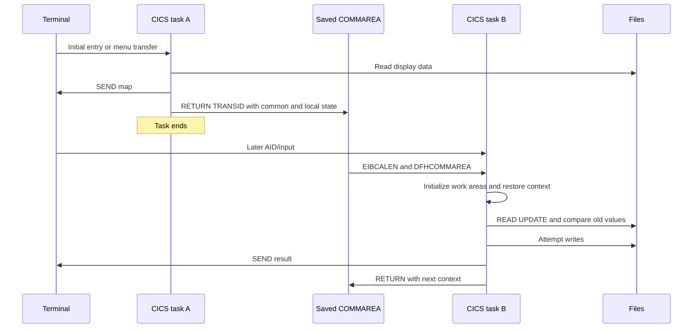
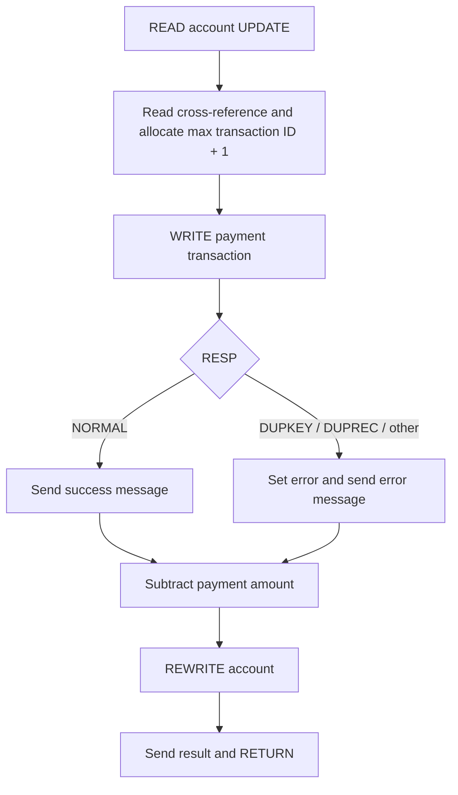

# 06 — Runtime, state and failure semantics

[Artifact index and shared conventions](README.md)

## Purpose and evidence boundary

**Question answered:** Where does CardDemo keep execution state, when does it change persistent data, and what can remain after an error, interruption, or rerun?

**Analyzed revision:** [`fbcb944af892dcb8c94c0549f2ee248945010ff8`](https://github.com/codev-workshops/uc-legacy-modernization-cobol-to-java/tree/fbcb944af892dcb8c94c0549f2ee248945010ff8).

**Evidence status: source-only. Runtime-observed evidence: none.** No COBOL program, CICS transaction, JCL job, scheduler, or optional subsystem was executed. Citations below refer to physical source-file line numbers at the analyzed revision, including files with embedded COBOL sequence numbers.

| Label | Meaning in this document |
| --- | --- |
| **Source-confirmed** | Executable statements, record declarations, or checked-in configuration specify the behavior. This does not prove that the configuration is installed. |
| **README/comment claim** | Documentation, comments, descriptions, or exported historical metadata say this; implementation evidence is identified separately. |
| **Inferred** | Consequence of the cited ordering, conditions, or configuration; not an observed outcome. |
| **Unknown** | Requires compiler listings, installed resources, runtime traces, operator procedures, or other evidence absent from this analysis. |

**Coverage:** core COBOL/CICS sign-on and navigation; account/customer and card updates; payment and transaction addition; batch posting, interest and import; optional Db2 transaction-type management; IMS authorization/fraud, purge and selected load/unload error paths; both MQ application families; copybooks, representative BMS maps, CSD, JCL/procedures, scheduler exports, sample catalog output, assembler helpers/macros, build/submission scripts, and sample-data representation boundaries. This is a failure-semantics review of those paths, not a claim that every paragraph in every program was exhaustively audited.

**Related documents:** [system inventory](01_SYSTEM_OVERVIEW_AND_INVENTORY.md), [execution flows](02_END_TO_END_EXECUTION_FLOWS.md), [business rules](03_BUSINESS_RULES_CATALOG.md), [data model and lineage](04_DATA_MODEL_DICTIONARY_AND_LINEAGE.md), [interface contracts](05_INTERFACE_CONTRACTS.md), and [behavioral evidence and open questions](07_BEHAVIORAL_EVIDENCE_AND_OPEN_QUESTIONS.md).

## Navigation

1. [Execution and representation assumptions](#1-execution-and-representation-assumptions)
2. [Conversation state and control transfer](#2-conversation-state-and-control-transfer)
3. [Sign-on, roles and deployment boundaries](#3-sign-on-roles-and-deployment-boundaries)
4. [Recovery configuration and units of work](#4-recovery-configuration-and-units-of-work)
5. [Account and card update](#5-account-and-card-update)
6. [Bill payment and transaction addition](#6-bill-payment-and-transaction-addition)
7. [Batch posting, interest and import](#7-batch-posting-interest-and-import)
8. [Optional subsystem errors and recovery](#8-optional-subsystem-errors-and-recovery)
9. [Datasets, reruns and scheduler policy](#9-datasets-reruns-and-scheduler-policy)
10. [Build and operational dependencies](#10-build-and-operational-dependencies)
11. [Failure matrix](#11-failure-matrix)
12. [Gaps, contradictions and consequences](#12-gaps-contradictions-and-consequences)

## 1. Execution and representation assumptions

### Initialization and storage

**Source-confirmed:** `COACTUPC.0000-MAIN` installs an abend handler and explicitly initializes `CC-WORK-AREA`, `WS-MISC-STORAGE`, and `WS-COMMAREA`. It then initializes first-entry context or restores the common and program-specific portions of `DFHCOMMAREA`. `COMMON-RETURN` assembles those two portions before returning them. Thus the source explicitly identifies which conversation state it carries between invocations. [Entry initialization][acct-entry]; [return assembly][acct-return].

**Source-confirmed:** `COSGN00C.MAIN-PARA` clears its error flag/message on entry, initializes the output map with `LOW-VALUES` on `EIBCALEN = 0`, and places `-1` in a map length field for cursor positioning. This is different from initializing every working-storage byte. The CSD also says `STORAGECLEAR(NO)` for account update; it must not be treated as an application data-initialization guarantee. [Sign-on entry][sign-entry]; [transaction attributes][csd-trans].

**Inferred:** working storage is a work area for the current invocation, while the copied COMMAREA is the explicit continuation state. Do not model a pseudo-conversation as one process retaining arbitrary locals or as one database transaction spanning terminal think time. **Unknown:** compiler/runtime allocation, initial bytes of fields without explicit initialization, and reuse behavior in the installed environment. The sample online build specifies `RENT`, but it is only one checked-in build procedure. [Account lifecycle][acct-entry]; [sample compile options][build-online].

### Values, comparisons and clocks

| Subject | Source-confirmed behavior and symbols | Consequence / unknown |
| --- | --- | --- |
| Fixed-width values | `ACCOUNT-RECORD` uses `PIC 9(11)` for the account identifier, `PIC S9(10)V99` for money and `PIC X(10)` for dates. `TRAN-RECORD` uses an alphanumeric 16-character ID and `PIC S9(09)V99` amount. These particular money fields have no `COMP-3` declaration. [Account layout][account-layout]; [transaction layout][tran-layout]. | Implied decimal scale, field width and signed display representation matter. They are not interchangeable with arbitrary strings or binary floating point. Actual external sign encoding and code page are **unknown**. |
| Numeric conversion | `COACTUPC.1100-RECEIVE-MAP` uses `TEST-NUMVAL-C` before `NUMVAL-C` for edited monetary inputs; MQ authorization input uses `NUMVAL`. [Monetary conversion][acct-num]; [MQ amount conversion][auth-convert]. | Accepted edited forms are tied to COBOL conversion semantics and runtime settings. Do not assume every input path has the same validation. |
| Arithmetic | `CBACT04C.1300-COMPUTE-INTEREST` computes `(TRAN-CAT-BAL * DIS-INT-RATE) / 1200` into `WS-MONTHLY-INT`, declared `S9(09)V99`, and adds that result to `WS-TOTAL-INT`. The computation has neither `ROUNDED` nor `ON SIZE ERROR`. [Declarations][interest-vars]; [calculation][interest-write]. | **Inferred:** receiver precision constrains the result before accumulation; a generic floating-point calculation or rounding policy is not established by this source. Exact compiler `ARITH`, `TRUNC`, `NUMPROC` and invalid-numeric behavior remain **unknown**. |
| Spaces and `LOW-VALUES` | Payment account/confirmation fields accept spaces and `LOW-VALUES` as empty cases; sign-on clears BMS output with `LOW-VALUES`. [Payment input][bill-input]; [sign-on entry][sign-entry]. | These are distinct COBOL values that specific branches treat alike. Neither is a universal application null. |
| BMS representation | `COBIL00` marks account/confirmation fields `FSET` and unprotected. The generated copybook has binary length, flag and input fields, and `COBIL0AO REDEFINES COBIL0AI`. [Map attributes][bill-map]; [symbolic map][bill-map-copy]. | Map state includes metadata and overlays, not just screen text. Empty input and cursor state depend on the BMS contract. |
| Case and padding | Sign-on uppercases both entered user ID and password before lookup/comparison. Account stale checks use case-folded comparison for names, addresses and account group, but direct comparison for several other fields. [Sign-on conversion][sign-convert]; [stale comparisons][acct-stale]. | Case changes are not uniformly distinguishable; stale detection is field-specific rather than a byte-for-byte record version check. |
| `HIGH-VALUES` and key order | `COBIL00C` and `COTRN02C` browse backward from `HIGH-VALUES`, copy the last transaction key into a numeric receiver, and increment it. The file key is 16 bytes starting at offset zero. [Payment allocation][bill-pay]; [transaction-add allocation][tran-add]; [VSAM definition][tran-define]. | **Inferred:** this assumes the highest collating key can be interpreted as a usable numeric sequence value. Code page, collating sequence, nonnumeric historical IDs and exhaustion behavior require validation; `HIGH-VALUES` is not a portable hard-coded byte value. |
| Dates and timestamps | `CBTRN02C.1500-B-LOOKUP-ACCT` compares the alphanumeric account expiry with the first ten characters of the input transaction timestamp. Payment uses CICS `ASKTIME`/`FORMATTIME`; batch timestamp construction uses `CURRENT-DATE`. [Expiry comparison][post-validation]; [payment clock][bill-clock]; [batch clock][post-clock]. | **Inferred:** comparable formatted dates are assumed; these are not all parsed calendar objects. Timezone, clock synchronization, daylight-saving behavior and replay clock are **unknown**. |
| Business date versus execution time | Interest IDs concatenate the ten-character `PARM-DATE` and a counter, while their timestamps come from the runtime clock. The JCL supplies the literal parameter `2022071800`. [Interest linkage/state][interest-vars]; [ID construction][interest-write]; [runtime clock][interest-clock]; [job parameter][interest-jcl]. | Rerunning the same parameter can reproduce IDs while producing different timestamps. The parameter is not evidence of a scheduler-injected current business date. |
| IMS age calculation | Purge accepts `CURRENT-YYDDD FROM DAY`, reverses the stored complemented authorization date, and subtracts the two numeric values. [Clock input][purge-params]; [`4000-CHECK-IF-EXPIRED`][purge-delete]. | **Inferred:** numeric subtraction of year/day-of-year encodings is not a general elapsed-days calculation across a year boundary. Calendar-correct aging is not established. |

**Source-confirmed:** the assembler `COBDATFT` tests format selectors and copies date substrings, inserting/removing separators. Its error path writes an error message and the exit zeros register 15. It is not a full calendar-validation implementation in the cited routine. [Assembler conversion][date-asm]. **Inferred:** callers need the data-area result, not an assumed nonzero machine return code, to identify this routine's error indication.

## 2. Conversation state and control transfer

**Source-confirmed:** `COCOM01Y.CARDDEMO-COMMAREA` contains from/to transaction and program identifiers, application user ID/type, `CDEMO-PGM-CONTEXT`, customer/account/card fields, and last map/mapset. Context values are `0` for enter and `1` for reenter; role conditions are `'A'` and `'U'`. `COSGN00C` declares linkage storage with length depending on `EIBCALEN`. [Common layout][commarea]; [linkage and entry][sign-entry].

| Mechanism | Implementation evidence | State/failure interpretation |
| --- | --- | --- |
| First entry / reentry | Sign-on checks `EIBCALEN`; menus restore passed state and inspect `CDEMO-PGM-REENTER` and `EIBAID`. [Sign-on][sign-entry]; [admin menu][admin-entry]. | **Source-confirmed:** different initialization and input branches. **Unknown:** behavior for malformed or incompatible COMMAREA lengths; source slices are not a versioned serialization protocol. |
| `RETURN TRANSID ... COMMAREA` | Sign-on and account update return the next transaction and COMMAREA, with explicit lengths in those programs. [Sign-on][sign-entry]; [account return][acct-return]. | **Inferred lifecycle:** the current task ends and later terminal input starts another task with continuation data. Old update locks must not be assumed to survive terminal think time. |
| `XCTL` | Successful sign-on transfers to a menu; a menu transfers to the selected program. [Sign-on routing][sign-routing]; [admin routing][admin-entry]. | **Inferred lifecycle:** a control transfer within the task, not a durable commit or an ordinary returning subroutine call. |
| `LINK` | `COPAUS1C.MARK-AUTH-FRAUD` links to the fraud program with `WS-FRAUD-DATA`, then evaluates `EIBRESP` and the returned action flag. [Fraud link][fraud-link]. | **Source-confirmed:** caller resumes and chooses update or rollback. A successful `LINK` alone does not establish the called business operation succeeded. |
| Screen send | `COBIL00C.SEND-BILLPAY-SCREEN` sends a map and ends its paragraph; the task's `RETURN` is elsewhere. [Send/receive][bill-send]; [task return][bill-return]. | **Inferred:** a `PERFORM` of this screen-send paragraph returns to its caller. An error message is not automatically an early exit from the payment operation. |

**Text equivalent / inferred model:** each terminal round trip carries selected state through COMMAREA. Account update refetches and compares persistent records during the later save task; it does not rely on a lock held while the user edits. The diagram abstracts the cited account entry, return and save paragraphs; it does not assert file recoverability. [Entry][acct-entry]; [return][acct-return]; [save reads][acct-lock].

## 3. Sign-on, roles and deployment boundaries

**Source-confirmed:** `COSGN00C.READ-USER-SEC-FILE` reads `USRSEC` with `RESP`/`RESP2`, compares the stored password field with the normalized input, copies `SEC-USR-TYPE` to COMMAREA and `XCTL`s administrators to `COADM01C`, others to `COMEN01C`. It distinguishes a password mismatch, user-not-found response and other lookup failure. This is application-file authentication in the shown implementation. No sample credentials are reproduced here. [Conversion][sign-convert]; [lookup/routing][sign-routing].

**Source-confirmed:** `COMEN01C.PROCESS-ENTER-KEY` rejects a user-role selection of an admin-only menu entry and checks target program availability using `INQUIRE PROGRAM ... NOHANDLE`. `COADM01C` redirects an invocation with no COMMAREA to sign-on, installs `HANDLE CONDITION PGMIDERR`, and routes selected programs. The cited admin entry/routing path does not perform a fresh `USRSEC` password comparison. [Normal-menu checks][menu-routing]; [admin entry/routing][admin-entry].

**Source-confirmed configuration:** sample RACF commands alter a `GCICSTRN` transaction group and connect a user to a group. CSD account/admin transactions specify `RESSEC(NO)` and `CMDSEC(NO)`. **Unknown:** region-level security, actual RACF profiles/group membership, terminal identity, transaction attachment permissions and any site overrides. The application role in COMMAREA and an external security identity are separate evidence boundaries; menu routing does not establish every deployment authorization rule. [RACF command sample][racf]; [CSD transaction attributes][csd-trans].

## 4. Recovery configuration and units of work

### What the checked-in CSD requests

**Source-confirmed configuration:** `ACCTDAT`, `CUSTDAT`, `CARDDAT`, `TRANSACT`, `USRSEC`, and the listed cross-reference/alternate-index resources use the following settings. Representative complete definitions are cited rather than treating a source `SYNCPOINT` as proof of durability. [Core file definitions][csd-files].

| Settings | What the repository establishes |
| --- | --- |
| `UPDATEMODEL(LOCKING)`, `RLSACCESS(NO)` | A locking update model is requested, without RLS access. This does not itself establish multi-file backout. |
| `READINTEG(UNCOMMITTED)`, `DSNSHARING(ALLREQS)`, `DISPOSITION(SHARE)` | These are the declared access/sharing attributes. They are not proof of serializable business operations. |
| `OPENTIME(FIRSTREF)`, `STATUS(ENABLED)` | Files are configured for opening on first reference. A dataset, path or authorization failure may therefore surface when first used. |
| `JOURNAL(NO)`, `JNLREAD(NONE)`, `JNLUPDATE(NO)`, `JNLADD(NONE)` | These definitions do not enable application-file journaling. `JNLSYNCWRITE(YES)` also appears, but must be read with journaling disabled. |
| `RECOVERY(NONE)`, `FWDRECOVLOG(NO)`, `BACKUPTYPE(STATIC)` | These definitions do not request CICS recoverable-file backout/forward recovery. They cannot support an assumption that prior VSAM writes are undone by every rollback or abend. |

**Source-confirmed configuration:** account update transaction attributes include `RESTART(NO)`, `DTIMOUT(NO)`, `SPURGE(YES)`, `TPURGE(YES)`, `DUMP(YES)`, `TRACE(YES)` and `ACTION(BACKOUT)`. **Inferred:** the backout action must still be interpreted with each resource's recovery settings; it does not turn `RECOVERY(NONE)` files into recoverable resources. These definitions also do not establish automatic application retries or a service-level timeout. [Transaction definition][csd-trans].

**Unknown:** installed definitions, runtime compatibility layer, recoverable resource managers enlisted in a task, logging, buffering and failure timing. Consequently this document identifies **issued operations and potential residual state**, not tested ACID guarantees. A checked-in historical `LISTCAT` excerpt contains dataset attributes and `RLS IN USE (NO)`; its `RECOVERY` text is catalog output, not evidence that the CICS `RECOVERY(NONE)` settings were replaced. [Catalog excerpt][catalog].

### Transaction boundary distinctions

**Source-confirmed:** account update explicitly issues `SYNCPOINT` before one exit `XCTL` and issues `SYNCPOINT ROLLBACK` after a failed customer rewrite. Optional Db2 updates issue their own success syncpoints; MQ modules use differing get/put syncpoint options. **Inferred:** terminal conversation, CICS task, explicit syncpoint interval, database transaction, MQ delivery and batch job are distinct boundaries. Recovery needs the relevant resource settings as well as control flow. [Exit syncpoint][acct-exit]; [rewrite rollback][acct-write]; [Db2 success][db2-update]; [authorization MQ get][auth-get]; [VSAM/MQ get][mq-get].

**Source-confirmed:** CICS response handling is operation-specific. Account save captures both `RESP` and `RESP2`, but maps every nonnormal lock-read response to one application lock-failure state; payment distinguishes duplicate writes and displays response/reason values for other write failures. `NOHANDLE` paths such as fraud `LINK` instead inspect `EIBRESP` and an application result. **Inferred:** a screen's “could not lock” message is not sufficient evidence of a particular deadlock or timeout reason; retain the underlying codes when diagnosing the path. [Account gate][acct-lock]; [payment responses][bill-write]; [linked result][fraud-link].

## 5. Account and card update

### Account/customer save ordering

**Source-confirmed — `COACTUPC.9600-WRITE-PROCESSING`:**

1. Read account with `UPDATE`; on nonnormal response set the account-lock failure state and leave the write paragraph.
2. Read customer with `UPDATE`; on nonnormal response set the customer-lock failure state and leave.
3. Perform `9700-CHECK-CHANGE-IN-REC`; leave if it reports stale data.
4. Build the account/customer update records.
5. Rewrite the account; on failure set `LOCKED-BUT-UPDATE-FAILED` and leave.
6. Rewrite the customer; on failure set the same failure state, issue `SYNCPOINT ROLLBACK`, and leave.

Evidence: [update reads and stale gate][acct-lock]; [record construction and write sequence][acct-write].

**Source-confirmed:** stale comparison is field-based: account status, monetary values, dates and group; customer names/address, phone and identity fields, date-of-birth components, EFT account, primary-holder indicator and score. It normalizes case for selected text and compares formatted date pieces against stored old fields. This is not a database row-version token and not a comparison of all record bytes, including filler. [Comparison paragraph][acct-stale].

**Inferred:** changes to fields included in the comparison can prevent overwriting a record changed during screen editing. Fields ignored or normalized by that predicate cannot be assumed to detect every concurrent change. Successful `READ UPDATE` expresses the later save task's lock acquisition, but does not by itself make the two rewrites atomic. On the customer failure path an account rewrite has already returned success; the explicit rollback demonstrates recovery intent, while the checked-in `RECOVERY(NONE)` definitions prevent claiming that account data is restored. [Write sequence][acct-write]; [CSD][csd-files].

**Source-confirmed:** `ABEND-ROUTINE` sends diagnostic data with `NOHANDLE`, cancels its handler, and issues CICS `ABEND ABCODE('9999')`. It does not explicitly repair account/customer records. The installed resource recovery behavior remains the determinant of persistent residual state. [Abend paragraph][acct-abend].

### Card save

**Source-confirmed:** `COCRDUPC.9200-WRITE-PROCESSING` performs `READ UPDATE`, then `9300-CHECK-CHANGE-IN-REC`, constructs the replacement card, and rewrites it. The predicate compares CVV, case-folded embossed name, selected expiry components, and active status; error states distinguish inability to lock, stale data and rewrite failure. [Card update and comparison][card-write]. **Inferred:** it follows the same compare-after-refetch pattern, but with one rewritten record. It inherits the `CARDDAT` recovery limitation. [CSD][csd-files].

## 6. Bill payment and transaction addition

### Payment is an ordered sequence, with important continuation behavior

**Source-confirmed — `COBIL00C.PROCESS-ENTER-KEY`:** the account lookup uses `READ UPDATE`, including the initial request without a yes/no confirmation. A confirmed payment reads the account cross-reference, derives the next transaction ID with `STARTBR`/`READPREV`/`ENDBR`, initializes a payment record, sets its amount to the account's current balance and writes it. It then subtracts that amount from `ACCT-CURR-BAL` and rewrites the account. [Input/confirmation][bill-input]; [account read/rewrite][bill-account]; [payment sequence][bill-pay].

**Source-confirmed:** `WRITE-TRANSACT-FILE` maps `NORMAL` to a success message and screen send, `DUPKEY`/`DUPREC` to a duplicate message, and other responses to a generic write failure. `SEND-BILLPAY-SCREEN` only sends; it does not return the task. There is **no intervening `IF NOT ERR-FLG-ON` between the transaction-write `PERFORM` and account subtraction/rewrite**. Thus the account rewrite is still reached after a handled transaction-write failure, assuming no separate runtime exception interrupts the flow. The success screen is likewise sent before the account rewrite is attempted. [Write responses][bill-write]; [send paragraph][bill-send]; [call-site ordering][bill-pay].

**Text equivalent:** both handled write outcomes return from the screen-send paragraph to account subtraction and rewrite. **Inferred failure windows:** (a) transaction write succeeds, account rewrite fails, leaving a possible transaction/balance mismatch; (b) transaction write fails, but account rewrite succeeds, leaving a possible balance change without a newly written transaction. No explicit payment rollback or compensating delete appears in this sequence. Residual durability is unobserved and resource-dependent. [Payment sequence][bill-pay]; [response handlers][bill-write]; [account rewrite][bill-account]; [CSD][csd-files].

### Identifier allocation and duplicate meaning

**Source-confirmed:** the backward browse treats `ENDFILE` as a zero key before the caller increments it. `COTRN02C.ADD-TRANSACTION` uses the same browse/increment pattern, then handles duplicates when writing. There is no retry-with-new-ID loop in the cited allocation/write paths. [Payment browse][bill-browse]; [transaction add][tran-add]; [transaction write][tran-write].

**Inferred:** two concurrent allocators can select the same next key; the duplicate response is a handled conflict, not business-level deduplication. The account update lock in a payment is not an explicit global lock on the last transaction key. Repeating a submission may allocate a different key and is not established as an idempotent replay. Exact races, empty-file browse behavior and numeric-key edge cases remain unexecuted. [Payment allocation][bill-pay]; [account lock][bill-account]; [transaction add][tran-add].

## 7. Batch posting, interest and import

### Posting: state changes precede the final transaction write

**Source-confirmed:** `CBTRN02C` opens files, reads daily input until EOF, validates each record, posts accepted records and writes rejects for validation failures, then closes all six files and returns code `4` if rejects occurred. Validation reads card/account references and checks limit and expiry; the cited validation path does not look up an already-posted transaction ID. [Main loop][post-main]; [validation][post-validation].

**Source-confirmed — `2000-POST-TRANSACTION`:** `2700-UPDATE-TCATBAL` runs first, `2800-UPDATE-ACCOUNT-REC` second, and `2900-WRITE-TRANSACTION-FILE` third. Category balances are created or incremented. Account current balance and the appropriate signed cycle total are incremented. The final transaction retains the input transaction ID. [Posting sequence][post-order]; [category/account changes][post-updates]; [transaction write][post-tran].

**Source-confirmed quirk:** the account rewrite's `INVALID KEY` branch sets validation reason `109`, but the caller continues to the transaction write without testing that new reason. The reject decision in the main loop happened before posting. Therefore reason `109` is not, by itself, evidence that this record will be written to the rejects file. Category/file-write failures instead call the abend routine. [Account rewrite][post-updates]; [caller][post-order]; [main decision][post-main].

**Inferred:** a failure at the final write can follow successful category and account changes. A repeated accepted input can repeat those arithmetic changes before any duplicate-write failure, unless dataset reset/restore behavior changes the preconditions. No application checkpoint, transaction-wide rollback or already-posted check is present in these posting paragraphs. This is not equivalent to “every rerun always doubles the balances”: validation, file `OPEN OUTPUT`, JCL recreation and operator restore choices also affect what is reached. [Validation/order][post-validation]; [writes][post-updates]; [open mode][post-open]; [backup/recreate job][tran-backup].

### Status values and batch termination

| Path | Source-confirmed handling | Interpretation |
| --- | --- | --- |
| Daily input | File status `'00'` maps to `APPL-RESULT = 0`; `'10'` maps to internal value `16` and EOF; other statuses map to `12` and an abend. [Read paragraph][post-read]. | Internal `APPL-RESULT = 16` at EOF is not an operating-system return code 16. |
| Posting open/write/close | Checks file status and displays diagnostics before `9999-ABEND-PROGRAM`; that paragraph calls `CEE3ABD` with `ABCODE = 999`, `TIMING = 0`. [Open][post-open]; [write][post-tran]; [close/abend/status formatting][post-close]. | A called LE abend is different from `GOBACK` with a warning return code. Exact job completion reporting remains runtime-dependent. |
| File-status diagnostics | `9910-DISPLAY-IO-STATUS` handles numeric statuses and extended/non-numeric forms, converting the second byte for a four-position display. [Formatter][post-close]. | Preserve both status bytes when explaining an error; a displayed four-character value is a formatting convention. |
| Posting rejects | Nonzero reject count sets `RETURN-CODE = 4` after closes. [Main completion][post-main]. | The job may have posted valid records and rejected others. Nonzero RC does not mean “nothing written.” |
| Db2 batch maintenance | `COBTUPDT.9999-ABEND` displays a message, sets `RETURN-CODE = 4` and executes `EXIT`, not `CEE3ABD` or `GOBACK`. [Db2 batch tail][db2-batch-tail]; [record loop][db2-batch-loop]. | Despite the paragraph name, it returns to its caller; earlier SQL statements and later input processing cannot be assumed rolled back or stopped. |
| IMS purge | `CBPAUP0C.9999-ABEND` sets RC `16` and executes `GOBACK`. [Checkpoint/termination][purge-checkpoint]. | Different termination contract from both posting and Db2 batch maintenance. |

### Interest and import

**Source-confirmed:** `CBACT04C` groups category-balance input by account, accumulates interest, writes system transaction records during calculation and rewrites account balances in `1050-UPDATE-ACCOUNT`, also resetting both cycle totals to zero. It uses file-status checks rather than a visible multi-file commit protocol. [Loop][interest-loop]; [account rewrite][interest-account]; [transaction output][interest-write]. **Inferred:** generated transaction output and master balances can diverge after interruption; regenerating output does not by itself restore account values, and repeating calculation can add interest again.

**Control-flow inference:** that account rewrite occurs when a new account group is encountered. The apparent final rewrite is in the outer ELSE of a test-before loop; the normal EOF read causes the next loop test to exit before that ELSE can run. Consequently the last account can have generated interest transactions without its balance/cycle update even when no I/O failure occurs. See [BR-INTEREST-FINAL-GROUP](03_BUSINESS_RULES_CATALOG.md#3-interest-and-cycle-processing), scenario I2 and `Q-INTEREST-EOF`. [Loop][interest-loop].

**Source-confirmed:** `CBIMPORT.1100-OPEN-FILES` opens an export input and customer/account/cross-reference/transaction/card/error outputs. It abends on checked open errors and entity-output write failures; `4000-FINALIZE` closes the files. `9999-ABEND-PROGRAM` calls `CEE3ABD`. In contrast, `2750-WRITE-ERROR` merely displays an error-output failure and still increments its written counter; `3000-VALIDATE-IMPORT` unconditionally displays “No validation errors detected.” These messages/counters therefore are not independent verification of successful import. [Open sequence][import-open]; [dispatch and writes][import-write]; [error sink and validation][import-error]; [finalization][import-end]. **Inferred:** an interrupted import can leave differing output prefixes; the cited flow has no persisted restart position or cross-output rollback. Actual dataset retention depends on its job allocation and termination outcome.

## 8. Optional subsystem errors and recovery

### Db2 transaction-type maintenance

**Source-confirmed:** `COTRTUPC.9600-WRITE-PROCESSING` issues `UPDATE`, then branches on `SQLCODE`: `0` issues CICS `SYNCPOINT`; `+100` invokes insert; `-911` sets the lock-failure state; other negative values set update failure and include SQL diagnostics. Insert success also issues `SYNCPOINT`. Delete success syncpoints; `-532` produces the “delete associated child records first” error. `COTRTLIC` has corresponding update/delete response paths. [Update][db2-update]; [insert/delete][db2-insert-delete]; [list maintenance][db2-list].

**Inferred:** `-911` is surfaced to the user rather than being a coded bounded retry loop in this path. Success commits are local to these operations; they do not establish one all-screen transaction. **Unknown:** bind isolation, installed packages/plans, subsystem rollback behavior and CICS attachment settings for this deployment. The optional README requires Db2/CICS support and precompilation, but is an installation claim, not evidence of successful installation. [README prerequisites][db2-readme].

**Source-confirmed:** `COBTUPDT` loops through input add/update/delete requests; its SQL failures call the RC-4 paragraph described above, and its file-open failure branch merely displays a message before subsequent flow. No explicit SQL `COMMIT`/`ROLLBACK` appears in the inspected batch program. **Unknown:** the final database outcome under the installed batch attachment on normal termination or RC 4. [Batch loop/open][db2-batch-loop]; [SQL handlers and tail][db2-batch-sql].

### IMS fraud update and Db2 linkage

**Source-confirmed:** `COPAUS1C` uses IMS `GU`/`GNP` and examines `DIBSTAT`; EOF/not-found states and other errors have different branches. Fraud processing `LINK`s to `COPAUS2C` with `NOHANDLE`, tests `EIBRESP` and `WS-FRD-UPDT-SUCCESS`, then either updates authorization details or performs rollback. Successful IMS `REPL` issues CICS `SYNCPOINT`; failed `REPL` issues `SYNCPOINT ROLLBACK`. [Linked decision][fraud-link]; [IMS reads/update/rollback][fraud-update].

**Source-confirmed retry exception:** `COPAUS1C.SCHEDULE-PSB` responds to `PSB-SCHEDULED-MORE-THAN-ONCE` by issuing `TERM` and scheduling once more with `NODHABEND`; other unsuccessful results become a screen error. This is a specific recovery attempt, not a universal retry loop for IMS reads/writes. [PSB scheduling][fraud-schedule].

**Source-confirmed status vocabulary:** the purge's IMS condition names accept spaces/`FW` as success, `GE` as segment not found, `GB` as end of database, `BA` as unavailable, `TC` as PSB scheduled more than once, and `TE` as inability to schedule. These are source-declared classifications; individual operations still apply their own checks, such as accepting only spaces after `CHKP` and `DLET`. [Declarations][purge-status]; [delete checks][purge-delete]; [checkpoint check][purge-checkpoint].

**Source-confirmed:** `COPAUS2C` handles Db2 insert `-803` by updating the existing fraud record; other SQL failures return diagnostics. This is a specific duplicate-to-update rule, not proof that all authorization processing is idempotent. [Fraud SQL][fraud-sql].

**Source-confirmed configuration:** optional CSD defines `DB2ENTRY` with `DROLLBACK(YES)`, `AUTHTYPE(USERID)`, `THREADLIMIT(1)`, `THREADWAIT(YES)`, and maps transaction `CPVD` to it. Its description contains the word “RETRY”; the executable attributes and caller paths are the actual evidence. **Unknown:** installed IMS/Db2 coordination and the recovery participation of each side of this linked operation. [Optional Db2 resource][auth-csd].

### MQ authorization processor: consumption, reply and database update are separated

**Source-confirmed — `COPAUA0C`:**

- `3100-READ-REQUEST-MQ` uses `MQGMO-NO-SYNCPOINT`, `WAIT`, `CONVERT` and `FAIL-IF-QUIESCING`, with a wait interval initialized to `5000`. It separates `MQRC-NO-MSG-AVAILABLE` from critical errors. Waiting for a message is not a failed-operation retry policy. [Initialization][auth-init]; [get options and responses][auth-get].
- `5000-PROCESS-AUTH` makes a decision, calls `7100-SEND-RESPONSE`, and only afterward calls `8000-WRITE-AUTH-TO-DB` when a card cross-reference was found. [Operation order][auth-order].
- The reply uses `MQPUT1`, `MQPMO-NO-SYNCPOINT`, `MQPER-NOT-PERSISTENT`, and expiry value `50`. A put failure is critical. [Reply options][auth-reply].
- IMS summary replacement/insertion and detail insertion are separate calls with status checks. A CICS `SYNCPOINT` follows a processed message in `2000-MAIN-PROCESS`. [IMS writes][auth-writes]; [message loop][auth-loop].
- `9500-LOG-ERROR` writes to transient data queue `CSSL` with `NOHANDLE`; a critical error invokes termination, which closes resources and issues CICS `RETURN`, not an explicit `ABEND` or rollback in that handler. [Logging and termination][auth-log].

**Inferred:** consuming the request without syncpoint and emitting the reply before IMS writes means the later CICS syncpoint is not an end-to-end atomic consume/process/reply boundary. A consumer can receive a reply before the database update succeeds; a consumed request may not be restored when later processing fails. A successful summary update followed by failed detail insertion also needs residual-state investigation. The source does not establish durable retry/redelivery, a dead-letter policy, or exactly-once processing. Queue-manager configuration and caller resubmission rules are **unknown**. [Get][auth-get]; [order][auth-order]; [reply][auth-reply]; [critical termination][auth-log].

### Separate VSAM/MQ examples

**Source-confirmed:** `COACCT01` gets its input queue from trigger data, uses MQ get/put **with** syncpoint options, reads account data and puts a reply or error message. `4000-MAIN-PROCESS` syncpoints **before** calling the next `3000-GET-REQUEST`; the loop therefore closes the preceding unit at that point. It handles no-message separately; other failures go through error/termination paths. `CODATE01` also uses syncpoint MQ options. [Trigger/loop][mq-trigger]; [syncpoint and get][mq-get]; [reply/error/termination][mq-put]; [date-service options][mq-date].

**Inferred:** these examples have a different MQ unit-of-work design from `COPAUA0C`; one module's guarantees must not be assigned to the other. Even here error termination uses CICS `RETURN`; it is not universally a rollback-and-retry path. Queue persistence, backout handling and installed MQ/CICS coordination remain **unknown**. [Termination][mq-put]; [optional transaction definitions][mq-csd].

### IMS purge, checkpoint and restart limits

**Source-confirmed:** `CBPAUP0C` reads `SYSIN` parameters for expiry days, checkpoint frequency, checkpoint display frequency and debug flag. Its defaults are `5`, `5`, `10`, and `N`; the supplied BMP job instead passes `00,00001,00001,Y`. It calls `DFSRRC00` with `BMP,CBPAUP0C,PSBPAUTB`. [Parameter handling][purge-params]; [BMP JCL][purge-jcl].

**Source-confirmed:** the purge deletes qualifying detail segments and conditionally deletes a summary. It checkpoints when `WS-AUTH-SMRY-PROC-CNT > P-CHKP-FREQ` and once at completion, not on an equality test. `9000-TAKE-CHECKPOINT` checks `DIBSTAT` and returns RC 16 on failure. The source declares `RETRY-CONDITION` values `BA`, `FH`, `TE`; an 88-level declaration is not a retry loop. [Status declarations][purge-status]; [purge loop][purge-loop]; [delete status handling][purge-delete]; [checkpoint/termination][purge-checkpoint].

**Source-confirmed quirk:** the summary-delete guard repeats `PA-APPROVED-AUTH-CNT <= 0` on both sides of `AND`; it does not check a second distinct counter in that expression. No correction or intended rule is assumed here. [Guard][purge-loop].

**Source-confirmed / scoped absence:** `CHKP` is present in this purge; no `XRST` call or saved application-state restore is present in the inspected core posting/interest paths or purge source. The purge JCL includes `IEFRDER DD DUMMY` and `IMSLOGR DD DUMMY`; the PSB declares the summary/detail hierarchy and `PROCOPT=AP`. **Unknown:** operational IMS restart selection, log allocation overrides and recovery from the last checkpoint. A checkpoint call alone is insufficient evidence of an end-to-end restart procedure. [Checkpoint][purge-checkpoint]; [JCL][purge-jcl]; [PSB][purge-psb]; [posting loop][post-main]; [interest loop][interest-loop].

**Source-confirmed:** the optional `PAUDBLOD` loader accepts PCB status `II` as “already in DB” for both root and child insertion. Selected unloaders use `CBLTDLI`, interpret PCB status, and return RC 16 from their named abend paragraphs. These are operation-specific duplicate/error rules; declarations of checkpoint counters in utility working storage are not evidence that those utilities actually checkpoint. [Loader root/child handling][ims-load]; [unloader handling][ims-unload]; [GSAM output/error path][ims-gsam].

## 9. Datasets, reruns and scheduler policy

### Allocation is part of the behavior

| Source-confirmed configuration / operation | Consequence for failure or rerun |
| --- | --- |
| Posting opens daily input and reference input, reject output, account/category files for I-O, and **transaction master with `OPEN OUTPUT`**. [Open paragraphs][post-open-all]. | **Inferred:** do not describe posting as simply appending to an untouched existing master. Existing-data retention/open failure depends on dataset/runtime properties. JCL `DISP=SHR` does not override the COBOL open mode. |
| `POSTTRAN` uses shared existing master/input DDs and `DALYREJS(+1)` with `DISP=(NEW,CATLG,DELETE)`. `INTCALC` uses `SYSTRAN(+1)` with the same disposition. [Posting DDs][post-jcl]; [interest DDs][interest-jcl]. | **Inferred JCL meaning:** successful completion can catalog a new generation; abnormal termination can delete that newly allocated output. That disposition does not undo writes to separately allocated shared masters. A normal RC-4 completion is not synonymous with an abend. |
| `DEFGDGB` defines several GDG bases with `LIMIT(5)` and `SCRATCH`, suppressing `LASTCC=12` by resetting `MAXCC`. [GDG definitions][gdg]. | Source requests finite retained generations and condition-code normalization. **Unknown:** which generations exist now and which backup is consistent with the other datasets. |
| `TRANBKP` copies the transaction master to a new backup generation, then deletes its cluster and alternate index and defines a new cluster. `REPROC` obtains `REPROCT` through `CNTLLIB`. [Backup/recreate][tran-backup]; [procedure][reproc]. | **Inferred:** this job has destructive intermediate states; interruption after deletion is not recovered merely by restarting posting. A backup job name is not evidence that it only copies data. |
| `COMBTRAN` sorts backup `(0)` and system transactions `(0)` into combined `(+1)`, then `REPRO`s that generation into VSAM. Its sort control specifies key ordering, not explicit duplicate elimination. [Combine job][combine]. | **Inferred:** catalog changes can change what `(0)` means on a later submission. Repeating the job is not established as restoring the exact same inputs or removing duplicate IDs. |
| `CLOSEFIL`/`OPENFIL` submit SDSF operator commands to close/open a named list of CICS files in a named region. [Close][close-jcl]; [open][open-jcl]. | **Unknown:** completion verification, outstanding tasks, authorization and site overrides. The list is finite; it must not be generalized to “all application files.” |

### Scheduler policy is not application idempotency

**Source-confirmed configuration:** Control-M export jobs including `CLOSEFIL`, `TRANBKP`, `TRANEXTR` and `INTCALC` carry `MAXRERUN="5"`; a `TransactionTypesDBRefresh` smart folder has `MAXRERUN="0"`. Dependencies are expressed through `INCOND`/`OUTCOND`. These are different object levels, not a contradiction. The XML does not by that attribute alone prove every failure triggers five automatic executions or specify which application's writes are safe to repeat. [Daily chain][controlm-daily]; [folder/job limits and monthly chain][controlm-monthly].

**README/comment/export claim:** the CA7 listing contains `# OF TIMES RESTARTED = 0000`, job information and triggered-job relationships. That is historical exported metadata, not a general application retry contract. `DEFGDGD` contains a commented `RESTART=STEP30`, not an active universal restart option. [CA7 excerpt][ca7]; [JCL comment][gdgd-comment].

**Source-confirmed:** the shell posting/full-batch scripts submit JES jobs through FTP and use fixed sleeps. They do not parse each job's terminal completion/return code in the shown sequence; they also submit data-refresh/recreation jobs. **Inferred:** “submission succeeded” and “all predecessor data changes completed correctly” are different claims. Running one of these scripts again is not equivalent to restarting a failed COBOL record. [Posting script][posting-script]; [full-batch script][batch-script].

**Inferred rerun classification:** account/card screens have explicit stale checks; payment/add rely on allocated keys and write responses; posting/interest perform arithmetic changes; Db2 fraud insert has a specific duplicate-update branch; IMS loader tolerates duplicate segments; scheduler rerun limits operate outside all of these. There is no source-supported single “CardDemo retry policy.” [Account][acct-stale]; [payment][bill-pay]; [posting][post-updates]; [interest][interest-account]; [fraud duplicate][fraud-sql]; [loader duplicate][ims-load].

## 10. Build and operational dependencies

| Evidence | Source-confirmed dependency or README/comment claim | Boundary |
| --- | --- | --- |
| Online compile | Sample `BUILDONL` uses `IGYCRCTL`, CICS copy/load libraries, application copybooks and LE libraries; options include `CICS,NODYNAM,RENT,NOSEQ`, followed by a binder step. [Online procedure][build-online]; [binder][build-link]. | Sample library versions and paths are not proof of the installed compiler or region. |
| Batch compile | Sample `BUILDBAT` uses `IGYCRCTL` with `APOST,LIST,MAP,NUMBER,NOSEQ`, then `HEWL` and LE libraries. [Batch procedure][build-batch]. | Arithmetic defaults and site options are not fully fixed by these explicit options. |
| Local/remote scripts | Local script is a single `cobc --std=ibm-strict` sizing command. Remote compile runs `make`, substitutes a JCL member into a template, and uses `tnftp` on a local tunnel. [Local script][local-build]; [remote script][remote-build]. | Neither proves a locally runnable CICS/IMS/Db2/MQ system; tunnel, working directory, external Makefile and remote datasets are operational inputs. |
| Optional IMS/MQ build | Sample compile JCL uses CICS/DLI translation, COBOL, MQ copybooks, CICS/IMS/LE link libraries, and `CSQCSTUB`. [Translator/compiler][build-ims]; [MQ/binder][build-mq]. | PSB/DBD, queues, trigger setup and subsystem attachment must match the modules; installed setup is unknown. |
| Optional Db2 | README requires Db2, CICS support, precompiler, CSD installation and extraction. Actual COBOL uses embedded SQL/SQLCA; authorization CSD maps a plan to a transaction. [README claim][db2-readme]; [SQL][db2-update]; [plan mapping][auth-csd]. | Schema/package/plan availability and runtime authorization are dependencies, not established deployment facts. |
| Assembler/time | `MVSWAIT` invokes `ASMWAIT`, whose macro uses `STIMER WAIT,BINTVL`; `COBDATFT` uses a shared data layout and format-copy routine. [Wait routine][wait-asm]; [macro][wait-macro]; [date routine][date-asm]. | Correct linkage/layout and time-unit conventions are part of the operational environment; a delay is not job completion polling. |
| Datasets/catalog | JCL binds logical DD names to VSAM/PS/GDG datasets; CSD binds logical CICS file names to datasets and alternate-index paths. [Posting JCL][post-jcl]; [CSD][csd-files]; [catalog example][catalog]. | Actual catalog allocation, alternate-index contents, storage, high-level qualifier changes and permissions require deployment evidence. |
| Sample data | ASCII transaction-type seed records are checked in; the README instructs transferring EBCDIC sample data in binary mode. [Nonpersonal seed example][sample-types]; [README transfer instructions][readme-data]. | These are input artifacts and instructions, not observed runtime records or proof of the installed code page. Customer, account and credential sample values are deliberately not reproduced. |

**README/comment claim versus implementation:** the root README's batch table names `IEFBR14` for `CLOSEFIL` and `OPENFIL`, but the checked-in jobs execute `SDSF` and issue `CEMT` commands. This document uses the JCL implementation for failure/authorization dependencies. [README table][readme-close]; [close implementation][close-jcl]; [open implementation][open-jcl].

## 11. Failure matrix

All **handling** and **prior writes** below are source-confirmed for the cited path. **Residual state** is an inference, not an observed incident. “Prior” means within the operation or earlier records in the same run; successful return from a write is not proof of crash durability.

| Operation | Failure point | Prior writes | Handling | Potential residual state | Recovery evidence / limit |
| --- | --- | --- | --- | --- | --- |
| Account/customer save | Either `READ UPDATE`, or stale comparison | None in this save path | Sets lock/stale state; leaves write paragraph | No new rewrite from this path; task/lock state depends on subsequent flow | [Lock gate][acct-lock], [comparison][acct-stale]; no automatic retry here |
| Account/customer save | Account rewrite | None of the two rewrites has confirmed success | `LOCKED-BUT-UPDATE-FAILED`; exit | Customer rewrite is skipped | [Write order][acct-write]; file recovery [CSD][csd-files] |
| Account/customer save | Customer rewrite | Account rewrite returned success | `SYNCPOINT ROLLBACK`; failure state | Account/customer mismatch cannot be excluded | [Rollback][acct-write] exists; `RECOVERY(NONE)` means backout is not assured [CSD][csd-files] |
| Account update | Unexpected abend | Depends on interruption point | Diagnostic send, cancel handler, `ABEND '9999'` | Completed nonrecoverable writes may remain | [Abend][acct-abend]; no record compensation |
| Card save | Stale check or rewrite | No earlier rewrite in this save path | Stale/update failure state | Card outcome requires response and runtime evidence | [Card path][card-write], [CSD][csd-files] |
| Bill payment | Transaction write duplicate/error | None in this payment's write sequence | Error flag/message; returns from screen send and continues | Account may be reduced despite no new transaction | [Write handler][bill-write], [continuation][bill-pay], [send][bill-send]; no rollback gate |
| Bill payment | Account rewrite | Payment transaction may already exist; success screen may have been sent | Account error message and normal surrounding return flow | Transaction exists while balance update failed | [Ordering][bill-pay], [account handler][bill-account]; nonrecoverable resources [CSD][csd-files] |
| Online transaction add | Duplicate transaction ID | No preceding file write in cited add path | Duplicate message | Requested addition absent; user may retry as a new allocation | [Add][tran-add], [write responses][tran-write]; no allocation retry loop |
| Batch posting | Validation rejection | Earlier accepted inputs may already be posted | Reject record; continue; final RC 4 | Mixed accepted/rejected batch | [Main loop][post-main], [validation][post-validation]; no all-batch undo |
| Batch posting | Category write/rewrite | Earlier inputs' writes | Status display and `CEE3ABD(999,0)` | Partial run; current category outcome requires file evidence | [Category writes][post-updates], [abend][post-close] |
| Batch posting | Account rewrite `INVALID KEY` | Current category balance changed | Set reason 109; caller still writes transaction | Category/transaction may advance without account | [Rewrite][post-updates], [caller][post-order]; rejection is not reevaluated |
| Batch posting | Final transaction write | Current category and account may both be changed | Status display and LE abend | Balances may advance without corresponding new transaction | [Order][post-order], [final write][post-tran]; no checkpoint/rollback in this path |
| Interest batch | Generated output or later account write | Earlier output records/accounts | File-status failure to abend path | Output/master disagreement; same parameter can repeat IDs | [Loop][interest-loop], [output][interest-write], [account][interest-account]; output disposition [JCL][interest-jcl] |
| Multi-output import | Open/entity-output write/interrupt | Earlier outputs or earlier type-specific rows | Checked open/entity-write failures call `CEE3ABD`; error-output failure only displays and continues | Different output prefixes; error count can overstate successful error writes | [Open][import-open], [writes][import-write], [error sink][import-error], [finalization][import-end]; no saved restart key |
| Db2 online update/delete | SQL error, including `-911` / `-532` | Earlier independently syncpointed operations may exist | Lock/failure flags and SQL diagnostics | Current SQL outcome depends on SQLCODE and attachment; no universal retry | [Db2 handlers][db2-update], [delete][db2-insert-delete] |
| Db2 batch maintenance | Negative SQLCODE | Earlier SQL operations | Named abend paragraph sets RC 4 and `EXIT`s | Further input can be processed; overall commit outcome unknown | [Loop][db2-batch-loop], [SQL/tail][db2-batch-sql]; no explicit commit/rollback in program |
| Fraud tagging | Linked program result or IMS `REPL` failure | Linked Db2 operation may have run | Caller requests rollback | Coordinated Db2/IMS backout depends on installed attachments | [Fraud program call][fraud-link], [rollback][fraud-update], [CSD][auth-csd] |
| Authorization MQ | Reply failure or later IMS failure | Request consumed; reply may already have been emitted; summary may have changed | Critical log to `CSSL`, cleanup, CICS `RETURN` | Lost work/reply disagreement or summary/detail mismatch possible | [Order][auth-order], [NO-SYNCPOINT get][auth-get], [reply][auth-reply], [termination][auth-log] |
| VSAM/MQ account service | Get/read/put failure | Request may be under syncpoint; reply/error put may have occurred | Error queue/display and termination | Cannot infer automatic redelivery from error logging alone | [Get][mq-get], [reply/error/return][mq-put]; resource coordination unknown |
| IMS purge | Delete/checkpoint failure | Earlier deletes and checkpoints | Diagnostic output; RC 16 and `GOBACK` | Prior checkpointed work may remain; restart position unproven | [Purge loop][purge-loop], [checkpoint][purge-checkpoint], [BMP allocations][purge-jcl] |
| Transaction backup/rebuild | After cluster deletion, before reload/index completion | Backup generation may exist | IDCAMS/JCL condition-code flow | Missing/empty master or missing alternate index | [Backup/recreate][tran-backup], [combine/reload][combine]; no repository-wide restore transaction |

## 12. Gaps, contradictions and consequences

### Questions requiring deployment or execution evidence

| Unknown / limitation | Why it matters | Evidence that bounds the question |
| --- | --- | --- |
| Are checked-in CSD recovery/journal attributes installed unchanged? | Determines whether rollback can restore the first record in a multi-record update | [`RECOVERY(NONE)` definitions][csd-files] versus [explicit rollback][acct-write] |
| Which compiler/code page/numeric options produced deployed load modules? | Determines exact conversion, signed-byte, rounding/truncation, comparison and invalid-data behavior | [Sample online][build-online], [sample batch][build-batch], [fixed-width records][account-layout] |
| What is the actual security/identity configuration? | Application role state does not determine every RACF/region permission | [Application sign-on][sign-routing], [sample RACF][racf], [CSD security attributes][csd-trans] |
| What are the actual lock waits, purge behavior and installed transaction overrides? | Needed to distinguish user-visible lock failure from waits, timeout or abend | [`READ UPDATE` responses][acct-lock], [transaction attributes][csd-trans] |
| How are masters, indexes and generations restored as a consistent set? | A backup generation alone does not establish a usable restart point | [Delete/recreate job][tran-backup], [relative-generation inputs][combine], [GDG limits][gdg] |
| Which scheduler events trigger reruns, and how are RC 4 and RC 16 classified? | Mixed-success jobs and terminating failures have different replay risks | [RC 4 posting][post-main], [RC 16 purge][purge-checkpoint], [Control-M limits][controlm-monthly], [CA7 export][ca7] |
| How do MQ, IMS and Db2 attachments coordinate recovery, retries and redelivery? | Different modules explicitly choose different boundaries | [Authorization NO-SYNCPOINT][auth-get], [VSAM/MQ SYNCPOINT][mq-get], [fraud rollback][fraud-update] |
| Is an IMS checkpoint restart procedure installed, including log overrides? | `CHKP` is present, but application-state restoration was not established | [Checkpoint code][purge-checkpoint], [dummy log DDs][purge-jcl] |
| What are clocks, business-date injection and operational sequencing in use? | A replay can have the same supplied ID prefix but a different timestamp or dataset generation | [Interest ID/clock][interest-write], [literal JCL parameter][interest-jcl], [fixed sleeps][batch-script] |
| What happens at actual failure injection points? | All residual-state conclusions are source-based possibilities | [Failure matrix](#11-failure-matrix); no runtime-observed evidence exists in this analysis |

### Contradictions and behaviors to preserve in the as-is account

- **Rollback intent versus file configuration:** account update requests rollback after the second write fails, while core CSD files request no recovery. Neither statement should be omitted to create a cleaner transaction story. [Account writes][acct-write]; [CSD][csd-files].
- **Payment message versus operation completion:** a success send precedes account rewrite, and an error send does not prevent that rewrite. “Payment successful” in source is not proof of completion of both writes. [Payment sequence][bill-pay]; [write response/send][bill-write].
- **Paragraph names versus actual termination:** Db2 batch `9999-ABEND` only sets RC 4 and exits; IMS purge returns RC 16; posting calls LE abend. They must not be collapsed into one exception model. [Db2][db2-batch-tail]; [IMS][purge-checkpoint]; [posting][post-close].
- **Documentation versus JCL:** README names a different utility for file close/open than the actual jobs. [README][readme-close]; [JCL][close-jcl].
- **Purge predicate:** the duplicated approved-count test is the executable condition, regardless of a presumed intent to examine multiple counts. [Purge guard][purge-loop].

**Consequences for understanding current behavior:** reconstruct an operation from its input state, executed branches, response values, resource definitions and actual dataset/subsystem state. Treat a normal screen return, nonzero job return code, successful write, syncpoint request and scheduler rerun as distinct facts. The cited implementations contain both explicit stale/duplicate handling and paths that can continue after errors; neither blanket atomicity nor blanket idempotency is source-supported. [Account comparison][acct-stale]; [payment continuation][bill-pay]; [batch order][post-order]; [optional boundaries][auth-order]; [scheduler metadata][controlm-monthly].

**Coverage limits:** the source families listed at the top were inspected for the selected semantics. Complete business-rule inventories, every screen field, every import/export record and exhaustive utility behavior belong to the sibling documents. Sample data, historical catalog/scheduler exports and runtime archives are not treated as observations of the present installation. No new target architecture, operational SLA, or deployed recovery procedure is inferred from their presence.

<!-- All source references below are pinned to the analyzed revision. -->
[acct-entry]: https://github.com/codev-workshops/uc-legacy-modernization-cobol-to-java/blob/fbcb944af892dcb8c94c0549f2ee248945010ff8/app/cbl/COACTUPC.cbl#L858-L893
[acct-return]: https://github.com/codev-workshops/uc-legacy-modernization-cobol-to-java/blob/fbcb944af892dcb8c94c0549f2ee248945010ff8/app/cbl/COACTUPC.cbl#L1007-L1019
[acct-exit]: https://github.com/codev-workshops/uc-legacy-modernization-cobol-to-java/blob/fbcb944af892dcb8c94c0549f2ee248945010ff8/app/cbl/COACTUPC.cbl#L933-L960
[acct-num]: https://github.com/codev-workshops/uc-legacy-modernization-cobol-to-java/blob/fbcb944af892dcb8c94c0549f2ee248945010ff8/app/cbl/COACTUPC.cbl#L1025-L1144
[acct-lock]: https://github.com/codev-workshops/uc-legacy-modernization-cobol-to-java/blob/fbcb944af892dcb8c94c0549f2ee248945010ff8/app/cbl/COACTUPC.cbl#L3888-L3952
[acct-write]: https://github.com/codev-workshops/uc-legacy-modernization-cobol-to-java/blob/fbcb944af892dcb8c94c0549f2ee248945010ff8/app/cbl/COACTUPC.cbl#L3953-L4106
[acct-stale]: https://github.com/codev-workshops/uc-legacy-modernization-cobol-to-java/blob/fbcb944af892dcb8c94c0549f2ee248945010ff8/app/cbl/COACTUPC.cbl#L4109-L4194
[acct-abend]: https://github.com/codev-workshops/uc-legacy-modernization-cobol-to-java/blob/fbcb944af892dcb8c94c0549f2ee248945010ff8/app/cbl/COACTUPC.cbl#L4203-L4224
[account-layout]: https://github.com/codev-workshops/uc-legacy-modernization-cobol-to-java/blob/fbcb944af892dcb8c94c0549f2ee248945010ff8/app/cpy/CVACT01Y.cpy#L4-L17
[tran-layout]: https://github.com/codev-workshops/uc-legacy-modernization-cobol-to-java/blob/fbcb944af892dcb8c94c0549f2ee248945010ff8/app/cpy/CVTRA05Y.cpy#L4-L18
[commarea]: https://github.com/codev-workshops/uc-legacy-modernization-cobol-to-java/blob/fbcb944af892dcb8c94c0549f2ee248945010ff8/app/cpy/COCOM01Y.cpy#L19-L44
[sign-entry]: https://github.com/codev-workshops/uc-legacy-modernization-cobol-to-java/blob/fbcb944af892dcb8c94c0549f2ee248945010ff8/app/cbl/COSGN00C.cbl#L64-L102
[sign-convert]: https://github.com/codev-workshops/uc-legacy-modernization-cobol-to-java/blob/fbcb944af892dcb8c94c0549f2ee248945010ff8/app/cbl/COSGN00C.cbl#L107-L140
[sign-routing]: https://github.com/codev-workshops/uc-legacy-modernization-cobol-to-java/blob/fbcb944af892dcb8c94c0549f2ee248945010ff8/app/cbl/COSGN00C.cbl#L209-L257
[menu-routing]: https://github.com/codev-workshops/uc-legacy-modernization-cobol-to-java/blob/fbcb944af892dcb8c94c0549f2ee248945010ff8/app/cbl/COMEN01C.cbl#L126-L203
[admin-entry]: https://github.com/codev-workshops/uc-legacy-modernization-cobol-to-java/blob/fbcb944af892dcb8c94c0549f2ee248945010ff8/app/cbl/COADM01C.cbl#L76-L158
[racf]: https://github.com/codev-workshops/uc-legacy-modernization-cobol-to-java/blob/fbcb944af892dcb8c94c0549f2ee248945010ff8/samples/jcl/RACFCMDS.jcl#L20-L30
[csd-files]: https://github.com/codev-workshops/uc-legacy-modernization-cobol-to-java/blob/fbcb944af892dcb8c94c0549f2ee248945010ff8/app/csd/CARDDEMO.CSD#L1-L99
[csd-trans]: https://github.com/codev-workshops/uc-legacy-modernization-cobol-to-java/blob/fbcb944af892dcb8c94c0549f2ee248945010ff8/app/csd/CARDDEMO.CSD#L306-L335
[catalog]: https://github.com/codev-workshops/uc-legacy-modernization-cobol-to-java/blob/fbcb944af892dcb8c94c0549f2ee248945010ff8/app/catlg/LISTCAT.txt#L22-L67
[card-write]: https://github.com/codev-workshops/uc-legacy-modernization-cobol-to-java/blob/fbcb944af892dcb8c94c0549f2ee248945010ff8/app/cbl/COCRDUPC.cbl#L1420-L1522
[bill-input]: https://github.com/codev-workshops/uc-legacy-modernization-cobol-to-java/blob/fbcb944af892dcb8c94c0549f2ee248945010ff8/app/cbl/COBIL00C.cbl#L154-L206
[bill-return]: https://github.com/codev-workshops/uc-legacy-modernization-cobol-to-java/blob/fbcb944af892dcb8c94c0549f2ee248945010ff8/app/cbl/COBIL00C.cbl#L124-L149
[bill-pay]: https://github.com/codev-workshops/uc-legacy-modernization-cobol-to-java/blob/fbcb944af892dcb8c94c0549f2ee248945010ff8/app/cbl/COBIL00C.cbl#L208-L244
[bill-clock]: https://github.com/codev-workshops/uc-legacy-modernization-cobol-to-java/blob/fbcb944af892dcb8c94c0549f2ee248945010ff8/app/cbl/COBIL00C.cbl#L250-L285
[bill-send]: https://github.com/codev-workshops/uc-legacy-modernization-cobol-to-java/blob/fbcb944af892dcb8c94c0549f2ee248945010ff8/app/cbl/COBIL00C.cbl#L287-L314
[bill-account]: https://github.com/codev-workshops/uc-legacy-modernization-cobol-to-java/blob/fbcb944af892dcb8c94c0549f2ee248945010ff8/app/cbl/COBIL00C.cbl#L343-L404
[bill-browse]: https://github.com/codev-workshops/uc-legacy-modernization-cobol-to-java/blob/fbcb944af892dcb8c94c0549f2ee248945010ff8/app/cbl/COBIL00C.cbl#L444-L505
[bill-write]: https://github.com/codev-workshops/uc-legacy-modernization-cobol-to-java/blob/fbcb944af892dcb8c94c0549f2ee248945010ff8/app/cbl/COBIL00C.cbl#L510-L547
[bill-map]: https://github.com/codev-workshops/uc-legacy-modernization-cobol-to-java/blob/fbcb944af892dcb8c94c0549f2ee248945010ff8/app/bms/COBIL00.bms#L80-L129
[bill-map-copy]: https://github.com/codev-workshops/uc-legacy-modernization-cobol-to-java/blob/fbcb944af892dcb8c94c0549f2ee248945010ff8/app/cpy-bms/COBIL00.CPY#L55-L86
[tran-add]: https://github.com/codev-workshops/uc-legacy-modernization-cobol-to-java/blob/fbcb944af892dcb8c94c0549f2ee248945010ff8/app/cbl/COTRN02C.cbl#L437-L466
[tran-write]: https://github.com/codev-workshops/uc-legacy-modernization-cobol-to-java/blob/fbcb944af892dcb8c94c0549f2ee248945010ff8/app/cbl/COTRN02C.cbl#L711-L754
[tran-define]: https://github.com/codev-workshops/uc-legacy-modernization-cobol-to-java/blob/fbcb944af892dcb8c94c0549f2ee248945010ff8/app/jcl/TRANFILE.jcl#L44-L66
[post-main]: https://github.com/codev-workshops/uc-legacy-modernization-cobol-to-java/blob/fbcb944af892dcb8c94c0549f2ee248945010ff8/app/cbl/CBTRN02C.cbl#L193-L234
[post-validation]: https://github.com/codev-workshops/uc-legacy-modernization-cobol-to-java/blob/fbcb944af892dcb8c94c0549f2ee248945010ff8/app/cbl/CBTRN02C.cbl#L370-L422
[post-order]: https://github.com/codev-workshops/uc-legacy-modernization-cobol-to-java/blob/fbcb944af892dcb8c94c0549f2ee248945010ff8/app/cbl/CBTRN02C.cbl#L424-L463
[post-updates]: https://github.com/codev-workshops/uc-legacy-modernization-cobol-to-java/blob/fbcb944af892dcb8c94c0549f2ee248945010ff8/app/cbl/CBTRN02C.cbl#L467-L560
[post-tran]: https://github.com/codev-workshops/uc-legacy-modernization-cobol-to-java/blob/fbcb944af892dcb8c94c0549f2ee248945010ff8/app/cbl/CBTRN02C.cbl#L562-L579
[post-open]: https://github.com/codev-workshops/uc-legacy-modernization-cobol-to-java/blob/fbcb944af892dcb8c94c0549f2ee248945010ff8/app/cbl/CBTRN02C.cbl#L236-L269
[post-open-all]: https://github.com/codev-workshops/uc-legacy-modernization-cobol-to-java/blob/fbcb944af892dcb8c94c0549f2ee248945010ff8/app/cbl/CBTRN02C.cbl#L236-L343
[post-read]: https://github.com/codev-workshops/uc-legacy-modernization-cobol-to-java/blob/fbcb944af892dcb8c94c0549f2ee248945010ff8/app/cbl/CBTRN02C.cbl#L345-L368
[post-close]: https://github.com/codev-workshops/uc-legacy-modernization-cobol-to-java/blob/fbcb944af892dcb8c94c0549f2ee248945010ff8/app/cbl/CBTRN02C.cbl#L581-L727
[post-clock]: https://github.com/codev-workshops/uc-legacy-modernization-cobol-to-java/blob/fbcb944af892dcb8c94c0549f2ee248945010ff8/app/cbl/CBTRN02C.cbl#L692-L705
[interest-vars]: https://github.com/codev-workshops/uc-legacy-modernization-cobol-to-java/blob/fbcb944af892dcb8c94c0549f2ee248945010ff8/app/cbl/CBACT04C.cbl#L153-L180
[interest-loop]: https://github.com/codev-workshops/uc-legacy-modernization-cobol-to-java/blob/fbcb944af892dcb8c94c0549f2ee248945010ff8/app/cbl/CBACT04C.cbl#L181-L232
[interest-account]: https://github.com/codev-workshops/uc-legacy-modernization-cobol-to-java/blob/fbcb944af892dcb8c94c0549f2ee248945010ff8/app/cbl/CBACT04C.cbl#L350-L370
[interest-write]: https://github.com/codev-workshops/uc-legacy-modernization-cobol-to-java/blob/fbcb944af892dcb8c94c0549f2ee248945010ff8/app/cbl/CBACT04C.cbl#L462-L516
[interest-clock]: https://github.com/codev-workshops/uc-legacy-modernization-cobol-to-java/blob/fbcb944af892dcb8c94c0549f2ee248945010ff8/app/cbl/CBACT04C.cbl#L613-L626
[import-open]: https://github.com/codev-workshops/uc-legacy-modernization-cobol-to-java/blob/fbcb944af892dcb8c94c0549f2ee248945010ff8/app/cbl/CBIMPORT.cbl#L196-L246
[import-write]: https://github.com/codev-workshops/uc-legacy-modernization-cobol-to-java/blob/fbcb944af892dcb8c94c0549f2ee248945010ff8/app/cbl/CBIMPORT.cbl#L270-L424
[import-error]: https://github.com/codev-workshops/uc-legacy-modernization-cobol-to-java/blob/fbcb944af892dcb8c94c0549f2ee248945010ff8/app/cbl/CBIMPORT.cbl#L425-L452
[import-end]: https://github.com/codev-workshops/uc-legacy-modernization-cobol-to-java/blob/fbcb944af892dcb8c94c0549f2ee248945010ff8/app/cbl/CBIMPORT.cbl#L452-L486
[db2-update]: https://github.com/codev-workshops/uc-legacy-modernization-cobol-to-java/blob/fbcb944af892dcb8c94c0549f2ee248945010ff8/app/app-transaction-type-db2/cbl/COTRTUPC.cbl#L1531-L1578
[db2-insert-delete]: https://github.com/codev-workshops/uc-legacy-modernization-cobol-to-java/blob/fbcb944af892dcb8c94c0549f2ee248945010ff8/app/app-transaction-type-db2/cbl/COTRTUPC.cbl#L1595-L1660
[db2-list]: https://github.com/codev-workshops/uc-legacy-modernization-cobol-to-java/blob/fbcb944af892dcb8c94c0549f2ee248945010ff8/app/app-transaction-type-db2/cbl/COTRTLIC.cbl#L1840-L1933
[db2-batch-loop]: https://github.com/codev-workshops/uc-legacy-modernization-cobol-to-java/blob/fbcb944af892dcb8c94c0549f2ee248945010ff8/app/app-transaction-type-db2/cbl/COBTUPDT.cbl#L80-L130
[db2-batch-sql]: https://github.com/codev-workshops/uc-legacy-modernization-cobol-to-java/blob/fbcb944af892dcb8c94c0549f2ee248945010ff8/app/app-transaction-type-db2/cbl/COBTUPDT.cbl#L132-L236
[db2-batch-tail]: https://github.com/codev-workshops/uc-legacy-modernization-cobol-to-java/blob/fbcb944af892dcb8c94c0549f2ee248945010ff8/app/app-transaction-type-db2/cbl/COBTUPDT.cbl#L230-L236
[db2-readme]: https://github.com/codev-workshops/uc-legacy-modernization-cobol-to-java/blob/fbcb944af892dcb8c94c0549f2ee248945010ff8/app/app-transaction-type-db2/README.md#L61-L89
[fraud-link]: https://github.com/codev-workshops/uc-legacy-modernization-cobol-to-java/blob/fbcb944af892dcb8c94c0549f2ee248945010ff8/app/app-authorization-ims-db2-mq/cbl/COPAUS1C.cbl#L230-L266
[fraud-update]: https://github.com/codev-workshops/uc-legacy-modernization-cobol-to-java/blob/fbcb944af892dcb8c94c0549f2ee248945010ff8/app/app-authorization-ims-db2-mq/cbl/COPAUS1C.cbl#L430-L569
[fraud-schedule]: https://github.com/codev-workshops/uc-legacy-modernization-cobol-to-java/blob/fbcb944af892dcb8c94c0549f2ee248945010ff8/app/app-authorization-ims-db2-mq/cbl/COPAUS1C.cbl#L574-L603
[fraud-sql]: https://github.com/codev-workshops/uc-legacy-modernization-cobol-to-java/blob/fbcb944af892dcb8c94c0549f2ee248945010ff8/app/app-authorization-ims-db2-mq/cbl/COPAUS2C.cbl#L199-L244
[auth-csd]: https://github.com/codev-workshops/uc-legacy-modernization-cobol-to-java/blob/fbcb944af892dcb8c94c0549f2ee248945010ff8/app/app-authorization-ims-db2-mq/csd/CRDDEMO2.csd#L69-L79
[auth-get]: https://github.com/codev-workshops/uc-legacy-modernization-cobol-to-java/blob/fbcb944af892dcb8c94c0549f2ee248945010ff8/app/app-authorization-ims-db2-mq/cbl/COPAUA0C.cbl#L386-L431
[auth-init]: https://github.com/codev-workshops/uc-legacy-modernization-cobol-to-java/blob/fbcb944af892dcb8c94c0549f2ee248945010ff8/app/app-authorization-ims-db2-mq/cbl/COPAUA0C.cbl#L238-L250
[auth-convert]: https://github.com/codev-workshops/uc-legacy-modernization-cobol-to-java/blob/fbcb944af892dcb8c94c0549f2ee248945010ff8/app/app-authorization-ims-db2-mq/cbl/COPAUA0C.cbl#L354-L379
[auth-order]: https://github.com/codev-workshops/uc-legacy-modernization-cobol-to-java/blob/fbcb944af892dcb8c94c0549f2ee248945010ff8/app/app-authorization-ims-db2-mq/cbl/COPAUA0C.cbl#L439-L465
[auth-reply]: https://github.com/codev-workshops/uc-legacy-modernization-cobol-to-java/blob/fbcb944af892dcb8c94c0549f2ee248945010ff8/app/app-authorization-ims-db2-mq/cbl/COPAUA0C.cbl#L738-L779
[auth-writes]: https://github.com/codev-workshops/uc-legacy-modernization-cobol-to-java/blob/fbcb944af892dcb8c94c0549f2ee248945010ff8/app/app-authorization-ims-db2-mq/cbl/COPAUA0C.cbl#L784-L934
[auth-loop]: https://github.com/codev-workshops/uc-legacy-modernization-cobol-to-java/blob/fbcb944af892dcb8c94c0549f2ee248945010ff8/app/app-authorization-ims-db2-mq/cbl/COPAUA0C.cbl#L323-L344
[auth-log]: https://github.com/codev-workshops/uc-legacy-modernization-cobol-to-java/blob/fbcb944af892dcb8c94c0549f2ee248945010ff8/app/app-authorization-ims-db2-mq/cbl/COPAUA0C.cbl#L940-L1025
[mq-trigger]: https://github.com/codev-workshops/uc-legacy-modernization-cobol-to-java/blob/fbcb944af892dcb8c94c0549f2ee248945010ff8/app/app-vsam-mq/cbl/COACCT01.cbl#L185-L218
[mq-get]: https://github.com/codev-workshops/uc-legacy-modernization-cobol-to-java/blob/fbcb944af892dcb8c94c0549f2ee248945010ff8/app/app-vsam-mq/cbl/COACCT01.cbl#L325-L445
[mq-put]: https://github.com/codev-workshops/uc-legacy-modernization-cobol-to-java/blob/fbcb944af892dcb8c94c0549f2ee248945010ff8/app/app-vsam-mq/cbl/COACCT01.cbl#L450-L549
[mq-date]: https://github.com/codev-workshops/uc-legacy-modernization-cobol-to-java/blob/fbcb944af892dcb8c94c0549f2ee248945010ff8/app/app-vsam-mq/cbl/CODATE01.cbl#L295-L437
[mq-csd]: https://github.com/codev-workshops/uc-legacy-modernization-cobol-to-java/blob/fbcb944af892dcb8c94c0549f2ee248945010ff8/app/app-vsam-mq/csd/CRDDEMOM.csd#L17-L36
[purge-status]: https://github.com/codev-workshops/uc-legacy-modernization-cobol-to-java/blob/fbcb944af892dcb8c94c0549f2ee248945010ff8/app/app-authorization-ims-db2-mq/cbl/CBPAUP0C.cbl#L75-L109
[purge-params]: https://github.com/codev-workshops/uc-legacy-modernization-cobol-to-java/blob/fbcb944af892dcb8c94c0549f2ee248945010ff8/app/app-authorization-ims-db2-mq/cbl/CBPAUP0C.cbl#L185-L220
[purge-loop]: https://github.com/codev-workshops/uc-legacy-modernization-cobol-to-java/blob/fbcb944af892dcb8c94c0549f2ee248945010ff8/app/app-authorization-ims-db2-mq/cbl/CBPAUP0C.cbl#L128-L180
[purge-delete]: https://github.com/codev-workshops/uc-legacy-modernization-cobol-to-java/blob/fbcb944af892dcb8c94c0549f2ee248945010ff8/app/app-authorization-ims-db2-mq/cbl/CBPAUP0C.cbl#L277-L349
[purge-checkpoint]: https://github.com/codev-workshops/uc-legacy-modernization-cobol-to-java/blob/fbcb944af892dcb8c94c0549f2ee248945010ff8/app/app-authorization-ims-db2-mq/cbl/CBPAUP0C.cbl#L352-L386
[purge-jcl]: https://github.com/codev-workshops/uc-legacy-modernization-cobol-to-java/blob/fbcb944af892dcb8c94c0549f2ee248945010ff8/app/app-authorization-ims-db2-mq/jcl/CBPAUP0J.jcl#L20-L47
[purge-psb]: https://github.com/codev-workshops/uc-legacy-modernization-cobol-to-java/blob/fbcb944af892dcb8c94c0549f2ee248945010ff8/app/app-authorization-ims-db2-mq/ims/PSBPAUTB.psb#L17-L21
[ims-load]: https://github.com/codev-workshops/uc-legacy-modernization-cobol-to-java/blob/fbcb944af892dcb8c94c0549f2ee248945010ff8/app/app-authorization-ims-db2-mq/cbl/PAUDBLOD.CBL#L242-L336
[ims-unload]: https://github.com/codev-workshops/uc-legacy-modernization-cobol-to-java/blob/fbcb944af892dcb8c94c0549f2ee248945010ff8/app/app-authorization-ims-db2-mq/cbl/PAUDBUNL.CBL#L210-L315
[ims-gsam]: https://github.com/codev-workshops/uc-legacy-modernization-cobol-to-java/blob/fbcb944af892dcb8c94c0549f2ee248945010ff8/app/app-authorization-ims-db2-mq/cbl/DBUNLDGS.CBL#L299-L364
[post-jcl]: https://github.com/codev-workshops/uc-legacy-modernization-cobol-to-java/blob/fbcb944af892dcb8c94c0549f2ee248945010ff8/app/jcl/POSTTRAN.jcl#L23-L42
[interest-jcl]: https://github.com/codev-workshops/uc-legacy-modernization-cobol-to-java/blob/fbcb944af892dcb8c94c0549f2ee248945010ff8/app/jcl/INTCALC.jcl#L22-L41
[gdg]: https://github.com/codev-workshops/uc-legacy-modernization-cobol-to-java/blob/fbcb944af892dcb8c94c0549f2ee248945010ff8/app/jcl/DEFGDGB.jcl#L21-L59
[tran-backup]: https://github.com/codev-workshops/uc-legacy-modernization-cobol-to-java/blob/fbcb944af892dcb8c94c0549f2ee248945010ff8/app/jcl/TRANBKP.jcl#L19-L67
[reproc]: https://github.com/codev-workshops/uc-legacy-modernization-cobol-to-java/blob/fbcb944af892dcb8c94c0549f2ee248945010ff8/app/proc/REPROC.prc#L19-L29
[combine]: https://github.com/codev-workshops/uc-legacy-modernization-cobol-to-java/blob/fbcb944af892dcb8c94c0549f2ee248945010ff8/app/jcl/COMBTRAN.jcl#L22-L48
[close-jcl]: https://github.com/codev-workshops/uc-legacy-modernization-cobol-to-java/blob/fbcb944af892dcb8c94c0549f2ee248945010ff8/app/jcl/CLOSEFIL.jcl#L20-L31
[open-jcl]: https://github.com/codev-workshops/uc-legacy-modernization-cobol-to-java/blob/fbcb944af892dcb8c94c0549f2ee248945010ff8/app/jcl/OPENFIL.jcl#L20-L31
[controlm-daily]: https://github.com/codev-workshops/uc-legacy-modernization-cobol-to-java/blob/fbcb944af892dcb8c94c0549f2ee248945010ff8/app/scheduler/CardDemo.controlm#L3-L24
[controlm-monthly]: https://github.com/codev-workshops/uc-legacy-modernization-cobol-to-java/blob/fbcb944af892dcb8c94c0549f2ee248945010ff8/app/scheduler/CardDemo.controlm#L57-L79
[ca7]: https://github.com/codev-workshops/uc-legacy-modernization-cobol-to-java/blob/fbcb944af892dcb8c94c0549f2ee248945010ff8/app/scheduler/CardDemo.ca7#L21-L43
[gdgd-comment]: https://github.com/codev-workshops/uc-legacy-modernization-cobol-to-java/blob/fbcb944af892dcb8c94c0549f2ee248945010ff8/app/jcl/DEFGDGD.jcl#L1-L3
[posting-script]: https://github.com/codev-workshops/uc-legacy-modernization-cobol-to-java/blob/fbcb944af892dcb8c94c0549f2ee248945010ff8/scripts/run_posting.sh#L1-L37
[batch-script]: https://github.com/codev-workshops/uc-legacy-modernization-cobol-to-java/blob/fbcb944af892dcb8c94c0549f2ee248945010ff8/scripts/run_full_batch.sh#L1-L70
[build-online]: https://github.com/codev-workshops/uc-legacy-modernization-cobol-to-java/blob/fbcb944af892dcb8c94c0549f2ee248945010ff8/samples/proc/BUILDONL.prc#L19-L48
[build-link]: https://github.com/codev-workshops/uc-legacy-modernization-cobol-to-java/blob/fbcb944af892dcb8c94c0549f2ee248945010ff8/samples/proc/BUILDONL.prc#L79-L108
[build-batch]: https://github.com/codev-workshops/uc-legacy-modernization-cobol-to-java/blob/fbcb944af892dcb8c94c0549f2ee248945010ff8/samples/proc/BUILDBAT.prc#L19-L83
[local-build]: https://github.com/codev-workshops/uc-legacy-modernization-cobol-to-java/blob/fbcb944af892dcb8c94c0549f2ee248945010ff8/scripts/local_compile.sh#L1-L2
[remote-build]: https://github.com/codev-workshops/uc-legacy-modernization-cobol-to-java/blob/fbcb944af892dcb8c94c0549f2ee248945010ff8/scripts/remote_compile.sh#L1-L43
[build-ims]: https://github.com/codev-workshops/uc-legacy-modernization-cobol-to-java/blob/fbcb944af892dcb8c94c0549f2ee248945010ff8/samples/jcl/IMSMQCMP.jcl#L23-L66
[build-mq]: https://github.com/codev-workshops/uc-legacy-modernization-cobol-to-java/blob/fbcb944af892dcb8c94c0549f2ee248945010ff8/samples/jcl/IMSMQCMP.jcl#L91-L110
[date-asm]: https://github.com/codev-workshops/uc-legacy-modernization-cobol-to-java/blob/fbcb944af892dcb8c94c0549f2ee248945010ff8/app/asm/COBDATFT.asm#L27-L66
[wait-asm]: https://github.com/codev-workshops/uc-legacy-modernization-cobol-to-java/blob/fbcb944af892dcb8c94c0549f2ee248945010ff8/app/asm/MVSWAIT.asm#L18-L30
[wait-macro]: https://github.com/codev-workshops/uc-legacy-modernization-cobol-to-java/blob/fbcb944af892dcb8c94c0549f2ee248945010ff8/app/maclib/ASMWAIT.mac#L17-L20
[readme-close]: https://github.com/codev-workshops/uc-legacy-modernization-cobol-to-java/blob/fbcb944af892dcb8c94c0549f2ee248945010ff8/README.md#L311-L320
[sample-types]: https://github.com/codev-workshops/uc-legacy-modernization-cobol-to-java/blob/fbcb944af892dcb8c94c0549f2ee248945010ff8/app/data/ASCII/trantype.txt#L1-L5
[readme-data]: https://github.com/codev-workshops/uc-legacy-modernization-cobol-to-java/blob/fbcb944af892dcb8c94c0549f2ee248945010ff8/README.md#L125-L132
