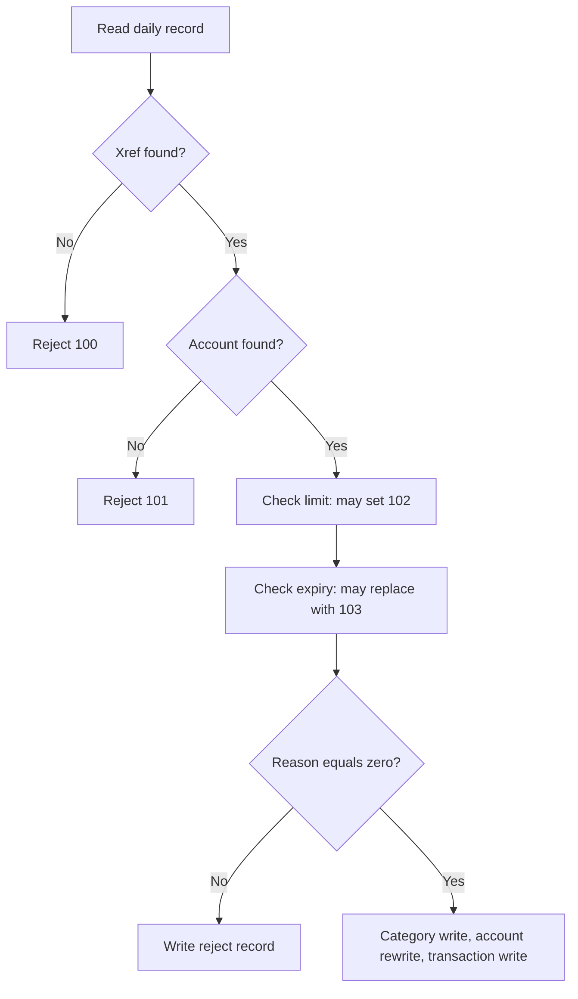

# Behavioral evidence and open questions

## Purpose, scope and evidence status

**Question answered:** What representative behavior can be derived from the current CardDemo source, what evidence would establish parity, and which decisions remain open?

**Analyzed revision:** `fbcb944af892dcb8c94c0549f2ee248945010ff8`. All source links below are pinned to that revision. Coverage includes posting, interest, payment, account/customer/card/user/transaction maintenance, batch orchestration, reports/statements, import/export, optional DB2 transaction types, IMS authorization/purge/fraud, and MQ inquiry. Examples use synthetic values and describe implementation behavior rather than a proposed business policy.

**Source-only analysis. No legacy program, CICS transaction, JCL job, scheduler, DB2 statement, IMS operation or MQ flow was executed. No golden output was captured. Runtime installation is unknown.**

| Label | Meaning in this document |
| --- | --- |
| **S — source-confirmed** | A branch, operation, field, constant or configuration exists in the cited source. This does not prove it is deployed. |
| **I — inferred** | A result derived by tracing that source with the stated synthetic preconditions. All scenario results below have this status. |
| **R — runtime-observed** | None. Repository file sizes and line counts are repository observations, not application executions. |
| **U — unknown** | Requires a deployed configuration, compiler listing, controlled execution, business decision or operational evidence. |
| **D — documentation/comment claim** | A README or comment says something; implementation evidence is assessed separately. |

Related documents, owned by other contributors:

- [System overview and component inventory](01_SYSTEM_OVERVIEW_AND_INVENTORY.md)
- [End-to-end execution flows](02_END_TO_END_EXECUTION_FLOWS.md)
- [Business rules catalog](03_BUSINESS_RULES_CATALOG.md)
- [Data model, record dictionary and lineage](04_DATA_MODEL_DICTIONARY_AND_LINEAGE.md)
- [Input, output and interface contracts](05_INTERFACE_CONTRACTS.md)
- [Runtime, state and failure semantics](06_RUNTIME_STATE_AND_FAILURE_SEMANTICS.md)

Navigation: [coverage matrix](#evidence-and-coverage-matrix), [financial examples](#financial-examples), [maintenance](#online-maintenance-examples), [batch and interchange](#batch-report-and-interchange-examples), [optional modules](#optional-module-examples), [fixtures](#fixture-inventory-and-its-limits), [questions](#stable-questions-register), [future capture](#future-legacy-evidence-capture-procedure), [gaps](#explicit-gaps-and-parent-reconciliation).

## Evidence and coverage matrix

Scenario IDs are local to this document. Question IDs beginning `Q-` are stable names suitable for cross-document reconciliation. “Covered” means a source trace exists, never that a test passed.

| Capability | Implementation/configuration evidence | Representative scenarios | Remaining evidence gap |
| --- | --- | --- | --- |
| Daily posting | `CBTRN02C` `1500-VALIDATE-TRAN`, `2000-POST-TRANSACTION`, `2500-WRITE-REJECT-REC` [validation][post-validate], [writes][post-write] | P1 positive; P2 negative/zero; P3 limit/date edges and precedence; P4 write failure/replay | `Q-POSTING-SIGNS`, `Q-POSTING-PRECEDENCE`, `Q-POSTING-PARTIAL` |
| Interest and fees | `CBACT04C` main loop, `1050-UPDATE-ACCOUNT`, `1300-COMPUTE-INTEREST`, `1400-COMPUTE-FEES` [loop][interest-loop], [arithmetic/stub][interest-compute] | I1 grouped calculation; I2 final account/empty input; I3 zero/default/fractional rate | `Q-INTEREST-EOF`, `Q-FEE-STUB`, `Q-NUMERIC` |
| Online bill payment | `COBIL00C` `PROCESS-ENTER-KEY`, `WRITE-TRANSACT-FILE` [control][payment-control], [write response][payment-write] | B1 full payment; B2 no balance/cancel; B3 transaction write failure | `Q-PAYMENT-FAILURE`, `Q-TRANSACTION-ID`, `Q-CSD-RECOVERY` |
| Account/customer update | `COACTUPC` FICO predicate, confirmation state, `9600-WRITE-PROCESSING` [validation][account-fico], [locking][account-lock], [rewrites][account-write] | A1 edit/confirm; A2 FICO endpoints; A3 concurrent edit/customer failure | `Q-CSD-RECOVERY`; complete field and terminal regression |
| Card update | `COCRDUPC` validation and `9200-WRITE-PROCESSING` [range declarations][card-ranges], [status][card-status], [write/compare][card-write] | C1 status change; C2 month/year edges; C3 stale copy/read failure | Calendar validity, filler/CVV handling and terminal attributes |
| Users/sign-on | `COUSR01C/02C/03C`, `COSGN00C` [add][user-add], [update][user-update], [delete][user-delete], [sign-on][signon] | U1 create/duplicate; U2 update/no-op/delete; U3 case conversion/authentication | `Q-USER-IDENTITY`; external access controls not established |
| Transaction entry | `COTRN02C` validation, `ADD-TRANSACTION`, CICS return [keys][entry-keys], [dates/add][entry-add], [write][entry-write] | T1 valid signed amount; T2 missing/malformed data; T3 duplicate ID | `Q-TRANSACTION-ID`, `Q-DATE-VALIDATOR`; multi-card AIX selection |
| Batch lifecycle | `POSTTRAN`, `INTCALC`, `COMBTRAN`, `CLOSEFIL/OPENFIL`, shell/CA7/Control-M [posting JCL][posting-jcl], [script][batch-script], [Control-M][controlm], [CA7][ca7] | J1 reject RC; J2 overlap/restart; J3 combine duplicate | `Q-SCHEDULER-AUTHORITY`, `Q-BATCH-CLOSE-SCOPE`, `Q-BUSINESS-DATE` |
| Transaction report | `CBTRN03C`, `TRANREPT.prc` [mainline][report-loop], [totals][report-totals], [PROC][report-proc] | R1 inclusive dates; R2 EOF totals; R3 no date input/read error | `Q-REPORT-EOF`, `Q-BUSINESS-DATE` |
| Statements | `CBSTM03A/CBSTM03B`, `CREASTMT.JCL` [grouping][statement-main], [amounts][statement-total], [job][statement-jcl] | S1 card total; S2 no/failed transaction read | Empty input, table limits, rendered text/HTML not captured |
| Export/import | `CBEXPORT`, `CBIMPORT`, `CVEXPORT`, both JCL members [export mapping][export-account], [import dispatch][import-dispatch], [layout][export-layout], [JCL][export-jcl] | X1 field round trip; X2 unknown record; X3 card/output/layout edge | `Q-EXPORT-LAYOUT`, `Q-IMPORT-CARD-DD`, `Q-IMPORT-VALIDATION` |
| Optional DB2 transaction types | `COBTUPDT`, `COTRTUPC` [batch dispatch][db2-batch], [batch errors][db2-batch-errors], [online upsert][db2-online] | D1 batch add/update/delete; D2 bad/missing row; D3 online upsert/foreign-key rejection | `Q-DB2-ERROR-CONTINUATION`; deployed DDL/binds/commit behavior |
| Optional authorization | `COPAUA0C` decision, response, IMS updates [order][auth-order], [decision][auth-decision], [summary][auth-summary] | O1 exact credit; O2 decline; O3 response/write failure | `Q-AUTH-MQ-ATOMICITY`, `Q-AUTH-SUMMARY`, `Q-AUTH-PROFILE` |
| Optional purge/fraud | `CBPAUP0C`, `COPAUS2C` [purge][purge-expiry], [summary condition][purge-loop], [fraud][fraud-upsert] | O4 expiry boundary/year change; O5 fraud insert/update | `Q-PURGE-DATE`, `Q-PURGE-SUMMARY`; IMS persistence/checkpoints |
| Optional MQ inquiries | `COACCT01`, `CODATE01` [account request][mq-account], [reply][mq-reply], [date][mq-date] | M1 inquiry; M2 invalid/not found; M3 MQ failure/time | `Q-MQ-CONTRACT`; queue configuration and CCSID evidence |
| Physical/runtime evidence | Copybooks, CSD, catalog, BMS, compile samples, assembler/macros, data files [record scale][account-layout], [CSD][csd], [build][build-sample], [wait helper][asm-wait] | Cross-cutting byte/lock/status capture | `Q-NUMERIC`, `Q-FIXTURE-ENCODING`, `Q-RUNTIME-BASELINE` |

## Financial examples

### Common synthetic state and arithmetic

Account `00000000001` and transaction/card keys used below are test-only labels, not fixture records. Unless overridden, records exist, dates are ten-character `YYYY-MM-DD`, all I/O returns its normal status, the selected card cross-reference identifies this account, transaction IDs are unique, and each scenario starts from a fresh snapshot. Do not run cases cumulatively unless explicitly stated.

**S:** Account amounts are `PIC S9(10)V99`; category balances and transaction amounts are `PIC S9(09)V99`; disclosure rates are `PIC S9(04)V99`. Values such as `12.00` therefore mean twelve in the rate field, not twelve hundred or a stored fractional `0.12`. Account IDs are eleven display digits; transaction and card keys are sixteen-character fields. The implied decimal is not a literal decimal byte in the record. These declarations establish scale, not the deployed sign encoding or arithmetic options. [Account layout][account-layout], [category balance][balance-layout], [rate][rate-layout], [transaction layout][transaction-layout].

### Posting: decision order matters

**S:** `1500-VALIDATE-TRAN` checks xref, then account. A found account is checked for credit using `cycle_credit - cycle_debit + amount`, then for expiration using the first ten characters of the original timestamp. It does not short-circuit the expiration check after an over-limit result. Successful validation enters category update → account rewrite → transaction write. Rejection instead writes the original record with a validation trailer. [Validation][post-validate], [posting/rejection][post-write].

Text equivalent: xref failure prevents account validation; account failure prevents limit/expiry checks; expiry runs after limit and can replace its reason; only reason zero reaches posting. The graph describes pre-post validation, not rollback or every I/O failure.

| ID / class | Starting state and action | Ordered decisions and derived output (**I**) | Changed/unchanged data and status |
| --- | --- | --- | --- |
| **P1 / normal** | Balance `100.00`, cycle credit `20.00`, cycle debit `0.00`, limit `50.00`, category balance `10.00`; post `+5.00`, unexpired original date. | Xref/account succeed; `20.00 - 0.00 + 5.00 = 25.00 <= 50.00`; date succeeds; category then account then transaction write. | Category `15.00`; balance `105.00`; credit `25.00`; debit stays `0.00`. One transaction carries `+5.00`; no reject. Customer/card/xref unchanged. [Validation][post-validate], [category/account writes][post-updates]. |
| **P2 / sign and zero boundaries** | Same initial state, post `-5.00`. Separate case posts `0.00` with no existing category key. | Negative case compares `15.00 <= 50.00`; category becomes `5.00`, balance `95.00`, debit becomes **`-5.00`**, credit stays `20.00`. Zero is in the `>= 0` branch. | Zero can create a zero-valued category row and a transaction while account amounts remain numerically unchanged. For a subsequent `+5.00` after the negative case, limit expression is `20.00 - (-5.00) + 5.00 = 30.00`. Do not substitute absolute debit values. [Category/account writes][post-updates]. |
| **P3 / validation boundaries and errors** | Credit `20.00`, debit `0.00`, limit `25.00`, amount `5.00`; expiry and original date both `2026-01-31`. Vary amount to `5.01`; separately vary original date to `2026-02-01`. | Exact limit and date equality pass. Amount `5.01` alone gives reason `102`. Later date alone gives `103`. Both failures finish with **`103`**, overwriting `102`. Missing xref gives `100`; missing account after valid xref gives `101`. | Rejected inputs do not reach the posting writes. Each produces its original daily data plus the final reason/description; reject count increments. A completed run with any rejects sets RC `4`. [Validation][post-validate], [reject/write order][post-write], [RC][post-rc]. |
| **P4 / partial failure and replay** | P1 passes validation; inject transaction-file write failure after prior writes. Separate case makes the account rewrite take `INVALID KEY`. | Category/account changes precede the failing transaction write, which calls the abend paragraph. Account rewrite failure sets reason `109`, but `2000-POST-TRANSACTION` still proceeds to transaction write; the mainline has already selected its posting branch. | Do not classify either case as the P3 reject path. Durable partial state and retry effects require capture. A repeat of already posted input is not protected by a validation-time transaction-ID lookup in the cited path; earlier amounts may be added again before a duplicate write fails. [Mainline][post-main], [posting order][post-write], [late failures][post-updates]. |

### Interest: distinguish emitted transactions from account persistence

**S:** `1300-COMPUTE-INTEREST` computes `balance * rate / 1200` into two fractional digits, accumulates it and writes a system transaction. `1050-UPDATE-ACCOUNT` adds total interest and resets both cycle fields. That account update is called at an account change. The apparent EOF update is in the outer `IF END-OF-FILE = 'N'` **ELSE**, while a test-before `PERFORM UNTIL END-OF-FILE = 'Y'` surrounds it. When the read sets EOF, the inner processing branch is skipped and the next loop test exits: the outer ELSE is not reached by that EOF transition. This source control-flow inference must not be replaced with the assumption “last account is flushed.” [Loop][interest-loop], [EOF read][interest-read], [account rewrite][interest-update].

| ID / class | Starting state and action | Ordered decisions and derived output (**I**) | Changed/unchanged data and status |
| --- | --- | --- | --- |
| **I1 / normal grouped path** | Accounts A then B each have one category balance `100.00`, rate `12.00`; A balance `100.00`, cycle credit `20.00`, debit `-5.00`. Valid xrefs and disclosure rows. Parameter prefix `2026013100`. | A computes `100.00 * 12.00 / 1200 = 1.00`; first system ID is `2026013100000001`. Reading B invokes A's update before computing B's interest. | A balance becomes `101.00`; both cycles become `0.00`; category input stays `100.00`. System transaction type `01`, source `System`, amount `1.00`, zero merchant ID; category is assigned with `MOVE '05' TO TRAN-CAT-CD` (capture its four-position numeric representation rather than assuming bytes). Timestamps come from the program's current-time construction, not solely the ID prefix. B's final-account persistence is I2. [Loop][interest-loop], [update][interest-update], [system record][interest-compute]. |
| **I2 / final group and empty file** | Only A's `100.00` category exists; EOF follows it. Separate input is empty. | The `1.00` system transaction is written for A; EOF then exits without the account-change update. Empty input reaches no interest computation and no successful account update. | For single-account input, account balance/cycle fields are inferred unchanged although system output contains interest. This is a source finding, not a captured defect report. Preserve it as a validation case before deciding parity policy. [Loop][interest-loop], [read][interest-read]. |
| **I3 / rate/fraction/error boundaries** | Rate `0.00`; or group missing with matching `DEFAULT` row; or both absent. Fraction test uses balance `1.00`, rate `1.00`. | Zero skips both interest and fee paragraphs. Missing group status `23` retries with `DEFAULT` while retaining type/category; missing default invokes abend. Fraction expression is `0.000833…`; under ordinary fixed-point assignment without `ROUNDED`, stored interest is inferred `0.00`, and the nonzero-rate branch still writes a transaction. | No fee is produced: `1400-COMPUTE-FEES` is only `EXIT`. Category balances stay unchanged. Zero-rate accounts may still have cycle fields reset when a later account triggers an update; I2 applies to the last group. Exact fractional/overflow results need compiler evidence. [Lookup][interest-rate], [computation/stub][interest-compute], [update][interest-update]. |

### Bill payment

| ID / class | Starting state and action | Ordered decisions and derived output (**I**) | Changed/unchanged data and status |
| --- | --- | --- | --- |
| **B1 / normal** | Balance `25.00`, credit `20.00`, debit `-5.00`; valid xref; highest transaction ID `0000000000000001`; account input with confirmation `Y`. | Update-read account; require positive balance; resolve account AIX; backward browse highest transaction; increment to `0000000000000002`; write type `02`, category `0002`, source `POS TERM`, description `BILL PAYMENT - ONLINE`, **positive** amount `25.00`; subtract it and rewrite account. | Balance becomes `0.00`; cycles remain `20.00/-5.00`; no category-balance update appears in this path. New transaction and account are the writes. Success message is generated by the transaction-write paragraph **before** account rewrite. Timestamp microseconds are zeroed. [Control][payment-control], [account I/O][payment-account], [write response][payment-write]. |
| **B2 / boundaries and validation** | Balance `0.00` or `-0.01`; alternatively positive balance with `N`, blank confirmation, or invalid confirmation. | Nonpositive balance produces “nothing to pay.” `N/n` clears the screen and sets error flag; blank confirmation reads/displays account and requests confirmation; other values are invalid. | These branches do not perform a successful payment transaction or balance subtraction. Blank confirmation still uses an update-read; lock lifetime is runtime evidence to capture. [Control][payment-control], [read][payment-account]. |
| **B3 / error continuation** | B1 state; force `DUPREC`/`DUPKEY` or other transaction-write error. | Write paragraph sets error flag and sends the screen, then returns to its caller. `SEND-BILLPAY-SCREEN` has no `CICS RETURN`; caller unconditionally subtracts `TRAN-AMT` and performs account rewrite after `WRITE-TRANSACT-FILE`. | If control returns normally and account rewrite succeeds, balance may become `0.00` without the new payment row. A rewrite failure can conversely follow a displayed success. Record actual responses and data; do not assume screen send exits the task or rolls back. [Caller][payment-control], [send][payment-send], [write][payment-write], [rewrite][payment-account]. |

## Online maintenance examples

For these cases, “unchanged” means named business records/fields outside the shown write path; byte-for-byte filler preservation is not asserted where a record is initialized and rebuilt. Screens, BMS attributes, `RESP/RESP2`, COMMAREA state and lock release remain uncaptured.

| ID / class | Starting state and input/action | Ordered decisions and derived output (**I**) | Changed/unchanged data and error/status evidence |
| --- | --- | --- | --- |
| **A1 / normal account/customer update** | Displayed account and customer match disk; change a valid customer field, preserve other inputs, then confirm with F5. | Valid changed details move to confirmation state; F5 calls `9600-WRITE-PROCESSING`; acquire account update-read, customer update-read, compare old values, construct records, rewrite account then customer. | Both records are rewritten; only supplied business values should differ for this case. Card, xref and transaction files have no write in this path. [Confirmation][account-confirm], [locks][account-lock], [writes][account-write]. |
| **A2 / field/no-op boundaries** | Valid otherwise-complete account form; FICO values `300`, `850`, `299`, `851`; separate case submits all original values. | `300..850` satisfy the actual 88-level predicate; `299/851` fail the FICO range check. No-change state does not advance into confirmed save. | Rejected/no-change cases should not reach rewrites. This tests one numeric boundary, not all address/date/phone validation. [Predicate][account-fico], [validation message][account-fico-check], [state machine][account-confirm]. |
| **A3 / concurrent/error** | Another task changes stored data after display; alternatively customer rewrite fails after account rewrite. | After locks, comparison detects changed data and exits write processing. Customer rewrite failure sets failure state and requests `SYNCPOINT ROLLBACK`. | Stale-input case does not overwrite the competing data. Rollback command is source-confirmed; durable restoration of the earlier account write is **unknown**, especially given CSD `RECOVERY(NONE)`. [Lock/compare call][account-lock], [rollback][account-write], [CSD][csd]. |
| **C1 / normal card update** | Stored/displayed card agree; valid existing name/date; change active status `Y` to `N`, confirm save. | Validate status, update-read, compare prior values, rebuild and rewrite card. | Active status becomes `N`; supplied account/name/date/CVV values retained for this case. Account balance, customer and transactions are unchanged by this paragraph. Lock/rewrite failures have distinct flags. [Status][card-status], [write/compare][card-write]. |
| **C2 / field boundaries** | Otherwise valid card form; months `01`, `12`, `00`, `13`; years `1950`, `2099`, `1949`, `2100`. | Month predicate is `1..12`; year predicate is `1950..2099`. Reject out-of-range values before saving. | Accepted numeric endpoints do not establish calendar-day validity or comparison with today's date. Year paragraph's “1 to 12” comment is not its actual predicate. [Declarations][card-ranges], [checks][card-date]. |
| **C3 / stale/read error** | Card changed on disk after display; alternatively update-read returns non-normal. | Non-normal lock result exits; changed stored fields refresh old values and exit before rewrite. | No overwrite from the stale form on those paths; capture response and new display state rather than assuming an automatic retry. [Read/compare/write][card-write]. |
| **U1 / create/error** | Synthetic user key absent, all fields nonblank, role `U`; submit create. Repeat with same key; separately leave first name blank. Password value deliberately omitted here. | Required fields checked in order; map inputs into security record; CICS write. Duplicate response uses explicit duplicate message; missing first name stops before write. | Normal case adds one security record. Duplicate/required-field cases add none; no financial data writes. Code validates role nonblank in this paragraph, not a whitelist. [Required fields][user-add], [write outcomes][user-add-write]. |
| **U2 / update/no-op/delete** | Existing user; change last name only; repeat with unchanged fields; then delete through the delete action. Separate nonexistent key. | Read user, compare fields, rewrite if modified; unchanged form says “Please modify to update.” Delete path reads then issues CICS delete. | Normal update changes security record; normal delete removes it; business data unchanged. `NOTFND` and other errors get different messages; deletion's generic error text says “Unable to Update User,” which must not be misread as an update operation. [Update][user-update], [delete][user-delete]. |
| **U3 / authentication boundary** | Synthetic security record and known test-only password; submit user/password in mixed case, then a wrong value. | `COSGN00C` uppercases both input fields before comparison; successful security read compares stored password, routes admin versus standard menu; mismatch/not-found sends error. | Financial/security records are not rewritten by this read/route path. Case-insensitive input does not imply stored values were normalized on create. No password examples or fixture credentials are needed. [Uppercase][signon-case], [comparison/routing][signon]. |
| **T1 / normal transaction add** | Existing xref, valid required fields/dates, highest transaction ID `…0001`; amount input `+00000005.00`, confirmation `Y`. | Resolve account or card key; validate fields; call date validator; backward browse/increment ID; populate transaction and write. | New transaction `…0002` has `5.00`; direct add does **not** invoke posting's category/account updates. Amount form has eight integer digits even though persistent amount has nine. [Key/confirmation][entry-keys], [amount syntax][entry-amount], [add][entry-add]. |
| **T2 / invalid and boundary** | Missing both keys; or amount without explicit sign/decimal positions; or date validator reports nonzero severity with message other than `2513`. | Field validation sends an error; this program's send paragraph executes `CICS RETURN`, so this differs from bill payment B3. For date result `2513`, code does not set the invalid-date error in that branch. | Invalid cases do not reach a successful write after the returning error screen; actual validator meaning of `2513` is unknown. Preserve validation order and first reported error. [Key/confirmation][entry-keys], [syntax][entry-amount], [date branches][entry-add], [send/return][entry-send]. |
| **T3 / ID collision/error** | Two synthetic tasks derive the same next ID, or inject a write failure. | `DUPKEY/DUPREC` selects “Tran ID already exist”; other responses select generic add failure. | No second row with the same key; account/category balances unchanged by add. No retry allocator exists in the cited add/write paragraphs. Maximum/nonnumeric/high-value IDs and empty browse need runtime validation. [Add][entry-add], [write][entry-write]. |

## Batch, report and interchange examples

| ID / class | Starting state and action | Ordered decisions and derived output (**I**) | Changed/unchanged data and status |
| --- | --- | --- | --- |
| **J1 / normal and reject completion** | One valid P1 record and one invalid-card P3 record in controlled daily input; execute `POSTTRAN` with isolated DDs. | `CBTRN02C` counts both records, posts one, writes one reject, closes files, sets RC `4`. | One accepted transaction and its balance changes; rejected business data unchanged. Reject output is a 430-byte JCL record, not an application abend. Scheduler treatment of RC `4` remains unspecified here. [Mainline][post-main], [RC][post-rc], [JCL][posting-jcl]. |
| **J2 / orchestration boundary/error** | Previous job remains active beyond the shell script's sleep, or `POSTTRAN` fails. Examine the next submission. | Full-batch script submits through FTP/JES and sleeps fixed intervals; it does not retrieve preceding JES completion codes in the shown sequence. Control-M has explicit input/output conditions; CA7 has job/schedule relationships. | No safe completion barrier or restart result is inferred from sleep alone. Close/open/refresh effects depend on job completion and actual CICS file state. [Script][batch-script], [Control-M][controlm], [CA7][ca7], [close job][close-jcl]. |
| **J3 / combined transaction boundary** | Backup contains ID K; system file contains a distinct ID L, or separately the same ID K. Run `COMBTRAN`. | SORT combines inputs by 16-character transaction ID; IDCAMS REPRO loads the result. No duplicate-elimination clause appears in the cited SORT control. | Distinct IDs supply two records to REPRO. Duplicate-case load status and partial dataset contents must be captured; do not label merge idempotent. Account/category values are not updated by these sort/load steps. [COMBTRAN][combine-jcl]. |
| **R1 / normal date edges** | One card, two transactions `+5.00/-2.00` on start/end dates `2026-01-01/2026-01-31`; third record outside range; valid type/category/xref. Align SORT and `DATEPARM`. | Inclusive date comparisons select both endpoints; detail processing adds signed amounts to page/account totals, giving `3.00` after these two details. | Report detail shows both selected transactions; input business files are read-only. Final printed totals are subject to R2, so `3.00` is the detail accumulation, not an asserted golden footer. [PROC][report-proc], [mainline][report-loop], [totals][report-totals]. |
| **R2 / EOF anomaly** | One selected record `+5.00`, then EOF, no page break. | Detail adds `5.00`; after the EOF read, mainline's EOF branch adds `TRAN-AMT` again before page/grand total writes. If the receiving record retains the last value at EOF, page/grand amount becomes `10.00`. | Double counting is a conditional inference dependent on EOF buffer behavior. Last-account subtotal handling also needs capture; the EOF path calls page/grand totals, not `1120-WRITE-ACCOUNT-TOTALS`. Do not silently repair the expected footer. [Loop][report-loop], [read][report-read], [totals][report-totals]. |
| **R3 / empty/error boundaries** | Empty `DATEPARM`; separately non-EOF read error. | Empty date input sets the shared EOF flag before transaction loop; non-EOF date read error invokes abend. | Empty dates cannot establish a successful full report; non-normal report-file writes also invoke abend. Exact output dataset existence/length requires job evidence. [Date read][report-date], [report output failure][report-output]. |
| **S1 / statement normal** | One xref card with two transactions `5.00/-2.00`; account/customer lookups succeed. | `CREASTMT.JCL` sorts/reformats transaction keys; `CBSTM03A` loads transaction data, reads xref/customer/account, writes card statement and transaction lines, accumulates `3.00`. | Statement amount field receives `3.00`; text/HTML output is written; master business records are inputs. No rendered HTML or complete statement bytes have been captured. [JCL][statement-jcl], [xref loop][statement-main], [transaction total][statement-total]. |
| **S2 / statement boundary/error** | Empty transaction source or failed initial transaction read; separately xref EOF. | Initial transaction read accepts only statuses `00/04`; other statuses invoke abend. Xref EOF `10` normally ends xref loop. | Empty transactions and empty xref therefore need separate cases. No claim that both produce blank valid statements. Statement table capacity and no-match cards need further traces. [Initial read][statement-initial], [xref EOF][statement-main]. |
| **X1 / mapped field round trip** | One account with balance `1.25`, cycle debit `-0.25`; controlled valid export layout/runtime; export then import into separate outputs. | Export initializes common/type-specific data, maps account values; import type `A` initializes account, moves values back, writes sequential account output. | Those mapped numeric values should remain `1.25/-0.25` if representations fit. This is a field-level inference, **not** proof of a byte-identical or executable round trip; source masters are inputs and import outputs are separate sequential datasets. [Export mapping][export-account], [import mapping][import-account], [file organizations][import-files]. |
| **X2 / unknown type and error log** | Input type `Z`, sequence 1, valid physical record. | Dispatch takes unknown branch; increments unknown count; composes timestamp/type/sequence/message; writes error output. `3000-VALIDATE-IMPORT` then only displays success-like validation text. | No customer/account/xref/transaction/card output record for Z. Error-write failure displays an error but still increments “errors written”; this count is not proof the record persisted. [Dispatch][import-dispatch], [unknown/error write][import-errors], [validation stub][import-validation]. |
| **X3 / physical/card boundary** | Type `D` record; execute with checked-in `CBIMPORT.jcl`, or compile/export against checked-in layout and KSDS key definition. | Program selects/opens `CARDOUT` and type D writes card output, but JCL defines customer/account/xref/transaction/error DDs with no `CARDOUT`. Separately, export JCL specifies `KEYS(4 28)` while layout has 1-byte type + 26-byte timestamp before the binary sequence. | Capture open/compile/record-layout evidence before any round-trip claim. Under ordinary four-byte `9(9) COMP`, sequence begins at zero-based offset **27**, not 28. Key offset and key declaration placement are `Q-EXPORT-LAYOUT`; no runtime failure was observed here. [Import organization][import-files], [card mapping][import-card], [JCL][import-jcl], [layout][export-layout], [export JCL][export-jcl]. |

### Conflicts that change expected evidence

1. **Fees:** `INTCALC.jcl` describes “interest and fees” (**D**); `1400-COMPUTE-FEES` only exits (**S**). A fee-bearing expected output cannot be derived from that stub. [Job][interest-jcl], [stub][interest-compute].
2. **Close/open job identity and scope:** README lists `IEFBR14` for close/open (**D**); actual `CLOSEFIL.jcl` executes SDSF and CEMT commands (**S**). Its listed files are `TRANSACT`, `CCXREF`, `ACCTDAT`, `CXACAIX`, `USRSEC`, while the full script also submits card/customer refreshes. This is evidence to reconcile with actual file use, not proof of corruption. [README table][readme-batch], [close][close-jcl], [open][open-jcl], [script][batch-script].
3. **Date sources:** interest JCL fixes `PARM='2022071800'`; its transaction ID uses that prefix. Report PROC fixes SORT date literals separately from the `DATEPARM` dataset consumed by COBOL. Payment/authorization clocks use runtime services. A single “business date” is not established by these artifacts. [Interest job][interest-jcl], [interest ID][interest-compute], [report PROC][report-proc], [payment clock][payment-control].
4. **Recovery:** application rollback in `COACTUPC` coexists with core CSD files configured `JOURNAL(NO)`, `RECOVERY(NONE)`, `FWDRECOVLOG(NO)`. Actual installed definitions and backing resources must decide recovery evidence; issuing `SYNCPOINT ROLLBACK` does not by itself prove restoration. [Rollback][account-write], [CSD][csd].
5. **Names do not establish effects:** `COBTUPDT`'s `9999-ABEND` displays a message, sets RC `4`, and `EXIT`s; it does not itself invoke an abend service or stop the record loop. Import's validation paragraph only displays messages. Follow actual control flow when selecting expected job outcomes. [DB2 error paragraph][db2-batch-errors], [import validation][import-validation].
6. **Case-sensitive inventory:** statement JCL is present as `app/jcl/CREASTMT.JCL`. A search for only lowercase `.jcl` would incorrectly report it missing. [Statement job][statement-jcl].

## Optional-module examples

These examples assume the named optional services have been provisioned in an isolated legacy test environment. Their presence in source does not establish that they are enabled with the core application.

| ID / class | Starting state and input/action | Ordered decisions and derived output (**I**) | Changed/unchanged data and status |
| --- | --- | --- | --- |
| **D1 / DB2 batch normal** | Synthetic transaction type `91` absent; input A/create, U/change description, D/delete, then `*` comment; SQL operations return zero. | `1003-TREAT-RECORD` dispatches each action; insert/update/delete emit corresponding success messages; comment performs no SQL mutation. | Type row is created, changed, then removed; comment unchanged. No account/card balances touched. Commit durability is not established by success text. [Dispatch/insert][db2-batch], [update/delete][db2-batch-errors]. |
| **D2 / DB2 boundary/error** | Update/delete absent type returns `+100`; invalid action `Z`; insert returns negative SQLCODE. | Missing row/error routes to `9999-ABEND`; its implementation sets RC `4` and returns. Record loop is not explicitly stopped by that paragraph. | Failed operation supplies no successful row change; later input may still be processed. Do not assert whole-job rollback or immediate abend. [Dispatch][db2-batch], [SQL/error handler][db2-batch-errors]. |
| **D3 / DB2 online upsert/delete error** | Valid online type/description; UPDATE returns `+100`. Separate delete returns `-532`; separate update returns `-911`. | `9600-WRITE-PROCESSING` falls back to INSERT on `+100`; successful update/insert issues CICS syncpoint. Delete `-532` asks to delete associated child records first; `-911` sets lock error. | Online missing-row behavior differs from batch D2. Successful insert changes the type table; failed delete retains row if DB2 rejects it. Actual constraints/bind options need evidence. [Upsert][db2-online], [insert/delete][db2-online-delete]. |
| **O1 / authorization exact limit** | Valid xref/account/customer; existing IMS summary has limit `100.00`, credit balance `90.00`, approved count/amount `0/0.00`; request `10.00`. No preexisting decline flags. | Lookups → summary/profile step → compare `10.00 > (100.00 - 90.00)`, false → response `00`, reason `0000`, approved amount `10.00` → send response → update summary/insert detail → per-message CICS syncpoint. | Summary approved count `1`, amount `10.00`, credit balance `100.00`, cash balance set to `0`; detail pending-match status. Core account balance is read, not rewritten by this path. [Order][auth-order], [decision][auth-decision], [summary/detail][auth-summary], [syncpoint][auth-loop]. |
| **O2 / authorization decline boundary** | Same summary, request `10.01`. Separate case has no summary and account limit/balance `100.00/90.00`. | Existing summary uses its available credit; absent summary falls back to account amounts. `10.01 > 10.00` declines with code `05`, reason `4100`, approved amount `0.00`. | Existing-summary decline increments declined count; approved credit balance is not increased. Declined amount calculation references `PA-TRANSACTION-AMT`, whereas request is `PA-RQ-TRANSACTION-AMT`; exact amount source and initialization must be captured (`Q-AUTH-SUMMARY`). [Decision][auth-decision], [summary][auth-summary]. |
| **O3 / authorization failure/atomicity** | O1 request consumed; response put succeeds; inject IMS summary/detail write failure. | `MQGET` and reply `MQPUT1` explicitly use **NO-SYNCPOINT**. Reply is sent before database updates; IMS non-normal status is sent to critical error logging. A later CICS syncpoint does not show MQ participation in the same unit of work. | Request removal/reply delivery and IMS persistence cannot be presumed all-or-nothing. Capture failure at each boundary, response persistence/expiry and retry state. This differs from M1's syncpoint MQ options. [Get options][auth-get], [order][auth-order], [reply options][auth-reply], [IMS write errors][auth-summary]. |
| **O4 / purge boundary/error** | Expiry days `5`, current `YYDDD=26010`; pending authorization represented by `PA-AUTH-DATE-9C=73995` (decoded date `26004`), amount `1.00`, approval count/amount `1/1.00`. | Decode `99999 - 73995 = 26004`; subtract `26010 - 26004 = 6`; `6 >= 5` qualifies; in-memory approved count/amount become `0/0.00`; detail delete follows. Age 4 stays; age 5 qualifies. Nonnumeric expiry input defaults to 5. | Detail and possibly summary are deleted. The shown loop does not REPL the adjusted surviving summary; durable decrements need validation. At year change, `26001 - 25365 = 636`, not elapsed-day arithmetic. Non-normal DLI deletion/checkpoint path ends with RC `16` via `GOBACK`. [Defaults][purge-default], [expiry/delete][purge-expiry], [loop][purge-loop], [checkpoint/error][purge-error]. |
| **O5 / fraud insert/update** | Valid card/timestamp key with no DB2 fraud row; mark through `COPAUS2C`. Repeat same key. | INSERT normal sets add-success; duplicate `-803` performs UPDATE of fraud marker and report date; UPDATE zero sets update-success; other SQL outcomes populate error text. | DB2 fraud row inserted/updated; not proof that approval engine blocks future authorizations. Profile-read paragraph in `COPAUA0C` is `CONTINUE`. No core balance changes in the cited SQL paragraphs. [Fraud upsert][fraud-upsert], [profile stub][auth-profile]. |
| **M1 / MQ account inquiry** | Message parsed as `INQA`, positive 11-digit account key; account exists with balance `1.25`; queue operations normal. | Save message/correlation/reply identifiers; CICS READ account; map fields; put fixed 1000-byte reply using saved message/correlation IDs and `MQFMT-STRING`. | Reply balance represents `1.25`; account unchanged. GET uses convert/syncpoint options; reply uses syncpoint; loop issues CICS syncpoint. Byte layout/CCSID and formatted numeric signs must be captured. [Get/loop][mq-get], [request][mq-account], [reply][mq-reply]. |
| **M2 / MQ boundary and errors** | Zero key or function other than `INQA`; separate positive nonexistent key; separate unexpected CICS READ response. | Invalid input/not-found builds “INVALID REQUEST PARAMETERS” reply. Other read error logs error and terminates. `MQRC-NO-MSG-AVAILABLE` ends input processing; other MQGET errors log/terminate. | No account mutation; normal error replies differ from operational failure paths. Do not collapse all into one “not found” status. [Get/result][mq-account], [input branches][mq-invalid]. |
| **M3 / MQ date inquiry** | Controlled queue request with environment clock recorded; execute `CODATE01`. | CICS `ASKTIME` then `FORMATTIME` populates reply; put sends result. | Clock-derived output is expected, but no concrete timestamp is asserted. Clock/timezone, payload formatting, request validation and MQ failure behavior need a captured contract. No account writes in this path. [Date flow][mq-date]. |

## Fixture inventory and its limits

This inventory was obtained from checked-in filenames, byte counts and line lengths at the analyzed revision. No customer, card, security/password or authorization record values are reproduced. ASCII length counts exclude LF; CR, if present, remains counted. A folder named “EBCDIC” is a packaging label, not proof of a particular CCSID or numeric sign convention.

| Family/file in `app/data` | Repository observation | What can and cannot be concluded |
| --- | --- | --- |
| ASCII `acctdata.txt`, `carddata.txt`, `custdata.txt` | 50 rows each; line lengths 300, 150, 500; sizes 15,050 / 7,550 / 25,050 bytes | Consistent with fixed-width records plus LF; not proof of valid fields or referential integrity. |
| ASCII `cardxref.txt` | 50 rows of 36 characters, 1,850 bytes | Copybook declares 16+9+11+14 = 50 bytes. File lacks the 14-byte filler width on each text line; padding/transformation must be recorded. [Xref layout][xref-layout]. |
| ASCII `dailytran.txt`, `discgrp.txt` | 300 × 350-character rows (105,300 bytes); 51 × 50-character rows (2,601 bytes) | Supplies candidate shapes only; not captured successful posting or interest output. |
| ASCII `tcatbal.txt` | 2,599 bytes; 49 rows of length 51 and one of 50 | Mixed lengths versus 50-byte copybook; do not blindly load text byte-for-byte. [Balance layout][balance-layout]. |
| ASCII `trancatg.txt`, `trantype.txt` | 1,116 bytes / 18 rows of 61; 433 bytes / six rows of 61 and one of 60 | Line endings/trailing bytes need byte-level classification; no universal “strip last byte” rule follows. |
| EBCDIC account/card/xref/customer | `…ACCDATA.PS` and `…ACCTDATA.PS` both 15,000 bytes and the same Git blob; `…CARDDATA.PS` 7,500; `…CARDXREF.PS` 2,500; `…CUSTDATA.PS` 25,000 | The two account artifacts are identical at this revision; neither name establishes the authoritative deployed dataset. |
| EBCDIC daily/disclosure/category | `…DALYTRAN.PS` 105,000; `…DALYTRAN.PS.INIT` 350; `…DISCGRP.PS` 2,550; `…TCATBALF.PS` 2,500 | Sizes divide into candidate fixed records; this is not decoded-field validation. |
| EBCDIC reference/security/export | `…TRANCATG.PS` 1,080; `…TRANTYPE.PS` 420; `…USRSEC.PS` 800; `…EXPORT.DATA.PS` 250,000; `.gitkeep` empty | Security data was not displayed. Export size is consistent with 500 × 500 bytes, but does not prove compatibility with current `CVEXPORT` or record lineage. |
| Optional IMS data | `app/app-authorization-ims-db2-mq/data/EBCDIC/AWS.M2.CARDDEMO.IMSDATA.DBPAUTP0.dat`, 51,736 bytes | Establishes a supplied binary artifact, not loaded segment counts, IMS generation, referential consistency or successful authorization results. |

Reproduce non-content inventory with `git ls-tree -r --long <revision> -- app/data app/app-authorization-ims-db2-mq/data`, then line-count/length aggregation on ASCII copies. Preserve exact bytes and hashes before transformations. Do not print records to build the manifest.

**S:** `CVEXPORT` mixes DISPLAY, `COMP` and `COMP-3`. **I:** With conventional mainframe storage sizes, its common header is 40 bytes and both customer and account redefine fields total 460, consistent with the declared 500-byte record. This calculation does not establish the deployed byte representation. A separate source concern remains: `CBEXPORT` names `EXPORT-SEQUENCE-NUM` as its record key but declares its copybook in working-storage while the FD record is an undivided `X(500)`. Obtain compiler diagnostics/layout and reconcile the sequence-key offset before treating the source as an executable round-trip contract. No compile failure was observed here. [Layout][export-layout], [SELECT/FD/copybook placement][export-fd], [KSDS][export-jcl].

**S:** `scripts/pad.awk` replaces CR with a space and uses `printf("%-80s\n", $0)`. Its “exactly 80” comment is stronger than its implementation: width 80 is a minimum, and longer records are not truncated. It is not a general transformer for 50/150/300/350/500-byte business records. [Padding script][pad-script].

Fixtures establish candidate input availability and shape. They do **not** establish test provenance, an accepted business date, output oracle, codepage, deployed schema, repeatability, decimal sign encoding, account ownership, test isolation or migration correctness.

## Stable questions register

All entries are open. Owners are suggested roles, not identified individuals or approvals. Priority is for evidence collection: **P0** can change money/state or destroy the parity oracle; **P1** changes interfaces/operations; **P2** expands coverage. No proposed answer silently changes legacy behavior.

| Stable ID / priority | Evidence and question | Impact / missing information | Suggested validation and decision owner |
| --- | --- | --- | --- |
| **Q-POSTING-SIGNS / P0** | P2: negative amounts are added to signed cycle debit, then debit is subtracted in limit calculation. [Validation][post-validate], [updates][post-updates]. Is this sign convention authoritative? | Later limit outcomes differ from an absolute-debit model; business meaning of credits/debits and external feeds absent. | Capture positive/negative/zero sequence from a reset snapshot; ledger/product owner with COBOL maintainer decides parity versus separately approved correction. |
| **Q-POSTING-PRECEDENCE / P1** | P3: expiry overwrites over-limit reason; xref/account short-circuit. [Validation][post-validate]. Is the single final reason contractual? | Reject reconciliation/client expectations; no multi-error specification. | Capture all pairwise-invalid cases; batch interface owner records exact reason bytes and precedence. |
| **Q-POSTING-PARTIAL / P0** | P4: category/account writes precede transaction write; reason `109` occurs after branch selection. [Posting][post-write], [late failures][post-updates]. What is the restart contract? | Double-applied balances or partial rows; no captured restart policy, snapshots or compensation. | Controlled failure at each write and restart from the same input; batch operations and ledger owner choose supported recovery procedure. |
| **Q-INTEREST-EOF / P0** | I2: EOF flush is in an unreachable outer ELSE for the normal test-before loop transition. [Loop][interest-loop], [read][interest-read]. Does deployed code differ? | Last/single account can have emitted interest without balance update; any “golden” must preserve actual state. | Empty, one-account, two-account and last-group cases with before/after account images; COBOL maintainer and ledger owner. |
| **Q-FEE-STUB / P1** | Job says interest/fees; fee paragraph only exits. [JCL][interest-jcl], [stub][interest-compute]. Are fees intentionally absent or elsewhere? | Invented fee logic would exceed parity; no active fee schedule/implementation identified in this path. | Obtain authoritative fee scope and deployed load-module lineage; product owner and batch maintainer. |
| **Q-PAYMENT-FAILURE / P0** | B3: failed transaction write can return to unconditional balance rewrite; success message precedes rewrite. [Caller][payment-control], [send][payment-send], [write][payment-write]. What actually persists? | Payment audit trail/account divergence; missing fault traces and installed recovery settings. | Inject duplicate/write/rewrite failures under controlled CICS task; payments owner and CICS specialist decide contractual result. |
| **Q-TRANSACTION-ID / P0** | Payment and add backward-browse highest key and increment numeric working fields. [Payment][payment-control], [add][entry-add]. What owns allocation and handles nonnumeric/system IDs? | Concurrent collisions, mixed interest-prefix IDs, exhaustion and empty file behavior; no allocator contract. | Capture two simultaneous adds, empty file, highest numeric and mixed ID sets; transaction-data owner. |
| **Q-CSD-RECOVERY / P0** | Core files declare `RECOVERY(NONE)` while account update requests rollback. [CSD][csd], [rollback][account-write]. Which definitions are installed? | Cannot promise cross-file atomicity from command syntax; missing installed CSD/RDO, VSAM recovery and transaction settings. | Export installed definitions and fault-test second rewrite; CICS/VSAM administrator with application owner. |
| **Q-NUMERIC / P0** | Monetary/rate fields have fixed scales, compute lacks `ROUNDED`, export mixes binary/packed/display. [Scales][transaction-layout], [interest][interest-compute], [export][export-layout]. What compiler/runtime semantics apply? | Fractional-cent truncation, overflow, invalid numeric bytes and sign behavior; sample compile PROC is not a production listing. | Obtain exact compiler release/options, listings and linkage; test signs, half-cent, maximal values and invalid bytes; compiler/platform owner plus ledger owner. |
| **Q-SCHEDULER-AUTHORITY / P0** | Shell sleeps, CA7 relationship listings and Control-M conditions are different artifacts. [Script][batch-script], [CA7][ca7], [Control-M][controlm]. Which is operational authority, especially for RC `4`? | Job overlap, prerequisite/restart/GDG selection; actual calendars and failure gates unknown. | Export active scheduler definitions and JES run chain including failures; batch operations owner. |
| **Q-BATCH-CLOSE-SCOPE / P0** | Close member names five files while refresh script also submits card/customer jobs; README names a different program. [Close][close-jcl], [script][batch-script], [README][readme-batch]. What is the actual quiesce set? | Online/batch interference and incomplete restart; installed files/concurrent usage unknown. | Capture file/transaction state and all relevant regions before refresh; CICS and batch operations owners. |
| **Q-BUSINESS-DATE / P1** | Interest parameter, report SORT literals/DATEPARM and online clocks are separate. [JCL][interest-jcl], [PROC][report-proc], [payment][payment-control]. How are they coordinated? | IDs, date filtering, rates and day-boundaries can differ; no authoritative clock/calendar policy. | Record each date source and effective overrides in one run manifest; batch/reporting owner. |
| **Q-REPORT-EOF / P0** | EOF branch adds `TRAN-AMT` again; final account-total call absent there. [Loop][report-loop], [totals][report-totals]. What bytes does EOF leave and what footer is printed? | Report may not reconcile to detail; empty file and final page behavior unknown. | One-record, multiple-card, exact-page and out-of-range-last-record captures with raw output; reporting owner and COBOL maintainer. |
| **Q-EXPORT-LAYOUT / P0** | X3: JCL key offset 28 versus inferred sequence offset 27; named record key resides in a working-storage copybook rather than the FD record. [Layout][export-layout], [FD][export-fd], [JCL][export-jcl]. Are current source and supplied export compatible? | Incorrect key bytes or compiler rejection could prevent a valid round trip; actual record map/compiler diagnostics absent. | Compile without source alteration, retain diagnostics/layout offsets; compare typed fields against binary export in isolated datasets; data/interface owner. |
| **Q-IMPORT-CARD-DD / P1** | Import selects `CARDOUT`; JCL omits it. [SELECT][import-files], [JCL][import-jcl]. Is another procedure/allocation used? | Open failure or absent card extraction; runtime DD allocation unknown. | Obtain expanded JCL and allocation messages, then a single type-D test; batch/interface owner. |
| **Q-IMPORT-VALIDATION / P0** | Validation only displays two messages; unknown/error counters are not success proof. [Error write][import-errors], [stub][import-validation]. What integrity checks actually gate downstream load? | Orphan, duplicate, malformed or incomplete data may be accepted; no semantic validator demonstrated. | Capture mismatched relationships, counts and errors; data owner defines external gate separately from current program behavior. |
| **Q-FIXTURE-ENCODING / P1** | ASCII lengths differ from copybooks; binary artifacts coexist; padding helper is not universal. [Xref][xref-layout], [balance][balance-layout], [pad][pad-script]. Which dataset/transfer format is authoritative? | Byte transforms can change signed amounts, keys, whitespace or binary fields; CCSID and transfer settings absent. | Produce restricted raw hashes, CCSID evidence and field-aware round trips; mainframe data and interface owners. |
| **Q-USER-IDENTITY / P1** | Create copies inputs, login uppercases user/password. [Create][user-add], [login][signon-case]. Which normalization/role rules are authoritative? | Provisioning/login mismatch; no active external security policy proved by these paragraphs. | Synthetic case-variant users and role boundaries; application identity owner, without using supplied credential records. |
| **Q-DATE-VALIDATOR / P1** | `COTRN02C` special-cases validator message `2513`. [Date checks][entry-add]. What library/version defines this result? | Date acceptance and linkage/runtime availability; meaning cannot be inferred from message number alone. | Obtain linked `CSUTLDTC` version/interface and controlled invalid/leap/boundary results; mainframe build owner. |
| **Q-DB2-ERROR-CONTINUATION / P1** | Batch “abend” only sets RC/returns; online `+100` becomes INSERT. [Batch][db2-batch-errors], [online][db2-online]. Which result/commit boundary is contractual? | Partial DB2 batch changes and different online/batch semantics; deployed DBRM/binds/driver commit policy absent. | Mixed success/error input, post-job query and rollback trace; DB2 DBA with reference-data owner. |
| **Q-AUTH-MQ-ATOMICITY / P0** | Authorization GET/PUT use NO-SYNCPOINT and reply precedes IMS writes; generic inquiry uses syncpoint options. [Get][auth-get], [order][auth-order], [reply][auth-reply], [inquiry][mq-get]. What delivery/retry contract exists? | Lost/repeated requests or visible reply without committed authorization; queue persistence/backout/client retry configuration unknown. | Fault before/after get, reply, IMS insert and commit; MQ/IMS/CICS owners and authorization owner. |
| **Q-AUTH-SUMMARY / P0** | Existing summary overrides account availability; new summary initializes amounts without copying account current balance; decline adds detail `PA-TRANSACTION-AMT` before detail population. [Decision][auth-decision], [summary][auth-summary]. Are these balances/amount sources intentional? | Subsequent approvals or declined totals may diverge; deployed segment initial state and intended ledger semantics absent. | Two approvals with/without starting summary, then decline following different request; compare request, detail, summary and account; authorization owner and IMS maintainer. |
| **Q-AUTH-PROFILE / P1** | `5600-READ-PROFILE-DATA` is `CONTINUE`; fraud flags exist elsewhere. [Stub][auth-profile], [fraud writes][fraud-upsert]. Which checks are actually enabled? | Do not promise fraud-driven declines from a DB2 marker alone; external/profile integration unknown. | Identify deployed load modules/call chain; controlled known-profile case; authorization/fraud owner. |
| **Q-PURGE-DATE / P0** | Purge subtracts `YYDDD` numbers, including across years. [Expiry][purge-expiry]. Is that deployed behavior or corrected elsewhere? | Premature expiry at year boundary; timezone/age definition absent. | Age 4/5/6, year-end and leap-year cases; retention/product owner and IMS maintainer. |
| **Q-PURGE-SUMMARY / P0** | Summary deletion tests approved count twice, not approved and declined; adjusted surviving summary has no REPL in shown loop. [Loop][purge-loop], [expiry][purge-expiry]. What persists? | Declined-only summaries/children and remaining credit totals; no loaded-IMS result captured. | Summary with zero approvals and live declines, plus partial expiry; inspect segments before/after/checkpoint; IMS and authorization owners. |
| **Q-MQ-CONTRACT / P1** | M1 fixed-size/string response, conversion and saved IDs differ from authorization reply construction. [Inquiry reply][mq-reply], [auth reply][auth-reply]. What do clients rely on? | CCSID, message/correlation ID semantics, padding, duplicate delivery, timeout and expiry; client/runtime configs absent. | Capture MQMD plus unconverted payload bytes and client result in both modules; MQ/interface owner. |
| **Q-RUNTIME-BASELINE / P0** | README identifies mainframe prerequisites; sample build members and optional JCL reference runtime resources. [Prerequisites][readme-prereqs], [build][build-sample], [IMS JCL][ims-runtime]. Which executable baseline exists? | All R evidence is absent; no compiler/load-module/CICS/VSAM/DB2/IMS/MQ/scheduler version or deployment lineage verified. | Obtain owner-supplied deployment manifest and exact expanded jobs without installing anything during this analysis; platform/release owner. |

## Future legacy evidence capture procedure

This is a procedure for an authorized legacy-environment owner. It was **not executed**, and it does not assume credentials, infrastructure or datasets exist.

1. **Identify the executable baseline.** Record source commit, load-module hashes/build dates, COBOL/compiler options and listings, copybook/map versions, link/bind results, expanded JCL/PROC, CICS region and installed resource definitions, VSAM/AIX metadata, DB2 DDL/packages, IMS DBD/PSB/ACB and queue/scheduler definitions. A sample source compile member is supporting evidence, not proof of deployed options. Record any difference from this pinned revision before comparing results.
2. **Create a controlled starting snapshot.** Use isolated synthetic datasets/DB2 rows/IMS segments/queues. Record each dataset's DSORG, RECFM, LRECL, key offsets, absolute GDG name, record count and SHA-256 of a byte-preserving unload; record typed financial values separately. Snapshot account, category balance, transaction, xref, card, customer, security/reference data and optional stores needed for the selected case. Mark untouched stores explicitly. Do not use destructive checked-in refresh jobs against shared datasets.
3. **Freeze and record all time inputs.** Include agreed business date, wall-clock/timezone, interest parameter prefix, report SORT dates plus `DATEPARM`, authorization request timestamps, purge `YYDDD`/expiry/checkpoint parameters and scheduler order date. If system time cannot be controlled, record it and define the permitted comparison before execution.
4. **Instantiate one scenario per snapshot.** Produce fixed-record inputs with explicit encoding, decimal/sign representation, key widths and order. Record each input's hash, count and typed values. For P3 vary one predicate at a time before combined failures; for I2/R2 record empty/single/final-group cases; for optional O3 use agreed deterministic failure injection. Store secrets and synthetic user passwords outside shared evidence.
5. **Record exact execution, not just program names.** Preserve submitted JCL bytes and JES job IDs/step results for `POSTTRAN`, `INTCALC`, `COMBTRAN`, report PROC and `CREASTMT`; record resolved DD/GDG allocations and scheduler predecessor/success rules. For online cases record transaction/program/map, initial COMMAREA/navigation state, exact entered fields and AID keys. For MQ record queue names, MQMD, request bytes, consumer program, message/correlation IDs and response. For DB2/IMS record executed input, SQLCODE/SQLSTATE or DIBSTAT and commit/checkpoint boundaries. Use the owning environment's approved submission mechanism; a shell sleep is not completion evidence.
6. **Capture outputs and mutations independently.** Preserve JES/spool/stdout, CICS task responses/screens, error logs, reject records/trailers, report/statement text and HTML, system transactions, import/export records, MQ response bytes, DB2 rows and IMS segment unloads. Immediately take post-state byte hashes and typed diffs for every starting store, including those expected unchanged. Financial reconciliation must compare transaction sums, account deltas and category deltas separately; a displayed success or RC alone is insufficient.
7. **Capture failure and restart as separate runs.** At each agreed write/commit boundary preserve the failure response, partial outputs, locks/task state, queue depth and durable records. Retry once under the documented restart procedure from that partial state, then repeat from the original snapshot. Do not label an operation idempotent because the second attempt reports a duplicate.
8. **Keep raw and normalized evidence side by side.** Raw bytes and hashes are immutable. Allowed normalization must be case-specific and logged: for example, map a recorded JES job ID to a token, or mask a documented display-clock field while retaining its raw bytes. Preserve widths, signs, amounts, keys, record order, duplicate rows, reject precedence, return codes, MQMD semantics and trailing spaces in the raw oracle. Do not normalize away suspected bugs, differing business dates, encoding changes or extra EOF totals. Sorting outputs is permitted only if the verified contract says order is irrelevant.
9. **Publish a restricted evidence manifest.** One entry per scenario records its ID, starting snapshot hashes, inputs, date sources, exact commands/jobs/transactions, expected derivation, observed raw artifacts/hashes, typed changes, statuses, normalization recipe and unresolved question IDs. Promote I to R only for observed fields and explicitly record source/runtime disagreements. Obtain domain-owner decisions for corrections separately from parity evidence.

## Explicit gaps and parent reconciliation

- **No runtime evidence:** CICS region/terminal/maps, JES/SORT/IDCAMS/SDSF, VSAM/AIX datasets, COBOL/LE and date services, DB2 catalogs/packages/binds, IMS segments/PSBs, MQ queues and CA7/Control-M installation were not available as verified execution evidence. This analysis did not install or request any of them. README prerequisites and sample JCL are source artifacts only. [Prerequisites][readme-prereqs], [build][build-sample], [IMS runtime references][ims-runtime].
- **Source families inspected:** core `cbl/cpy`, representative `bms/cpy-bms`, `jcl/proc`, `csd`, `scheduler`, `catlg`, `asm/maclib`, `data`, `samples`, `scripts`, and the three named optional module trees. COBOL paragraphs and selected physical/interface artifacts were traced; this is not every-program or every-screen branch coverage. BMS and generated map copybooks show field contracts, not a captured terminal rendering. The wait assembler/macro and date-layout helper show external execution dependencies, not tested timing/date equivalence. [Representative map][bms], [map copybook][bms-copy], [wait][asm-wait], [date layout][asm-date-layout].
- **Physical evidence limitations:** checked-in catalog metadata and JCL definitions do not establish today's allocation, dataset contents, secondary indexes, recovery behavior or copybook compatibility. No binary fixture decode was used as a behavior oracle. [Catalog][catalog], [CSD][csd], [export JCL][export-jcl].
- **Not exhausted:** account/card field validators, paging/navigation, all DB2 list/filter paths, IMS authorization-list/detail UI, every MQ error branch, statement in-memory limits, all load/refresh/backup jobs, concurrency scheduling, numeric extremes and every missing-resource combination. These require additional scenario rows/evidence, not assumptions of success.
- **Reconcile across siblings:** documents 02/03 should explicitly compare I2, B3 and D2 against any simplified “flush at EOF,” “stop on screen error,” or “abend on SQL error” descriptions. Documents 04/05 should reconcile export sizes/key offsets, fixture lengths, date/ID formats and optional MQ differences. Document 06 should own installed recovery/restart conclusions and distinguish NO-SYNCPOINT authorization from syncpoint inquiry. All should preserve current-source quirks until an owner makes a separate correction decision.
- **Acceptance boundary:** this document provides source-confirmed predicates and writes, synthetic derived scenarios, static fixture observations, open decisions and a future capture method. It does not certify financial correctness, operational safety, runtime availability or modernization parity.

## Pinned source references

The labels used above identify symbols/paragraphs in their local context; line fragments below are physical repository line numbers, including files containing COBOL sequence columns.

[account-layout]: https://github.com/codev-workshops/uc-legacy-modernization-cobol-to-java/blob/fbcb944af892dcb8c94c0549f2ee248945010ff8/app/cpy/CVACT01Y.cpy#L4-L17
[xref-layout]: https://github.com/codev-workshops/uc-legacy-modernization-cobol-to-java/blob/fbcb944af892dcb8c94c0549f2ee248945010ff8/app/cpy/CVACT03Y.cpy#L4-L8
[balance-layout]: https://github.com/codev-workshops/uc-legacy-modernization-cobol-to-java/blob/fbcb944af892dcb8c94c0549f2ee248945010ff8/app/cpy/CVTRA01Y.cpy#L4-L10
[rate-layout]: https://github.com/codev-workshops/uc-legacy-modernization-cobol-to-java/blob/fbcb944af892dcb8c94c0549f2ee248945010ff8/app/cpy/CVTRA02Y.cpy#L4-L10
[transaction-layout]: https://github.com/codev-workshops/uc-legacy-modernization-cobol-to-java/blob/fbcb944af892dcb8c94c0549f2ee248945010ff8/app/cpy/CVTRA05Y.cpy#L4-L18
[post-main]: https://github.com/codev-workshops/uc-legacy-modernization-cobol-to-java/blob/fbcb944af892dcb8c94c0549f2ee248945010ff8/app/cbl/CBTRN02C.cbl#L193-L234
[post-validate]: https://github.com/codev-workshops/uc-legacy-modernization-cobol-to-java/blob/fbcb944af892dcb8c94c0549f2ee248945010ff8/app/cbl/CBTRN02C.cbl#L370-L422
[post-write]: https://github.com/codev-workshops/uc-legacy-modernization-cobol-to-java/blob/fbcb944af892dcb8c94c0549f2ee248945010ff8/app/cbl/CBTRN02C.cbl#L424-L464
[post-updates]: https://github.com/codev-workshops/uc-legacy-modernization-cobol-to-java/blob/fbcb944af892dcb8c94c0549f2ee248945010ff8/app/cbl/CBTRN02C.cbl#L467-L578
[post-rc]: https://github.com/codev-workshops/uc-legacy-modernization-cobol-to-java/blob/fbcb944af892dcb8c94c0549f2ee248945010ff8/app/cbl/CBTRN02C.cbl#L222-L233
[interest-loop]: https://github.com/codev-workshops/uc-legacy-modernization-cobol-to-java/blob/fbcb944af892dcb8c94c0549f2ee248945010ff8/app/cbl/CBACT04C.cbl#L166-L232
[interest-read]: https://github.com/codev-workshops/uc-legacy-modernization-cobol-to-java/blob/fbcb944af892dcb8c94c0549f2ee248945010ff8/app/cbl/CBACT04C.cbl#L324-L348
[interest-update]: https://github.com/codev-workshops/uc-legacy-modernization-cobol-to-java/blob/fbcb944af892dcb8c94c0549f2ee248945010ff8/app/cbl/CBACT04C.cbl#L350-L369
[interest-rate]: https://github.com/codev-workshops/uc-legacy-modernization-cobol-to-java/blob/fbcb944af892dcb8c94c0549f2ee248945010ff8/app/cbl/CBACT04C.cbl#L415-L460
[interest-compute]: https://github.com/codev-workshops/uc-legacy-modernization-cobol-to-java/blob/fbcb944af892dcb8c94c0549f2ee248945010ff8/app/cbl/CBACT04C.cbl#L462-L520
[payment-control]: https://github.com/codev-workshops/uc-legacy-modernization-cobol-to-java/blob/fbcb944af892dcb8c94c0549f2ee248945010ff8/app/cbl/COBIL00C.cbl#L154-L267
[payment-account]: https://github.com/codev-workshops/uc-legacy-modernization-cobol-to-java/blob/fbcb944af892dcb8c94c0549f2ee248945010ff8/app/cbl/COBIL00C.cbl#L343-L403
[payment-send]: https://github.com/codev-workshops/uc-legacy-modernization-cobol-to-java/blob/fbcb944af892dcb8c94c0549f2ee248945010ff8/app/cbl/COBIL00C.cbl#L285-L301
[payment-write]: https://github.com/codev-workshops/uc-legacy-modernization-cobol-to-java/blob/fbcb944af892dcb8c94c0549f2ee248945010ff8/app/cbl/COBIL00C.cbl#L510-L547
[account-fico]: https://github.com/codev-workshops/uc-legacy-modernization-cobol-to-java/blob/fbcb944af892dcb8c94c0549f2ee248945010ff8/app/cbl/COACTUPC.cbl#L842-L849
[account-fico-check]: https://github.com/codev-workshops/uc-legacy-modernization-cobol-to-java/blob/fbcb944af892dcb8c94c0549f2ee248945010ff8/app/cbl/COACTUPC.cbl#L2514-L2532
[account-confirm]: https://github.com/codev-workshops/uc-legacy-modernization-cobol-to-java/blob/fbcb944af892dcb8c94c0549f2ee248945010ff8/app/cbl/COACTUPC.cbl#L2584-L2621
[account-lock]: https://github.com/codev-workshops/uc-legacy-modernization-cobol-to-java/blob/fbcb944af892dcb8c94c0549f2ee248945010ff8/app/cbl/COACTUPC.cbl#L3888-L3952
[account-write]: https://github.com/codev-workshops/uc-legacy-modernization-cobol-to-java/blob/fbcb944af892dcb8c94c0549f2ee248945010ff8/app/cbl/COACTUPC.cbl#L4007-L4103
[card-ranges]: https://github.com/codev-workshops/uc-legacy-modernization-cobol-to-java/blob/fbcb944af892dcb8c94c0549f2ee248945010ff8/app/cbl/COCRDUPC.cbl#L91-L99
[card-status]: https://github.com/codev-workshops/uc-legacy-modernization-cobol-to-java/blob/fbcb944af892dcb8c94c0549f2ee248945010ff8/app/cbl/COCRDUPC.cbl#L845-L878
[card-date]: https://github.com/codev-workshops/uc-legacy-modernization-cobol-to-java/blob/fbcb944af892dcb8c94c0549f2ee248945010ff8/app/cbl/COCRDUPC.cbl#L880-L946
[card-write]: https://github.com/codev-workshops/uc-legacy-modernization-cobol-to-java/blob/fbcb944af892dcb8c94c0549f2ee248945010ff8/app/cbl/COCRDUPC.cbl#L1420-L1519
[user-add]: https://github.com/codev-workshops/uc-legacy-modernization-cobol-to-java/blob/fbcb944af892dcb8c94c0549f2ee248945010ff8/app/cbl/COUSR01C.cbl#L115-L160
[user-add-write]: https://github.com/codev-workshops/uc-legacy-modernization-cobol-to-java/blob/fbcb944af892dcb8c94c0549f2ee248945010ff8/app/cbl/COUSR01C.cbl#L238-L276
[user-update]: https://github.com/codev-workshops/uc-legacy-modernization-cobol-to-java/blob/fbcb944af892dcb8c94c0549f2ee248945010ff8/app/cbl/COUSR02C.cbl#L177-L245
[user-delete]: https://github.com/codev-workshops/uc-legacy-modernization-cobol-to-java/blob/fbcb944af892dcb8c94c0549f2ee248945010ff8/app/cbl/COUSR03C.cbl#L267-L336
[signon-case]: https://github.com/codev-workshops/uc-legacy-modernization-cobol-to-java/blob/fbcb944af892dcb8c94c0549f2ee248945010ff8/app/cbl/COSGN00C.cbl#L118-L138
[signon]: https://github.com/codev-workshops/uc-legacy-modernization-cobol-to-java/blob/fbcb944af892dcb8c94c0549f2ee248945010ff8/app/cbl/COSGN00C.cbl#L210-L257
[entry-keys]: https://github.com/codev-workshops/uc-legacy-modernization-cobol-to-java/blob/fbcb944af892dcb8c94c0549f2ee248945010ff8/app/cbl/COTRN02C.cbl#L164-L230
[entry-amount]: https://github.com/codev-workshops/uc-legacy-modernization-cobol-to-java/blob/fbcb944af892dcb8c94c0549f2ee248945010ff8/app/cbl/COTRN02C.cbl#L340-L350
[entry-add]: https://github.com/codev-workshops/uc-legacy-modernization-cobol-to-java/blob/fbcb944af892dcb8c94c0549f2ee248945010ff8/app/cbl/COTRN02C.cbl#L383-L466
[entry-send]: https://github.com/codev-workshops/uc-legacy-modernization-cobol-to-java/blob/fbcb944af892dcb8c94c0549f2ee248945010ff8/app/cbl/COTRN02C.cbl#L516-L534
[entry-write]: https://github.com/codev-workshops/uc-legacy-modernization-cobol-to-java/blob/fbcb944af892dcb8c94c0549f2ee248945010ff8/app/cbl/COTRN02C.cbl#L711-L749
[posting-jcl]: https://github.com/codev-workshops/uc-legacy-modernization-cobol-to-java/blob/fbcb944af892dcb8c94c0549f2ee248945010ff8/app/jcl/POSTTRAN.jcl#L18-L45
[interest-jcl]: https://github.com/codev-workshops/uc-legacy-modernization-cobol-to-java/blob/fbcb944af892dcb8c94c0549f2ee248945010ff8/app/jcl/INTCALC.jcl#L18-L41
[combine-jcl]: https://github.com/codev-workshops/uc-legacy-modernization-cobol-to-java/blob/fbcb944af892dcb8c94c0549f2ee248945010ff8/app/jcl/COMBTRAN.jcl#L22-L48
[batch-script]: https://github.com/codev-workshops/uc-legacy-modernization-cobol-to-java/blob/fbcb944af892dcb8c94c0549f2ee248945010ff8/scripts/run_full_batch.sh#L9-L70
[controlm]: https://github.com/codev-workshops/uc-legacy-modernization-cobol-to-java/blob/fbcb944af892dcb8c94c0549f2ee248945010ff8/app/scheduler/CardDemo.controlm#L3-L24
[ca7]: https://github.com/codev-workshops/uc-legacy-modernization-cobol-to-java/blob/fbcb944af892dcb8c94c0549f2ee248945010ff8/app/scheduler/CardDemo.ca7#L18-L95
[close-jcl]: https://github.com/codev-workshops/uc-legacy-modernization-cobol-to-java/blob/fbcb944af892dcb8c94c0549f2ee248945010ff8/app/jcl/CLOSEFIL.jcl#L22-L31
[open-jcl]: https://github.com/codev-workshops/uc-legacy-modernization-cobol-to-java/blob/fbcb944af892dcb8c94c0549f2ee248945010ff8/app/jcl/OPENFIL.jcl#L22-L31
[readme-batch]: https://github.com/codev-workshops/uc-legacy-modernization-cobol-to-java/blob/fbcb944af892dcb8c94c0549f2ee248945010ff8/README.md#L310-L322
[report-proc]: https://github.com/codev-workshops/uc-legacy-modernization-cobol-to-java/blob/fbcb944af892dcb8c94c0549f2ee248945010ff8/app/proc/TRANREPT.prc#L38-L78
[report-loop]: https://github.com/codev-workshops/uc-legacy-modernization-cobol-to-java/blob/fbcb944af892dcb8c94c0549f2ee248945010ff8/app/cbl/CBTRN03C.cbl#L159-L217
[report-date]: https://github.com/codev-workshops/uc-legacy-modernization-cobol-to-java/blob/fbcb944af892dcb8c94c0549f2ee248945010ff8/app/cbl/CBTRN03C.cbl#L220-L243
[report-read]: https://github.com/codev-workshops/uc-legacy-modernization-cobol-to-java/blob/fbcb944af892dcb8c94c0549f2ee248945010ff8/app/cbl/CBTRN03C.cbl#L246-L272
[report-totals]: https://github.com/codev-workshops/uc-legacy-modernization-cobol-to-java/blob/fbcb944af892dcb8c94c0549f2ee248945010ff8/app/cbl/CBTRN03C.cbl#L274-L322
[report-output]: https://github.com/codev-workshops/uc-legacy-modernization-cobol-to-java/blob/fbcb944af892dcb8c94c0549f2ee248945010ff8/app/cbl/CBTRN03C.cbl#L324-L358
[statement-jcl]: https://github.com/codev-workshops/uc-legacy-modernization-cobol-to-java/blob/fbcb944af892dcb8c94c0549f2ee248945010ff8/app/jcl/CREASTMT.JCL#L19-L97
[statement-main]: https://github.com/codev-workshops/uc-legacy-modernization-cobol-to-java/blob/fbcb944af892dcb8c94c0549f2ee248945010ff8/app/cbl/CBSTM03A.CBL#L316-L362
[statement-total]: https://github.com/codev-workshops/uc-legacy-modernization-cobol-to-java/blob/fbcb944af892dcb8c94c0549f2ee248945010ff8/app/cbl/CBSTM03A.CBL#L416-L464
[statement-initial]: https://github.com/codev-workshops/uc-legacy-modernization-cobol-to-java/blob/fbcb944af892dcb8c94c0549f2ee248945010ff8/app/cbl/CBSTM03A.CBL#L728-L762
[export-account]: https://github.com/codev-workshops/uc-legacy-modernization-cobol-to-java/blob/fbcb944af892dcb8c94c0549f2ee248945010ff8/app/cbl/CBEXPORT.cbl#L338-L376
[export-layout]: https://github.com/codev-workshops/uc-legacy-modernization-cobol-to-java/blob/fbcb944af892dcb8c94c0549f2ee248945010ff8/app/cpy/CVEXPORT.cpy#L9-L100
[export-fd]: https://github.com/codev-workshops/uc-legacy-modernization-cobol-to-java/blob/fbcb944af892dcb8c94c0549f2ee248945010ff8/app/cbl/CBEXPORT.cbl#L65-L96
[export-jcl]: https://github.com/codev-workshops/uc-legacy-modernization-cobol-to-java/blob/fbcb944af892dcb8c94c0549f2ee248945010ff8/app/jcl/CBEXPORT.jcl#L24-L63
[import-dispatch]: https://github.com/codev-workshops/uc-legacy-modernization-cobol-to-java/blob/fbcb944af892dcb8c94c0549f2ee248945010ff8/app/cbl/CBIMPORT.cbl#L270-L285
[import-files]: https://github.com/codev-workshops/uc-legacy-modernization-cobol-to-java/blob/fbcb944af892dcb8c94c0549f2ee248945010ff8/app/cbl/CBIMPORT.cbl#L36-L78
[import-account]: https://github.com/codev-workshops/uc-legacy-modernization-cobol-to-java/blob/fbcb944af892dcb8c94c0549f2ee248945010ff8/app/cbl/CBIMPORT.cbl#L323-L349
[import-card]: https://github.com/codev-workshops/uc-legacy-modernization-cobol-to-java/blob/fbcb944af892dcb8c94c0549f2ee248945010ff8/app/cbl/CBIMPORT.cbl#L402-L422
[import-errors]: https://github.com/codev-workshops/uc-legacy-modernization-cobol-to-java/blob/fbcb944af892dcb8c94c0549f2ee248945010ff8/app/cbl/CBIMPORT.cbl#L425-L446
[import-validation]: https://github.com/codev-workshops/uc-legacy-modernization-cobol-to-java/blob/fbcb944af892dcb8c94c0549f2ee248945010ff8/app/cbl/CBIMPORT.cbl#L449-L452
[import-jcl]: https://github.com/codev-workshops/uc-legacy-modernization-cobol-to-java/blob/fbcb944af892dcb8c94c0549f2ee248945010ff8/app/jcl/CBIMPORT.jcl#L18-L65
[db2-batch]: https://github.com/codev-workshops/uc-legacy-modernization-cobol-to-java/blob/fbcb944af892dcb8c94c0549f2ee248945010ff8/app/app-transaction-type-db2/cbl/COBTUPDT.cbl#L93-L161
[db2-batch-errors]: https://github.com/codev-workshops/uc-legacy-modernization-cobol-to-java/blob/fbcb944af892dcb8c94c0549f2ee248945010ff8/app/app-transaction-type-db2/cbl/COBTUPDT.cbl#L162-L236
[db2-online]: https://github.com/codev-workshops/uc-legacy-modernization-cobol-to-java/blob/fbcb944af892dcb8c94c0549f2ee248945010ff8/app/app-transaction-type-db2/cbl/COTRTUPC.cbl#L1531-L1577
[db2-online-delete]: https://github.com/codev-workshops/uc-legacy-modernization-cobol-to-java/blob/fbcb944af892dcb8c94c0549f2ee248945010ff8/app/app-transaction-type-db2/cbl/COTRTUPC.cbl#L1596-L1664
[auth-loop]: https://github.com/codev-workshops/uc-legacy-modernization-cobol-to-java/blob/fbcb944af892dcb8c94c0549f2ee248945010ff8/app/app-authorization-ims-db2-mq/cbl/COPAUA0C.cbl#L323-L344
[auth-get]: https://github.com/codev-workshops/uc-legacy-modernization-cobol-to-java/blob/fbcb944af892dcb8c94c0549f2ee248945010ff8/app/app-authorization-ims-db2-mq/cbl/COPAUA0C.cbl#L386-L409
[auth-order]: https://github.com/codev-workshops/uc-legacy-modernization-cobol-to-java/blob/fbcb944af892dcb8c94c0549f2ee248945010ff8/app/app-authorization-ims-db2-mq/cbl/COPAUA0C.cbl#L438-L465
[auth-profile]: https://github.com/codev-workshops/uc-legacy-modernization-cobol-to-java/blob/fbcb944af892dcb8c94c0549f2ee248945010ff8/app/app-authorization-ims-db2-mq/cbl/COPAUA0C.cbl#L647-L654
[auth-decision]: https://github.com/codev-workshops/uc-legacy-modernization-cobol-to-java/blob/fbcb944af892dcb8c94c0549f2ee248945010ff8/app/app-authorization-ims-db2-mq/cbl/COPAUA0C.cbl#L657-L718
[auth-reply]: https://github.com/codev-workshops/uc-legacy-modernization-cobol-to-java/blob/fbcb944af892dcb8c94c0549f2ee248945010ff8/app/app-authorization-ims-db2-mq/cbl/COPAUA0C.cbl#L738-L776
[auth-summary]: https://github.com/codev-workshops/uc-legacy-modernization-cobol-to-java/blob/fbcb944af892dcb8c94c0549f2ee248945010ff8/app/app-authorization-ims-db2-mq/cbl/COPAUA0C.cbl#L786-L930
[purge-loop]: https://github.com/codev-workshops/uc-legacy-modernization-cobol-to-java/blob/fbcb944af892dcb8c94c0549f2ee248945010ff8/app/app-authorization-ims-db2-mq/cbl/CBPAUP0C.cbl#L136-L180
[purge-default]: https://github.com/codev-workshops/uc-legacy-modernization-cobol-to-java/blob/fbcb944af892dcb8c94c0549f2ee248945010ff8/app/app-authorization-ims-db2-mq/cbl/CBPAUP0C.cbl#L183-L209
[purge-expiry]: https://github.com/codev-workshops/uc-legacy-modernization-cobol-to-java/blob/fbcb944af892dcb8c94c0549f2ee248945010ff8/app/app-authorization-ims-db2-mq/cbl/CBPAUP0C.cbl#L277-L347
[purge-error]: https://github.com/codev-workshops/uc-legacy-modernization-cobol-to-java/blob/fbcb944af892dcb8c94c0549f2ee248945010ff8/app/app-authorization-ims-db2-mq/cbl/CBPAUP0C.cbl#L352-L383
[fraud-upsert]: https://github.com/codev-workshops/uc-legacy-modernization-cobol-to-java/blob/fbcb944af892dcb8c94c0549f2ee248945010ff8/app/app-authorization-ims-db2-mq/cbl/COPAUS2C.cbl#L173-L244
[mq-get]: https://github.com/codev-workshops/uc-legacy-modernization-cobol-to-java/blob/fbcb944af892dcb8c94c0549f2ee248945010ff8/app/app-vsam-mq/cbl/COACCT01.cbl#L319-L350
[mq-account]: https://github.com/codev-workshops/uc-legacy-modernization-cobol-to-java/blob/fbcb944af892dcb8c94c0549f2ee248945010ff8/app/app-vsam-mq/cbl/COACCT01.cbl#L363-L445
[mq-invalid]: https://github.com/codev-workshops/uc-legacy-modernization-cobol-to-java/blob/fbcb944af892dcb8c94c0549f2ee248945010ff8/app/app-vsam-mq/cbl/COACCT01.cbl#L428-L457
[mq-reply]: https://github.com/codev-workshops/uc-legacy-modernization-cobol-to-java/blob/fbcb944af892dcb8c94c0549f2ee248945010ff8/app/app-vsam-mq/cbl/COACCT01.cbl#L462-L484
[mq-date]: https://github.com/codev-workshops/uc-legacy-modernization-cobol-to-java/blob/fbcb944af892dcb8c94c0549f2ee248945010ff8/app/app-vsam-mq/cbl/CODATE01.cbl#L337-L386
[csd]: https://github.com/codev-workshops/uc-legacy-modernization-cobol-to-java/blob/fbcb944af892dcb8c94c0549f2ee248945010ff8/app/csd/CARDDEMO.CSD#L1-L100
[build-sample]: https://github.com/codev-workshops/uc-legacy-modernization-cobol-to-java/blob/fbcb944af892dcb8c94c0549f2ee248945010ff8/samples/proc/BUILDONL.prc#L19-L55
[asm-wait]: https://github.com/codev-workshops/uc-legacy-modernization-cobol-to-java/blob/fbcb944af892dcb8c94c0549f2ee248945010ff8/app/asm/MVSWAIT.asm#L17-L30
[asm-date-layout]: https://github.com/codev-workshops/uc-legacy-modernization-cobol-to-java/blob/fbcb944af892dcb8c94c0549f2ee248945010ff8/app/maclib/COCDATFT.mac#L17-L23
[pad-script]: https://github.com/codev-workshops/uc-legacy-modernization-cobol-to-java/blob/fbcb944af892dcb8c94c0549f2ee248945010ff8/scripts/pad.awk#L1-L5
[readme-prereqs]: https://github.com/codev-workshops/uc-legacy-modernization-cobol-to-java/blob/fbcb944af892dcb8c94c0549f2ee248945010ff8/README.md#L93-L102
[ims-runtime]: https://github.com/codev-workshops/uc-legacy-modernization-cobol-to-java/blob/fbcb944af892dcb8c94c0549f2ee248945010ff8/app/app-authorization-ims-db2-mq/jcl/LOADPADB.JCL#L24-L40
[bms]: https://github.com/codev-workshops/uc-legacy-modernization-cobol-to-java/blob/fbcb944af892dcb8c94c0549f2ee248945010ff8/app/bms/COBIL00.bms#L19-L75
[bms-copy]: https://github.com/codev-workshops/uc-legacy-modernization-cobol-to-java/blob/fbcb944af892dcb8c94c0549f2ee248945010ff8/app/cpy-bms/COBIL00.CPY#L1-L70
[catalog]: https://github.com/codev-workshops/uc-legacy-modernization-cobol-to-java/blob/fbcb944af892dcb8c94c0549f2ee248945010ff8/app/catlg/LISTCAT.txt#L1-L60
